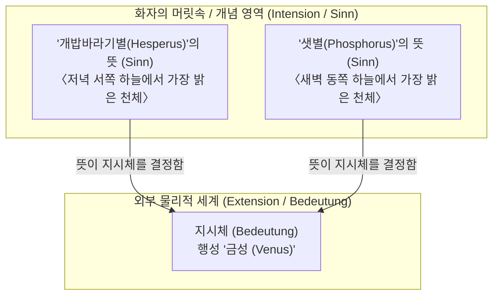
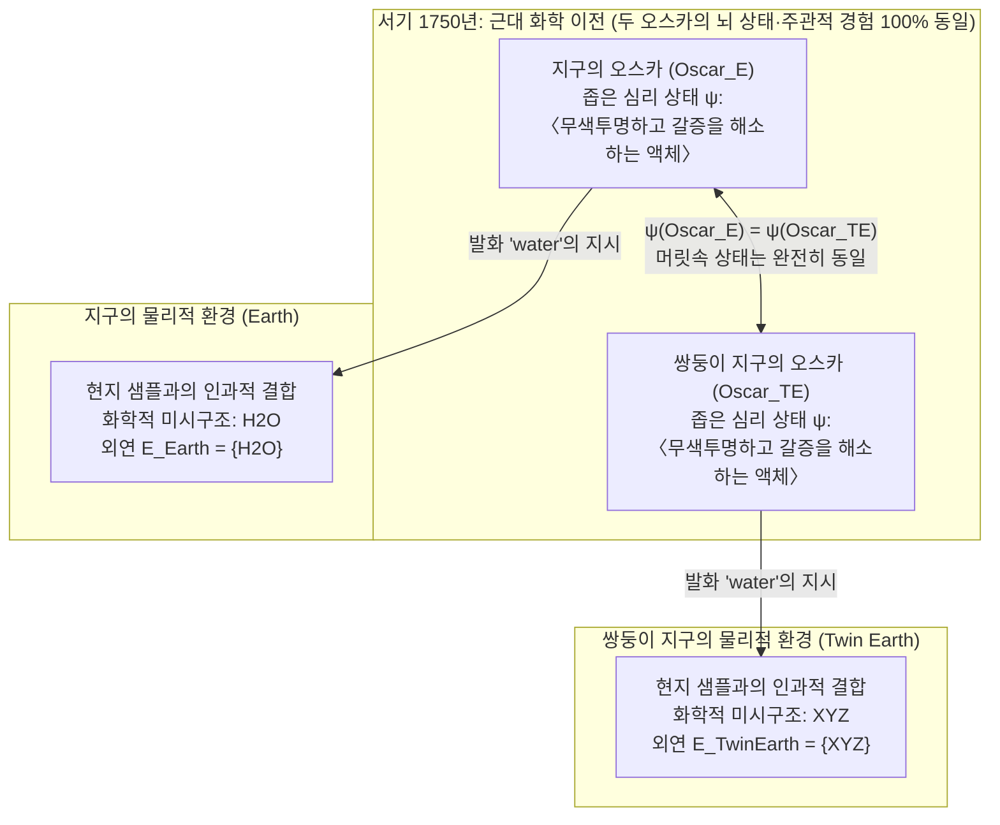

## 1. 서론: '단어의 의미'는 어디에 존재하는가?

우리가 일상에서 '물(water)', '금(gold)', '아리스토텔레스(Aristotle)'라는 단어를 발화할 때, 그 음성이나 문자는 어떻게 우리의 마음 바깥에 있는 물리적 세계의 특정 물질이나 역사적 인물을 정확히 가리킬(지시할) 수 있는가?

17세기 존 로크(John Locke)가 "단어는 화자의 마음속에 있는 관념(Ideas)의 기호"라고 선언한 이래, 고틀로프 프레게(Gottlob Frege)와 버트런드 러셀(Bertrand Russell)을 거쳐 20세기 중반 분석철학에 이르기까지 언어철학은 하나의 강력한 정설에 지배받고 있었다. 그것은 바로 <strong>의미론적 내재주의(Semantic Internalism)</strong>와 <strong>기술이론(Descriptivism)</strong>이다. 이 입장에 따르면, 단어의 의미(내포, Intension)를 이해한다는 것은 화자의 머릿속(뇌·마음)에 특정한 개념이나 식별 기술(description)의 목록을 보유하는 것이며, 그 내적 의미가 외부 세계의 어떤 대상(외연, Extension)을 지시할지를 결정한다.

그러나 1970년대 초, 솔 크립키(Saul Kripke)의 강연록 <strong>『이름과 필연성』(Naming and Necessity, 1972/1980)</strong>과 힐러리 퍼트넘(Hilary Putnam)의 기념비적 논문 <strong>「'의미'의 의미」(The Meaning of 'Meaning', 1975)</strong>가 발표되면서 이 수백 년 된 통념은 뿌리째 무너졌다.

퍼트넘은 유명한 <strong>'쌍둥이 지구(Twin Earth)' 사고실험</strong>을 통해 충격적인 결론을 도출했다. 근대 화학이 탄생하기 전인 서기 1750년, 지구의 오스카(Oscar)와 쌍둥이 지구의 분자 단위 복제인간인 쌍둥이 오스카(Twin Oscar)는 <strong>뇌의 신경 상태와 주관적 경험, 내적 개념이 100% 완전히 동일함에도 불구하고, 두 사람이 발화하는 '물(water)'이라는 단어는 전혀 다른 화학 물질($\text{H}_2\text{O}$ 대 $\text{XYZ}$)을 지시하며 따라서 서로 다른 의미를 갖는다!</strong> 퍼트넘은 이를 유명한 한 문장으로 요약했다.

> <strong>"파이를 어떻게 자르든 간에, '의미'는 머릿속에 있지 않다! (Cut the pie any way you like, 'meanings' just ain't in the head!)"</strong>

본고에서는 프레게·러셀·설의 고전적 기술주의부터 크립키의 고정 지시어와 인과적 지시 이론, 퍼트넘의 쌍둥이 지구와 언어적 노동 분업, 타일러 버지(Tyler Burge)의 사회적 외재주의(관절염 사고실험), 그리고 현대 인공지능 거대언어모델(LLM)의 기호 접지 문제(Symbol Grounding Problem)까지 언어철학과 심리철학의 거대한 전환을 체계적으로 살펴본다.

---

## 2. 고전적 내재주의와 기술이론의 전통: 프레게, 러셀, 설

### 2.1 프레게의 퍼즐과 『뜻과 지시체에 관하여』(1892)

1892년 현대 논리학의 아버지 고틀로프 프레게는 논문 『뜻과 지시체에 관하여』(Über Sinn und Bedeutung)에서 동일성 진술에 관한 유명한 <strong>프레게의 퍼즐(Frege's Puzzle)</strong>을 제기했다. 다음 두 문장을 비교해 보자.

1. <strong>$a = a$: "개밥바라기별(저녁별, Hesperus)은 개밥바라기별이다."</strong>
2. <strong>$a = b$: "개밥바라기별(Hesperus)은 샛별(새벽별, Phosphorus)이다."</strong>

천문학적으로 저녁 서쪽 하늘에 빛나는 '개밥바라기별(Hesperus)'과 새벽 동쪽 하늘에 빛나는 '샛별(Phosphorus)'은 동일한 행성인 <strong>금성(Venus)</strong>을 가리킨다.

$$\llbracket \text{Hesperus} \rrbracket = \llbracket \text{Phosphorus} \rrbracket = \text{Venus}$$

만약 이름의 의미가 그것이 가리키는 외부 세계의 <strong>지시체 / 외연(Bedeutung / Reference)</strong>뿐이라면, $a = b$는 동어반복인 $a = a$와 인식적 가치가 같아야 한다. 그러나 (1)은 경험과 무관하게 참인 <strong>선험적(a priori) 분석 명제</strong>인 반면, (2)는 고대 바빌로니아 천문학자들이 정밀한 관측 끝에 발견한 <strong>후험적(a posteriori) 종합 명제</strong>이다.

프레게는 이를 해결하기 위해 의미를 두 층위로 구분했다.
- <strong>지시체 / 외연(Bedeutung / Extension)</strong>: 단어가 세계에서 가리키는 실제 대상(금성).
- <strong>뜻 / 내포(Sinn / Sense / Intension)</strong>: 대상이 주어지는 방식(mode of presentation), 즉 화자의 마음이 파악하는 개념적 기준.

프레게에 따르면 화자는 마음속으로 <strong>뜻(Sinn)</strong>을 파악하며, <strong>뜻이 지시체(Bedeutung)를 유일하게 결정한다</strong>.

### 2.2 러셀의 확정 기술구 이론(1905)과 설의 다발 기술이론(1958)

버트런드 러셀은 「지칭에 관하여」(On Denoting, 1905)에서 '그 $F$는 $G$이다(The $F$ is $G$, $\iota x\, F(x)$)'라는 확정 기술구를 1차 술어논리의 존재 양화 및 유일성 조건으로 분석했다.

$$\text{The } F \text{ is } G \iff \exists x \Big( F(x) \land \forall y \big(F(y) \to y = x\big) \land G(x) \Big)$$

러셀은 일상적 고유명사('아리스토텔레스')와 자연종 용어('물', '금')가 실제로는 <strong>위장된 확정 기술구(Disguised Definite Descriptions)</strong>라고 주장했다. 이후 존 설(John Searle, 1958)은 단일 기술구의 한계를 보완하기 위해 <strong>다발 기술이론(Cluster Descriptivism)</strong>을 제안했다. 이름은 화자의 머릿속에 있는 가중치 부여된 기술구들의 다발 $\{D_1, D_2, \dots, D_n\}$과 결합하며, 그중 '충분한 가중 다수'를 만족하는 대상을 지시한다.

$$\llbracket N \rrbracket = \iota x \left( \sum_{i=1}^{n} w_i \cdot \mathbb{I}\big[D_i(x)\big] \ge \theta \right)$$

### 2.3 전통적 의미론의 두 가지 근본 전제: (A1)과 (A2)

퍼트넘은 전통 의미론이 다음 두 가지 기본 전제 위에 서 있음을 밝혀냈다.

- <strong>전제 (A1) 방법론적 유아론(Methodological Solipsism)</strong>: 단어 $t$의 의미(내포 $I(t)$)를 안다는 것은 오직 화자의 머릿속에 있는 <strong>좁은 심리 상태(Narrow psychological state $\psi \in \mathcal{S}_{\text{narrow}}$)</strong>에 있는 것이다.
- <strong>전제 (A2) 내포는 외연을 결정한다(Intension Determines Extension)</strong>: 단어의 내포 $I(t)$는 외연 $E(t)$를 유일하게 결정한다. 즉, 두 화자의 좁은 심리 상태가 같다면 그들이 쓰는 단어의 외연도 반드시 같아야 한다.

$$\psi(S_1, t) = \psi(S_2, t) \stackrel{\text{(A1)}}{\implies} I_1(t) = I_2(t) \stackrel{\text{(A2)}}{\implies} E_1(t) = E_2(t)$$

---

## 3. 크립키의 『이름과 필연성』: 고정 지시어와 인과적 지시 이론

### 3.1 기술이론에 대한 세 가지 반박과 '괴델/슈미트' 사고실험

크립키는 가능세계 의미론을 통해 기술이론을 논박했다.

1. <strong>양상 논증(Modal Argument)</strong>: 만약 '아리스토텔레스'가 〈알렉산드로스 대왕의 스승〉이라는 기술구와 동의어라면, 다른 가능세계 $w'$에서 아리스토텔레스가 알렉산드로스를 가르치지 않았을 가능성($\Diamond \neg \text{Taught}(\text{Aristotle}, \text{Alexander})$)을 설명할 수 없게 된다.
2. <strong>인식적·의미론적 논증 — 괴델과 슈미트 사례(The Gödel / Schmidt Case)</strong>:
   일반 화자가 수학자 '괴델(Kurt Gödel)'에 대해 알고 있는 유일한 기술구가 $D_{\text{Gödel}} =$ <strong>〈산술의 불완전성 정리를 증명한 사람〉</strong>이라고 가정하자. 그런데 사실은 빈에 살던 <strong>슈미트(Schmidt)</strong>라는 수학자가 그 정리를 증명했으나 발표 직전 의문사했고, 친구인 <strong>괴델</strong>이 원고를 훔쳐 자신의 이름으로 발표했다고 상상해 보자.
   기술이론에 따르면, $D_{\text{Gödel}}$을 유일하게 만족하는 사람은 슈미트이므로($\iota x\, D_{\text{Gödel}}(x) = \text{Schmidt}$), 우리가 '괴델'이라고 말할 때 우리는 사실 <strong>슈미트</strong>를 지시하고 있다는 터무니없는 결론이 나온다! 그러나 우리의 직관은 명백하다. 우리는 여전히 <strong>괴델 본인</strong>을 지시하며, "괴델은 불완전성 정리를 증명하지 않고 슈미트에게서 훔쳤다!"라고 말할 것이다. 따라서 머릿속의 기술구는 지시체를 결정하지 못한다.

### 3.2 고정 지시어(Rigid Designators)와 인과·역사적 지시 이론

가능세계 모델 $\mathcal{M} = \langle \mathcal{W}, \mathcal{D}, w_0, \mathcal{I} \rangle$에서 크립키는 다음과 같이 정의한다.

- <strong>비고정 지시어(Non-Rigid Designator)</strong>: '이중초점 렌즈의 발명가' 같은 확정 기술구는 가능세계마다 다른 인물을 가리킨다.
- <strong>고정 지시어(Rigid Designator)</strong>: <strong>그 대상이 존재하는 모든 가능세계 $w \in \mathcal{W}$에서 항상 완전히 동일한 대상 $o_{\text{actual}}$을 지시하는 표현</strong>이다.
  $$\forall w \in \mathcal{W}, \quad \llbracket d_{\text{rigid}} \rrbracket_w = \llbracket d_{\text{rigid}} \rrbracket_{w_0} = o_{\text{actual}}$$

크립키에 따르면 <strong>모든 고유명사('아리스토텔레스', '금성')와 자연종 용어('물', '금', '호랑이')는 고정 지시어</strong>이다. 지시는 머릿속 기술구가 아니라, (1) 대상을 직접 가리키는 <strong>최초의 명명식(Initial Baptism)</strong>과 (2) 언어 공동체 내의 <strong>의사소통의 인과적·역사적 사슬(Causal-Historical Chain of Communication, $S_0 \to S_1 \to \dots \to S_n$)</strong>을 통해 성립한다.

### 3.3 칸트적 도그마의 타파: 후험적 필연적 진리(Necessary *A Posteriori* Truths)

'개밥바라기별($a$)'과 '샛별($b$)', 그리고 '물(Water)'과 '$\text{H}_2\text{O}$'는 모두 고정 지시어이므로, 현실 세계 $w_0$에서 둘이 동일하다는 것이 경험적으로 밝혀지면 모든 가능세계에서 필연적으로 동일하다.

$$(\text{Water} = \text{H}_2\text{O}) \implies \Box(\text{Water} = \text{H}_2\text{O}), \quad (\text{Hesperus} = \text{Phosphorus}) \implies \Box(\text{Hesperus} = \text{Phosphorus})$$

이로써 크립키는 경험적 과학을 통해서만 알 수 있으면서도 형이상학적으로는 모든 가능세계에서 참인 <strong>후험적 필연적 진리(Necessary A Posteriori Truths)</strong>의 존재를 증명했다.

---

## 4. 퍼트넘의 '쌍둥이 지구(Twin Earth)' 사고실험 (1975)

### 4.1 서기 1750년의 지구와 쌍둥이 지구: $\text{H}_2\text{O}$ 대 $\text{XYZ}$

퍼트넘은 「'의미'의 의미」(1975)에서 전제 (A1)과 (A2)가 양립할 수 없음을 증명하기 위해 <strong>쌍둥이 지구(Twin Earth)</strong>를 제시했다.

1. <strong>거시적·심리적 동일성</strong>: 쌍둥이 지구는 지구와 거시적으로 똑같으며 주민들도 영어를 쓴다. <strong>지구의 오스카($\text{Oscar}_E$)</strong>와 쌍둥이 지구의 도플갱어 <strong>쌍둥이 오스카($\text{Oscar}_{TE}$)</strong>는 완전히 동일한 내적 뇌 상태와 주관적 경험을 갖는다.
2. <strong>유일한 미시적 화학 차이</strong>: <strong>지구</strong>에서 강과 바다를 채우고 갈증을 해소하며 `"water"`라 불리는 액체의 화학식은 <strong>$\text{H}_2\text{O}$</strong>이다. 반면 <strong>쌍둥이 지구</strong>에서 똑같은 거시적 성질을 지니고 `"water"`라 불리는 액체는 $\text{H}_2\text{O}$가 아니라 복잡한 화합물 <strong>$\text{XYZ}$</strong>이다!
3. <strong>1750년이라는 시간 설정</strong>: 근대 화학 이전인 1750년에는 지구와 쌍둥이 지구의 누구도 $\text{H}_2\text{O}$나 $\text{XYZ}$를 알지 못한다. 따라서 1750년 두 오스카의 <strong>좁은 심리 상태(머릿속 상태)는 100% 동일</strong>하다.

$$\text{State}_{\text{narrow}}\big(\text{Oscar}_E, 1750\big) \equiv \text{State}_{\text{narrow}}\big(\text{Oscar}_{TE}, 1750\big)$$

### 4.2 왜 $\text{XYZ}$는 물이 아니라 '바보의 물'인가?

그러나 1750년 두 오스카가 발화하는 `"water"`의 외연은 같은가? <strong>전혀 다르다!</strong>
자연종 용어 `"water"`는 우리 주변의 '이(this)' 액체 샘플과 <strong>동일한 미시적 본질 구조(동종 액체 관계 $\text{same}_L$)</strong>를 공유하는 물질만을 지시하는 지표적(Indexical) 성격을 갖는다.

$$\forall x, \quad x \in \llbracket \text{water} \rrbracket_{\text{Earth}} \iff \text{same}_L\big(x, \text{sample}_{\text{Earth}}\big) \iff \text{Microstructure}(x) = \text{H}_2\text{O}$$
$$\forall x, \quad x \in \llbracket \text{water} \rrbracket_{\text{TwinEarth}} \iff \text{same}_L\big(x, \text{sample}_{\text{TwinEarth}}\big) \iff \text{Microstructure}(x) = \text{XYZ}$$

마치 <strong>황철석($\text{FeS}_2$, '바보의 금 / Fool's Gold')</strong>이 고대에도 진짜 금($\text{Au}$)이 아니었듯이, 쌍둥이 지구의 $\text{XYZ}$는 물이 아니라 <strong>'바보의 물(Fool's Water)'</strong>이다.

결국 두 오스카의 머릿속 상태는 동일하지만($\psi(\text{Oscar}_E) = \psi(\text{Oscar}_{TE})$) 외연은 다르므로($\{\text{H}_2\text{O}\} \neq \{\text{XYZ}\}$), 전제 (A1)과 (A2)는 동시에 성립할 수 없다. <strong>의미는 머릿속에 있지 않으며, 외부 물리적 환경과의 인과적 관계에 의해 결정된다!</strong>

---

## 5. 언어적 노동 분업, 사회적 외재주의, 그리고 현대 인공지능(LLM)

### 5.1 퍼트넘의 '언어적 노동 분업'(느릅나무와 너도밤나무)과 4성분 의미 벡터

퍼트넘은 자신이 <strong>느릅나무(Elm, *Ulmus*)</strong>와 <strong>너도밤나무(Beech, *Fagus*)</strong>를 구별하지 못해 두 단어에 대한 내적 개념이 완전히 같다고 고백한다($\psi(\text{Putnam}, \text{``elm''}) = \psi(\text{Putnam}, \text{``beech''})$). 그럼에도 퍼트넘의 `"elm"`이 정확히 느릅나무만을 지시하는 이유는 언어 공동체 내에 <strong>언어적 노동 분업(Division of Linguistic Labor)</strong>이 존재하여, 일반 화자가 식물학자 등 <strong>전문가(Experts)</strong>에게 지시 기준을 위임(Deference)하기 때문이다.

퍼트넘은 단어의 의미를 4성분 <strong>의미 벡터(Meaning Vector)</strong>로 정식화했다.

$$\vec{M}(\text{``water''}) = \big\langle \text{통사적 표지},\, \text{의미론적 표지},\, \text{고정관념 (Stereotype)},\, \text{외연 (Extension)} \big\rangle$$

### 5.2 타일러 버지(1979)의 사회적 외재주의: '허벅지 관절염' 사고실험

타일러 버지(Tyler Burge)는 「개체주의와 심적인 것」(1979)의 <strong>'관절염(Arthritis)' 사고실험</strong>을 통해 개인의 <strong>믿음과 사고 내용(Mental Content)</strong>조차 외재주의적임을 입증했다.
- <strong>현실의 버트(Bert)</strong>: "내 관절염이 허벅지로 번졌다"고 믿는다. 현실 의학에서 관절염은 관절에만 생기므로 버트의 믿음은 <strong>거짓(False)</strong>이다.
- <strong>반사실적 쌍둥이 버트(Twin Bert)</strong>: 뇌 상태와 신체 이력은 현실 버트와 100% 동일하지만, 그가 속한 공동체의 의사들은 `"arthritis"`(개념 `tharthritis`)를 근육통까지 포함하도록 정의한다. 따라서 쌍둥이 버트의 믿음은 <strong>참(True)</strong>이다!
- 참·거짓 조건이 다른 두 믿음은 동일한 사고일 수 없으므로, <strong>우리 마음속의 믿음 내용조차 사회적 언어 관습에 의해 외적으로 결정된다!</strong>

### 5.3 현대 거대언어모델(LLM)과 기호 접지 문제에 대한 시사점

텍스트만으로 학습된 거대언어모델(LLM)은 다음 토큰 예측 $P_\theta(w_t \mid w_{1:t-1})$을 통해 퍼트넘 의미 벡터의 <strong>고정관념(Stereotype)</strong>을 완벽히 학습한다. Bender & Koller(2020)의 <strong>'문어 사고실험(Octopus Test)'</strong>과 퍼트넘의 <strong>'통 속의 뇌(Brains in a Vat, 1981)'</strong>가 보여주듯, 신경망의 가중치 행렬 $\Theta$ 내부만으로는 $\text{H}_2\text{O}$와 $\text{XYZ}$를 구별하는 고유한 지시가 성립하지 않는다. 그러나 현실의 LLM은 실제 $\text{H}_2\text{O}$ 및 대상들과 인과적으로 상호작용한 인간들이 작성한 텍스트를 학습했기 때문에, 인간 언어 공동체의 <strong>인과·역사적 사슬</strong>과 <strong>언어적 노동 분업</strong>에 결합함으로써 물리적 세계에 대한 <strong>파생적·기생적 지시(Derivative Reference)</strong>를 획득한다.

| 비교 항목 | 고전적 내재주의 및 기술이론 (Frege, Russell, Searle) | 의미론적·사회적 외재주의 (Kripke, Putnam, Burge) |
| :--- | :--- | :--- |
| <strong>핵심 테제</strong> | 의미(내포)는 화자의 머릿속 기술 개념이며, 내포가 외연을 결정한다. | <strong>"의미는 머릿속에 있지 않다."</strong> 의미와 심적 내용은 외부 환경 및 사회적 공동체에 의해 결정된다. |
| <strong>고유명사·자연종 용어</strong> | 축약된 확정 기술구 또는 기술구 다발(비고정 지시어). | <strong>고정 지시어(Rigid Designator)</strong>. 모든 가능세계에서 동일한 대상·미시구조를 지시한다. |
| <strong>괴델/슈미트 사례</strong> | 화자가 '괴델'이라 할 때 슈미트를 지시한다고 잘못 예측함. | 인과적 사슬의 기원인 괴델 본인을 정확히 지시함. |
| <strong>1750년 쌍둥이 지구</strong> | 두 오스카의 뇌 상태가 같으므로 의미와 외연도 동일함. | 뇌 상태가 100% 같아도 지구는 $\text{H}_2\text{O}$, 쌍둥이 지구는 $\text{XYZ}$만을 지시함. |
| <strong>양상과 인식론의 관계</strong> | 필연적 진리 $=$ 선험적 진리. '물 $=\text{H}_2\text{O}$'는 우연적 진리. | <strong>후험적 필연적 진리</strong> 확립: $\Box(\text{Water} = \text{H}_2\text{O})$, $\Box(\text{Hesperus} = \text{Phosphorus})$. |
