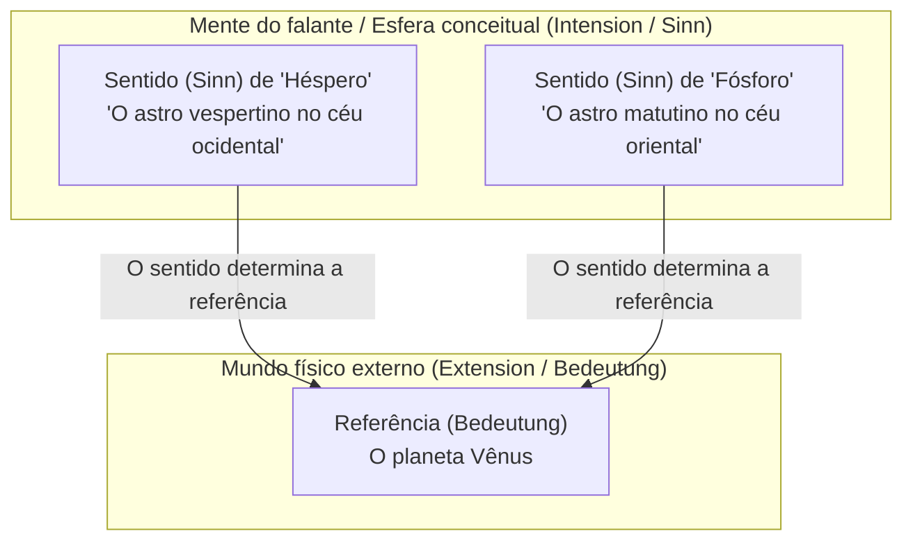
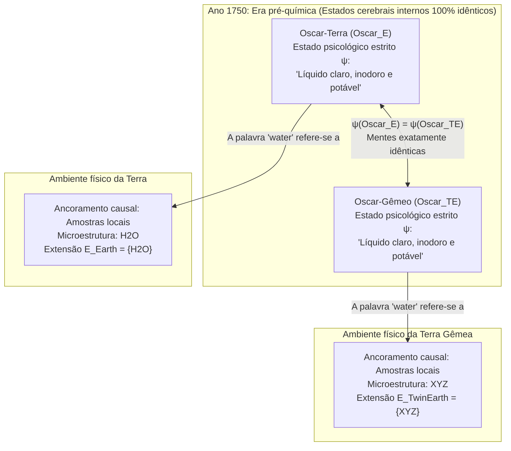

## 1. Introdução: Onde reside o "significado" de uma palavra?

Quando pronunciamos palavras cotidianas como *"água"*, *"ouro"* ou *"Aristóteles"*, como esses sons ou marcas de tinta conseguem ultrapassar as fronteiras da nossa mente para se referir com precisão a substâncias químicas ou indivíduos históricos no universo físico?

Desde a tese de John Locke no século XVII de que as palavras são sinais das "ideias na mente de quem as usa", até a filosofia analítica de Gottlob Frege, Bertrand Russell, Rudolf Carnap e John Searle no século XX, a filosofia da linguagem foi dominada por uma ortodoxia profundamente intuitiva: o <strong>internalismo semântico</strong> e o <strong>descritivismo</strong>. Segundo essa visão, compreender o significado (a intensão) de um termo consiste simplesmente em possuir dentro da própria cabeça (cérebro ou consciência) um conceito ou uma lista de descrições identificadoras; e esse estado mental interno determina por si só quais objetos do mundo exterior constituem a referência (a extensão) da palavra.

No entanto, no início da década de 1970, duas obras revolucionárias derrubaram esse edifício clássico: as conferências de Saul Kripke <strong>*O Nomear e a Necessidade* (*Naming and Necessity*, 1972/1980)</strong> e o célebre ensaio de Hilary Putnam <strong>*"O significado de 'significado'"* (*The Meaning of "Meaning"*, 1975)</strong>.

Por meio de seu famoso <strong>experimento mental da Terra Gêmea (Twin Earth: $\text{H}_2\text{O}$ vs. $\text{XYZ}$)</strong>, Putnam demonstrou um paradoxo impressionante: no ano de 1750 (antes do surgimento da química moderna), um falante na Terra (Oscar) e seu duplicado molécula por molécula na Terra Gêmea (Oscar Gêmeo) podem estar em <strong>estados psicológicos e neurofisiológicos estritos 100% idênticos</strong> e, ainda assim, sua palavra *"água"* refere-se a substâncias químicas completamente diferentes ($\text{H}_2\text{O}$ vs. $\text{XYZ}$), possuindo portanto significados diferentes! Como Putnam concluiu em sua famosa frase:

> <strong>"Corte a torta como quiser, os 'significados' simplesmente não estão na cabeça! (Cut the pie any way you like, 'meanings' just ain't in the head!)"</strong>

Neste artigo, examinamos a transição do descritivismo clássico (Frege, Russell, Searle) para os <strong>designadores rígidos</strong> e as <strong>verdades necessárias *a posteriori*</strong> de Kripke, a <strong>Terra Gêmea</strong> e a <strong>divisão do trabalho linguístico</strong> de Putnam, o <strong>externalismo social</strong> de Tyler Burge (o experimento da artrite) e suas implicações contemporâneas para os <strong>Grandes Modelos de Linguagem (LLMs)</strong> e o problema do ancoramento de símbolos (*Symbol Grounding Problem*).

---

## 2. A tradição internalista e descritivista clássica: Frege, Russell e Searle

### 2.1 O quebra-cabeça de Frege e *"Sobre o Sentido e a Referência"* (1892)

Em 1892, Gottlob Frege abriu seu ensaio clássico *"Über Sinn und Bedeutung"* propondo um enigma sobre enunciados de identidade (<strong>o quebra-cabeça de Frege</strong>). Compare estas duas sentenças:

1. <strong>$a = a$: "Héspero é Héspero"</strong> ("A Estrela Vespertina é a Estrela Vespertina").
2. <strong>$a = b$: "Héspero é Fósforo"</strong> ("A Estrela Vespertina é a Estrela Matutina").

Astronomicamente, tanto `"Héspero"` quanto `"Fósforo"` designam exatamente o mesmo corpo celeste: o planeta <strong>Vênus</strong>:

$$\llbracket \text{Héspero} \rrbracket = \llbracket \text{Fósforo} \rrbracket = \text{Vênus}$$

Se o significado de um nome se esgotasse em sua <strong>referência / extensão (*Bedeutung*)</strong>, então $a = b$ teria o mesmo valor cognitivo que a tautologia trivial $a = a$. Contudo, $a = a$ é uma verdade analítica cognoscível <strong>*a priori*</strong>, ao passo que $a = b$ foi uma descoberta astronômica empírica <strong>*a posteriori*</strong> de imenso valor informativo.

Para resolver esse paradoxo, Frege dividiu o conteúdo semântico em dois níveis:
- <strong>Referência / Extensão (*Bedeutung*)</strong>: o objeto concreto no mundo físico (o planeta Vênus).
- <strong>Sentido / Intensão (*Sinn*)</strong>: o <strong>"modo de apresentação" (*Art des Gegebenseins*)</strong> do objeto, isto é, o critério conceitual apreendido pela mente do falante (*o astro mais brilhante ao entardecer no oeste* vs. *o astro mais brilhante ao amanhecer no leste*).

Segundo Frege, o falante compreende um termo ao apreender mentalmente seu *sentido* (*Sinn*), e <strong>o sentido determina de forma única a referência (*Bedeutung*)</strong>.

### 2.2 A teoria das descrições definidas de Russell (1905) e o descritivismo de feixe de Searle (1958)

Em *"On Denoting"* (1905), Bertrand Russell analisou as <strong>descrições definidas</strong> da forma "o $F$ é $G$" ($\iota x\, F(x)$) mediante quantificação existencial e unicidade na lógica de primeira ordem:

$$\text{O } F \text{ é } G \iff \exists x \Big( F(x) \land \forall y \big(F(y) \to y = x\big) \land G(x) \Big)$$

Russell sustentou que nomes próprios comuns ("Aristóteles") e termos de espécies naturais ("água", "ouro") são na verdade <strong>descrições definidas disfarçadas ou abreviadas</strong>. Posteriormente, John Searle (1958) propôs o <strong>descritivismo de feixe (Cluster Descriptivism)</strong>: um nome está associado a um feixe ponderado de descrições $\{D_1, D_2, \dots, D_n\}$ na mente do falante e refere-se ao objeto $x$ que satisfaz uma maioria ponderada suficiente dessas propriedades:

$$\llbracket N \rrbracket = \iota x \left( \sum_{i=1}^{n} w_i \cdot \mathbb{I}\big[D_i(x)\big] \ge \theta \right)$$

### 2.3 Os dois dogmas fundamentais da semântica tradicional: (A1) e (A2)

Hilary Putnam sintetizou toda essa tradição clássica em dois pressupostos fundamentais:

- <strong>Pressuposto (A1) Solipsismo metodológico</strong>: Conhecer o significado (a intensão $I(t)$) de um termo $t$ consiste inteiramente em estar em um <strong>estado psicológico estrito ($\psi \in \mathcal{S}_{\text{narrow}}$)</strong> dentro da cabeça do falante (sem pressupor nada sobre o mundo exterior).
- <strong>Pressuposto (A2) A intensão determina a extensão</strong>: A intensão mental $I(t)$ fixa de maneira única a extensão $E(t)$ no mundo:

$$\psi(S_1, t) = \psi(S_2, t) \stackrel{\text{(A1)}}{\implies} I_1(t) = I_2(t) \stackrel{\text{(A2)}}{\implies} E_1(t) = E_2(t)$$

---

## 3. Saul Kripke e *O Nomear e a Necessidade*: Designadores rígidos e teoria causal

### 3.1 O experimento mental Gödel / Schmidt e a refutação do descritivismo

Saul Kripke demoliu o descritivismo por meio de três argumentos decisivos:

1. <strong>O argumento modal</strong>: Se "Aristóteles" significasse "o mestre de Alexandre, o Grande", então em um mundo possível contrafactual $w'$ onde Aristóteles nunca ensinou Alexandre, o enunciado verdadeiro $\Diamond(\neg \text{Taught}(\text{Aristotle}, \text{Alexander}))$ seria contraditório.
2. <strong>O argumento epistêmico e semântico — O caso Gödel / Schmidt</strong>:
   Suponhamos que a única descrição que um falante comum associa a "Kurt Gödel" seja $D_{\text{Gödel}} =$ <strong>"o descobridor do teorema da incompletude da aritmética"</strong>. Imaginemos que, na realidade, um matemático vienense chamado <strong>Schmidt</strong> provou o teorema, mas morreu misteriosamente antes de publicá-lo, e <strong>Gödel</strong> roubou o manuscrito e o publicou sob seu próprio nome.
   Segundo o descritivismo, como Schmidt é o único indivíduo que satisfaz $D_{\text{Gödel}}$ ($\iota x\, D_{\text{Gödel}}(x) = \text{Schmidt}$), quando dizemos "Gödel" estaríamos nos referindo a <strong>Schmidt</strong>! Kripke aponta o absurdo disso: ao dizer "Gödel", referimo-nos sem dúvida ao próprio <strong>Gödel</strong> (e diríamos: *"Gödel não provou o teorema, ele o roubou de Schmidt!"*). Descrições na cabeça não determinam a referência.

### 3.2 Designadores rígidos e a teoria causal-histórica da referência

Na semântica de mundos possíveis $\mathcal{M} = \langle \mathcal{W}, \mathcal{D}, w_0, \mathcal{I} \rangle$, Kripke define:

- <strong>Designador não rígido (acidental)</strong>: Uma descrição definida como "o inventor das lentes bifocais" designa diferentes indivíduos em diferentes mundos possíveis (Benjamin Franklin em $w_0$, Thomas Edison em $w_1$).
- <strong>Designador rígido (Rigid Designator)</strong>: Um designador $d_{\text{rigid}}$ é <strong>rígido</strong> se e somente se designa <strong>exatamente o mesmo objeto $o_{\text{actual}}$ em todos os mundos possíveis $w \in \mathcal{W}$</strong> nos quais esse objeto existe:
  $$\forall w \in \mathcal{W}, \quad \llbracket d_{\text{rigid}} \rrbracket_w = \llbracket d_{\text{rigid}} \rrbracket_{w_0} = o_{\text{actual}}$$

Nomes próprios ("Aristóteles", "Héspero") e termos de espécies naturais ("água", "ouro", "tigre") são <strong>designadores rígidos</strong>. Sua referência é fixada por (1) um <strong>batismo inicial (Initial Baptism)</strong> por ostensão direta e (2) uma <strong>cadeia causal-histórica de comunicação ($S_0 \to S_1 \to \dots \to S_n$)</strong> através da comunidade linguística.

### 3.3 O fim do dogma kantiano: Verdades necessárias *a posteriori*

Dado que "Héspero" e "Fósforo", assim como "Água" e "$\text{H}_2\text{O}$", são designadores rígidos, sua identidade descoberta empiricamente no mundo atual $w_0$ mantém-se necessariamente em <strong>todos os mundos possíveis</strong>:

$$(\text{Água} = \text{H}_2\text{O}) \implies \Box(\text{Água} = \text{H}_2\text{O}), \quad (\text{Héspero} = \text{Fósforo}) \implies \Box(\text{Héspero} = \text{Fósforo})$$

Kripke separa assim a necessidade metafísica ($\Box$) da aprioridade epistêmica, demonstrando a existência de <strong>verdades necessárias *a posteriori*</strong>.

---

## 4. O experimento mental da Terra Gêmea de Hilary Putnam (1975)

### 4.1 A Terra e a Terra Gêmea em 1750: $\text{H}_2\text{O}$ vs. $\text{XYZ}$

Em *"O significado de 'significado'"* (1975), Putnam concebeu o famoso cenário da <strong>Terra Gêmea (Twin Earth)</strong>:

1. <strong>Identidade macroscópica e psicológica</strong>: A Terra Gêmea é macroscopicamente idêntica à Terra. Cada habitante terrestre como <strong>Oscar-Terra ($\text{Oscar}_E$)</strong> tem um duplicado exato <strong>Oscar-Gêmeo ($\text{Oscar}_{TE}$)</strong> com idênticos estados cerebrais e experiências subjetivas.
2. <strong>A única diferença química microscópica</strong>: Na <strong>Terra</strong>, o líquido incolor, inodoro e potável chamado `"water"` que enche rios e oceanos tem a estrutura química <strong>$\text{H}_2\text{O}$</strong>. Na <strong>Terra Gêmea</strong>, o líquido macroscopicamente indistinguível chamado `"water"` <strong>não é $\text{H}_2\text{O}$</strong>, mas um composto químico diferente abreviado como <strong>$\text{XYZ}$</strong>!
3. <strong>O ano de 1750</strong>: Antes de Lavoisier e Dalton, ninguém na Terra nem na Terra Gêmea sabe nada sobre $\text{H}_2\text{O}$ ou $\text{XYZ}$. Em 1750, $\text{Oscar}_E$ e $\text{Oscar}_{TE}$ encontram-se em <strong>estados psicológicos estritos 100% idênticos</strong>:

$$\text{State}_{\text{narrow}}\big(\text{Oscar}_E, 1750\big) \equiv \text{State}_{\text{narrow}}\big(\text{Oscar}_{TE}, 1750\big)$$

### 4.2 Por que $\text{XYZ}$ é "água dos tolos" e o colapso de (A1) e (A2)

Em 1750, a palavra `"water"` tem a mesma extensão na boca de $\text{Oscar}_E$ e de $\text{Oscar}_{TE}$? <strong>Absolutamente não!</strong>
O termo de espécie natural `"water"` possui um componente <strong>indexical</strong> implícito: designa toda substância que mantenha a relação $\text{same}_L$ (mesma microestrutura líquida) com *esta* amostra local de nosso ambiente:

$$\forall x, \quad x \in \llbracket \text{water} \rrbracket_{\text{Terra}} \iff \text{same}_L\big(x, \text{sample}_{\text{Terra}}\big) \iff \text{Microstructure}(x) = \text{H}_2\text{O}$$
$$\forall x, \quad x \in \llbracket \text{water} \rrbracket_{\text{TerraGemea}} \iff \text{same}_L\big(x, \text{sample}_{\text{TerraGemea}}\big) \iff \text{Microstructure}(x) = \text{XYZ}$$

Assim como a <strong>pirita de ferro ($\text{FeS}_2$, "ouro dos tolos")</strong> jamais foi ouro ($\text{Au}$) nem mesmo na Antiguidade, o $\text{XYZ}$ da Terra Gêmea não é água, mas <strong>"água dos tolos" (Fool's Water)</strong>.

Dado que $\psi(\text{Oscar}_E) = \psi(\text{Oscar}_{TE})$, mas suas extensões diferem ($\{\text{H}_2\text{O}\} \neq \{\text{XYZ}\}$), (A1) e (A2) não podem ser ambos verdadeiros: <strong>os significados não estão na cabeça!</strong>

---

## 5. Divisão do trabalho linguístico, externalismo social de Burge e IA (LLMs)

### 5.1 A divisão do trabalho linguístico (Olmos vs. Faias) e o vetor de significado

Putnam confessa não saber distinguir um <strong>olmo (*Ulmus*)</strong> de uma <strong>faia (*Fagus*)</strong>: seus conceitos internos de `"elm"` e `"beech"` são idênticos ($\psi(\text{Putnam}, \text{``elm''}) = \psi(\text{Putnam}, \text{``beech''})$). Contudo, sua palavra `"elm"` refere-se exclusivamente aos olmos graças à <strong>divisão do trabalho linguístico</strong>: falantes leigos delegam a fixação exata da extensão aos <strong>especialistas</strong> (botânicos, químicos) de sua comunidade.

Putnam representa o significado mediante um <strong>vetor de significado</strong> de quatro componentes:

$$\vec{M}(\text{``water''}) = \big\langle \text{Marcadores sintáticos},\, \text{Marcadores semânticos},\, \text{Estereótipo},\, \text{Extensão} \big\rangle$$

### 5.2 O externalismo social de Tyler Burge (1979): O experimento da "artrite"

Em *"Individualism and the Mental"* (1979), <strong>Tyler Burge</strong> demonstrou que até mesmo o conteúdo de nossas <strong>crenças mentais</strong> é externo:
- <strong>Bert (mundo real)</strong> acredita: *"Minha artrite espalhou-se para a minha coxa"*. Como a artrite é definida medicamente apenas como inflamação das <strong>articulações</strong>, Bert tem uma <strong>crença falsa</strong> sobre a artrite.
- <strong>Bert Gêmeo (mundo contrafactual)</strong> tem exatamente a mesma história física e estados cerebrais, mas em sua comunidade os médicos usam `"arthritis"` (conceito `tharthritis`) para incluir dores reumáticas nos <strong>músculos da coxa</strong>. A crença de Bert Gêmeo é <strong>verdadeira</strong>!
- Duas crenças com valores de verdade opostos não podem ter o mesmo conteúdo proposicional: <strong>nossos próprios pensamentos são individuados pelo ambiente social!</strong>

### 5.3 Implicações para os Grandes Modelos de Linguagem (LLMs) e o ancoramento de símbolos

Os LLMs treinados apenas com texto via predição do próximo token $P_\theta(w_t \mid w_{1:t-1})$ dominam com perfeição os <strong>estereótipos</strong> (componente 3 de Putnam). Como mostram o <strong>teste do polvo de Bender e Koller (2020)</strong> e os <strong>cérebros numa cuba de Putnam (1981)</strong>, a referência não reside intrinsecamente nos pesos $\Theta$ da rede. Entretanto, como os corpora de treinamento foram escritos por seres humanos em interação causal com o $\text{H}_2\text{O}$ real e o mundo físico, os LLMs integram-se na <strong>cadeia causal-histórica</strong> e na <strong>divisão do trabalho linguístico</strong> humana, adquirindo assim uma <strong>referência derivada ou parasitária</strong>.

| Dimensão | Internalismo clássico e Descritivismo (Frege, Russell, Searle) | Externalismo semântico e social (Kripke, Putnam, Burge) |
| :--- | :--- | :--- |
| <strong>Tese central</strong> | O significado (intensão) é uma descrição mental na cabeça e determina a extensão. | <strong>"Os significados não estão na cabeça."</strong> A referência e o pensamento dependem do ambiente físico e social. |
| <strong>Nomes próprios e espécies naturais</strong> | Descrições definidas abreviadas ou feixes (designadores não rígidos). | <strong>Designadores rígidos</strong> ($\forall w \in \mathcal{W}, \llbracket d \rrbracket_w = o_{\text{actual}}$) que designam a mesma essência em todo mundo possível. |
| <strong>Caso Gödel / Schmidt</strong> | Prediz erroneamente que "Gödel" refere-se a Schmidt. | Refere-se corretamente a Gödel mediante a cadeia causal-histórica. |
| <strong>Terra Gêmea em 1750</strong> | Estados cerebrais idênticos $\implies$ mesmo significado e extensão. | Apesar de cérebros idênticos, `"water"` designa $\text{H}_2\text{O}$ na Terra e $\text{XYZ}$ na Terra Gêmea. |
| <strong>Modalidade e Epistemologia</strong> | Necessário $\iff$ *a priori*; "Água $=\text{H}_2\text{O}$" é tido como contingente. | Estabelece <strong>verdades necessárias *a posteriori*</strong>: $\Box(\text{Água} = \text{H}_2\text{O})$, $\Box(\text{Héspero} = \text{Fósforo})$. |
