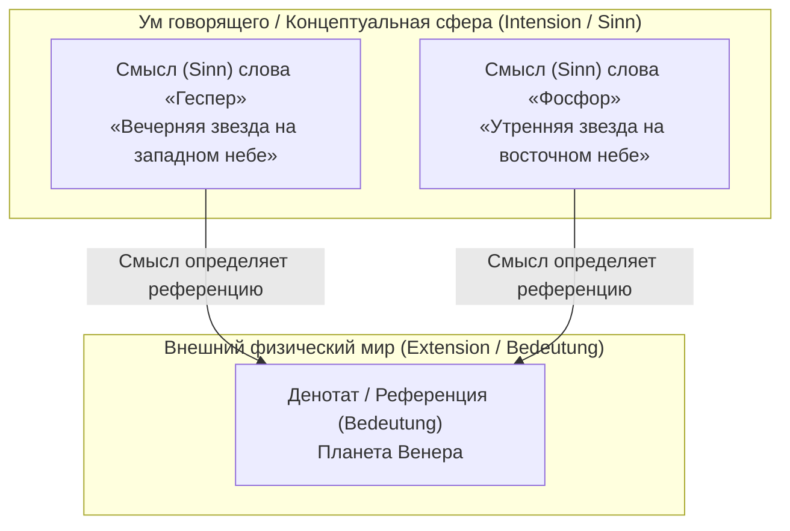
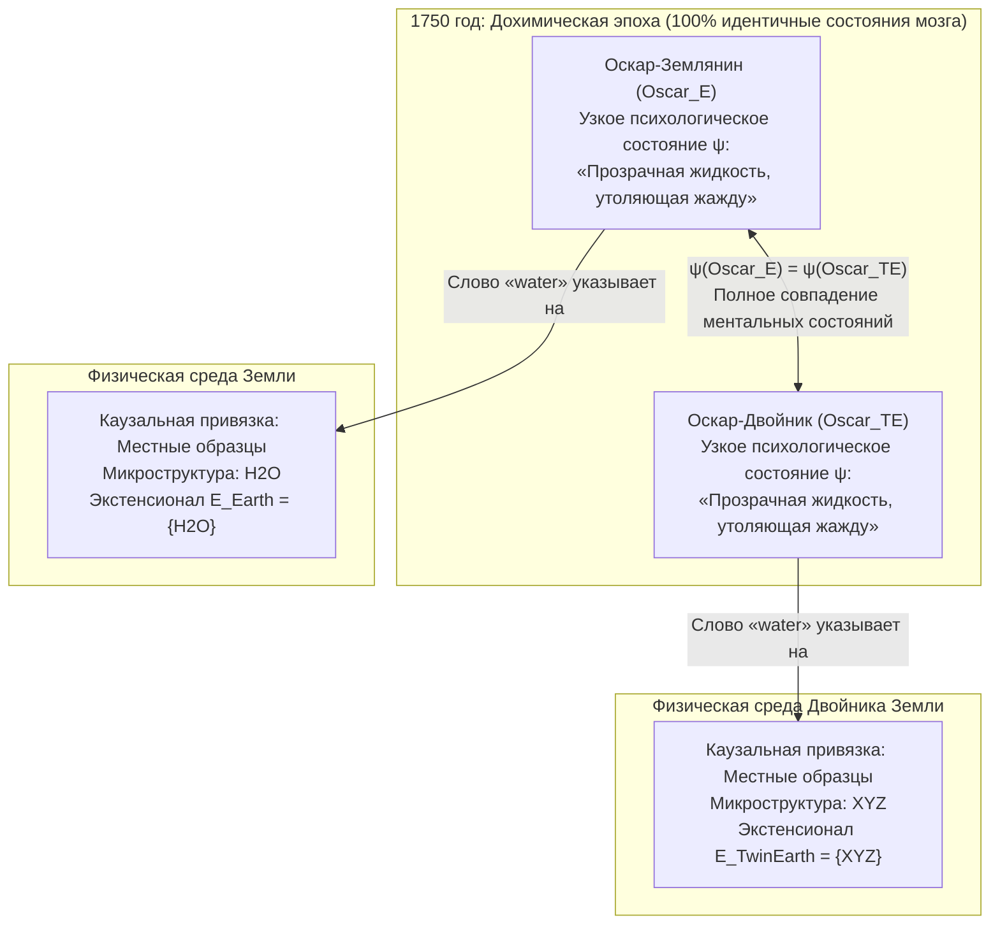

## 1. Введение: где живет «значение» слова?

Когда мы произносим обычные слова вроде *«вода»*, *«золото»* или *«Аристотель»*, каким образом эти звуковые колебания или знаки на бумаге выходят за пределы нашего сознания и точно указывают на конкретные химические вещества или исторических личностей в физическом мире?

Начиная с тезиса Джона Локка в XVII веке о том, что слова суть знаки «идей в уме говорящего», и вплоть до аналитической философии Готлоба Фреге, Бертрана Рассела, Рудольфа Карнапа и Джона Сёрла в XX веке, в философии языка господствовала мощная и интуитивно убедительная ортодоксия — <strong>семантический интернализм</strong> и <strong>дескриптивизм</strong>. Согласно этому подходу, понимать значение (интенсионал) слова — значит просто иметь в своей голове (в мозге или сознании) определенное понятие или список идентифицирующих описаний (дескрипций), причем это внутреннее ментальное состояние само по себе однозначно определяет, какие объекты внешнего мира образуют референцию (экстенсионал) данного слова.

Однако в начале 1970-х годов две революционные работы разрушили это классическое здание: курс лекций Сола Крипке <strong>«Именование и необходимость» (*Naming and Necessity*, 1972/1980)</strong> и фундаментальная статья Хилари Патнэма <strong>«Значение "значения"» (*The Meaning of "Meaning"*, 1975)</strong>.

С помощью своего знаменитого <strong>мысленного эксперимента «Двойник Земли» (Twin Earth: $\text{H}_2\text{O}$ против $\text{XYZ}$)</strong> Патнэм продемонстрировал поразительный парадокс: в 1750 году (до появления современной химии) житель Земли (Оскар) и его точная, молекула к молекуле, копия на Двойнике Земли (Оскар-двойник) находятся в <strong>100 % идентичных узких психологических и нейрофизиологических состояниях</strong>, и тем не менее произносимое ими слово *«вода» (water)* указывает на совершенно разные химические вещества ($\text{H}_2\text{O}$ и $\text{XYZ}$) и, следовательно, имеет разное значение! Патнэм подытожил это знаменитым афоризмом:

> <strong>«Как ни режь пирог, "значения" просто не находятся в голове! (Cut the pie any way you like, 'meanings' just ain't in the head!)»</strong>

В этой статье мы подробно проследим путь от классического дескриптивизма (Фреге, Рассел, Сёрл) к <strong>жестким десигнаторам</strong> и <strong>необходимым апостериорным истинам</strong> Крипке, <strong>«Двойнику Земли»</strong> и <strong>языковому разделению труда</strong> Патнэма, <strong>социальному экстернализму</strong> Тайлера Бёрджа (мысленный эксперимент с артритом), а также к современным спорам о <strong>больших языковых моделях (LLM)</strong> и проблеме заземления символов (*Symbol Grounding Problem*).

---

## 2. Классическая интерналистская и дескриптивистская традиция: Фреге, Рассел и Сёрл

### 2.1 Загадка Фреге и работа *«О смысле и значении»* (1892)

В 1892 году Готлоб Фреге начал свою классическую статью *«Über Sinn und Bedeutung»* с постановки знаменитой головоломки об утверждениях тождества (<strong>загадка Фреге</strong>). Сравним два предложения:

1. <strong>$a = a$: «Геспер есть Геспер»</strong> («Вечерняя звезда есть Вечерняя звезда»).
2. <strong>$a = b$: «Геспер есть Фосфор»</strong> («Вечерняя звезда есть Утренняя звезда»).

С точки зрения астрономии и «Геспер», и «Фосфор» обозначают одно и то же небесное тело — планету <strong>Венера</strong>:

$$\llbracket \text{Геспер (Hesperus)} \rrbracket = \llbracket \text{Фосфор (Phosphorus)} \rrbracket = \text{Венера (Venus)}$$

Если бы семантическое содержание имени исчерпывалось его предметным <strong>значением / референцией (*Bedeutung* / экстенсионал)</strong>, то предложение $a = b$ обладало бы такой же познавательной ценностью, что и тривиальная тавтология $a = a$. Однако $a = a$ есть аналитическая истина <strong>*a priori*</strong>, тогда как $a = b$ стало важнейшим эмпирическим открытием <strong>*a posteriori*</strong> древневавилонских астрономов.

Чтобы разрешить этот парадокс, Фреге разделил семантику знака на два уровня:
- <strong>Значение / Денотат / Референция (*Bedeutung* / Extension)</strong>: сам реальный объект в физическом мире (планета Венера).
- <strong>Смысл / Интенсионал (*Sinn* / Sense)</strong>: <strong>«способ данности» (*Art des Gegebenseins*)</strong> объекта, то есть концептуальный критерий, схватываемый умом говорящего (*самое яркое светило на западе вечером* против *самого яркого светила на востоке утром*).

По Фреге, говорящий понимает слово, мысленно схватывая его *смысл* (*Sinn*), и <strong>смысл однозначно определяет референцию (*Bedeutung*)</strong>.

### 2.2 Теория определенных дескрипций Рассела (1905) и кластерный дескриптивизм Сёрла (1958)

В статье *«Обобозначании»* (*On Denoting*, 1905) Бертран Рассел проанализировал <strong>определенные дескрипции</strong> вида «тот самый $F$ есть $G$» ($\iota x\, F(x)$) через квантор существования и условие единственности в логике первого порядка:

$$\text{Тот самый } F \text{ есть } G \iff \exists x \Big( F(x) \land \forall y \big(F(y) \to y = x\big) \land G(x) \Big)$$

Рассел утверждал, что обычные имена собственные («Аристотель») и термины естественных видов («вода», «золото») на самом деле являются <strong>скрытыми или сокращенными определенными дескрипциями</strong>. Позже Джон Сёрл (1958) предложил <strong>кластерную теорию дескрипций (Cluster Descriptivism)</strong>: имя связано в голове говорящего с взвешенным пучком (кластером) дескрипций $\{D_1, D_2, \dots, D_n\}$ и указывает на тот объект $x$ в мире, который удовлетворяет достаточному взвешенному большинству этих свойств:

$$\llbracket N \rrbracket = \iota x \left( \sum_{i=1}^{n} w_i \cdot \mathbb{I}\big[D_i(x)\big] \ge \theta \right)$$

### 2.3 Две фундаментальные догмы традиционной семантики: (A1) и (A2)

Хилари Патнэм сформулировал два базовых постулата, на которых держалась вся эта классическая традиция:

- <strong>Постулат (A1) Методологический солипсизм</strong>: Знать значение (интенсионал $I(t)$) термина $t$ — значит просто находиться в определенном <strong>узком психологическом состоянии ($\psi \in \mathcal{S}_{\text{narrow}}$)</strong> внутри собственной головы (независимо от существования или природы внешнего мира).
- <strong>Постулат (A2) Интенсионал определяет экстенсионал</strong>: Ментальный интенсионал $I(t)$ однозначно фиксирует экстенсионал $E(t)$ в мире:

$$\psi(S_1, t) = \psi(S_2, t) \stackrel{\text{(A1)}}{\implies} I_1(t) = I_2(t) \stackrel{\text{(A2)}}{\implies} E_1(t) = E_2(t)$$

---

## 3. Сол Крипке и «Именование и необходимость»: жесткие десигнаторы и каузальная теория

### 3.1 Мысленный эксперимент Гёдель / Шмидт и опровержение дескриптивизма

Сол Крипке разрушил дескриптивизм тремя сокрушительными аргументами:

1. <strong>Модальный аргумент</strong>: Если бы имя «Аристотель» было синонимом описания «учитель Александра Македонского», то в контрфактическом возможном мире $w'$, где Аристотель никогда не учил Александра, истинное модальное высказывание $\Diamond(\neg \text{Taught}(\text{Aristotle}, \text{Alexander}))$ стало бы противоречивым.
2. <strong>Эпистемический и семантический аргумент — Случай Гёделя и Шмидта</strong>:
   Предположим, единственное описание, которое обычный говорящий связывает с именем «Курт Гёдель», — это $D_{\text{Gödel}} =$ <strong>«человек, доказавший теорему о неполноте арифметики»</strong>. Вообразим теперь, что на самом деле теорему доказал венский математик по фамилии <strong>Шмидт</strong>, но он загадочно умер до публикации, а его друг <strong>Гёдель</strong> украл рукопись и издал ее под своим именем.
   Согласно дескриптивизму, поскольку единственным человеком, удовлетворяющим описанию $D_{\text{Gödel}}$, является Шмидт ($\iota x\, D_{\text{Gödel}}(x) = \text{Schmidt}$), то, произнося «Гёдель», мы якобы указываем на <strong>Шмидта</strong>! Крипке показывает абсурдность этого вывода: говоря «Гёдель», мы, безусловно, имеем в виду самого <strong>Гёделя</strong> (и сказали бы: *«Оказывается, Гёдель не доказывал теорему, а украл ее у Шмидта!»*). Описания в голове не определяют референцию.

### 3.2 Жесткие десигнаторы и каузально-историческая теория референции

В семантике возможных миров $\mathcal{M} = \langle \mathcal{W}, \mathcal{D}, w_0, \mathcal{I} \rangle$ Крипке вводит строгие определения:

- <strong>Нежесткий (акцидентальный) десигнатор</strong>: Определенная дескрипция вроде «изобретатель бифокальных очков» указывает на разных людей в разных возможных мирах (Бенджамин Франклин в $w_0$, Томас Эдисон в $w_1$).
- <strong>Жесткий десигнатор (Rigid Designator)</strong>: Десигнатор $d_{\text{rigid}}$ является <strong>жестким</strong> тогда и только тогда, когда он обозначает <strong>один и тот же объект $o_{\text{actual}}$ во всех возможных мирах $w \in \mathcal{W}$</strong>, в которых этот объект существует:
  $$\forall w \in \mathcal{W}, \quad \llbracket d_{\text{rigid}} \rrbracket_w = \llbracket d_{\text{rigid}} \rrbracket_{w_0} = o_{\text{actual}}$$

Имена собственные («Аристотель», «Геспер») и термины естественных видов («вода», «золото», «тигр») суть <strong>жесткие десигнаторы</strong>. Их референция устанавливается через (1) <strong>первоначальное крещение (Initial Baptism)</strong> путем прямого остенсивного указания и (2) <strong>каузально-историческую цепочку коммуникации ($S_0 \to S_1 \to \dots \to S_n$)</strong> в языковом сообществе.

### 3.3 Крушение кантовской догмы: необходимые апостериорные истины

Поскольку «Геспер» и «Фосфор», а также «Вода» и «$\text{H}_2\text{O}$» являются жесткими десигнаторами, их тождество, эмпирически открытое в актуальном мире $w_0$, необходимо истинно во <strong>всех возможных мирах</strong>:

$$(\text{Вода} = \text{H}_2\text{O}) \implies \Box(\text{Вода} = \text{H}_2\text{O}), \quad (\text{Геспер} = \text{Фосфор}) \implies \Box(\text{Геспер} = \text{Фосфор})$$

Тем самым Крипке отделил метафизическую необходимость ($\Box$) от эпистемической априорности, доказав существование <strong>необходимых апостериорных истин (Necessary *A Posteriori* Truths)</strong>.

---

## 4. Мысленный эксперимент «Двойник Земли» Хилари Патнэма (1975)

### 4.1 Земля и Двойник Земли в 1750 году: $\text{H}_2\text{O}$ против $\text{XYZ}$

В работе *«Значение "значения"»* (1975) Патнэм предложил знаменитый сценарий <strong>Двойника Земли (Twin Earth)</strong>:

1. <strong>Макроскопическое и психологическое тождество</strong>: Планета Двойник Земли макроскопически полностью идентична Земле. У каждого жителя Земли, например <strong>Оскара-Землянина ($\text{Oscar}_E$)</strong>, на Двойнике Земли есть точный микрофизический двойник <strong>Оскар-Двойник ($\text{Oscar}_{TE}$)</strong> с идентичными состояниями мозга и субъективным опытом.
2. <strong>Единственное микроструктурное химическое различие</strong>: На <strong>Земле</strong> прозрачная, не имеющая запаха и утоляющая жажду жидкость в реках и океанах, называемая `"water"`, имеет химическую формулу <strong>$\text{H}_2\text{O}$</strong>. На <strong>Двойнике Земли</strong> макроскопически неотличимая жидкость, называемая `"water"`, состоит <strong>не из $\text{H}_2\text{O}$</strong>, а из сложного химического соединения <strong>$\text{XYZ}$</strong>!
3. <strong>Перенос в 1750 год</strong>: До открытий Лавуазье и Дальтона никто ни на Земле, ни на Двойнике Земли не знал о существовании $\text{H}_2\text{O}$ или $\text{XYZ}$. Следовательно, в 1750 году $\text{Oscar}_E$ и $\text{Oscar}_{TE}$ находятся в <strong>100 % идентичных узких психологических состояниях</strong>:

$$\text{State}_{\text{narrow}}\big(\text{Oscar}_E, 1750\big) \equiv \text{State}_{\text{narrow}}\big(\text{Oscar}_{TE}, 1750\big)$$

### 4.2 Почему $\text{XYZ}$ — это «вода дураков», и крах постулатов (A1) и (A2)

Одинаков ли экстенсионал слова `"water"` в устах $\text{Oscar}_E$ и $\text{Oscar}_{TE}$ в 1750 году? <strong>Однозначно нет!</strong>
Термин естественного вида `"water"` содержит скрытый <strong>индексикальный</strong> компонент: он обозначает любое вещество, находящееся в отношении $\text{same}_L$ (та же самая жидкая микроструктура) к *этому* образцу жидкости вокруг нас:

$$\forall x, \quad x \in \llbracket \text{water} \rrbracket_{\text{Earth}} \iff \text{same}_L\big(x, \text{sample}_{\text{Earth}}\big) \iff \text{Microstructure}(x) = \text{H}_2\text{O}$$
$$\forall x, \quad x \in \llbracket \text{water} \rrbracket_{\text{TwinEarth}} \iff \text{same}_L\big(x, \text{sample}_{\text{TwinEarth}}\big) \iff \text{Microstructure}(x) = \text{XYZ}$$

Подобно тому как <strong>пирит ($\text{FeS}_2$, «золото дураков»)</strong> никогда не был настоящим золотом ($\text{Au}$), даже в древности до появления химии, вещество $\text{XYZ}$ на Двойнике Земли не является водой — это <strong>«вода дураков» (Fool's Water)</strong>.

Поскольку $\psi(\text{Oscar}_E) = \psi(\text{Oscar}_{TE})$, но экстенсионалы различны ($\{\text{H}_2\text{O}\} \neq \{\text{XYZ}\}$), постулаты (A1) и (A2) несовместимы: <strong>значения находятся не в голове!</strong>

---

## 5. Языковое разделение труда, социальный экстернализм Бёрджа и ИИ (LLM)

### 5.1 Языковое разделение труда (вяз против бука) и вектор значения Патнэма

Патнэм признается, что не отличает <strong>вяз (*Ulmus*)</strong> от <strong>бука (*Fagus*)</strong>: его внутренние понятия для `"elm"` и `"beech"` идентичны ($\psi(\text{Putnam}, \text{``elm''}) = \psi(\text{Putnam}, \text{``beech''})$). Тем не менее его слово `"elm"` указывает строго на вязы благодаря <strong>языковому разделению труда (Division of Linguistic Labor)</strong>: рядовые носители языка делегируют определение точного экстенсионала <strong>экспертам</strong> (ботаникам, химикам) своего сообщества.

Патнэм предлагает описывать значение слова четырехкомпонентным <strong>вектором значения (Meaning Vector)</strong>:

$$\vec{M}(\text{``water''}) = \big\langle \text{Синтаксические маркеры},\, \text{Семантические маркеры},\, \text{Стереотип},\, \text{Экстенсионал} \big\rangle$$

### 5.2 Социальный экстернализм Тайлера Бёрджа (1979): эксперимент с «артритом»

В статье *«Individualism and the Mental»* (1979) <strong>Тайлер Бёрдж</strong> доказал, что даже содержание наших <strong>ментальных убеждений (beliefs)</strong> экстерналистично:
- <strong>Берт (реальный мир)</strong> убежден: *«Мой артрит перекинулся на бедро»*. Поскольку в медицине артрит определяется строго как воспаление <strong>суставов</strong>, убеждение Берта <strong>ложно</strong>.
- <strong>Берт-двойник (контрфактический мир)</strong> имеет абсолютно ту же историю тела и состояния мозга, но в его сообществе врачи используют слово `"arthritis"` (понятие `tharthritis`) шире, включая ревматические боли в <strong>мышцах бедра</strong>. Поэтому убеждение Берта-двойника <strong>истинно</strong>!
- Два убеждения с противоположными условиями истинности не могут иметь одно и то же содержание: <strong>даже наши мысли индивидуализируются социальной средой!</strong>

### 5.3 Значение для больших языковых моделей (LLM) и заземления символов

LLM, обученные только на текстах через предсказание следующего токена $P_\theta(w_t \mid w_{1:t-1})$, в совершенстве усваивают <strong>стереотипы</strong> (3-й компонент вектора Патнэма). Как показывают <strong>мысленный эксперимент с осьминогом Бендер и Коллера (2020)</strong> и <strong>мозги в бочке Патнэма (1981)</strong>, референция не заключена внутри весов $\Theta$ самой нейросети. Однако, поскольку обучающие корпуса созданы людьми, находящимися в каузальном взаимодействии с реальной $\text{H}_2\text{O}$ и физическим миром, LLM включаются в <strong>каузально-историческую цепочку</strong> и <strong>языковое разделение труда</strong> человеческого общества, приобретая <strong>производную (паразитическую) референцию</strong>.

| Критерий сравнения | Классический интернализм и дескриптивизм (Frege, Russell, Searle) | Семантический и социальный экстернализм (Kripke, Putnam, Burge) |
| :--- | :--- | :--- |
| <strong>Главный тезис</strong> | Значение (интенсионал) — ментальное описание в голове, определяющее экстенсионал. | <strong>«Значения не в голове.»</strong> Референция и мысль определяются физической и социальной средой. |
| <strong>Имена и естественные виды</strong> | Сокращенные дескрипции или кластеры (нежесткие десигнаторы). | <strong>Жесткие десигнаторы</strong> ($\forall w \in \mathcal{W}, \llbracket d \rrbracket_w = o_{\text{actual}}$), указывающие на одну сущность во всех мирах. |
| <strong>Случай Гёделя / Шмидта</strong> | Ошибочно предсказывает, что «Гёдель» указывает на Шмидта. | Корректно указывает на Гёделя через каузально-историческую цепь. |
| <strong>Двойник Земли в 1750 г.</strong> | Одинаковые состояния мозга $\implies$ одинаковое значение и экстенсионал. | При идентичном мозге `"water"` на Земле означает $\text{H}_2\text{O}$, а на Двойнике Земли — $\text{XYZ}$. |
| <strong>Модальность и эпистемология</strong> | Необходимое $\iff$ априорное; «Вода $=\text{H}_2\text{O}$» считается случайным. | Доказывает <strong>необходимые апостериорные истины</strong>: $\Box(\text{Вода} = \text{H}_2\text{O})$, $\Box(\text{Геспер} = \text{Фосфор})$. |
