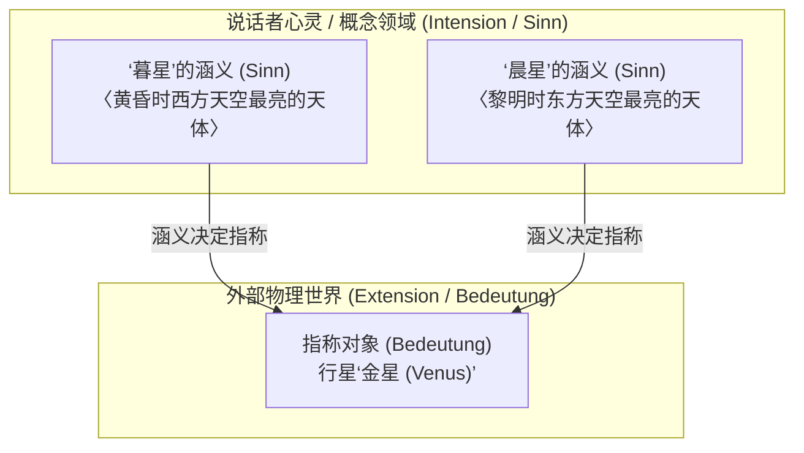
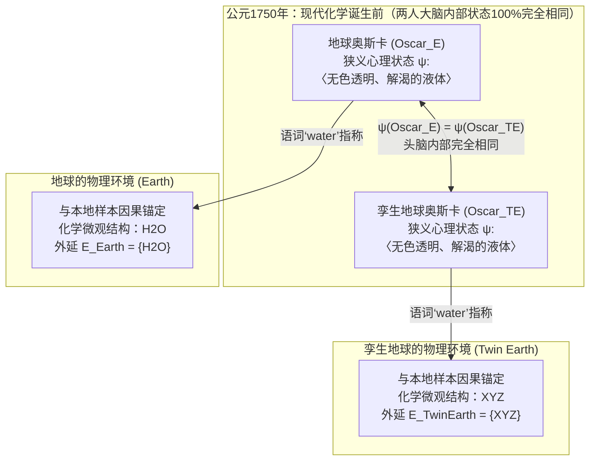

## 1. 引言：“词的意义”究竟存在于何处？

当我们在日常语言中说出“水（water）”、“黄金（gold）”或“亚里士多德（Aristotle）”时，这些声音或文字究竟是如何跨越心灵与物理世界的鸿沟，精确地指向特定物质或历史人物的？

自17世纪约翰·洛克（John Locke）提出“语词是说话者心灵中观念（Ideas）的标记”以来，直至20世纪中叶的分析哲学，语言哲学和心灵哲学长期被一种极具直觉吸引力的正统观念所统治——即<strong>语义内在主义（Semantic Internalism）</strong>与<strong>摹状词理论（Descriptivism）</strong>。该观点认为：理解一个词的意义（内涵，Intension），就是在大脑或心灵内部持有某种特定的概念、心理图像或识别性描述清单；而外部世界中任何满足这一套心理描述清单的事物，就是该词所指称的对象（外延，Extension）。

然而在20世纪70年代初，索尔·克里普克（Saul Kripke）的经典演讲集<strong>《命名与必然性》（*Naming and Necessity*, 1972/1980）</strong>与希拉里·普特南（Hilary Putnam）的里程碑论文<strong>《“意义”的意义》（*The Meaning of "Meaning"*, 1975）</strong>彻底颠覆了这一延续数百年的哲学教条。

普特南通过著名的<strong>“孪生地球（Twin Earth）”思想实验</strong>证明：在公元1750年（现代分子化学诞生之前），地球上的奥斯卡（Oscar）与“孪生地球”上他的分子级复制品（孪生奥斯卡，Twin Oscar）在大脑神经元状态、主观意识体验和心理概念上<strong>100%完全相同</strong>，但当他们各自说出“水（water）”这个词时，地球奥斯卡指的是 $\text{H}_2\text{O}$，而孪生奥斯卡指的却是另一种化学成分 $\text{XYZ}$！普特南由此得出了分析哲学史上最著名的一句格言：

> <strong>“无论你怎么切这块馅饼，‘意义’绝不在头脑之中！（Cut the pie any way you like, 'meanings' just ain't in the head!）”</strong>

本文将系统梳理从弗雷格、罗素、塞尔的古典内在主义，到克里普克的严格指示词与因果历史指称论、普特南的孪生地球与语言劳动分工、泰勒·伯吉（Tyler Burge）的社会外在主义（关节炎思想实验），以及这一革命对当代人工智能与大语言模型（LLM）符号接地问题的深远启示。

---

## 2. 古典内在主义与摹状词传统：弗雷格、罗素与塞尔

### 2.1 弗雷格之谜与《论涵义与指称》（1892）

1892年，现代逻辑学之父戈特洛布·弗雷格（Gottlob Frege）在《论涵义与指称》（*Über Sinn und Bedeutung*）中提出了著名的<strong>弗雷格之谜（Frege's Puzzle）</strong>。请比较以下两个同一性陈述：

1. <strong>$a = a$：“暮星是暮星（Hesperus is Hesperus）。”</strong>
2. <strong>$a = b$：“暮星是晨星（Hesperus is Phosphorus）。”</strong>

在天文学上，“暮星”（黄昏时出现在西方天空最亮的天体）与“晨星”（黎明时出现在东方天空最亮的天体）指称的是同一个物理实体——<strong>金星（Venus）</strong>：

$$\llbracket \text{暮星 (Hesperus)} \rrbracket = \llbracket \text{晨星 (Phosphorus)} \rrbracket = \text{金星 (Venus)}$$

如果一个名称的意义仅仅等于它在外部世界中的<strong>指称 / 外延（Bedeutung / Reference）</strong>，那么由于 $a$ 和 $b$ 的指称完全相同，语句 $a = b$ 就应当和同义反复的 $a = a$ 具有完全相同的认知价值。然而事实上，$a = a$ 是无需经验观察即可知道的<strong>先验（a priori）分析命题</strong>；而 $a = b$ 则是古代巴比伦天文学家通过长期天文观测才确立的重大<strong>后验（a posteriori）经验发现</strong>。

为了解决这一悖论，弗雷格将语词的语义结构划分为两个层次：
- <strong>指称 / 外延（Bedeutung / Extension）</strong>：语词在客观世界中所指向的实体（金星本身）。
- <strong>涵义 / 内涵（Sinn / Sense / Intension）</strong>：指称对象的<strong>“呈现方式（Art des Gegebenseins）”</strong>，即说话者心灵所把握的概念判准（例如〈黄昏西方之星〉与〈黎明东方之星〉）。

在弗雷格看来，说话者通过心理把握“涵义（Sinn）”来理解语言，并且<strong>涵义唯一地决定指称（Sinn determines Bedeutung）</strong>。

### 2.2 罗素的摹状词理论（1905）与塞尔的簇摹状词理论（1958）

伯特兰·罗素（Bertrand Russell）在1905年的《论指称》（*On Denoting*）中进一步提出<strong>确定摹状词理论（Theory of Definite Descriptions）</strong>。罗素将形如“那个 $F$ 是 $G$（The $F$ is $G$，记作 $\iota x\, F(x)$）”的句子还原为一阶谓词逻辑的存在性与唯一性量化公式：

$$\text{The } F \text{ is } G \iff \exists x \Big( F(x) \land \forall y \big(F(y) \to y = x\big) \land G(x) \Big)$$

罗素认为，日常专名（如“亚里士多德”）和自然种类词（如“水”、“黄金”）实际上都是<strong>伪装或缩写的确定摹状词（Disguised Definite Descriptions）</strong>。为了避免单一摹状词将经验命题变成分析命题的缺陷，约翰·塞尔（John Searle, 1958）提出了<strong>簇摹状词理论（Cluster Descriptivism）</strong>：一个名称或自然种类词关联着说话者头脑中的一簇加权描述 $\{D_1, D_2, \dots, D_n\}$，世界中满足该描述簇“足够加权多数”的对象即为该词的指称：

$$\llbracket N \rrbracket = \iota x \left( \sum_{i=1}^{n} w_i \cdot \mathbb{I}\big[D_i(x)\big] \ge \theta \right)$$

### 2.3 传统语义学的“两大教条”：(A1) 与 (A2)

普特南指出，整个古典语义学传统建立在两个不言自明的核心公理之上：

- <strong>公理 (A1) 方法论唯我论（Methodological Solipsism）</strong>：理解一个词的意义（内涵 $I(t)$），完全在于处于某种<strong>狭义心理状态（Narrow psychological state $\psi \in \mathcal{S}_{\text{narrow}}$）</strong>——即完全独立于头脑之外任何外部环境的内在心理/神经状态。
- <strong>公理 (A2) 内涵决定外延（Intension Determines Extension）</strong>：语词的内涵 $I(t)$ 唯一地决定其外延 $E(t)$。若两个语词具有相同的内涵，则它们必定具有完全相同的外延：

$$\psi(S_1, t) = \psi(S_2, t) \stackrel{\text{(A1)}}{\implies} I_1(t) = I_2(t) \stackrel{\text{(A2)}}{\implies} E_1(t) = E_2(t)$$

---

## 3. 克里普克《命名与必然性》：严格指示词与因果历史理论

### 3.1 对摹状词理论的三重反驳与“哥德尔/施密特”思想实验

索尔·克里普克在《命名与必然性》中从模态（Modal）、认识论（Epistemic）和语义（Semantic）三个维度击碎了摹状词理论：

1. <strong>模态论证（The Modal Argument）</strong>：如果“亚里士多德”等同于“亚历山大大帝的老师”，那么在另一个可能世界 $w'$ 中，“亚里士多德从未教过亚历山大”就会变成自相矛盾的伪命题。但事实上，$\Diamond(\neg \text{Taught}(\text{Aristotle}, \text{Alexander}))$ 显然为真。
2. <strong>认识论与语义论证——哥德尔与施密特案例（The Gödel / Schmidt Case）</strong>：
   假设普通说话者关于数学家“哥德尔（Kurt Gödel）”脑中唯一的描述是 $D_{\text{Gödel}} =$ <strong>〈证明了算术不完全性定理的人〉</strong>。现在设想一个反事实场景：实际上是一名叫<strong>施密特（Schmidt）</strong>的维也纳数学家独立证明了不完全性定理，但他在发表前离奇去世；他的朋友<strong>哥德尔</strong>窃取了手稿并以自己的名字发表。
   按照罗素和塞尔的摹状词理论，由于施密特才是唯一满足描述 $D_{\text{Gödel}}$ 的人（$\iota x\, D_{\text{Gödel}}(x) = \text{Schmidt}$），当我们说“哥德尔”时，我们指称的竟然是<strong>施密特</strong>！克里普克指出这显然荒谬绝伦：当我们说“哥德尔”时，我们指的毫无疑问是<strong>哥德尔本人</strong>（并且我们会惊讶地说：“原来哥德尔没有证明该定理，他偷了施密特的成果！”）。因此，头脑中的描述根本不能决定指称！

### 3.2 严格指示词（Rigid Designators）与因果历史指称论

在可能世界语义学框架 $\mathcal{M} = \langle \mathcal{W}, \mathcal{D}, w_0, \mathcal{I} \rangle$ 中，克里普克给出了严格定义：

- <strong>非严格指示词（Non-Rigid Designator）</strong>：如确定摹状词“双光眼镜的发明者”，在不同可能世界指称不同个体（在现实世界 $w_0$ 指富兰克林，在可能世界 $w_1$ 可能指爱迪生）。
- <strong>严格指示词（Rigid Designator）</strong>：在<strong>该对象存在的所有可能世界 $w \in \mathcal{W}$ 中，始终指称完全相同的同一个对象 $o_{\text{actual}}$</strong> 的指示表达式：
  $$\forall w \in \mathcal{W}, \quad \llbracket d_{\text{rigid}} \rrbracket_w = \llbracket d_{\text{rigid}} \rrbracket_{w_0} = o_{\text{actual}}$$

克里普克证明：<strong>自然语言中的所有专名（“亚里士多德”、“暮星”）和自然种类词（“水”、“黄金”、“老虎”）都是严格指示词！</strong>

那么严格指示词如何固定指称？克里普克提出了<strong>因果历史指称论（Causal-Historical Theory of Reference）</strong>：首先通过<strong>初始命名仪式（Initial Baptism）</strong>（利用直接感知与指物展示 Ostension：“将这样本所属的同种液体称为‘水’”），随后通过语言共同体内部的<strong>交流因果链条（Causal Chain of Communication, $S_0 \to S_1 \to \dots \to S_n$）</strong>代代相传。

### 3.3 打破康德教条：后验必然真理（Necessary *A Posteriori* Truths）

自康德至逻辑实证主义，哲学界一直将形而上学的<strong>必然性（$\Box P$）</strong>与认识论的<strong>先验性（A Priori）</strong>混为一谈。克里普克证明：由于“暮星（Hesperus）”、“晨星（Phosphorus）”以及“水（Water）”、“$\text{H}_2\text{O}$”都是严格指示词，一旦经验科学在现实世界 $w_0$ 中发现它们指称同一实体，它们在<strong>一切可能世界</strong>中都必然指称同一实体：

$$(\text{Water} = \text{H}_2\text{O}) \implies \Box(\text{Water} = \text{H}_2\text{O}), \quad (\text{Hesperus} = \text{Phosphorus}) \implies \Box(\text{Hesperus} = \text{Phosphorus})$$

因此，“水是 $\text{H}_2\text{O}$”和“暮星是晨星”虽然在认识论上是<strong>后验的（a posteriori，需靠经验科学发现）</strong>，但在形而上学上却是<strong>必然的（necessary）</strong>！

---

## 4. 普特南的“孪生地球（Twin Earth）”思想实验（1975）

### 4.1 1750年的地球与孪生地球：$\text{H}_2\text{O}$ vs. $\text{XYZ}$

为了彻底证伪传统语义学的公理 (A1) 和 (A2)，普特南在《“意义”的意义》（1975）中构想了著名的<strong>孪生地球（Twin Earth）</strong>：

1. <strong>宏观与主观状态的完全同一</strong>：孪生地球在宏观上与地球完全相同，居民讲着同样的英语。地球上的每一个人——例如<strong>地球奥斯卡（$\text{Oscar}_E$）</strong>——在孪生地球上都有一个微观神经状态与心理体验完全相同的复制品<strong>孪生奥斯卡（$\text{Oscar}_{TE}$）</strong>。
2. <strong>唯一的微观化学差异</strong>：在<strong>地球</strong>上，填充江河湖海、无色无味、能解渴且被称为 `"water"` 的液体是<strong>$\text{H}_2\text{O}$</strong>；而在<strong>孪生地球</strong>上，具有完全相同宏观物理性质且被称为 `"water"` 的液体<strong>不是 $\text{H}_2\text{O}$</strong>，而是一种复杂的化合物<strong>$\text{XYZ}$</strong>！
3. <strong>将时钟拨回公元1750年</strong>：在拉瓦锡和道尔顿创立现代化学之前的1750年，地球和孪生地球上没有任何人知道 $\text{H}_2\text{O}$ 或 $\text{XYZ}$。因此，1750年的地球奥斯卡与孪生奥斯卡在说 `"water"` 时，他们大脑内部的<strong>狭义心理状态 100% 完全相同</strong>：

$$\text{State}_{\text{narrow}}\big(\text{Oscar}_E, 1750\big) \equiv \text{State}_{\text{narrow}}\big(\text{Oscar}_{TE}, 1750\big)$$

### 4.2 为什么 $\text{XYZ}$ 不是水，而是“愚人水”？

然而，在1750年，地球奥斯卡口中的 `"water"` 与孪生奥斯卡口中的 `"water"` 指称相同的事物吗？<strong>绝不相同！</strong>
自然种类词 `"water"` 具有隐含的<strong>指示性本质规定（Indexicality）</strong>：它指称的是与我们周围“这（this）”液体样本具有<strong>相同微观本质结构（同种液体关系 $\text{same}_L$）</strong>的物质：

$$\forall x, \quad x \in \llbracket \text{water} \rrbracket_{\text{Earth}} \iff \text{same}_L\big(x, \text{sample}_{\text{Earth}}\big) \iff \text{Microstructure}(x) = \text{H}_2\text{O}$$
$$\forall x, \quad x \in \llbracket \text{water} \rrbracket_{\text{TwinEarth}} \iff \text{same}_L\big(x, \text{sample}_{\text{TwinEarth}}\big) \iff \text{Microstructure}(x) = \text{XYZ}$$

正如<strong>黄铁矿（$\text{FeS}_2$，“愚人金 / Fool's Gold”）</strong>即便在古代人类尚不知晓原子序数79（$\text{Au}$）时也从来不是真正的黄金一样，孪生地球上的 $\text{XYZ}$ 在1750年也绝不是水，而只是宏观性质酷似水的<strong>“愚人水（Fool's Water）”</strong>！

由此，两位奥斯卡<strong>狭义心理状态完全相同</strong>（$\psi(\text{Oscar}_E) = \psi(\text{Oscar}_{TE})$），但语词<strong>外延截然不同</strong>（$\{\text{H}_2\text{O}\} \neq \{\text{XYZ}\}$）。公理 (A1) 与 (A2) 彻底崩塌：<strong>意义绝不在头脑之中，而是由说话者与外部物理环境的因果互动共同构成的！</strong>

---

## 5. 语言劳动分工、社会外在主义与当代人工智能（LLM）

### 5.1 普特南的“语言劳动分工”（榆树与山毛榉）与四维意义向量

普特南坦承自己分不清<strong>榆树（Elm, *Ulmus*）</strong>和<strong>山毛榉（Beech, *Fagus*）</strong>，他脑中关于这两个词的内部概念完全相同（$\psi(\text{Putnam}, \text{``elm''}) = \psi(\text{Putnam}, \text{``beech''})$）。但他说的 `"elm"` 依然严格指称榆树，因为语言共同体存在<strong>语言劳动分工（Division of Linguistic Labor）</strong>：普通说话者将精确界定外延的语义权威让渡（Deference）给共同体内的<strong>专家（植物学家、化学家）</strong>。

为此，普特南提出用四元组<strong>意义向量（Meaning Vector）</strong>来表示词义：

$$\vec{M}(\text{``water''}) = \big\langle \text{句法标记},\, \text{语义标记},\, \text{刻板印象 (Stereotype)},\, \text{外延 (Extension)} \big\rangle$$

日常交流只需要掌握<strong>刻板印象</strong>（无色透明液体），而<strong>外延</strong>（$\text{H}_2\text{O}$）则由外部世界与科学共同体锚定。

### 5.2 泰勒·伯吉（1979）的社会外在主义：“大腿患关节炎”思想实验

1979年，泰勒·伯吉（Tyler Burge）在《个体主义与心理》（*Individualism and the Mental*）中通过<strong>“关节炎（Arthritis）”思想实验</strong>证明，不仅公共语言，连个人的<strong>私密信念与思想内容（Mental Content）</strong>也是外在主义的：
- <strong>现实世界的伯特（Bert）</strong>：手腕患有关节炎，某天大腿肌肉疼痛，便产生了信念：“我的关节炎扩散到了大腿。”由于标准医学定义中关节炎仅限于<strong>关节（joints）</strong>炎症，伯特抱有一个关于关节炎的<strong>错误信念（False belief）</strong>。
- <strong>反事实世界的孪生伯特（Twin Bert）</strong>：从出生到现在的生理历史、大脑神经元状态与痛觉与现实伯特<strong>100%完全相同</strong>。唯一区别是其语言共同体的医生将 `"arthritis"`（记作概念 `tharthritis`）定义为涵盖<strong>关节与肌肉的一切风湿痛</strong>。因此，孪生伯特抱有一个关于 `tharthritis` 的<strong>真实信念（True belief）</strong>！
- 既然一个信念为假、另一个为真，两人的大脑虽完全相同，其心智信念内容却截然不同！

### 5.3 对当代大语言模型（LLM）与符号接地问题的启示

在当代人工智能中，纯文本训练的大语言模型（LLM）通过预测下一个词元 $P_\theta(w_t \mid w_{1:t-1})$ 完美掌握了普特南意义向量中的前三个维度（句法标记、语义标记与<strong>刻板印象 Stereotype</strong>）。正如 Bender 与 Koller（2020）的<strong>“海底章鱼思想实验（Octopus Test）”</strong>以及普特南的<strong>“缸中之脑（Brains in a Vat, 1981）”</strong>所揭示的：如果仅看神经网络的内部权重矩阵 $\Theta$，意义并不在权重内部。然而，现实世界中的 LLM 所学习的语料库是由与真实 $\text{H}_2\text{O}$ 发生因果互动的人类撰写的，因此 LLM 通过<strong>因果历史链条</strong>与人类社会的<strong>语言劳动分工</strong>，获得了指向物理世界的<strong>衍生性/寄生性指称（Derivative Reference）</strong>。

| 比较维度 | 古典内在主义与摹状词理论 (Frege, Russell, Searle) | 语义与社会外在主义 (Kripke, Putnam, Burge) |
| :--- | :--- | :--- |
| <strong>核心命题</strong> | 意义（内涵）是头脑内部的描述概念，内涵唯一决定外延。 | <strong>“意义不在头脑中。”</strong>意义与思想内容由外部物理环境及社会共同体共同决定。 |
| <strong>专名与自然种类词</strong> | 缩写的确定摹状词或描述簇，属于非严格指示词。 | <strong>严格指示词（Rigid Designators）</strong>，在所有可能世界指称同一实体或微观本质。 |
| <strong>哥德尔/施密特案例</strong> | 荒谬地预测说话者说的“哥德尔”指称的是施密特。 | 准确预测“哥德尔”通过因果历史链条指称哥德尔本人。 |
| <strong>1750年孪生地球</strong> | 两位奥斯卡大脑相同，故词义与外延完全相同。 | 虽大脑状态100%相同，地球指 $\text{H}_2\text{O}$，孪生地球指 $\text{XYZ}$（愚人水）。 |
| <strong>模态与认识论关系</strong> | 必然真理等同于先验真理；“水 $=\text{H}_2\text{O}$”是偶然的。 | 确立<strong>后验必然真理</strong>：$\Box(\text{Water} = \text{H}_2\text{O})$ 与 $\Box(\text{Hesperus} = \text{Phosphorus})$。 |
