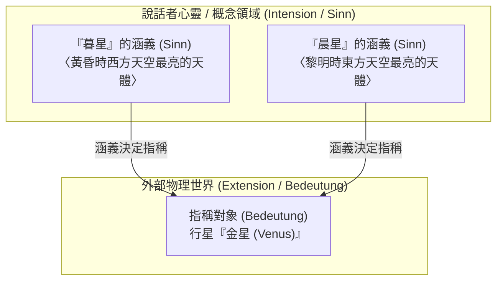
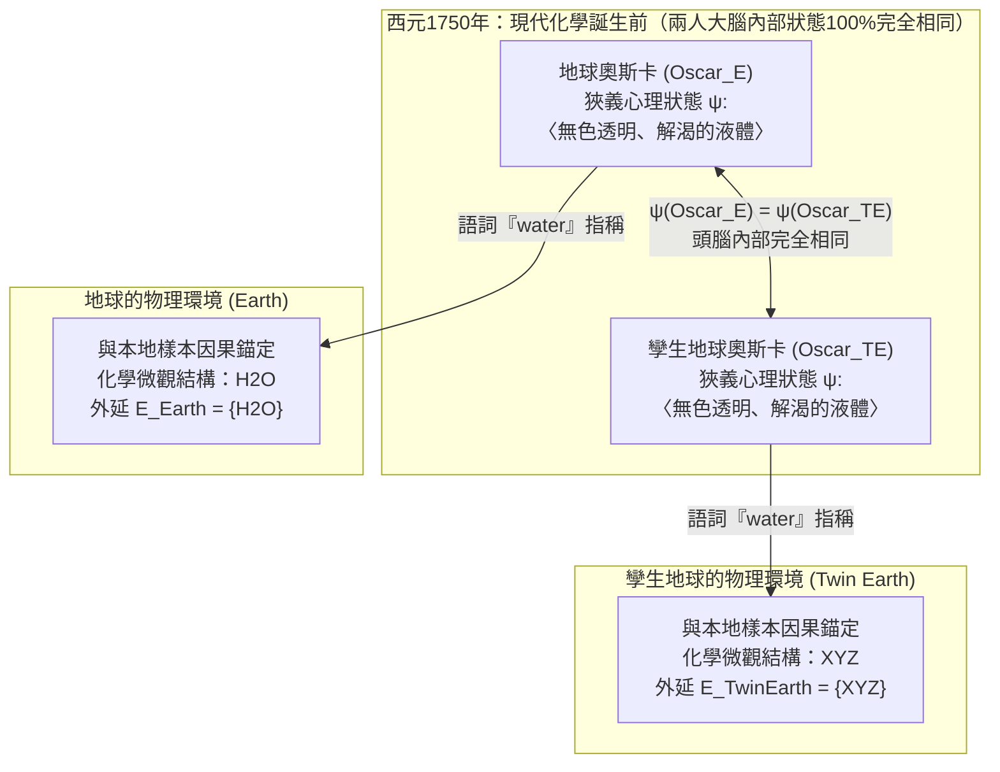

## 1. 引言：「詞的意義」究竟存在於何處？

當我們在日常語言中說出「水（water）」、「黃金（gold）」或「亞里斯多德（Aristotle）」時，這些聲音或文字究竟是如何跨越心靈與物理世界的鴻溝，精確地指向特定物質或歷史人物的？

自17世紀約翰·洛克（John Locke）提出「語詞是說話者心靈中觀念（Ideas）的標記」以來，直至20世紀中葉的分析哲學，語言哲學和心靈哲學長期被一種極具直覺吸引力的正統觀念所統治——即<strong>語義內在主義（Semantic Internalism）</strong>與<strong>摹狀詞理論（Descriptivism）</strong>。該觀點認為：理解一個詞的意義（內涵，Intension），就是在大腦或心靈內部持有某種特定的概念、心理圖像或識別性描述清單；而外部世界中任何滿足這一套心理描述清單的事物，就是該詞所指稱的對象（外延，Extension）。

然而在20世紀70年代初，索爾·克里普克（Saul Kripke）的經典演講集<strong>《命名與必然性》（*Naming and Necessity*, 1972/1980）</strong>與希拉蕊·普特南（Hilary Putnam）的里程碑論文<strong>《「意義」的意義》（*The Meaning of "Meaning"*, 1975）</strong>徹底顛覆了這一延續數百年的哲學教條。

普特南透過著名的<strong>「孿生地球（Twin Earth）」思想實驗</strong>證明：在西元1750年（現代分子化學誕生之前），地球上的奧斯卡（Oscar）與「孿生地球」上他的分子級複製品（孿生奧斯卡，Twin Oscar）在大腦神經元狀態、主觀意識體驗和心理概念上<strong>100%完全相同</strong>，但當他們各自說出「水（water）」這個詞時，地球奧斯卡指的是 $\text{H}_2\text{O}$，而孿生奧斯卡指的卻是另一種化學成分 $\text{XYZ}$！普特南由此得出了分析哲學史上最著名的一句格言：

> <strong>「無論你怎麼切這塊餡餅，『意義』絕不在頭腦之中！（Cut the pie any way you like, 'meanings' just ain't in the head!）」</strong>

本文將系統梳理從弗雷格、羅素、塞爾的古典內在主義，到克里普克的嚴格指示詞與因果歷史指稱論、普特南的孿生地球與語言勞動分工、泰勒·伯吉（Tyler Burge）的社會外在主義（關節炎思想實驗），以及這一革命對當代人工智慧與大型語言模型（LLM）符號接地問題的深遠啟示。

---

## 2. 古典內在主義與摹狀詞傳統：弗雷格、羅素與塞爾

### 2.1 弗雷格之謎與《論涵義與指稱》（1892）

1892年，現代邏輯學之父戈特洛布·弗雷格（Gottlob Frege）在《論涵義與指稱》（*Über Sinn und Bedeutung*）中提出了著名的<strong>弗雷格之謎（Frege's Puzzle）</strong>。請比較以下兩個同一性陳述：

1. <strong>$a = a$：「暮星是暮星（Hesperus is Hesperus）。」</strong>
2. <strong>$a = b$：「暮星是晨星（Hesperus is Phosphorus）。」</strong>

在天文學上，「暮星」（黃昏時出現在西方天空最亮的天體）與「晨星」（黎明時出現在東方天空最亮的天體）指稱的是同一個物理實體——<strong>金星（Venus）</strong>：

$$\llbracket \text{暮星 (Hesperus)} \rrbracket = \llbracket \text{晨星 (Phosphorus)} \rrbracket = \text{金星 (Venus)}$$

如果一個名稱的意義僅僅等於它在外部世界中的<strong>指稱 / 外延（Bedeutung / Reference）</strong>，那麼由於 $a$ 和 $b$ 的指稱完全相同，語句 $a = b$ 就應當和同義反覆的 $a = a$ 具有完全相同的認知價值。然而事實上，$a = a$ 是無需經驗觀察即可知道的<strong>先驗（a priori）分析命題</strong>；而 $a = b$ 則是古代巴比倫天文學家透過長期天文觀測才確立的重大<strong>後驗（a posteriori）經驗發現</strong>。

為了解決這一悖論，弗雷格將語詞的語義結構劃分為兩個層次：
- <strong>指稱 / 外延（Bedeutung / Extension）</strong>：語詞在客觀世界中所指向的實體（金星本身）。
- <strong>涵義 / 內涵（Sinn / Sense / Intension）</strong>：指稱對象的<strong>「呈現方式（Art des Gegebenseins）」</strong>，即說話者心靈所把握的概念判準（例如〈黃昏西方之星〉與〈黎明東方之星〉）。

在弗雷格看來，說話者透過心理把握「涵義（Sinn）」來理解語言，並且<strong>涵義唯一地決定指稱（Sinn determines Bedeutung）</strong>。

### 2.2 羅素的摹狀詞理論（1905）與塞爾的簇摹狀詞理論（1958）

伯特蘭·羅素（Bertrand Russell）在1905年的《論指稱》（*On Denoting*）中進一步提出<strong>確定摹狀詞理論（Theory of Definite Descriptions）</strong>。羅素將形如「那個 $F$ 是 $G$（The $F$ is $G$，記作 $\iota x\, F(x)$）」的句子還原為一階謂詞邏輯的存在性與唯一性量化公式：

$$\text{The } F \text{ is } G \iff \exists x \Big( F(x) \land \forall y \big(F(y) \to y = x\big) \land G(x) \Big)$$

羅素認為，日常專名（如「亞里斯多德」）和自然種類詞（如「水」、「黃金」）實際上都是<strong>偽裝或縮寫的確定摹狀詞（Disguised Definite Descriptions）</strong>。為了避免單一摹狀詞將經驗命題變成分析命題的缺陷，約翰·塞爾（John Searle, 1958）提出了<strong>簇摹狀詞理論（Cluster Descriptivism）</strong>：一個名稱或自然種類詞關聯著說話者頭腦中的一簇加權描述 $\{D_1, D_2, \dots, D_n\}$，世界中滿足該描述簇「足夠加權多數」的對象即為該詞的指稱：

$$\llbracket N \rrbracket = \iota x \left( \sum_{i=1}^{n} w_i \cdot \mathbb{I}\big[D_i(x)\big] \ge \theta \right)$$

### 2.3 傳統語義學的「兩大教條」：(A1) 與 (A2)

普特南指出，整個古典語義學傳統建立在兩個不言自明的核心公理之上：

- <strong>公理 (A1) 方法論唯我論（Methodological Solipsism）</strong>：理解一個詞的意義（內涵 $I(t)$），完全在於處於某種<strong>狹義心理狀態（Narrow psychological state $\psi \in \mathcal{S}_{\text{narrow}}$）</strong>——即完全獨立於頭腦之外任何外部環境的內在心理/神經狀態。
- <strong>公理 (A2) 內涵決定外延（Intension Determines Extension）</strong>：語詞的內涵 $I(t)$ 唯一地決定其外延 $E(t)$。若兩個語詞具有相同的內涵，則它們必定具有完全相同的外延：

$$\psi(S_1, t) = \psi(S_2, t) \stackrel{\text{(A1)}}{\implies} I_1(t) = I_2(t) \stackrel{\text{(A2)}}{\implies} E_1(t) = E_2(t)$$

---

## 3. 克里普克《命名與必然性》：嚴格指示詞與因果歷史理論

### 3.1 對摹狀詞理論的三重反駁與「哥德爾/施密特」思想實驗

索爾·克里普克在《命名與必然性》中從模態（Modal）、認識論（Epistemic）和語義（Semantic）三個維度擊碎了摹狀詞理論：

1. <strong>模態論證（The Modal Argument）</strong>：如果「亞里斯多德」等同於「亞歷山大大帝的老師」，那麼在另一個可能世界 $w'$ 中，「亞里斯多德從未教過亞歷山大」就會變成自相矛盾的偽命題。但事實上，$\Diamond(\neg \text{Taught}(\text{Aristotle}, \text{Alexander}))$ 顯然為真。
2. <strong>認識論與語義論證——哥德爾與施密特案例（The Gödel / Schmidt Case）</strong>：
   假設普通說話者關於數學家「哥德爾（Kurt Gödel）」腦中唯一的描述是 $D_{\text{Gödel}} =$ <strong>〈證明了算術不完全性定理的人〉</strong>。現在設想一個反事實場景：實際上是一名叫<strong>施密特（Schmidt）</strong>的維也納數學家獨立證明了不完全性定理，但他在發表前離奇去世；他的朋友<strong>哥德爾</strong>竊取了手稿並以自己的名字發表。
   按照羅素和塞爾的摹狀詞理論，由於施密特才是唯一滿足描述 $D_{\text{Gödel}}$ 的人（$\iota x\, D_{\text{Gödel}}(x) = \text{Schmidt}$），當我們說「哥德爾」時，我們指稱的竟然是<strong>施密特</strong>！克里普克指出這顯然荒謬絕倫：當我們說「哥德爾」時，我們指的毫無疑問是<strong>哥德爾本人</strong>（並且我們會驚訝地說：「原來哥德爾沒有證明該定理，他偷了施密特的成果！」）。因此，頭腦中的描述根本不能決定指稱！

### 3.2 嚴格指示詞（Rigid Designators）與因果歷史指稱論

在可能世界語義學框架 $\mathcal{M} = \langle \mathcal{W}, \mathcal{D}, w_0, \mathcal{I} \rangle$ 中，克里普克給出了嚴格定義：

- <strong>非嚴格指示詞（Non-Rigid Designator）</strong>：如確定摹狀詞「雙光眼鏡的發明者」，在不同可能世界指稱不同個體（在現實世界 $w_0$ 指富蘭克林，在可能世界 $w_1$ 可能指愛迪生）。
- <strong>嚴格指示詞（Rigid Designator）</strong>：在<strong>該對象存在的所有可能世界 $w \in \mathcal{W}$ 中，始終指稱完全相同的同一個對象 $o_{\text{actual}}$</strong> 的指示表達式：
  $$\forall w \in \mathcal{W}, \quad \llbracket d_{\text{rigid}} \rrbracket_w = \llbracket d_{\text{rigid}} \rrbracket_{w_0} = o_{\text{actual}}$$

克里普克證明：<strong>自然語言中的所有專名（「亞里斯多德」、「暮星」）和自然種類詞（「水」、「黃金」、「老虎」）都是嚴格指示詞！</strong>

那麼嚴格指示詞如何固定指稱？克里普克提出了<strong>因果歷史指稱論（Causal-Historical Theory of Reference）</strong>：首先透過<strong>初始命名儀式（Initial Baptism）</strong>（利用直接感知與指物展示 Ostension：「將這樣本所屬的同種液體稱為『水』」），隨後透過語言共同體內部的<strong>交流因果鏈條（Causal Chain of Communication, $S_0 \to S_1 \to \dots \to S_n$）</strong>代代相傳。

### 3.3 打破康德教條：後驗必然真理（Necessary *A Posteriori* Truths）

自康德至邏輯實證主義，哲學界一直將形上學的<strong>必然性（$\Box P$）</strong>與認識論的<strong>先驗性（A Priori）</strong>混為一談。克里普克證明：由於「暮星（Hesperus）」、「晨星（Phosphorus）」以及「水（Water）」、「$\text{H}_2\text{O}$」都是嚴格指示詞，一旦經驗科學在現實世界 $w_0$ 中發現它們指稱同一實體，它們在<strong>一切可能世界</strong>中都必然指稱同一實體：

$$(\text{Water} = \text{H}_2\text{O}) \implies \Box(\text{Water} = \text{H}_2\text{O}), \quad (\text{Hesperus} = \text{Phosphorus}) \implies \Box(\text{Hesperus} = \text{Phosphorus})$$

因此，「水是 $\text{H}_2\text{O}$」和「暮星是晨星」雖然在認識論上是<strong>後驗的（a posteriori，需靠經驗科學發現）</strong>，但在形上學上卻是<strong>必然的（necessary）</strong>！

---

## 4. 普特南的「孿生地球（Twin Earth）」思想實驗（1975）

### 4.1 1750年的地球與孿生地球：$\text{H}_2\text{O}$ vs. $\text{XYZ}$

為了徹底證偽傳統語義學的公理 (A1) 和 (A2)，普特南在《「意義」的意義》（1975）中構想了著名的<strong>孿生地球（Twin Earth）</strong>：

1. <strong>宏觀與主觀狀態的完全同一</strong>：孿生地球在宏觀上與地球完全相同，居民講著同樣的英語。地球上的每一個人——例如<strong>地球奧斯卡（$\text{Oscar}_E$）</strong>——在孿生地球上都有一個微觀神經狀態與心理體驗完全相同的複製品<strong>孿生奧斯卡（$\text{Oscar}_{TE}$）</strong>。
2. <strong>唯一的微觀化學差異</strong>：在<strong>地球</strong>上，填充江河湖海、無色無味、能解渴且被稱為 `"water"` 的液體是<strong>$\text{H}_2\text{O}$</strong>；而在<strong>孿生地球</strong>上，具有完全相同宏觀物理性質且被稱為 `"water"` 的液體<strong>不是 $\text{H}_2\text{O}$</strong>，而是一種複雜的化合物<strong>$\text{XYZ}$</strong>！
3. <strong>將時鐘撥回西元1750年</strong>：在拉瓦節和道耳頓創立現代化學之前的1750年，地球和孿生地球上沒有任何人知道 $\text{H}_2\text{O}$ 或 $\text{XYZ}$。因此，1750年的地球奧斯卡與孿生奧斯卡在說 `"water"` 時，他們大腦內部的<strong>狹義心理狀態 100% 完全相同</strong>：

$$\text{State}_{\text{narrow}}\big(\text{Oscar}_E, 1750\big) \equiv \text{State}_{\text{narrow}}\big(\text{Oscar}_{TE}, 1750\big)$$

### 4.2 為什麼 $\text{XYZ}$ 不是水，而是「愚人水」？

然而，在1750年，地球奧斯卡口中的 `"water"` 與孿生奧斯卡口中的 `"water"` 指稱相同的事物嗎？<strong>絕不相同！</strong>
自然種類詞 `"water"` 具有隱含的<strong>指示性本質規定（Indexicality）</strong>：它指稱的是與我們周圍「這（this）」液體樣本具有<strong>相同微觀本質結構（同種液體關係 $\text{same}_L$）</strong>的物質：

$$\forall x, \quad x \in \llbracket \text{water} \rrbracket_{\text{Earth}} \iff \text{same}_L\big(x, \text{sample}_{\text{Earth}}\big) \iff \text{Microstructure}(x) = \text{H}_2\text{O}$$
$$\forall x, \quad x \in \llbracket \text{water} \rrbracket_{\text{TwinEarth}} \iff \text{same}_L\big(x, \text{sample}_{\text{TwinEarth}}\big) \iff \text{Microstructure}(x) = \text{XYZ}$$

正如<strong>黃鐵礦（$\text{FeS}_2$，「愚人金 / Fool's Gold」）</strong>即便在古代人類尚不知曉原子序數79（$\text{Au}$）時也從來不是真正的黃金一樣，孿生地球上的 $\text{XYZ}$ 在1750年也絕不是水，而只是宏觀性質酷似水的<strong>「愚人水（Fool's Water）」</strong>！

由此，兩位奧斯卡<strong>狹義心理狀態完全相同</strong>（$\psi(\text{Oscar}_E) = \psi(\text{Oscar}_{TE})$），但語詞<strong>外延截然不同</strong>（$\{\text{H}_2\text{O}\} \neq \{\text{XYZ}\}$）。公理 (A1) 與 (A2) 徹底崩塌：<strong>意義絕不在頭腦之中，而是由說話者與外部物理環境的因果互動共同構成的！</strong>

---

## 5. 語言勞動分工、社會外在主義與當代人工智慧（LLM）

### 5.1 普特南的「語言勞動分工」（榆樹與山毛櫸）與四維意義向量

普特南坦承自己分不清<strong>榆樹（Elm, *Ulmus*）</strong>和<strong>山毛櫸（Beech, *Fagus*）</strong>，他腦中關於這兩個詞的內部概念完全相同（$\psi(\text{Putnam}, \text{``elm''}) = \psi(\text{Putnam}, \text{``beech''})$）。但他說的 `"elm"` 依然嚴格指稱榆樹，因為語言共同體存在<strong>語言勞動分工（Division of Linguistic Labor）</strong>：普通說話者將精確界定外延的語義權威讓渡（Deference）給共同體內的<strong>專家（植物學家、化學家）</strong>。

為此，普特南提出用四元組<strong>意義向量（Meaning Vector）</strong>來表示詞義：

$$\vec{M}(\text{``water''}) = \big\langle \text{句法標記},\, \text{語義標記},\, \text{刻板印象 (Stereotype)},\, \text{外延 (Extension)} \big\rangle$$

日常交流只需要掌握<strong>刻板印象</strong>（無色透明液體），而<strong>外延</strong>（$\text{H}_2\text{O}$）則由外部世界與科學共同體錨定。

### 5.2 泰勒·伯吉（1979）的社會外在主義：「大腿患關節炎」思想實驗

1979年，泰勒·伯吉（Tyler Burge）在《個體主義與心理》（*Individualism and the Mental*）中透過<strong>「關節炎（Arthritis）」思想實驗</strong>證明，不僅公共語言，連個人的<strong>私密信念與思想內容（Mental Content）</strong>也是外在主義的：
- <strong>現實世界的伯特（Bert）</strong>：手腕患有關節炎，某天大腿肌肉疼痛，便產生了信念：「我的關節炎擴散到了大腿。」由於標準醫學定義中關節炎僅限於<strong>關節（joints）</strong>炎症，伯特抱有一個關於關節炎的<strong>錯誤信念（False belief）</strong>。
- <strong>反事實世界的孿生伯特（Twin Bert）</strong>：從出生到現在的生理歷史、大腦神經元狀態與痛覺與現實伯特<strong>100%完全相同</strong>。唯一區別是其語言共同體的醫生將 `"arthritis"`（記作概念 `tharthritis`）定義為涵蓋<strong>關節與肌肉的一切風濕痛</strong>。因此，孿生伯特抱有一個關於 `tharthritis` 的<strong>真實信念（True belief）</strong>！
- 既然一個信念為假、另一個為真，兩人的大腦雖完全相同，其心智信念內容卻截然不同！

### 5.3 對當代大型語言模型（LLM）與符號接地問題的啟示

在當代人工智慧中，純文本訓練的大型語言模型（LLM）透過預測下一個詞元 $P_\theta(w_t \mid w_{1:t-1})$ 完美掌握了普特南意義向量中的前三個維度（句法標記、語義標記與<strong>刻板印象 Stereotype</strong>）。正如 Bender 與 Koller（2020）的<strong>「海底章魚思想實驗（Octopus Test）」</strong>以及普特南的<strong>「桶中之腦（Brains in a Vat, 1981）」</strong>所揭示的：如果僅看神經網路的內部權重矩陣 $\Theta$，意義並不在權重內部。然而，現實世界中的 LLM 所學習的語料庫是由與真實 $\text{H}_2\text{O}$ 發生因果互動的人類撰寫的，因此 LLM 透過<strong>因果歷史鏈條</strong>與人類社會的<strong>語言勞動分工</strong>，獲得了指向物理世界的<strong>衍生性/寄生性指稱（Derivative Reference）</strong>。

| 比較維度 | 古典內在主義與摹狀詞理論 (Frege, Russell, Searle) | 語義與社會外在主義 (Kripke, Putnam, Burge) |
| :--- | :--- | :--- |
| <strong>核心命題</strong> | 意義（內涵）是頭腦內部的描述概念，內涵唯一決定外延。 | <strong>「意義不在頭腦中。」</strong>意義與思想內容由外部物理環境及社會共同體共同決定。 |
| <strong>專名與自然種類詞</strong> | 縮寫的確定摹狀詞或描述簇，屬於非嚴格指示詞。 | <strong>嚴格指示詞（Rigid Designators）</strong>，在所有可能世界指稱同一實體或微觀本質。 |
| <strong>哥德爾/施密特案例</strong> | 荒謬地預測說話者說的「哥德爾」指稱的是施密特。 | 準確預測「哥德爾」透過因果歷史鏈條指稱哥德爾本人。 |
| <strong>1750年孿生地球</strong> | 兩位奧斯卡大腦相同，故詞義與外延完全相同。 | 雖大腦狀態100%相同，地球指 $\text{H}_2\text{O}$，孿生地球指 $\text{XYZ}$（愚人水）。 |
| <strong>模態與認識論關係</strong> | 必然真理等同於先驗真理；「水 $=\text{H}_2\text{O}$」是偶然的。 | 確立<strong>後驗必然真理</strong>：$\Box(\text{Water} = \text{H}_2\text{O})$ 與 $\Box(\text{Hesperus} = \text{Phosphorus})$。 |
