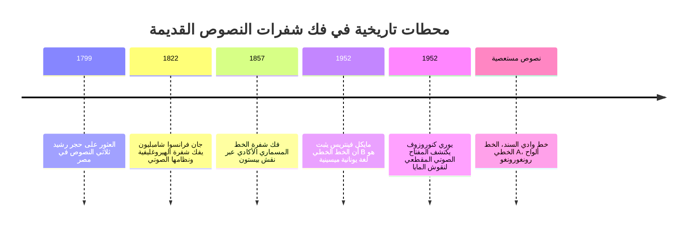
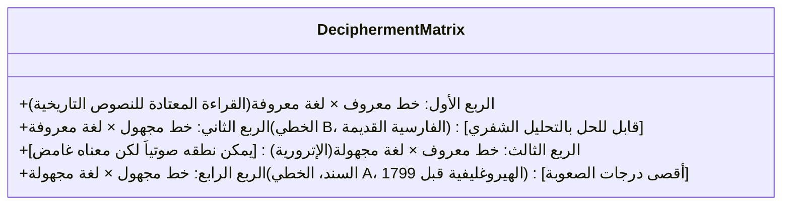

بين سائر إبداعات العقل البشري، يبرز اختراع الكتابة كأعظم إنجاز على الإطلاق. لقد حولت الكلمة المنطوقة العابرة إلى أثر مادي خالد، لتبني جسراً زمنياً يتحدى آلاف السنين.

لكن حين تنهار الحضارات وتندثر لغاتها المنطوقة، تغرق النصوص في صمت مطبق. إن فك رموز النصوص القديمة ليس مجرد أحجية أكاديمية، بل هو عمل مجيد من أعمال البعث التاريخي لإعادة إحياء أصوات البشرية المدفونة في ظلمات الماضي.

---

## 1. الأسس الرياضية وتصنيف أنظمة الكتابة

يواجه الباحث مصفوفة "المجهول المزدوج":

يكشف عدد الرموز المميزة طبيعة النظام:
- **20 إلى 40 رمزاً**: أبجدية (أصوات فردية صامتة وصائتة)
- **50 إلى 100 رمز**: نظام مقطعي (صامت + صائت)، مثل الخطي B (87 رمزاً)
- **400 إلى 1,000 رمز**: نظام مقطعي-رمزي مركب، مثل المايا والمصرية القديمة
- **آلاف الرموز**: نظام رمزي خالص للكلمات (مثل المقاطع الصينية)

---

## 2. الانتصارات الكبرى الثلاثة

### 2.1 حجر رشيد والهيروغليفية المصرية (شامبليون)
أثبت **جان فرانسوا شامبليون** بمقارنة 486 كلمة يونانية بـ 1,419 رمزاً هيروغليفياً أن النص ليس رموزاً سحرية بل أصواتاً لغوية. وبقراءة الخراطيش الملكية (بطليموس وكليوباترا) واستعانته باللغة **القبطية**، قرأ أسماء الفراعنة مثل *رمسيس* و*تحتمس*.

---

### 2.2 معجزة الخط الخطي B (أليس كوبر ومايكل فينتريس)
- **أليس كوبر** صممت شبكة صوتية لعلامات المقاطع عبر دراسة تصريف نهايات الكلمات دون أي تخمين مسبق.
- **مايكل فينتريس** أسقط أسماء مدن كريت (*كنوسوس*، *أمنيسوس*) على الشبكة، لتتفجر النصوص فجأة بكلمات **اللغة اليونانية الميسينية** القديمة!

---

### 2.3 نقوش المايا (يوري كنوروزوف)
أثبت العالم السوفيتي **يوري كنوروزوف** عام 1952 أن خط المايا مقطعي ورمزي، وصاغ **قاعدة التناغم الصوتي** ($CV_1 + CV_2 = CVC$) حيث الحرف الصائت الأخير صامت. واليوم، يُقرأ أكثر من 90% من نصوص المايا بدقة تامة.

---

## 3. النصوص المستعصية على الحل

- **خط وادي السند**: أكثر من 4,000 نقش من حضارة هارابا (2600-1900 ق.م). يبلغ متوسط طول النقش 4.6 رموز فقط دون وجود أي نص ثنائي اللغة، مما يجعله لغزاً معلقاً.
- **الخط الخطي A**: سلف الخط الخطي B في كريت المينوية، ينقل لغة منعزلة مجهولة تماماً.
- **رونغورونغو**: ألواح خشبية من جزيرة الفصح بنظام الكتابة بالحرث المعكوس، فُقدت تقاليد قراءتها في عام 1862 بعد غارات تجار الرقيق في بيرو.
---

## 4. نقش بيستون والذكاء الاصطناعي في فك التشفير الحديث

لا يقل **نقش بيستون (Behistun Inscription)** في إيران أهمية عن حجر رشيد؛ حيث نحت على جرف صخري شاهق بثلاث لغات (الفارسية القديمة والعيلامية والبابلية الأكادية). قاد الضابط البريطاني هنري راولنسون عملية استنساخه البطولية، مما فتح الباب لقراءة أدب بلاد الرافدين وملحمة جلجامش.

وفي العصر الحديث، توظف أبحاث معهد ماساتشوستس للتكنولوجيا (MIT) تقنيات الذكاء الاصطناعي والتعلم العميق لإيجاد الروابط الرياضية بين الرموز المجهولة واللغات القديمة، إلا أن استخراج نصوص ثنائية اللغة جديدة يظل المفتاح الحاسم لفك الألغاز المتبقية.
