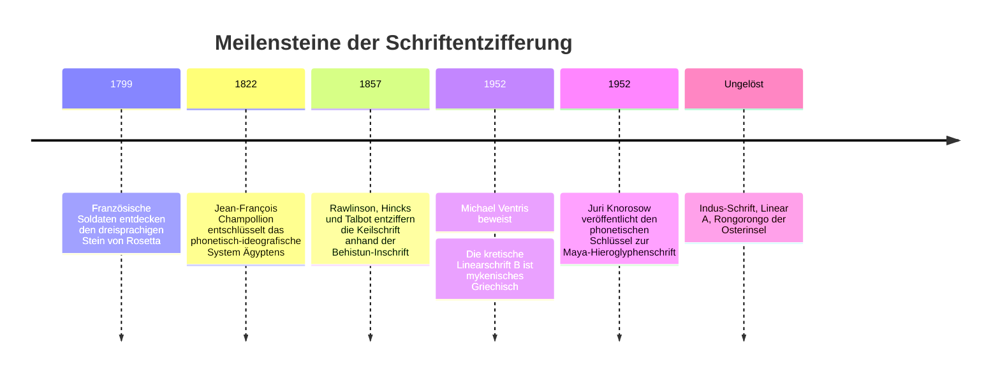
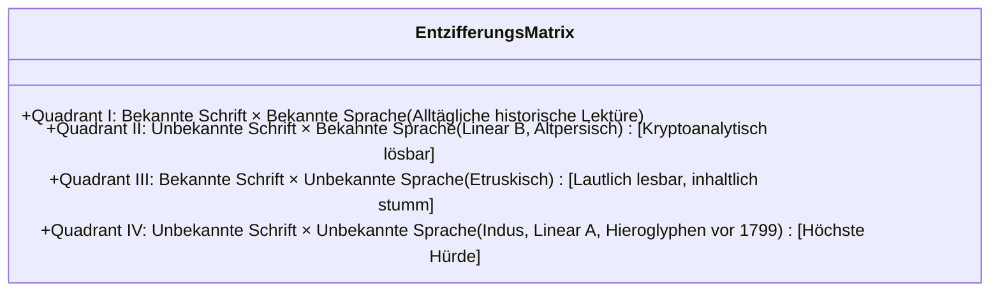

Unter allen Schöpfungen des menschlichen Geistes ragt die Erfindung der Schrift als unvergleichliches Monument hervor. Sie verwandelte das flüchtige gesprochene Wort in eine dauerhafte materielle Spur und schuf eine Zeitbrücke über Jahrtausende hinweg.

Doch wenn Reiche zerfallen und die gesprochenen Sprachen verstummen, erstarrt die Schrift zu einem rätselhaften Schweigen. Die Entzifferung antiker Schriftsysteme ist daher kein akademisches Glasperlenspiel, sondern eine Wiedererweckung menschlicher Stimmen aus dem Dunkel der Geschichte.

---

## 1. Mathematische Grundlagen und linguistische Typologie

Jede Schriftentzifferung steht vor der doppelten Herausforderung von **Schriftsystem** und **unterliegender Sprache**:

### Der Zeicheninventar-Test:
Die Anzahl der voneinander unterscheidbaren Grapheme verrät sofort den strukturellen Aufbau eines Schriftsystems:
- **20 bis 40 Zeichen**: Reines Alphabet oder Abdschad (Konsonantenschrift)
- **50 bis 100 Zeichen**: Silbenschrift (Syllabar), z. B. Linear B (87 Zeichen)
- **400 bis 1.000 Zeichen**: Gemischtes Wort-Silben-System (Logosyllabisch), wie Maya und Hieroglyphen
- **Tausende bis Zehntausende**: Reine Wortschrift (Logogramme), wie chinesische Hanzi

---

## 2. Die drei großen historischen Triumphe

### 2.1 Der Stein von Rosetta und die ägyptischen Hieroglyphen
Der 1799 gefundene Granodiorit-Block enthielt dasselbe Dekret von Ptolemaios V. in drei Schriftarten: Hieroglyphen, Demotisch und Altgriechisch.
Der französische Linguist **Jean-François Champollion** zählte die Wörter: Dem griechischen Text mit 486 Wörtern standen 1.419 Hieroglyphenzeichen gegenüber. Damit bewies er mathematisch, dass Hieroglyphen keine reinen Bildersymbole waren, sondern Laute abbildeten. Durch den Vergleich königlicher Kartuschen (Ptolemaios, Kleopatra) und seine virtuose Beherrschung des **Koptischen** entzifferte er Pharaonennamen wie *Ramesses* (Sohn des Sonnengottes Ra) und erweckte das alte Ägypten zu neuem Leben.

---

### 2.2 Das Wunder von Linear B (Alice Kober und Michael Ventris)
Sir Arthur Evans hielt die 1900 auf Kreta gefundenen Tontäfelchen für eine nicht-griechische „minoische“ Sprache.
- Die US-Philologin **Alice Kober** analysierte die Endungen ohne jede vorgefasste Meinung und entdeckte grammatische Flexionsmuster („Kober-Drillinge“). Sie erstellte ein zweidimensionales Gitter phonetischer Verwandtschaften.
- Der britische Architekt und ehemalige Kryptoanalytiker **Michael Ventris** setzte kretische Ortsnamen (*Knossos*, *Amnisos*) in das Kober-Gitter ein. Schlagartig löste sich das Rätsel auf: Die Täfelchen waren in **mykenischem Griechisch** verfasst – 700 Jahre älter als Homers Ilias!

---

### 2.3 Die Maya-Schrift (Juri Knorosow sprengt den Eisernen Vorhang)
In den 1950er-Jahren bewies der sowjetische Linguist **Juri Knorosow**, dass die rund 800 Maya-Schriftzeichen ein logosyllabisches System bildeten. Er entdeckte das **Prinzip der vokalischen Harmonie (Synharmonie)**: Monosyllabische Wörter wurden durch zwei Silbenzeichen gebildet ($CV_1 + CV_2 = CVC$), wobei der zweite Vokal stumm blieb. Dank Tatiana Proskouriakoffs Nachweis historischer Königsbiografien auf den Stelen sind heute über 90 % der Maya-Texte lesbar.

---

## 3. Die unbezwingbaren Rätsel: Indus-Schrift und Linear A

- **Indus-Schrift**: Über 4.000 Inschriften der Harappa-Kultur (ca. 2600–1900 v. Chr.) sind bekannt. Die durchschnittliche Textlänge beträgt jedoch nur 4,6 Zeichen. Da bisher keine zweisprachige Bilingue gefunden wurde, streiten Forscher, ob die Sprache dravidisch oder indoiranisch war – oder ob es sich gar um rein heraldische Bildsymbole handelte.
- **Linear A**: Das minoische Schriftsystem Kretas kann zwar phonetisch mit Linear-B-Werten gelesen werden, doch die zugrundeliegende minoische Sprache bleibt ein isoliertes, unverstandenes Rätsel.
- **Rongorongo**: Die Holztafeln der Osterinsel mit verkehrter Boustrophedon-Schrift verloren ihre Lesetradition 1862 durch verheerende Sklavenüberfälle, bei denen die gebildete Oberschicht der Rapa Nui vollständig ausgelöscht wurde.
