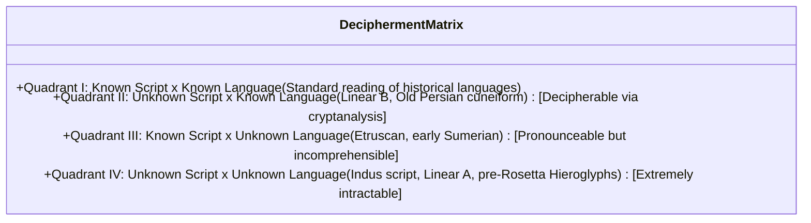
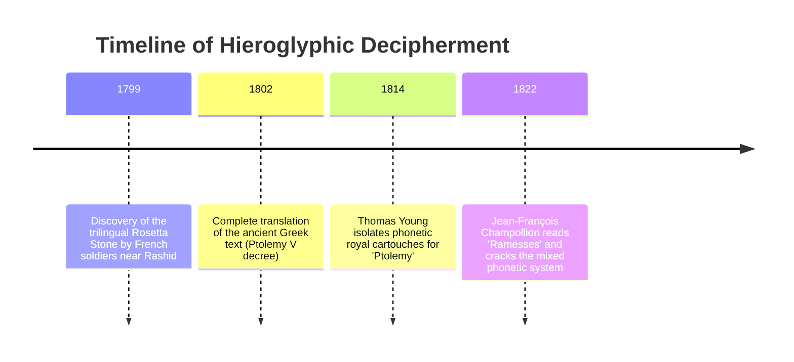
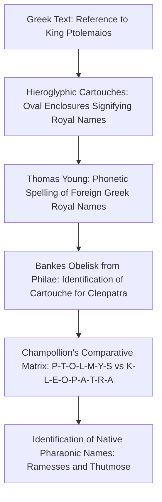
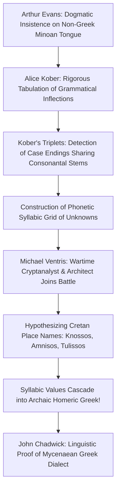
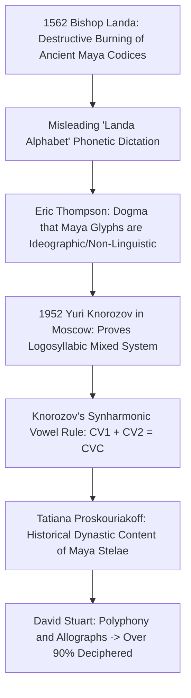
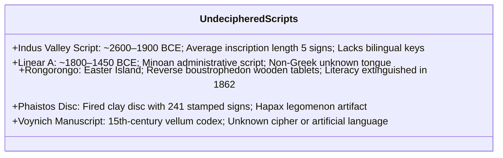
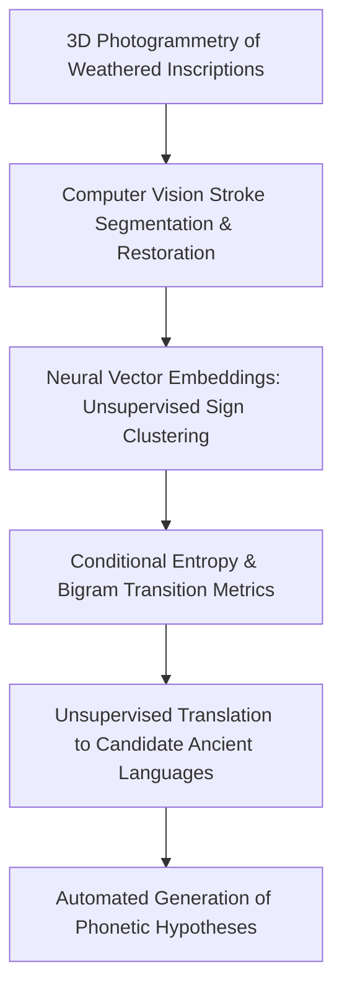

Of all humanity's intellectual creations, the invention of writing stands as the supreme achievement. Writing transformed ephemeral spoken words into durable physical marks, liberating thoughts, laws, mythologies, and histories from the biological limits of human memory. It forged an unbroken **temporal bridge across millennia**.

Yet when civilizations collapse and their spoken tongues vanish, scripts fall silent. Carved hieroglyphs on crumbling temple walls, incisions on baked clay tablets, and bizarre characters etched into weathered wood transform into impenetrable ciphers.

Deciphering an ancient script is not merely solving a dry academic crossword puzzle. It is an act of historical resurrection: restoring the living voices, political intrigues, religious poetry, and mundane economic transactions of our ancestors from millennia of silence.

This treatise explores the multidisciplinary science of linguistic decipherment: the theoretical and mathematical foundations of writing systems, the three greatest triumphs in historical cryptanalysis (Egyptian Hieroglyphs, Linear B, and Maya Glyphs), and the profound mysteries of scripts that continue to defy humanity—including the Indus script, Linear A, and Rongorongo.

---

## 1. The Mathematical and Linguistic Mechanics of Decipherment

The decipherment of lost scripts shares profound theoretical underpinnings with information theory, statistical mechanics, and military cryptanalysis.

### 1.1 The Double-Unknown Matrix

Every aspiring decipherer confronts two fundamental variables: the **writing system (the visual code)** and the **underlying spoken language (grammar, phonology, and vocabulary)**.



- **Quadrant II (Unknown Script $\times$ Known Language)**:
  Once phonetic values are assigned to characters, the underlying grammar and vocabulary reveal themselves through a known ancestral or related tongue (e.g., Linear B resolving into archaic Mycenaean Greek).
- **Quadrant III (Known Script $\times$ Unknown Language)**:
  Phonetic values can be pronounced because the alphabet is borrowed (e.g., Etruscan written in an archaic Greek-derived alphabet), but because the language belongs to no known linguistic family, the actual semantic meaning remains largely elusive.
- **Quadrant IV (Unknown Script $\times$ Unknown Language)**:
  The cryptanalytic worst-case scenario. Without a multilingual translation bridge (such as the Rosetta Stone) or massive text corpora amenable to high-dimensional statistical modeling, decipherment remains mathematically intractable.

---

### 1.2 Typological Diagnostics: Character Inventory Size

When linguistic cryptanalysts encounter an unread script, their first mathematical step is to count the **number of unique discrete graphemes (signs)**. This simple count immediately identifies the structural taxonomy of the writing system:

```mermaid
flowchart TD
    Count[Count Number of Distinct Graphemes] --> Opt1{"20 to 40 Distinct Signs"}
    Count --> Opt2{"50 to 100 Distinct Signs"}
    Count --> Opt3{"Hundreds to Thousands of Signs"}
    
    Opt1 --> Type1[Alphabetic or Abjad: Segmental Phonemes (Individual consonants and vowels)]
    Opt2 --> Type2[Syllabic: Consonant-Vowel (CV) combinations]
    Opt3 --> Type3[Logographic or Mixed Logosyllabic: Morphemes and concepts coupled with phonetic complements]
```

| Script Classification | Typical Sign Count | Linguistic Unit Encoded | Representative Systems |
| :--- | :--- | :--- | :--- |
| **Alphabet / Abjad** | 20 – 40 signs | Individual phonemes | Latin (26), Phoenician (22), Greek (24), Arabic (28) |
| **Syllabary** | 50 – 100 signs | Open syllables (CV, V) | Japanese Kana (~50), Linear B (87), Cherokee (85) |
| **Logosyllabic** | 400 – 1,000 signs | Morphemes + Syllabic signs | Maya glyphs (~800), Egyptian Hieroglyphs (~700–1,000) |
| **Morphosyllabic / Pure Logographic** | Thousands to tens of thousands | Morphemes / semantic words | Chinese characters (Kangxi Dictionary: >47,000 signs) |

---

### 1.3 Zipf's Law and Conditional Entropy

In every natural human language, the frequency distribution of words follows **Zipf's Law**: the frequency of any word $f(r)$ is inversely proportional to its rank $r$ in the frequency table:

$$f(r) \propto \frac{1}{r^s} \quad (s \approx 1)$$

Taking logarithms yields a linear equation with a slope near $-1$:

$$\ln f(r) = -s \ln r + C$$

Plotting sign-frequency distributions on log-log scales provides an immediate test: natural language corpora collapse onto a straight line of slope $\approx -1$. Non-linguistic symbol sets, random ornamental sequences, and computational barcodes deviate sharply, offering a vital mathematical test in controversies surrounding the Indus valley inscriptions.

---

## 2. The Three Great Historic Triumphs

### 2.1 The Rosetta Stone and Egyptian Hieroglyphs

For over fourteen centuries, Egyptian hieroglyphs were silenced by religious proscription. Scholars across Europe were misled by Horapollo's 5th-century treatise *Hieroglyphica*, which erroneously claimed hieroglyphs were purely mystical allegories devoid of phonetic sounds.



#### The Polyglot Key
Discovered in July 1799 by French engineering officer Pierre-François Bouchard, the **Rosetta Stone** (a granodiorite stele weighing 762 kg) preserved three distinct scripts recording a single royal decree issued at Memphis in 196 BCE by Ptolemy V Epiphanes:
1. **Hieroglyphic**: Sacred, formal script of the priesthood.
2. **Demotic**: Cursive script of everyday Egyptian administration.
3. **Ancient Greek**: Administrative language of the Ptolemaic ruling dynasty.

Because Ancient Greek was readily readable, the semantic message was known. The puzzle was determining how individual hieroglyphic glyphs mapped to meaning and sound.



#### Champollion's Mathematical Insight
Jean-François Champollion (1790–1832) carried out an elementary mathematical count: the Greek text contained 486 words, whereas the hieroglyphic text displayed 1,419 individual signs. If each hieroglyph stood for a single whole concept (logogram), there should have been fewer than 500 signs. 

Champollion proved that hieroglyphs were primarily **phonetic signs**. Leveraging his fluent mastery of **Coptic** (the direct linguistic descendant of ancient Egyptian), he unlocked native pharaonic cartouches in September 1822:
- A sun disk ($\text{Coptic } Ra$) + unknown sign + two folded cloths ($s$): **$Ra-ms-s$ (Ramesses)**!
- An ibis ($\text{god Thoth}$) + unknown sign + $s$: **$Thoth-ms$ (Thutmose)**!

Hieroglyphic writing was neither purely symbolic nor purely alphabetic, but a complex, harmonious fusion: **"at once figurative, symbolic, and phonetic in one and the same text, in one and the same sentence, and even in one and the same word."**

---

### 2.2 Linear B: Cracking the Aegean Bronze Age

In 1900, British archaeologist Sir Arthur Evans unearthed thousands of inscribed clay tablets at the palace of Knossos on Crete, cataloging two linear scripts: **Linear A** and **Linear B**. Convinced that Minoan civilization was an indigenous, non-Greek maritime empire, Evans insisted the language was entirely alien to Indo-European Greek.



#### Alice Kober's Grid
American classicist **Alice Kober (1906–1950)** bypassed wild guesswork in favor of rigorous statistical analysis. Analyzing variations in word endings across hundreds of tablets, she identified what became known as **Kober's Triplets**: sets of words sharing identical roots that inflected through systematic grammatical declensions.

Kober realized that in an inflected language written with an open-syllable syllabary (CV signs), changing a case ending from $-o$ to $-a$ while preserving a stem ending in $-k-$ converts the terminal glyph from $[ko]$ to $[ka]$. She constructed a **two-dimensional phonetic grid**, grouping signs that shared identical consonants along horizontal rows and identical vowels along vertical columns—without knowing the absolute phonetic value of a single sign.

#### Michael Ventris and the Greek Epiphany
British architect and former RAF cryptanalyst **Michael Ventris (1922–1956)** inherited Kober's grid following her tragic death.

Ventris hypothesized that recurring words unique to Knossos tablets represented local geographic place names:
- $\text{Sign } 08\text{-}39\text{-}06 \rightarrow \text{A-MI-NI-SO (Amnisos, port of Knossos)}$
- $\text{Sign } 52\text{-}08\text{-}70 \rightarrow \text{KO-NO-SO (Knossos)}$
- $\text{Sign } 69\text{-}53\text{-}12 \rightarrow \text{TU-LI-SO (Tulissos)}$

Plugging these tentative phonetic values into the Kober grid caused the entire system to unlock like a combination safe. Archaic Greek words tumbled across the tablets:
- $po\text{-}me \rightarrow \pi o\iota\mu\eta\nu \text{ (poimen: shepherd)}$
- $ko\text{-}wo \rightarrow \kappa o\rho\mathcal{F}o\varsigma \text{ (korwos: boy/son)}$
- $ti\text{-}ri\text{-}po \rightarrow \tau\rho\iota\pi o\varsigma \text{ (tripos: three-legged cauldron/tripod)}$

On July 1, 1952, Ventris announced on BBC Radio that **Linear B was Greek**—a dialect 700 years older than Homer.

---

### 2.3 Maya Glyphs: Shattering the Cold War Curtain

In 1562, Bishop Diego de Landa oversaw the auto-da-fé at Maní, burning countless irreplaceable bark-paper Maya codices. For centuries thereafter, Western Mayanists, led by Sir J. Eric S. Thompson, dogmatically asserted that Maya writing consisted of non-linguistic mystical symbols and calendar mathematics.



#### Yuri Knorozov's Mathematical Deduction
In 1952, isolated behind the Iron Curtain in Leningrad, linguist **Yuri Knorozov (1922–1999)** cracked Maya writing using mathematical linguistics. 

Recognizing that the ~800 Maya signs were typologically inconsistent with an alphabet or pure logography, Knorozov established that Maya was **logosyllabic**.

Crucially, he deciphered how spoken monosyllabic words ($CVC$) were written using two syllabic glyphs ($CV_1 + CV_2$). Knorozov formulated the **Synharmonic Vowel Principle**: the vowel of the second, terminal syllabogram was silent ($V_2 = \emptyset$), but echoed the vowel of the first syllabogram ($V_2 = V_1$):

$$\text{Word } [tzul] \text{ ("dog")} = \text{Glyph } [tzu] + \text{Glyph } [lu] \quad (\text{read as } tzu\text{-}l)$$

Coupled with Tatiana Proskouriakoff's discovery that stelae recorded historical royal dynastic births, accessions, and conquests, and David Stuart's resolution of allographs (diverse aesthetic variations of identical syllables), over **90% of Maya texts** can now be read with absolute linguistic accuracy.

---

## 3. The Unbroken Enigmas: Undeciphered Scripts

Despite modern computational tools, several major writing systems continue to resist human decipherment:



---

### 3.1 The Indus Valley Script (~2600–1900 BCE)
Harappa and Mohenjo-daro anchored the vast Bronze Age Indus Civilization. Over 4,000 steatite stamp seals, pottery fragments, and copper tablets bear approximately 400 distinct signs.

#### The Three Structural Roadblocks:
1. **Extreme Brevity**: The mean inscription length is **4.6 signs**. The longest continuous text on a single surface is only 17 signs (or 26 across multiple faces). This is insufficient to extract stable n-gram syntax or grammatical inflections.
2. **Absence of Bilingual Keys**: No "Indus Rosetta Stone" has ever been discovered.
3. **Contested Linguistic Affinity**: Scholars remain fiercely divided between Proto-Dravidian (championed by Asko Parpola), Proto-Indo-Aryan, and extinct isolate tongues.

In 2004, Steve Farmer, Richard Sproat, and Michael Witzel published their controversial **Non-linguistic Hypothesis**, arguing that Indus symbols functioned like medieval European heraldic coats-of-arms or clan emblems rather than spoken phonetic language.

---

### 3.2 Linear A (~1800–1450 BCE)
The administrative script of Minoan Crete, Linear A served as the direct graphic ancestor of Linear B. 

While scholars can approximate the phonetic pronunciation of Linear A signs by projecting Linear B values backward, the resulting words—such as $\text{KU-RO}$ (apparently meaning "total") and $\text{KI-RO}$ ("deficit")—do not conform to Greek or Semitic. The **Minoan language remains an unclassified isolate**, rendering deep semantic translation impossible.

---

### 3.3 Rongorongo of Rapa Nui
Discovered on Easter Island in the 1860s, Rongorongo consists of glyphs depicting stylized human figures, birds, crustaceans, and plants carved into 26 surviving wooden tablets.

Rongorongo is inscribed in **reverse boustrophedon**: a reader begins at the bottom left, reads along the line, turns the wooden tablet $180^\circ$ upside down, and reads the next line. In 1862, catastrophic Peruvian slave raids carried off half the island's population, including the King, royal sages, and literate priesthood (*tangata rongorongo*), who all perished of smallpox and abuse. The living oral tradition was severed forever.

---

## 4. Artificial Intelligence and the Future of Cryptanalysis

Recent advances in deep learning and natural language processing are revolutionizing epigraphy:



Researchers at MIT and Google DeepMind have developed unsupervised machine-translation frameworks capable of mapping lost scripts (such as Ugaritic and Linear B) directly to known cognate languages by optimizing geometric embeddings across high-dimensional semantic spaces.

Yet computational power has immutable physical limits. Deep learning algorithms cannot synthesize data that does not exist. The ultimate resolution to the Indus script and Linear A still awaits the archaeologist's trowel—unearthing a forgotten trilingual clay tablet from the deserts of the East.

---

## 5. Conclusion: Resurrecting Humanity's Lost Memory

The history of decipherment illustrates the triumph of human tenacity against the erosion of time:

1. **Challenging Orthodoxy**: Champollion, Kober, Ventris, and Knorozov each triumphed by courageously dismantling the dogma of contemporary authorities.
2. **Mathematical Precision**: The door to lost civilizations opens only when rigorous statistical frequency mapping combines with historical and geographical insight.
3. **The Voice of Antiquity**: Decipherment is the ultimate act of historical empathy—transforming cold, weathered stones into living, resonant human speech.
