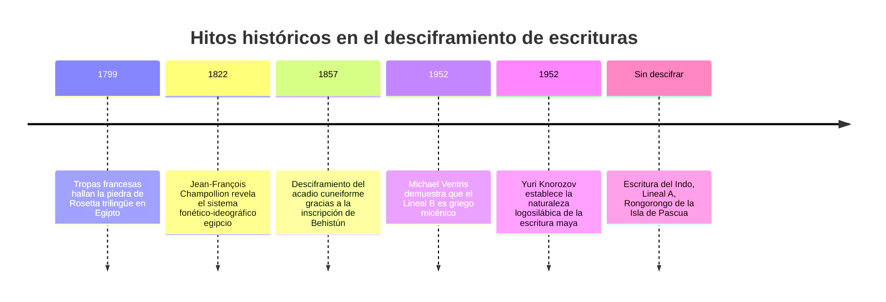
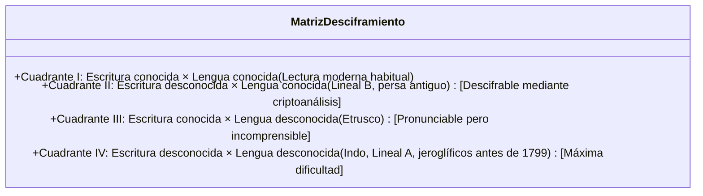

Entre todas las creaciones del ingenio humano, la invención de la escritura ocupa el pináculo más alto. Logró transformar la palabra hablada en un registro físico imperecedero, tendiendo un puente que desafía el paso de los milenios.

Sin embargo, cuando una civilización se derrumba y sus lenguas dejan de hablarse, sus textos se congelan en el silencio. Descifrar una escritura antigua no es un mero pasatiempo: es devolverle la voz y la historia a generaciones de seres humanos sepultadas en el olvido.

---

## 1. Fundamentos matemáticos y taxonomía epigráfica

Todo desciframiento lingüístico se enfrenta a la matriz de la «doble incógnita»:

### Diagnóstico por el inventario de signos:
El recuento estadístico de grafemas distintos determina la tipología del sistema:
- **20 a 40 signos**: Alfabeto o abyad (unidades fonémicas de consonantes y vocales)
- **50 a 100 signos**: Silabario (consonante + vocal), como el Lineal B (87 signos)
- **400 a 1.000 signos**: Sistema mixto logosilábico (ideogramas y signos silábicos), como el maya y egipcio
- **Miles de caracteres**: Logografía pura (morfemas completos), como los caracteres chinos

---

## 2. Las tres grandes victorias históricas

### 2.1 La piedra de Rosetta y los jeroglíficos egipcios
La estela de Rosetta (1799) presentaba un decreto de Ptolomeo V en tres escrituras: jeroglífica, demótica y griego antiguo.
**Jean-François Champollion** descubrió que frente a 486 palabras griegas había 1.419 jeroglíficos, deduciendo que la escritura era fonética. Identificó nombres extranjeros en los cartuchos reales (Ptolomeo, Cleopatra) y, gracias a su dominio del **copto**, descifró nombres nativos como *Ramsés* y *Tutmosis*, desentrañando la gramática de los faraones.

---

### 2.2 El milagro del Lineal B (Alice Kober y Michael Ventris)
Halladas por Arthur Evans en Creta, se creía que las tablillas registraban una lengua «minoica» ajena al griego.
- **Alice Kober** demostró las flexiones gramaticales de las palabras («trillizos de Kober») y diseñó una cuadrícula fonética de consonantes y vocales desconocidas.
- **Michael Ventris**, arquitecto y criptoanalista de la Segunda Guerra Mundial, asignó a la cuadrícula topónimos cretenses (*Knossos*, *Amnisos*). La clave funcionó de inmediato: ¡emergieron palabras en **griego micénico arcaico**, 700 años anterior a Homero!

---

### 2.3 Los glifos mayas (Yuri Knorozov y la caída del telón de acero)
Frente al dogma de que los glifos eran únicamente símbolos místicos, el lingüista soviético **Yuri Knorozov** demostró en 1952 que el sistema era logosilábico. Formuló el **principio de sinharmonía** ($CV_1 + CV_2 = CVC$), donde la vocal final es muda pero repite la primera. Junto a las investigaciones históricas de Tatiana Proskouriakoff, hoy es posible leer más del 90 % de los textos mayas.

---

## 3. Escrituras que siguen desafiando a la ciencia

- **La escritura del Indo**: Más de 4.000 sellos de la civilización de Harappa (2600-1900 a.C.). Con una media de apenas 4,6 signos por inscripción y sin textos bilingües, se debate si representa una lengua dravídica, indoeuropea o símbolos puramente heráldicos.
- **El Lineal A**: Antecesor minoico del Lineal B. Aunque se puede pronunciar con los valores del Lineal B, transcribe una lengua aislada totalmente desconocida.
- **El Rongorongo**: Tablillas de madera de la Isla de Pascua con escritura en bustrófedon inverso. Las incursiones esclavistas peruanas de 1862 extinguieron a toda la élite letrada, condenando la tradición al silencio eterno.
