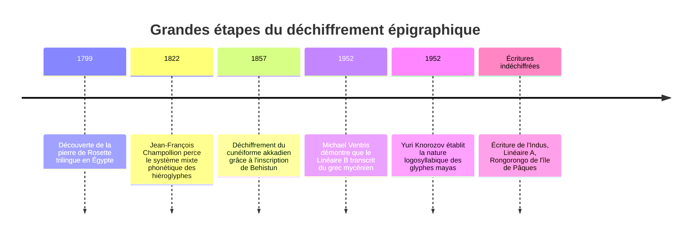
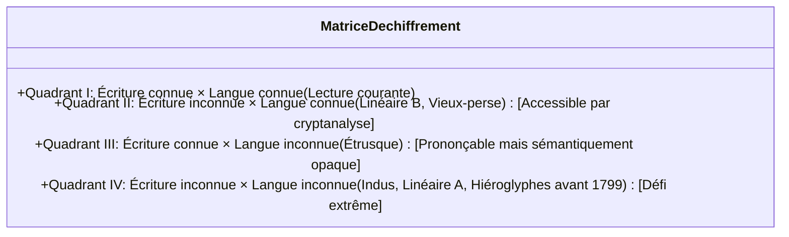

De toutes les créations de l'esprit humain, l'écriture constitue le sommet absolu. Elle a métamorphosé la parole volatile en traces impérissables, créant une passerelle temporelle défiant les millénaires.

Cependant, lorsque les empires s'effondrent et que les locuteurs s'éteignent, les écritures basculent dans le silence. Le déchiffrement des écritures anciennes n'est pas une simple énigme intellectuelle : c'est un acte de résurrection historique qui redonne voix aux peuples oubliés.

---

## 1. Mathématiques et typologie des écritures perdues

Le cryptanalyste linguiste affronte la matrice de la « double inconnue » :

### Le diagnostic par le nombre de signes :
Le simple dénombrement des graphèmes distincts révèle l'architecture profonde d'une écriture :
- **20 à 40 signes** : Alphabet ou abjad (unités phonémiques)
- **50 à 100 signes** : Syllabaire (consonne + voyelle), ex. Linéaire B (87 signes)
- **400 à 1 000 signes** : Système mixte logosyllabique (idéogrammes + compléments phonétiques), ex. Maya et hiéroglyphes
- **Milliers de signes** : Logographie pure (morphèmes entiers), ex. sinogrammes

---

## 2. Les trois grandes victoires de la cryptanalyse historique

### 2.1 La pierre de Rosette et les hiéroglyphes (Champollion)
Découverte en 1799, la stèle de Rosette portait un décret de Ptolémée V en trois écritures : hiéroglyphique, démotique et grec ancien.
**Jean-François Champollion** constata que le texte grec comptait 486 mots pour 1 419 hiéroglyphes. Il en déduisit que l'écriture était largement phonétique. En déchiffrant les cartouches royaux étrangers (Ptolémée, Cléopâtre) puis en s'appuyant sur sa maîtrise du **copte**, il lut les noms de pharaons indigènes comme *Ramsès* et *Thoutmosis*, révélant la grammaire de l'Égypte pharaonique.

---

### 2.2 Le mystère du Linéaire B (Alice Kober et Michael Ventris)
Découvertes en Crète par Arthur Evans, les tablettes d'argile étaient réputées transcrire une mystérieuse langue « minoenne ».
- **Alice Kober** répertoria méticuleusement les déclinaisons grammaticales (« triplets de Kober ») et conçut une grille syllabique croisant consonnes et voyelles inconnues.
- **Michael Ventris**, architecte et ancien décrypteur de la RAF, y inséra des toponymes crétois (*Knossos*, *Amnisos*). Le système s'ouvrit en cascade, révélant une langue indo-européenne familière : du **grec mycénien archaïque**, 700 ans plus ancien qu'Homère !

---

### 2.3 Les glyphes mayas (La percée de Yuri Knorozov)
Face au dogme occidental affirmant que les glyphes n'étaient que des symboles calendaires, le savant soviétique **Yuri Knorozov** démontra en 1952 qu'il s'agissait d'un système logosyllabique. Il identifia la **règle de synharmonie** ($CV_1 + CV_2 = CVC$), où la seconde voyelle est muette mais identique à la première. Conjugué aux découvertes de Tatiana Proskouriakoff, le déchiffrement permit de restituer l'histoire politique des dynasties mayas.

---

## 3. Les forteresses imprenables : Indus et Rongorongo

- **L'écriture de l'Indus** : 4 000 sceaux et tablettes de la civilisation d'Harappa (2600-1900 av. J.-C.). La longueur moyenne n'étant que de 4,6 signes et en l'absence totale de texte bilingue, son statut de véritable langue reste débattu face à la thèse de symboles héraldiques.
- **Le Linéaire A** : Ancêtre minoen du Linéaire B. Bien que lisible phonétiquement, il retranscrit une langue inconnue sans parenté identifiée.
- **Le Rongorongo** : Écriture sur bois de l'île de Pâques en boustrophédon inversé. La capture des lettrés lors des raids esclavagistes péruviens de 1862 a éteint à jamais la tradition orale vivante.
