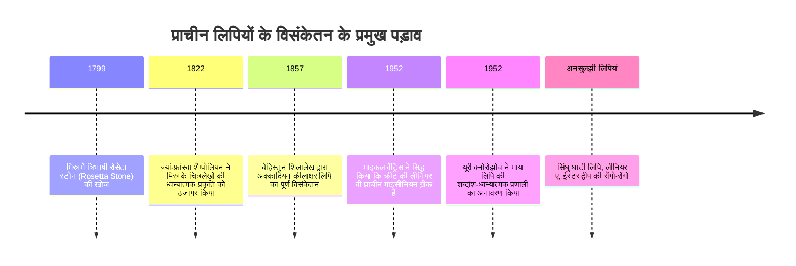
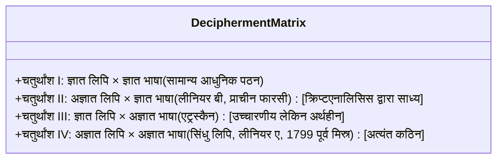

मानव मन के सभी आविष्कारों में लिपि का आविष्कार सर्वोपरि है। इसने क्षणभंगुर बोली जाने वाली भाषा को एक स्थायी भौतिक रूप दिया और सहस्राब्दियों के पार ज्ञान का सेतु बना दिया।

लेकिन जब सभ्यताएं नष्ट हो जाती हैं और उनकी भाषाएं मौन हो जाती हैं, तो लिपियां गूढ़ पहेली बन जाती हैं। प्राचीन लिपियों को पढ़ना केवल अकादमिक पहेली सुलझाना नहीं है, बल्कि इतिहास के अंधकार में दबी मानवीय आवाज़ों को पुनर्जीवित करना है।

---

## 1. लिपि विसंकेतन के गणितीय आधार और वर्गीकरण

विसंकेतन में भाषाविद "दो अज्ञात चरों" का सामना करते हैं:

विशिष्ट प्रतीकों की संख्या लिपि के प्रकार को दर्शाती है:
- **20 से 40 प्रतीक**: वर्णमाला (अकेले स्वर और व्यंजन)
- **50 से 100 प्रतीक**: शब्दांश लिपि (Syllabary: व्यंजन + स्वर), जैसे लीनियर बी (87 प्रतीक)
- **400 से 1,000 प्रतीक**: मिश्रित शब्द-शब्दांश लिपि (Logosyllabic), जैसे माया और मिस्री चित्रलिपि
- **हज़ारों प्रतीक**: शुद्ध चित्रलिपि / भावचित्र

---

## 2. तीन महान ऐतिहासिक विजय

### 2.1 रोसेटा स्टोन और मिस्र की चित्रलिपि (शैम्पोलियन)
**ज्यां-फ्रांस्वा शैम्पोलियन** ने देखा कि 486 ग्रीक शब्दों के मुकाबले 1,419 मिस्री प्रतीक थे, जिससे सिद्ध हुआ कि यह केवल भावचित्र नहीं बल्कि ध्वन्यात्मक वर्ण थे। कार्टूश में विदेशी राजाओं (टॉलेमी, क्लियोपेट्रा) के नाम पढ़कर और **कॉप्टिक भाषा** के ज्ञान के बल पर उन्होंने *रामेसेस* और *थुथमोस* जैसे फराओ के नाम पढ़े।

---

### 2.2 लीनियर बी का रहस्य (एलिस कोबर और माइकल वेंट्रिस)
- **एलिस कोबर** ने व्याकरणिक विभक्तियों की तालिकाओं ("कोबर के ट्रिपलेट्स") से एक 2-आयामी ध्वन्यात्मक ग्रिड बनाया।
- वास्तुकार **माइकल वेंट्रिस** ने क्रीट के प्राचीन नगरों (*नोसॉस*, *अम्निसोस*) के नाम ग्रिड में रखे। अचानक पट्टिकाओं पर होमर से 700 वर्ष पुरानी **माइसीनियन ग्रीक भाषा** के शब्द प्रकट हो गए!

---

### 2.3 माया ग्लिफ़्स (यूरी क्नोरोझोव)
1952 में सोवियत संघ के भाषाविद **यूरी क्नोरोझोव** ने लगभग 800 प्रतीकों के आधार पर सिद्ध किया कि माया लिपि शब्द-शब्दांश प्रणाली है। उन्होंने **सिन्हार्मोनिक स्वर नियम** ($CV_1 + CV_2 = CVC$) खोजा, जिससे आज 90% से अधिक माया शिलालेख पढ़े जा सकते हैं।

---

## 3. अनसुलझी पहेलियां: सिंधु लिपि और रोंगो-रोंगो

- **सिंधु घाटी लिपि**: हड़प्पा सभ्यता (2600-1900 ईसा पूर्व) के 4,000 से अधिक मुहरें। औसत शिलालेख लंबाई केवल 4.6 प्रतीक है और कोई द्विभाषी शिलालेख उपलब्ध नहीं है।
- **लीनियर ए**: लीनियर बी की पूर्वज लिपि, जो एक अज्ञात पृथक भाषा को दर्शाती है।
- **रोंगो-रोंगो**: ईस्टर द्वीप की लकड़ी की पट्टियों पर उत्कीर्ण लिपि, जिसकी पठन परंपरा 1862 के पेरू दास छापों में साक्षर वर्ग की मृत्यु के साथ सदा के लिए लुप्त हो गई।
