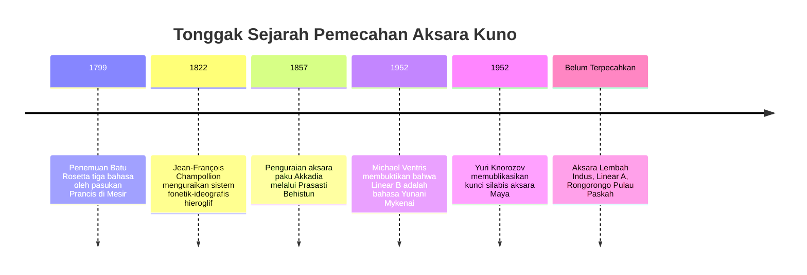
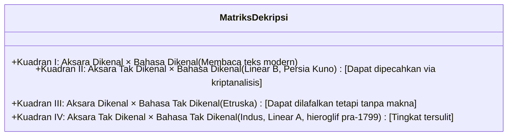

Dari semua ciptaan pikiran manusia, penemuan tulisan adalah puncak paling agung. Tulisan mengubah ucapan lisan yang fana menjadi rekaman fisik abadi, membangun jembatan peradaban melintasi ribuan tahun.

Namun, ketika sebuah peradaban runtuh dan penuturnya punah, aksara tersebut membisu. Memecahkan tulisan kuno bukanlah teka-teki akademis biasa, melainkan tindakan membangkitkan kembali suara sejarah manusia yang terkubur dalam kegelapan.

---

## 1. Landasan Matematis dan Taksonomi Aksara

Kriptanalisis bahasa menghadapi matriks "ganda tak diketahui":

Jumlah grafem unik menentukan jenis aksara:
- **20–40 tanda**: Alfabet atau abjad (satuan fonem)
- **50–100 tanda**: Silabari (konsonan + vokal), seperti Linear B (87 tanda)
- **400–1.000 tanda**: Sistem campuran logosilabis (kata dan suku kata), seperti hieroglif dan Maya
- **Ribuan tanda**: Logografi murni (morfem utuh)

---

## 2. Tiga Kemenangan Bersejarah

### 2.1 Batu Rosetta dan Hieroglif Mesir
Batu Rosetta memuat dekret Ptolemaios V dalam aksara hieroglif, demotik, dan Yunani Kuno. **Jean-François Champollion** membandingkan 486 kata Yunani dengan 1.419 hieroglif, membuktikan sifat fonetiknya. Berbekal penguasaan **bahasa Koptik**, ia membaca nama firaun *Ramesses* dan *Thutmose*.

---

### 2.2 Misteri Linear B (Alice Kober dan Michael Ventris)
- **Alice Kober** memetakan infleksi tata bahasa ("Triplet Kober") dan membangun kisi fonetik silabis dua dimensi.
- **Michael Ventris**, arsitek dan mantan pemecah kode Perang Dunia II, memasukkan nama tempat di Kreta (*Knossos*, *Amnisos*). Tiba-tiba teks tersebut terbaca sebagai **bahasa Yunani Mykenai**, 700 tahun lebih tua dari epos Homer!

---

### 2.3 Glif Maya (Yuri Knorozov)
Pada tahun 1952 di Leningrad, **Yuri Knorozov** membuktikan aksara Maya bersifat logosilabis dengan **hukum vokal sinharmonik** ($CV_1 + CV_2 = CVC$). Bersama riset sejarah dinasti oleh Tatiana Proskouriakoff, lebih dari 90% teks Maya kini dapat dibaca sempurna.

---

## 3. Misteri yang Belum Terpecahkan: Indus dan Rongorongo

- **Aksara Lembah Indus**: Lebih dari 4.000 cap peradaban Harappa (2600–1900 SM). Rata-rata panjang inskripsi hanya 4,6 tanda dan tanpa teks dwibahasa, memicu debat apakah ini bahasa Dravida atau simbol non-bahasa.
- **Linear A**: Aksara Minoa leluhur Linear B, mewakili bahasa isolat tak dikenal.
- **Rongorongo**: Papan kayu Pulau Paskah berformat bustrofedon terbalik, yang tradisi membacanya musnah pada tahun 1862 akibat perbudakan Peru.
