人類が誕生させたあらゆる発明の中で、最も偉大なものは「文字（Script）」です。文字の発明によって、人類の知識や思想、法律、神話は、個人の肉体の死や地理的距離という物理的限界を超え、数千年の時を越えて未来へと伝達される**「時間のタイムカプセル」**となりました。

しかし、文明が崩壊し、その言語を話す人々が途絶えたとき、文字は沈黙します。石碑に刻まれた奇妙な幾何学模様、粘土板に穿たれた無数の引っかき傷、古木に刻まれた謎の記号――それらは、解読の鍵が失われた瞬間、誰にも開けられない「暗号」へと姿を変えてしまうのです。

古代文字の解読とは、単なる学術的好奇心のパズルではありません。それは、数千年の暗闇に葬られた古代人の肉声、歴史の悲劇、愛や信仰の告白を再びこの地上に響かせる、人類の知性が成し遂げ得る最もスリリングな冒険です。

本稿では、文字解読の言語学的・暗号解読的メカニズムから、人類史に輝く「三大解読勝利史」（エジプト神聖文字・線文字B・マヤ文字）、そしてインダス文字や線文字A、ロンゴロンゴなど現代のAIをもってしても未だ突破できない「未解読文字の深淵」まで、文字と文明の壮大なドラマを徹底解明します。

---

## 1. 文字解読の数理と言語学的メカニズム

文字を解読する作業は、情報理論や軍事暗号解読（クリプトアナリシス）と極めて近しい数学的構造を持っています。

### 1.1 「二重の未知」という壁

失われた文字の解読に挑む際、研究者は**「表記体系（文字）」**と**「背後にある言語（文法・語彙・音韻）」**という2つの変数の組み合わせに直面します。

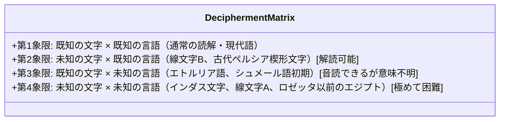

- **未知の文字 $\times$ 既知の言語（第2象限）**:
  文字の読み方（音価）さえ特定できれば、既知の言語（例えば古代ギリシャ語やセム語）の文法・辞書を適用することで、一気に意味が氷解します（例：線文字B）。
- **既知の文字 $\times$ 未知の言語（第3象限）**:
  文字自体はギリシャ文字やラテン文字に似ているため「声に出して読む」ことはできますが、その言語の系統が孤立しているため、何を言っているのか意味が分かりません（例：古代イタリアのエトルリア語）。
- **未知の文字 $\times$ 未知の言語（第4象限）**:
  文字の形も発音も分からず、背後にある言語の系統すら不明という最悪の状況です。これを突破するには、同一内容を既知の言語と併記した**「多言語対訳碑文（バイリンガル）」**の発見か、天文学的な統計解析が不可欠となります。

---

### 1.2 文字体系の判別：文字数による類型論

暗号解読官が暗号文の長さや文字頻度を調べるのと同様に、言語学者が未知の文字に遭遇した際、最初に数えるのが**「使われている異なり記号数（文字種数）」**です。この記号数だけで、その文字体系がどのような原理で作られているかが数学的に判明します。

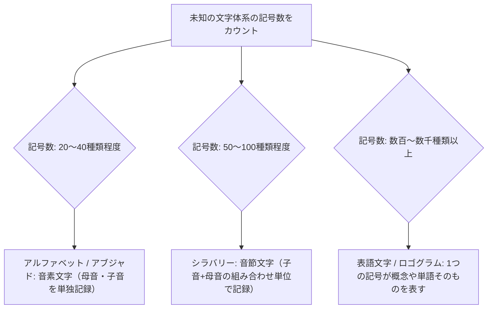

| 文字体系 | 典型的な記号数 | 情報表現の単位 | 代表例 |
| :--- | :--- | :--- | :--- |
| **音素文字（Alphabet / Abjad）** | 20 〜 40 種類 | 単一の母音または子音（音素） | ラテン文字（26）、フェニキア文字（22）、ハングル（24基本字母） |
| **音節文字（Syllabary）** | 50 〜 100 種類 | 子音＋母音（CV音節など） | 日本の仮名（約50）、線文字B（87記号）、チェロキー文字（85） |
| **表語・音節混合文字** | 400 〜 1,000 種類 | 単語概念（表語）＋補助的音節記号 | マヤ文字（約800）、ヒエログリフ（約700〜1,000） |
| **純粋表語文字** | 数千 〜 数万 種類 | 単語や形態素 | 漢字（常用漢字2,136、大漢和辞典5万字超） |

---

### 1.3 ジップの法則（Zipf's Law）と情報エントロピー

自然言語のテキストにおいて、単語の出現頻度 $f(r)$ は、その頻度順位 $r$ に反比例するという普遍的な法則（**ジップの法則**）が成り立ちます。

$$f(r) \propto \frac{1}{r^s} \quad (s \approx 1)$$

両辺の対数をとると：

$$\ln f(r) = -s \ln r + C$$

両対数グラフにプロットしたとき、傾きが約 $-1$ の直線に乗る場合、その記号列は「自然言語」としての統計的特性を備えています。逆に、ランダムな記号や装飾文様、単なる宗教的シンボル群はジップの法則から大きく逸脱します。現代のインダス文字論争でも、このジップの法則や条件付きエントロピー解析が主戦場となっています。

---

## 2. 偉大なる解読の三大勝利史

### 2.1 ロゼッタストーンと古代エジプト文字（ヒエログリフ）

紀元後4世紀、エジプトがキリスト教化されると、異教の象徴とみなされたヒエログリフ（神聖文字）の読み手は途絶え、1400年もの間、完全な沈黙に包まれました。「エジプト文字は神秘的な霊的真理を象徴した純粋な絵文字であり、発音とは無関係である」というホラポロの誤った解釈が中世から近世の学者を長く惑わせました。

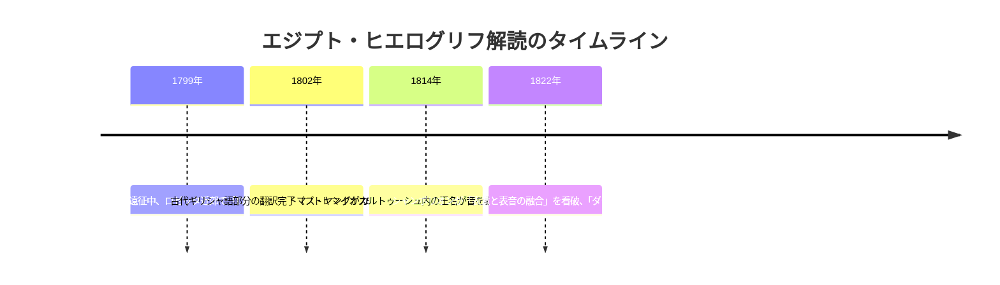

#### ロゼッタストーンの奇跡
1799年、ナポレオン軍の工兵士官ブシャールが港湾要塞の改築中に発見した漆黒の玄武岩（花崗閃緑岩）板――**ロゼッタストーン**には、同一の勅令（前196年のプトレマイオス5世の徳政令）が3つの書体で刻まれていました：
1. **神聖文字（ヒエログリフ）**: 神官や神殿碑文用の公式文字
2. **民用文字（デモティック）**: 当時の民衆が日常的に使っていた簡略筆記体
3. **古代ギリシャ文字**: 当時の支配階級（プトレマイオス朝）の言語

ギリシャ語が読めたため、テキストの「意味」は最初から分かっていました。問題は、ヒエログリフのどの記号がギリシャ語のどの単語に対応するのかという点でした。

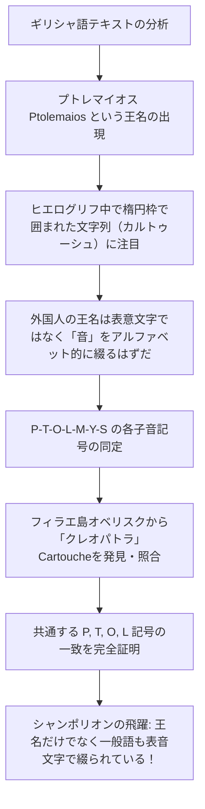

#### シャンポリオンの天才的飛躍
フランスの天才言語学者**ジャン＝フランソワ・シャンポリオン（Jean-François Champollion、1790–1832）**は、幼少期からコプト語（古代エジプト語がギリシャ文字を取り入れて生き残った典礼言語）を母国語のように操ることができました。

シャンポリオンは、ヒエログリフのテキスト全体の記号数を数え上げました。ギリシャ語テキストが486語であるのに対し、ヒエログリフの記号は1,419個もありました。もしヒエログリフが「1文字＝1語」を表す純粋な表意文字なら記号数は486個程度のはずです。1,419個もあるということは、**「文字の多くはアルファベットのような音素・音節を表す表音文字でなければならない」**という決定的な数学的帰結に達したのです。

1822年9月14日、アブ・シンベル神殿の写本を分析していたシャンポリオンは、太陽の絵（コプト語で「ラー：$Ra$」）＋未知の記号＋2つの $s$ 記号（既知）という文字列を発見しました。
「ラー ＋ ？ ＋ ス ＋ ス」……古代エジプトの偉大なるファラオ、**ラメセス（Ramesses：ラーが生み出した者）**！
続くカルトゥーシュでは、トキの鳥（知恵の神トート：$Thoth$）＋未知の記号＋$s$……**トトメス（Thutmose）**！

「わかったぞ！（Je tiens mon affaire!）」と叫んだシャンポリオンは、兄の部屋に駆け込んだ直後に卒倒し、数日間の昏睡状態に陥ったと伝えられます。ヒエログリフは、**「一連のテキストの中で、形象的であり、象徴的であり、かつ表音的であるという、同一の文において同時に機能する複雑な体系」**であったのです。

---

### 2.2 線文字Bの解読：20世紀言語学の奇跡

1900年、イギリスの考古学者アーサー・エヴァンズはクレタ島のクノッソス宮殿を発掘し、ホメロスのトロイア戦争の時代よりはるかに遡る青銅器時代の粘土板文書を大量に発見しました。そこには3種類の未知の文字が記されていました：
- **クレタ聖刻文字（絵文字）**
- **線文字A（Linear A）**: 前18世紀〜前15世紀
- **線文字B（Linear B）**: 前14世紀〜前12世紀

エヴァンズは「この文字はギリシャ語とは全く無関係な、未知のミノア民族の非印欧語である」と信じ込み、その権威によって学会は半世紀近く袋小路に入り込みました。

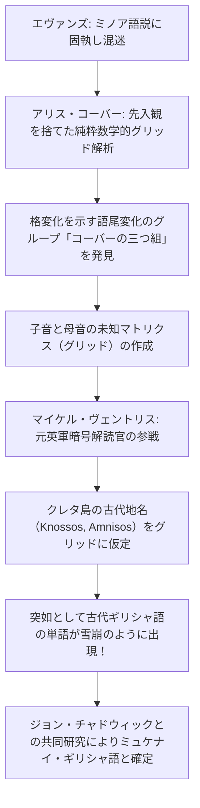

#### アリス・コーバーの孤独なグリッド解析
ブルックリン大学の古典学者**アリス・コーバー（Alice Kober、1906–1950）**は、一切の先入観を排し、文字が何を意味するかの推測を拒絶して、記号の出現パターンの純粋な形態素解析を行いました。彼女は、特定の単語が語尾の記号だけを規則的に変化させていることを見抜きました（**コーバーの三つ組: Kober's Triplets**）。

屈折語（ラテン語やギリシャ語など）では、語幹の子音を保ったまま格変化によって母音（主格、対格、属格など）が変わります。
たとえば語幹が $-k-$ で終わる単語の語尾が $-o, -e, -a$ と変化するとき、音節文字（CV）で書けば、語尾の文字記号はそれぞれ $[ko], [ke], [ka]$ という「子音は共通で母音が異なる別の文字」になります。
コーバーはこの論理を用いて、**「音価は不明だが、同じ子音を共有する記号グループ」と「同じ母音を共有する記号グループ」を二次元マトリクス（グリッド）に整理する手法**を考案しました。コーバーは43歳の若さで病没しますが、このグリッドこそが解読の決定的な発射台となりました。

#### 建築家マイケル・ヴェントリスの電撃解読
イギリスの若き建築家であり、第二次世界大戦中に暗号解読の経験を積んだ**マイケル・ヴェントリス（Michael Ventris、1922–1956）**は、コーバーのグリッドを引き継ぎました。

ヴェントリスは、粘土板の出土頻度から、ある特定の単語群がクレタ島の「地名」を表しているのではないかという仮説を立てました。
もしある記号列が、クノッソスの港町である**「アムニソス（A-MI-NI-SO）」**や、宮殿の所在地**「クノッソス（KO-NO-SO）」**、**「トゥリッソス（TU-LI-SO）」**であるならば、グリッドの該当セルに具体的な子音と母音を代入できます。

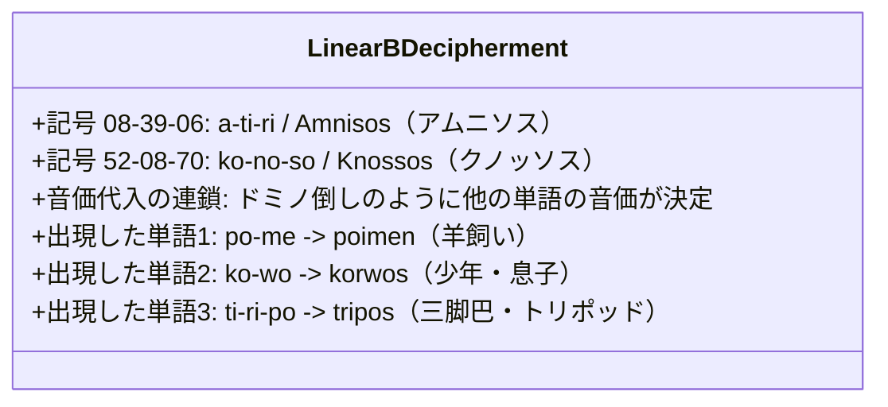

代入した瞬間、奇跡が起きました。現れた文字列は、未知のミノア語などではなく、ホメロスの叙事詩『イリアス』より700年も古い、**最古のアルカイックなギリシャ語（ミュケナイ・ギリシャ語）そのものだった**のです！

1952年7月1日、BBCラジオに出演したヴェントリスは「線文字Bはギリシャ語である」と発表し、世界中の言語学界を震撼させました。惜しくもヴェントリスは解読のわずか数年後、34歳の若さで自動車事故により世を去りましたが、彼の業績は「言語学のエベレスト登頂」として永遠に語り継がれています。

---

### 2.3 マヤ文字の解読：冷戦の鉄のカーテンを越えた革命

メソアメリカの密林に聳え立つティカルやパレンケの巨大ピラミッド。そこに刻まれた複雑怪奇なマヤの石碑文字は、16世紀のスペイン人宣教師ディエゴ・デ・ランダによる苛烈な異端審問と焚書により、数千冊に及ぶ樹皮紙のマヤ絵文書（コデックス）が焼き払われ、灰燼に帰しました。

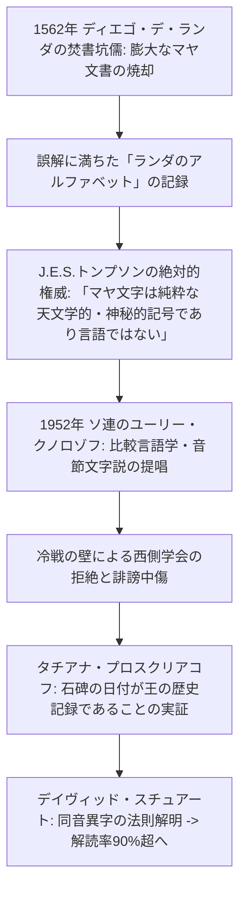

#### ランダの錯誤
ランダ司教はマヤ貴族を拷問しながら「マヤのアルファベット」を聞き取ろうとしました。「A」を発音させ、マヤ人が描いた記号を記録しました。しかしマヤ語はアルファベットではなく音節文字だったため、ランダが「A（アー）」と言ったとき、マヤ人は亀（ac）の絵文字を描き、「B（ベー）」と言ったとき、道（be）の音節を描いていたのです。この相互不理解による「ランダのアルファベット」は、後世の学者たちを「使い物にならない偽文書」として混乱させました。

#### ユーリー・クノロゾフの鉄槌
第二次世界大戦末期、燃え盛るベルリンの国立図書館からマヤ絵文書の複製本を救い出したソ連の若き言語学者**ユーリー・クノロゾフ（Yuri Knorozov、1922–1999）**は、モスクワで鉄のカーテンの向こうからマヤ文字に挑みました。

クノロゾフは明晰な統計的論理を展開しました。マヤ文字には約800種類の記号が存在します。これは純粋なアルファベット（数十字）にしては多すぎ、純粋な漢字のような表語文字（数千〜数万字）にしては少なすぎます。したがって、マヤ文字はヒエログリフや日本の仮名交じり文と同様に、**「表語文字（ロゴグラム）」と「音節文字（シラバリー）」を組み合わせた複合文字体系**でなければならないと看破したのです。

クノロゾフは、マヤ語（ユカテコ語）の単語が主に「子音＋母音＋子音（CVC）」の構造を持つことに着目しました。マヤ人はこの単語を、2つの「子音＋母音（CV）」の音節文字を組み合わせて表記していました。

$$\text{CVC} = \text{CV}_1 + \text{CV}_2 \quad (\text{ただし } V_2 \text{ は発音しない無音母音})$$

このとき、**2つ目の音節文字の母音は1つ目の母音と一致させる（調和母音則: Synharmonic Vowel Rule）**という美しい法則を発見したのです。

```mermaid
flowchart LR
    subgraph クノロゾフの調和母音則の例: 七面鳥（tzu-tul -> tzutul）
        Tzu[音節文字: tzu] --> Plus[+]
        Lu[音節文字: lu （母音uは読まない）] --> Result[単語: tzul （犬）]
    end
    subgraph ジャガー（balam）の表記の多様性
        Logogram[表語文字: BALAM（ジャガーの頭）]
        Mixed[表語文字 + 音符: BALAM + ba + ma]
        Phonetic[純粋な音節文字: ba-la-ma]
    end
```

西側の学会を支配していた大権威エリック・トンプソンは「共産主義のプロパガンダ」としてクノロゾフを猛烈に攻撃しましたが、真実は揺らぎませんでした。ロシア出身の女性考古学者タチアナ・プロスクリアコフによる石碑の歴史性証明、そして天才少年デイヴィッド・スチュアートによる同音異字（同じ音を全く異なるデザインの絵文字で自在に書き分けるマヤ書記の美意識）の解明により、現在マヤ文字の90%以上が正確に読解できるようになっています。

---

## 3. 未だ人類を拒み続ける未解読文字の深淵

偉大な勝利の一方で、現代の最先端コンピュータやAIをもってしても、未だに1行すら解読できない謎の古代文字が地球上には存在します。

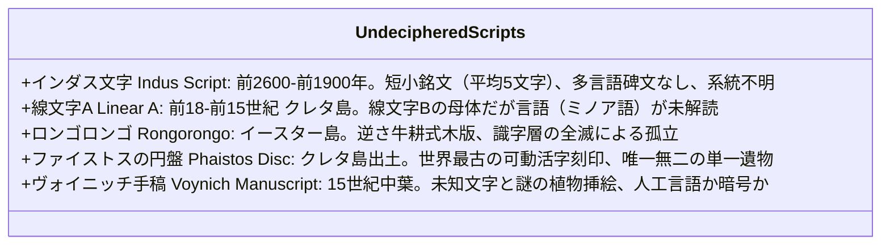

---

### 3.1 インダス文字（Indus Script）：古代四大文明最大の謎

紀元前2600年〜紀元前1900年頃、パキスタンから北西インドに栄えたインダス文明（ハラッパー、モヘンジョダロ）。上下水道が完備された碁盤目状の巨大都市を建設しながら、彼らが残した文字は未だ解読されていません。

#### 解読を阻む3つの障壁：
1. **銘文の極端な短さ**:
   出土した約4,000点に及ぶ石製印章や銅板の碑文のうち、1つの銘文に含まれる文字数は**平均わずか5文字程度**、最長のものでも26文字しかありません。文脈や文法を特定するための統計的サンプル長が決定的に不足しています。
2. **多言語併記碑文（バイリンガル）の完全な不在**:
   ロゼッタストーンのような他言語との対訳資料が1点も発見されていません。メソポタミアとの貿易が行われていたにもかかわらず、楔形文字との対訳板は未だ見つかっていません。
3. **言語系統の不確定性**:
   インダス文明の人々が話していた言語が、南インドの「ドラヴィダ語族」の祖先なのか、アーリア人の「インド・ヨーロッパ語族（サンスクリット祖語）」なのか、あるいは完全に消滅した孤立言語（ムンダ語族や未知の言語）なのか、激しい論争が続いています。

2004年、計算機科学者のスティーブ・ファーマーらは「インダス文字は言語（音声を写した文字）ではなく、氏族や宗教、職業を表す非言語的な政治・宗教シンボル記号にすぎない」という過激な**非言語説（Non-linguistic Hypothesis）**を提唱し、世界的な大論争を巻き起こしました。

---

### 3.2 線文字A（Linear A）：ミノア王国の失われた声

線文字Bの解読に成功した人類ですが、その直接の母体である**線文字A**は未だ読めません。

粘土板の会計記録（数字や度量衡、麦やオリーブオイルを表す表語文字）の構造は判明しており、線文字Bの音価をそのまま線文字Aの記号に当てはめることである程度「発音」することは可能です。しかし、発音してみても、そこに現れる単語（例：`KU-RO`＝合計？、`KI-RO`＝不足？）は、ギリシャ語でもセム語でもインド・ヨーロッパ語でもない、**完全に未知の「ミノア語」**であり、意味の確定には至っていません。

---

### 3.3 ロンゴロンゴ（Rongorongo）：孤島に消えた鳥人たちの記録

太平洋の絶海の孤島、イースター島（ラパ・ヌイ）。モアイ像で知られるこの島には、**「ロンゴロンゴ」**と呼ばれる幾何学的な人間、鳥、魚、植物を象った記号がびっしりと刻まれた木板が残されています。

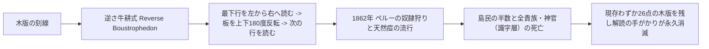

ロンゴロンゴは**「逆さ牛耕式（Reverse Boustrophedon）」**という特異な書式で刻まれており、行末まで読むと板を天地逆さまに180度回転させて次の行を読み進める構造を持っています。1862年、ペルーの奴隷略奪船が島を襲い、文字を読み書きできた王族や神官を含む知識階級全員を連れ去り、天然痘で全滅させたため、文字を読む伝統は完全に絶滅しました。現存する資料が世界各地の博物館に散逸したわずか26点しか存在しないことも、統計的解読を極めて困難にしています。

---

### 3.4 ヴォイニッチ手稿とファイストスの円盤

- **ヴォイニッチ手稿（Voynich Manuscript）**:
  1912年に古書商ウィルフリッド・ヴォイニッチがイタリアで発見した羊皮紙写本（放射性炭素年代測定により15世紀初頭の作と判明）。未知の文字で書かれた精緻な文章の周囲に、実在しない奇怪な植物、占星術の天体図、緑色の液体に浸かる裸の女性群が描かれています。単語の出現頻度はジップの法則に完璧に従っており、精巧な人工言語説、洗練された換字暗号説、あるいはルネサンス期の天才詐欺師による偽書説が今なお激突しています。
- **ファイストスの円盤（Phaistos Disc）**:
  クレタ島南部のファイストス宮殿から出土した直径約16cmの粘土製円盤。表裏両面に渦巻状に45種類の絵文字記号が刻まれています。最大の驚異は、これが手書きではなく**「文字の形を彫ったスタンプ（印章）を粘土に押し付けて印字されている」**という点です。活版印刷を3000年先取りした技術ですが、類似の碑文が他に1点も存在しない（ハパックス・レゴメノン）ため、真の文字なのか、ボードゲームの盤面なのかすら決定打がありません。

---

## 4. 人工知能（AI）と計算言語学が拓く新地平

近年、未解読文字の領域に**深層学習（ディープラーニング）と大規模言語モデル（LLM）**の技術が急速に投入されています。

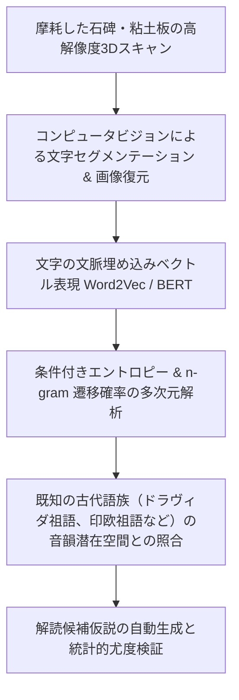

MIT（マサチューセッツ工科大学）の研究チームは、線文字Bの解読プロセスをモデル化し、ウガリット語やフェニキア文字を既知の近縁言語と教師なし学習（Unsupervised Machine Translation）で自動マッピングし、高精度で文字対応を再発見させるアルゴリズムを開発しました。

しかし、AIであっても**「インダスの銘文があまりに短く、データ量が不足している問題」**や、**「背後の言語が完全に未知である問題」**を魔法のように解決することはできません。文字を解読するための最後の鍵は、常に**「泥まみれの考古学者が掘り出す新たな一枚のバイリンガル粘土板」**にかかっているのです。

---

---

## 5. メソポタミア楔形文字の解読史：ベヒストゥン碑文の断崖

ロゼッタストーンと並び称されるもう一つの偉大な多言語碑文が、イラン西部のケルマーンシャー近郊、地上100メートルの垂直な断崖絶壁に刻まれた**「ベヒストゥン碑文（Behistun Inscription）」**です。

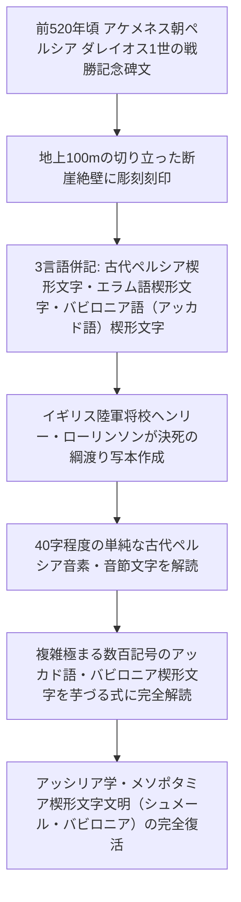

### 5.1 ローリンソンの命がけの転写作業
イギリス陸軍の将校であった**ヘンリー・ローリンソン（Henry Rawlinson、1810–1895）**は、1830年代から1840年代にかけて、命綱一本で断崖絶壁に身を乗り出し、何ヶ月もかけて楔形文字の精密な紙型（スクイーズ）と写本を作成しました。

ベヒストゥン碑文には、アケメネス朝ペルシアのダレイオス1世の業績が3つの言語で記されていました：
1. **古代ペルシア語**: 約40文字の極めて単純な音素・音節文字体系。
2. **エラム語**: 100文字程度の音節文字体系。
3. **バビロニア語（アッカド語）**: 数百種類の記号からなる複雑極まる表語・音節混合体系。

ローリンソンらは、まず文字数が少なく構造が明快な「古代ペルシア語」をアヴェスター語やサンスクリット語の知識を手がかりに解読しました。そしてその王名や人名（ダレイオス、クセルクセス、キュロスなど）を足がかりに、難攻不落とされたバビロニア語楔形文字を攻略しました。これにより、バビロニア、アッシリア、そして人類最古の文学『ギルガメシュ叙事詩』や『ハンムラビ法典』が3000年の眠りから目覚めることとなったのです。

---

## 6. 音読できるが意味が分からない悲劇：エトルリア語の壁

古代ローマが勃興する以前、イタリア半島中部で洗練された青銅器・陶器文化を築いていた**エトルリア人（Etruscans）**。彼らが残した「エトルリア文字」は、解読の難しさにおいて特異な位置を占めています。

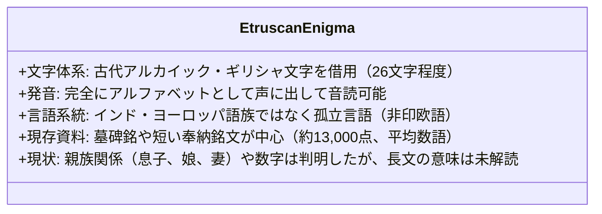

エトルリア文字はギリシャ文字から派生したアルファベットであるため、**「誰でも現代のローマ字のようにスラスラと音読できる」**のです。しかし、エトルリア語はラテン語やギリシャ語などのインド・ヨーロッパ語族とは全く血縁関係を持たない孤立した古代言語でした。
出土する碑文の大多数が「〜の息子、〜の墓」といった短い定型文ばかりであるため、包括的な文法や複雑な語彙を復元することができず、「音は聞こえるが、何を言っているのか理解できない」というもどかしい状態が今も続いています。

---

## 7. 「文字」の定義を揺るがすインカ帝国のキープ（Quipu）

「文字とは、二次元の平面に描かれた視覚的記号でなければならないのか？」

この近代言語学の暗黙の前提を根底から覆すのが、南米アンデス山脈を支配したインカ帝国（タワンティンスーユ）の情報記録媒体**「キープ（Quipu: 結縄）」**です。

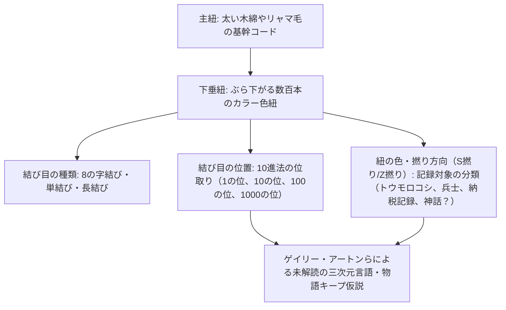

インカ帝国は、車輪も鉄器も持たず、二次元の書き言葉文字体系を一切持たなかったとされてきました。しかし、彼らは原色に染められたリャマやアルパカの毛、木綿の紐に精緻な結び目を施した「キープ」によって、帝国の人口調査、穀物備蓄、税の徴収、さらには歴史の年代記や神話を完全に記録・伝達していました。

ハーバード大学の人類学者ゲイリー・アートン（Gary Urton）らの研究により、キープの結び目（10進法）だけでなく、**紐の色、撚り方向（S撚り/Z撚り）、結び目の向きの組み合わせ（7ビットのバイナリコードに匹敵する情報量）**によって、数字だけでなく固有名詞や物語が記録されていた可能性が強く示唆されています。キープは、人類が考案した唯一無二の**「三次元・触覚的テキスト」**であり、その全貌の解明は今も続けられています。

## 8. まとめ：文字が繋ぐ人類の記憶

失われた文字の解読史は、人間精神の不屈の粘り強さを証明する歴史そのものです。

1. **先入観の破壊**: シャンポリオン、コーバー、ヴェントリス、クノロゾフ――すべての偉大な解読者は、当代の「定説」や権威者の思い込みを粉砕することからスタートした。
2. **論理と直観の融合**: 厳密な統計的文字頻度分析と、地名や神名の閃きが組み合わさった瞬間にのみ、文字の扉は開かれる。
3. **人類の対話**: 文字を解読することは、数千年の時を超えて、名もなき古代の書記や王たちの息遣いに直接触れる、もっとも純粋な知的情熱である。

地中に眠る未解読の文字たちは、今この瞬間も、自らの記憶を蘇らせてくれる次なる解読者の出現を静かに待ち続けています。
