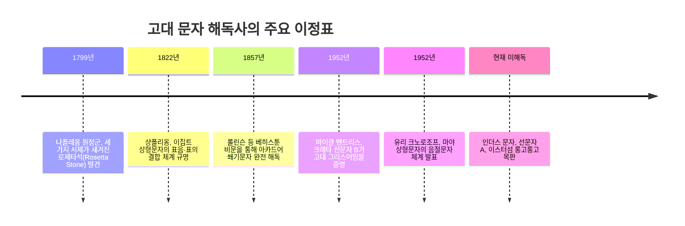
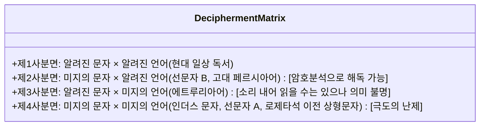

인류가 이룩한 모든 발명 중 가장 위대한 것은 바로 '문자(Script)'입니다. 문자의 탄생을 통해 인간의 지식, 법률, 신화, 철학은 한 개인의 유한한 수명과 지리적 한계를 넘어 수천 년의 시간을 관통하는 타임캡슐이 되었습니다.

그러나 문명이 멸망하고 그 언어를 구사하던 민족이 사라질 때, 문자는 침묵에 빠집니다. 거대한 신전 벽에 새겨진 기묘한 그림, 점토판에 새겨진 무수한 쐐기 자국, 절해고도 목판의 기괴한 기호들은 해독의 열쇠가 사라진 순간 그 누구도 풀 수 없는 '암호'로 변합니다.

고대 문자 해독은 단순한 학술적 퍼즐이 아닙니다. 그것은 수천 년 동안 암흑 속에 묻혀 있던 고대인들의 육성과 고백, 역사의 진실을 오늘날에 되살려내는 인류 지성의 가장 위대한 모험입니다.

---

## 1. 고대 문자 해독의 수학적 기초와 체계론

암호 해독학과 정보이론의 관점에서 볼 때 고대 문자의 해독은 **'문자 체계'**와 **'배후 언어'**라는 두 변수의 조합에 직면합니다.

### 기호 수에 따른 문자 체계 진단:
- **20 ~ 40개 내외**: 음소문자 (알파벳 체계, 자음 및 모음 단독 기록)
- **50 ~ 100개 내외**: 음절문자 (Syllabary, 자음+모음 음절 단위, 예: 선문자 B, 일본어 가나)
- **400 ~ 1,000개 내외**: 표의·음절 혼합문자 (마야 문자, 이집트 성각문자)
- **수천 ~ 수만 개**: 표어문자 (한자)

---

## 2. 문자 해독사의 3대 위대한 승리

### 2.1 로제타석과 이집트 상형문자 (샹폴리옹의 비약)
1799년 발견된 로제타석에는 프톨레마이오스 5세의 칙령이 성각문자, 민중문자, 고대 그리스어 3가지 서체로 병기되어 있었습니다.
프랑스의 천재 언어학자 **장프랑수아 샹폴리옹(Jean-François Champollion)**은 그리스어 단어가 486개인 반면 성각문자 기호는 1,419개에 달한다는 통계적 사실을 통해, 상형문자가 순수 표의문자가 아닌 **표음문자**가 섞여 있음을 간파했습니다.
카르투슈(타원형 테두리) 속 파라오의 이름(프톨레마이오스, 클레오파트라)을 분석하고, 고대 이집트어의 직계 후손인 **콥트어**를 무기로 삼아 람세스(Ramesses)와 투트모세(Thutmose)를 읽어내며 1822년 해독에 성공했습니다.

---

### 2.2 선문자 B의 기적 (앨리스 코버와 마이클 벤트리스)
아서 에번스는 크레타섬 크노소스 점토판의 선문자 B가 비(非)그리스계 '미노아어'라는 독단에 빠져 있었습니다.
- 미국의 **앨리스 코버(Alice Kober)**는 선입견 없이 단어들의 어미 변화를 정밀 추적하여 굴절 격변화를 나타내는 '코버의 삼조(Kober's Triplets)'를 발견하고, 모음과 자음을 대조하는 2차원 음가 격자판(Grid)을 고안했습니다.
- 암호 해독관 출신 건축가 **마이클 벤트리스(Michael Ventris)**는 크레타섬의 고대 지명(암니소스, 크노소스)을 격자판에 대입했습니다. 그 순간 점토판 속에서 호메로스보다 700년 앞선 **미케네 그리스어** 단어들이 쏟아져 나오며 1952년 해독이 완성되었습니다.

---

### 2.3 마야 상형문자 (철의 장막을 넘어선 크노로조프)
스페인의 정복과 디에고 데 란다 주교의 분서로 파괴되었던 마야 문자는 에릭 톰슨 등에 의해 비언어적 종교 기호로 왜곡되어 있었습니다.
1952년 레닌그라드의 소련 언어학자 **유리 크노로조프(Yuri Knorozov)**는 약 800개의 기호 수로부터 마야 문자가 음절·표어 복합문자임을 수학적으로 증명했습니다. 그는 두 개의 CV 음절문자가 합쳐져 하나의 CVC 단어를 이루며 두 번째 모음은 묵음이 된다는 **조화모음 법칙(Synharmonic Rule)**을 밝혀냈고, 타티아나 프로스쿠리아코프의 왕조 역사 실증과 결합하여 마야 문자의 90% 이상이 해독되었습니다.

---

## 3. 침묵하는 미지의 문자들

- **인더스 문자 (Indus Script)**: 기원전 2600~1900년 하라파·모헨조다로의 인장 문자. 출토된 4,000여 점의 명문 평균 길이가 4.6자에 불과하고 이중언어 비문이 전무하여 드라비다어족설, 인도아리아어족설, 비언어 기호설이 팽팽히 맞서고 있습니다.
- **선문자 A (Linear A)**: 선문자 B의 모체이지만 배후의 '미노아어'가 계통을 알 수 없는 고립어라 음독은 가능하나 의미 파악이 불가능합니다.
- **롱고롱고 (Rongorongo)**: 이스터섬의 독특한 역우경식(Reverse Boustrophedon) 목판 문자. 1862년 페루 노예 사냥으로 문자를 읽을 줄 알던 왕족과 사제층이 전멸하면서 영원한 침묵 속에 갇혔습니다.
---

## 4. 베히스툰 비문과 쐐기문자, 그리고 잉카의 키푸

로제타석에 필적하는 또 하나의 위대한 다언어 기념비는 이란 서부 수직 절벽에 새겨진 **베히스툰 비문(Behistun Inscription)**입니다. 영국 장교 헨리 롤린슨은 밧줄에 매달려 탁본을 떴으며, 다리우스 1세의 업적이 고대 페르시아어, 엘람어, 바빌로니아(아카드)어 3개 언어로 기록되어 있었습니다. 단순한 고대 페르시아어를 디딤돌 삼아 복잡한 아카드어 쐐기문자를 완전 해독함으로써 3,000년 동안 잊혔던 《길가메시 서사시》와 《함무라비 법전》이 부활했습니다.

아울러 문자 없이 매듭의 굵기, 색상, 꼬임 방향으로 방대한 제국 통계와 역사를 기록했던 잉카 제국의 **키푸(Quipu, 결승문자)**는 '인간의 언어 기록 체계란 무엇인가'라는 근본적인 질문을 오늘날에도 던지고 있습니다.
### 4.2 파이스토스 원반과 보이니치 필사본
크레타섬에서 출토된 파이스토스 원반(Phaistos Disc)은 인류 최초의 활자 도장 압인 기술을 보여주지만, 비교할 다른 유물이 전혀 없는 고립된 단일 유물이라 해독이 불가능합니다. 15세기의 보이니치 필사본(Voynich Manuscript)은 지프의 법칙을 완벽히 따르는 미지의 문자와 기묘한 식물 그림으로 가득 차 있으며, 정교한 인공 언어인지, 복잡한 환자 암호인지, 르네상스 시대의 위작인지 여전히 논쟁이 계속되고 있습니다.
