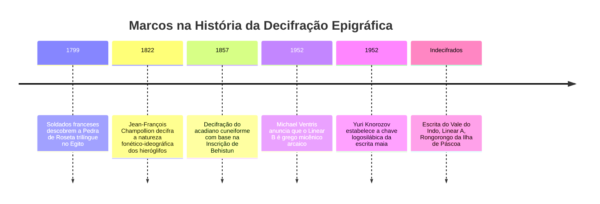
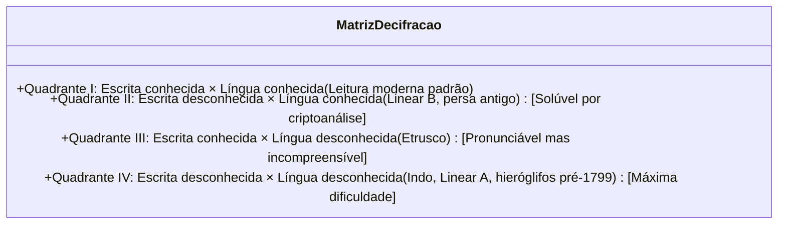

Dentre todas as criações da inteligência humana, a invenção da escrita permanece como a mais extraordinária. Ela transformou a efêmera palavra falada em um monumento físico imperecível, erguendo uma ponte atemporal sobre milênios de história.

Contudo, quando civilizações desmoronam e seus idiomas cessam de ser falados, os textos petrificam-se em silêncio. Decifrar uma escrita antiga é um ato supremo de ressurreição histórica: devolver a voz a civilizações soterradas pelo tempo.

---

## 1. Fundamentos Matemáticos e Taxonomia das Escritas

O analista enfrenta a matriz da "dupla incógnita":

A contagem estatística de caracteres revela a estrutura:
- **20 a 40 sinais**: Alfabeto ou abjad (fonemas consonantais/vocálicos)
- **50 a 100 sinais**: Silabário (consoante + vogal), como o Linear B (87 sinais)
- **400 a 1.000 sinais**: Sistema misto logosilábico (ideogramas e sílabas), como o egípcio e o maia
- **Milhares de sinais**: Logografia pura (morfemas completos)

---

## 2. Os Três Grandes Triunfos Históricos

### 2.1 A Pedra de Roseta e os Hieróglifos Egípcios
A estela de Roseta continha o mesmo decreto de Ptolomeu V em hieróglifos, demótico e grego antigo. **Jean-François Champollion** comprovou que os 1.419 hieróglifos para 486 palavras gregas provavam a existência de fonemas. Ao isolar cartuchos reais estrangeiros (Ptolomeu, Cleópatra) e recorrer à língua **copta**, decifrou faraós nativos como *Ramsés* e *Tutmés*, revelando a gramática do Egito faraônico.

---

### 2.2 O Enigma do Linear B (Alice Kober e Michael Ventris)
- **Alice Kober** tabulou as flexões gramaticais sem fazer suposições semânticas ("trigêmeos de Kober") e construiu uma grade fonética bidimensional.
- **Michael Ventris**, arquiteto e ex-criptoanalista de guerra, aplicou topônimos de Creta (*Knossos*, *Amnisos*). A chave funcionou: surgiram palavras em **grego micênico arcaico**, 700 anos mais antigo que Homero!

---

### 2.3 Glifos Maias (Yuri Knorozov)
Derrubando o dogma ocidental de que os glifos maias eram apenas símbolos místicos, o linguista soviético **Yuri Knorozov** provou em 1952 sua natureza logosilábica, descobrindo o **princípio da sinharmonia** ($CV_1 + CV_2 = CVC$). Com os estudos históricos de Tatiana Proskouriakoff, mais de 90% dos textos maias são hoje perfeitamente lidos.

---

## 3. Escritas que Desafiam a Humanidade

- **Escrita do Vale do Indo**: Mais de 4.000 inscrições em selos de Harappa (2600-1900 a.C.). Com extensão média de apenas 4,6 sinais e sem textos bilíngues, debate-se se representa uma língua dravídica ou símbolos heráldicos.
- **Linear A**: Ancestral minoico do Linear B. Embora pronunciável, expressa uma língua isolada desconhecida.
- **Rongorongo**: Tábuas de madeira da Ilha de Páscoa em bustrofédon reverso, cuja tradição de leitura foi extinta em 1862 após expedições escravagistas peruanas.
