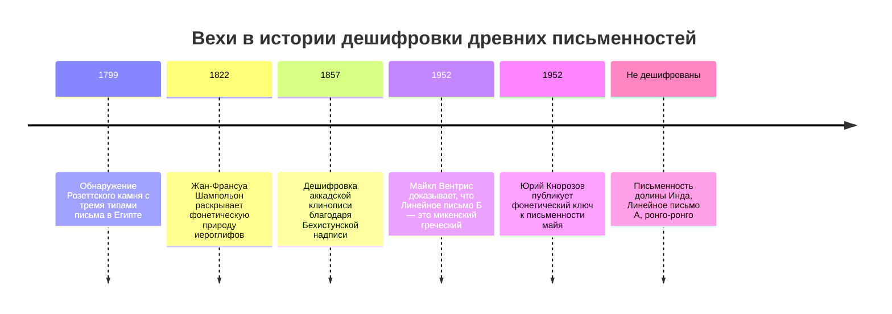
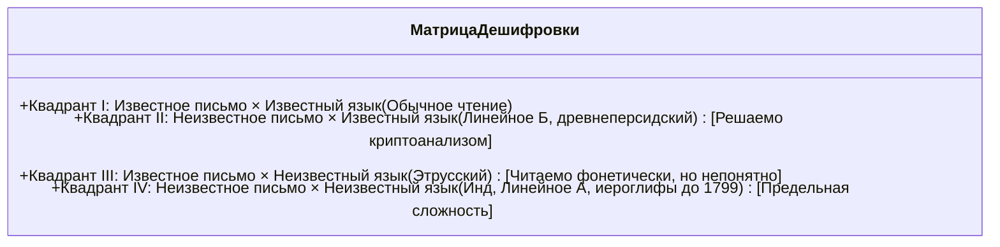

Среди всех творений человеческого разума письменность занимает наивысшую ступень. Она превратила мимолетное звучание речи в непреходящий материальный след, соединив тысячелетия истории.

Но когда рушатся цивилизации и умолкают живые языки, письмена застывают в немом молчании. Дешифровка древней письменности — это не кабинетная забава, а воскрешение подлинных голосов человеческой истории.

---

## 1. Математический криптоанализ и классификация письменностей

Дешифровщик сталкивается с матрицей «двойной неизвестности»:

Число уникальных графем определяет тип письма:
- **20–40 знаков**: Алфавит или консонантное письмо (звуковые фонемы)
- **50–100 знаков**: Силлабарий (слоговое письмо: согласный + гласный), как Линейное Б (87 знаков)
- **400–1000 знаков**: Словесно-слоговая система (логограммы и слоги), как у майя и египтян
- **Тысячи знаков**: Чистая идеография / логография

---

## 2. Три великих триумфа дешифровки

### 2.1 Розеттский камень и египетские иероглифы
Сопоставив 486 греческих слов с 1419 иероглифами, **Жан-Франсуа Шампольон** математически доказал фонетическую природу египетского письма. Читая имена царей в картушах (Птолемей, Клеопатра) и используя **коптский язык**, он расшифровал имена фараонов Рамсеса и Тутмоса.

---

### 2.2 Тайна Линейного письма Б (Алиса Кобер и Майкл Вентрис)
- **Алиса Кобер** выявила падежные грамматические флексии («триплеты Кобер») и составила фонетическую сетку согласных и гласных.
- **Майкл Вентрис**, архитектор и криптоаналитик, подставил критские топонимы (*Кносс*, *Амнисос*). Из табличек хлынули слова **микенского греческого языка**, опережавшего Гомера на 700 лет!

---

### 2.3 Письмо майя (Подвиг Юрия Кнорозова)
В 1952 году в Ленинграде советский ученый **Юрий Валентинович Кнорозов** доказал, что письмо майя было логосиллабическим, и открыл **правило сингармонизма** ($CV_1 + CV_2 = CVC$), в котором второй гласный не читается. Вместе с работами Татьяны Проскуряковой это открыло возможность читать свыше 90% текстов древних майя.

---

## 3. Непокоренные загадки: Инд и ронго-ронго

- **Письменность долины Инда**: 4 000 печатей цивилизации Хараппы. Средняя длина надписи — всего 4,6 знака, а билингвы отсутствуют, что порождает споры о дравидийских или нелингвистических символах.
- **Линейное письмо А**: Минойский предок Линейного Б, передающий неизвестный догреческий язык-изолят.
- **Ронго-ронго**: Деревянные дощечки острова Пасхи перевернутым бустрофедоном. Традиция чтения погибла в 1862 году после перуанских работорговых набегов.
