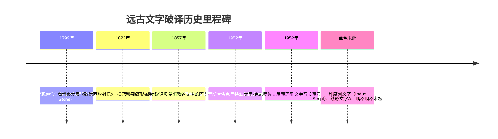
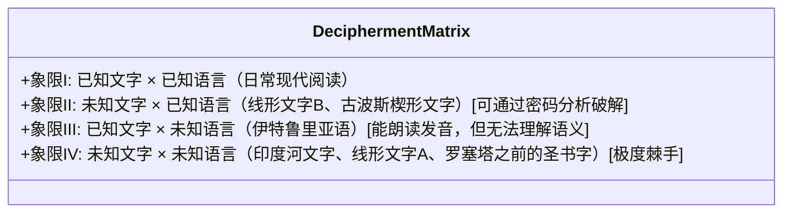
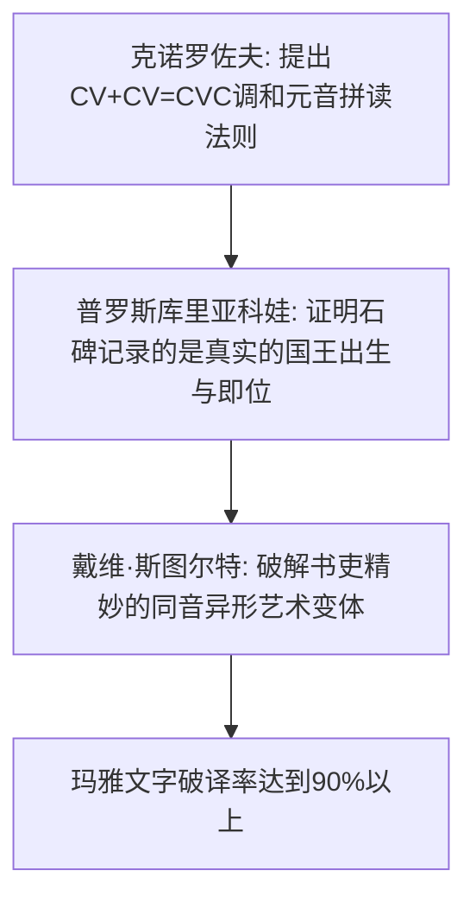

在人类所有伟大的发明中，文字是无与伦比的巅峰。它让知识、神话、法律与思想跨越了个体肉身的死亡与地理距离的限制，成为连接数千年时光的坚固桥梁。

然而，当一个文明陨落、其口语在历史长河中失传时，文字便陷入了漫长的沉寂。刻在古埃及神庙墙壁上的图画、泥板上神秘的划痕、大洋孤岛上刻满木板的怪异符号——在失去解读钥匙的瞬间，全部沦为凡人无法窥视的“密码”。

古代文字的破译绝非书斋里的益智游戏，而是人类理性与坚韧意志的最壮丽胜利：它将数千年黑暗中冰冷的石头，重新转化为古代人类鲜活而有温度的声音。

---

## 1. 文字破译的数理基础与分类学

在信息论与密码学视角下，破解失落文字的核心难点在于“双重未知”的矩阵：

### 符号总数的统计学指示：
语言学家接触未知书写体系的第一步，是统计其**不重复符号总数（字符集规模）**：
- **20 ～ 40 个符号**：音素文字（字母系统），记录辅音和元音。
- **50 ～ 100 个符号**：音节文字（Syllabary），如线形文字B（87字）、日文假名。
- **400 ～ 1,000 个符号**：词素-音节混合文字（Logosyllabic），如埃及象形文字、玛雅文字。
- **数千至数万符号**：纯表意或语素文字，如汉字。

---

## 2. 伟大破译史的三座丰碑

### 2.1 罗塞塔石碑与埃及圣书字（商博良的跨越）
1799年发现的罗塞塔石碑铭刻着同一篇托勒密五世法令的三种文本：圣书体（神职专用）、世俗体（平民行政草书）与古希腊语。
法国天才语言学家**让-弗朗索瓦·商博良（Jean-François Champollion）**通过对比发现：希腊语仅486词，而圣书体却有1419个符号。这在数学上彻底粉碎了“象形文字纯属神秘表意”的千年迷信。

利用椭圆形王名圈（Cartouche），商博良率先拼读出外国君主名字（托勒密、克利奥帕特拉），进而凭借对古埃及语后裔**科普特语（Coptic）**的精通，破解了拉美西斯（Ramesses，太阳神拉诞生之子）与图特摩斯（Thutmose），一举唤醒了古埃及三千年的历史。

---

### 2.2 线形文字B的奇迹（阿丽丝·科贝尔与迈克尔·文特里斯）
克诺索斯王宫出土的线形文字B曾被发掘者阿瑟·埃文斯坚信为与希腊语无关的非印欧“米诺斯语”。
- **爱丽丝·科贝尔（Alice Kober）**抛弃一切预设猜测，对数千枚泥板进行纯词形变格统计，发现了表明屈折语词尾屈折变化的“科贝尔三组词（Kober's Triplets）”，并绘制了未知辅音-元音对齐网格矩阵。
- **迈克尔·文特里斯（Michael Ventris）**基于二战军事情报密码分析经验，假设特定高频词为克里特岛本土城邦地名（阿姆尼索斯 Amnisos、克诺索斯 Knossos）。当这些音值填入科贝尔网格后，泥板上不可思议地涌现出古希腊语单词：*poimen*（牧羊人）、*tripos*（三足鼎）。线形文字B被证明为比荷马史诗早700年的最古老**迈锡尼希腊语**！

---

### 2.3 玛雅圣书字（冷战铁幕后的突破）
长期以来，西方学界被J.E.S.汤普森垄断，认为玛雅文字纯粹是神秘宗教与历法符号。
1952年，身处列宁格勒的苏联语言学家**尤里·克诺罗佐夫（Yuri Knorozov）**根据约800个符号的总数，断定其为“表语＋音节”混合体系。他发现了**调和元音法则（Synharmonic Rule）**：两个CV（辅音+元音）音节符号拼合为一个CVC闭音节词，且第二个符号的无声元音与首个元音相同。结合塔季扬娜·普罗斯库里亚科娃（Tatiana Proskouriakoff）对石碑历史纪年的确证，玛雅王朝的真实历史大白于天下。

---

## 3. 拒绝对话的未解符码：印度河文字与朗格朗格

- **印度河文字（Indus Script）**：公元前2600-前1900年哈拉帕与摩亨佐-达罗文明的印章文字。现存4000余件铭文中，单条平均长度仅4.6个符号，缺乏任何双语对照文本，其语言归属（达罗毗荼语、印欧语或孤立语）争议巨大，甚至有学者提出其并非记录语言的政治家族徽章。
- **线形文字A（Linear A）**：线形文字B的母体。借用线形文字B的音值虽可朗读发音，但其背后承载的“米诺斯语”至今没有在任何已知语族中找到亲属。
- **复活节岛朗格朗格（Rongorongo）**：木板上采用奇特的“反向牛耕式”雕刻。1862年秘鲁奴隶贩子掠走包括国王与祭司在内的所有识字阶层，导致解读传统彻底断绝，现存仅26件孤本木板。

古代文字破译史印证了人类精神的无畏：只要人类对自身过去的探索渴望未泯，那些封存在泥土与巨石中的失落文明，终将在未来的某一天被人类的智慧重新唤醒。
---

## 4. 贝希斯敦铭文与美索不达米亚楔形文字

与罗塞塔石碑齐名的另一座伟大丰碑，是位于伊朗西部崖壁之上的**贝希斯敦铭文（Behistun Inscription）**。英国军官亨利·罗林森（Henry Rawlinson）悬吊在百米绝壁之上完成了纸模拓印。该铭文用三种文字记录了大流士一世的功绩：符号较少的古波斯语、埃兰语以及极为复杂的阿卡德语巴比伦楔形文字。学者们以古波斯语为突破口，最终攻克了阿卡德语，让沉睡三千年的《吉尔伽美什史诗》和《汉谟拉比法典》重见天日。

此外，印加帝国用于人口普查与赋税记录的**“奇普（Quipu，结绳记事）”**利用绳结种类、颜色、位置构筑了复杂的三维触觉记录系统，为现代学者探索人类文字的终极定义提供了崭新的视角。
### 4.2 费斯托斯圆盘与伏尼契手稿
克里特岛出土的费斯托斯圆盘（Phaistos Disc）展示了世界上最早的活字印章压印技术，但因缺乏第二件同类物证而成为孤证。而15世纪的伏尼契手稿（Voynich Manuscript）包含大量奇异植物与未知文字，虽然文字出现频率完全符合齐普夫定律，但它究竟是精密的换字密码、未知的欧洲孤立语，还是文艺复兴时期的精巧伪作，至今仍是密码学界激辩的热点。
