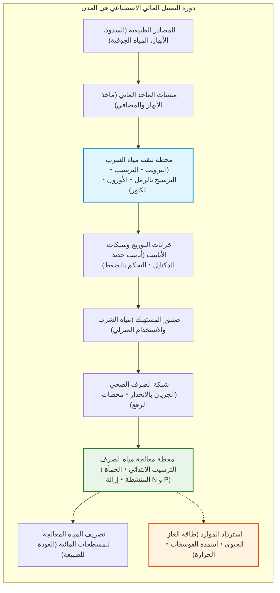
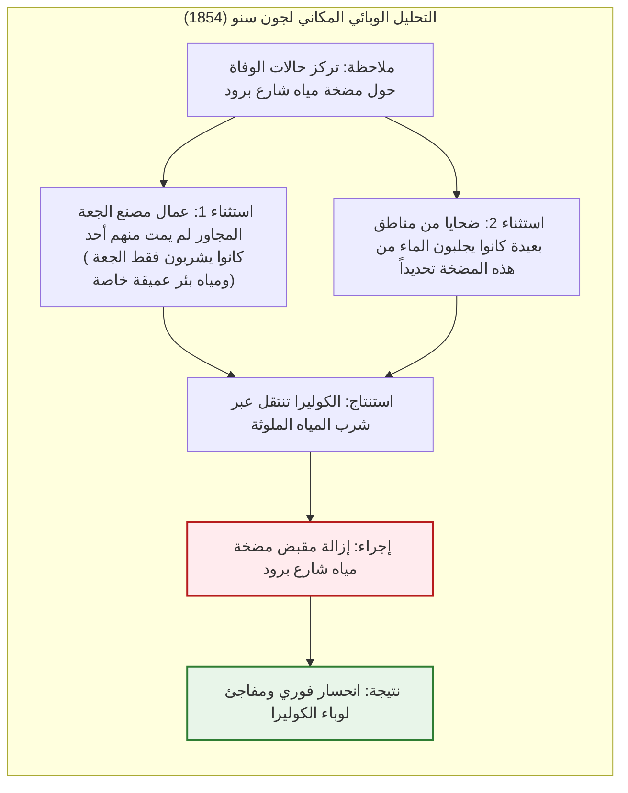
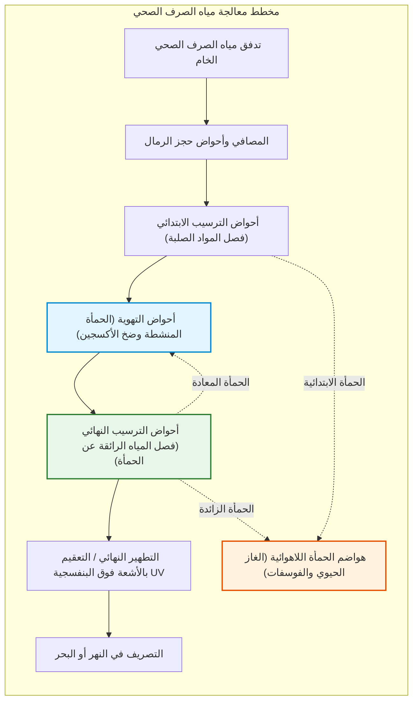

## مقدمة: المعجزة اليومية لتدفق مياه الشرب النقية من الصنبور

كل صباح، يفتح مئات الملايين من سكان المدن الحديثة صنبور المياه لغسل وجوههم أو ملء كوب ماء عذب يرتوون به دون أدنى شك في نقائه.

في المجتمعات المتقدمة، يُعتبر الحصول الفوري وغير المحدود داخل المنازل على مياه عديمة اللون والرائحة ومجانية تماماً من مسببات الأمراض أمراً بديهياً وطبيعياً مثل استنشاق الهواء. لكن من منظور التاريخ البشري، **يمثل هذا الإنجاز إحدى أعظم الملاحم الهندسية والبيولوجية التي حققتها البشرية**.

وحالياً، لا يتجاوز عدد البلدان التي تضمن صلاحية مياه الصنبور للشرب المباشر في جميع أرجائها خمس عشرة دولة حول العالم. ولا يزال أكثر من ملياري إنسان يفتقرون إلى خدمات مياه الشرب المدارة بأمان، بينما تحصد الأمراض المنقولة بالمياه كالكوليرا والتيفود أرواح مئات الآلاف سنوياً.

تحت شوارع المدن تمتد شبكات هيدروليكية من الأنابيب المضغوطة وقنوات الصرف بالجاذبية تتجاوز في طولها شبكات الطرق، تعمل دون توقف على مدار الساعة بفضل ميكانيكا الموائع وكيمياء الغرويات والتكنولوجيا الحيوية الميكروبية.

---

## الفصل الأول: تاريخ المدن والماء — من روما إلى «النتانة الكبرى» في لندن

أي تجمع سكاني قديم عجز عن استجلاب مياه نقية وتصريف الفضلات البشرية سرعان ما أبادته الأوبئة.

### 1.1 القنوات الرومانية وكلواكا ماكسيما

بنت روما 11 قناة مائية عملاقة بطول فاق 400 كم. وبالاعتماد على **الانحدار الهيدروليكي الطبيعي**، قادت مياه الينابيع الجبلية من جبال الأبينيني لعشرات الكيلومترات بقوة الجاذبية وحدها عبر جسور معمارية مثل جسر غار. وكانت مياه الصرف تُصرّف إلى نهر التيبر عبر **كلواكا ماكسيما (Cloaca Maxima)**.

> **حقيقة تسمم الرومان بالرصاص**  
> أثبتت الدراسات الحديثة خطأ الاعتقاد بأن روما سقطت بسبب أنابيب الرصاص؛ فالمياه الكلسية الرومانية كانت تشكل سريعاً طبقة سميكة من كربونات الكالسيوم عزلت المياه تماماً عن الرصاص.

### 1.2 «النتانة الكبرى» في لندن (1858) وخريطة جون سنو للكوليرا

في القرن التاسع عشر، أدى تصريف مياه الصرف في نهر التايمز إلى كارثة بيئية وفي صيف 1858 نتجت روائح كريهة أوقفت البرلمان البريطاني وعرفت باسم **«النتانة الكبرى» (The Great Stink)**.

وفي عام 1854، قام الطبيب **جون سنو** برسم خريطة لوفيات الكوليرا في حي سوهو، مبيناً تركزها حول مضخة مياه شارع برود، ومثبتاً أن المرض ينتقل عبر الماء وليس عبر الهواء الفاسد.

بإزالة مقبض المضخة، خمد الوباء. لاحقاً، صمم المهندس **سير جوزيف بازالجيت** أكثر من 1800 كم من أنفاق الصرف الصحي المتقاطعة، قاضياً نهائياً على الكوليرا في لندن.

---

## الفصل الثاني: هندسة تنقية مياه الشرب

تتميز الجسيمات الغروية الطينية في المياه الطبيعية بجهد زيتا سالب ($\zeta \approx -15 \dots -30\text{ mV}$) يجعلها تتنافر. وتقوم محطات التنقية بإضافة مواد الترويب (PAC) لمعادلة الشحنات وتكوين ندف تترسب وفق **قانون ستوكس**:

$$v_s = \frac{g (\rho_p - \rho_f) d^2}{18 \mu}$$

زيادة حجم الندف بمقدار 1,000 ضعف يضاعف سرعة الترسيب **مليون مرة**. وتخضع كفاءة التعقيم بالكلور لـ **قانون تشيك-واتسون**:

$$\ln\left(\frac{N}{N_0}\right) = -k \cdot C^n \cdot t$$

---

## الفصل الثالث: شبكات الأنابيب ومعالجة الحمأة المنشطة

تتبع المياه المضغوطة **معادلة برنولي** ($H = z + \frac{P}{\rho g} + \frac{v^2}{2g}$) وصيغة **هازن-ويليامز**:

$$h_f = 10.666 \cdot C_H^{-1.85} \cdot D^{-4.87} \cdot Q^{1.85} \cdot L$$

وفي محطات معالجة الصرف الصحي، تعتمد **طريقة الحمأة المنشطة** على مليارات البكتيريا والكائنات الدقيقة المؤكسدة للفضلات العضوية وفق حركية **معادلة مونود**:

$$\mu = \mu_{\max} \frac{S}{K_s + S}$$

وتعمل عملية **$A^2O$ (اللاهوائية-الأنوكسية-الهوائية)** على طرد النيتروجين كغاز نيتروجين ($\text{N}_2$) وتكديس الفوسفور حيوياً لحماية البيئة البحرية.

---

## الفصل الرابع: محطات المعالجة كمنشآت لاسترداد الموارد

1. **الغاز الحيوي للكهرباء**: التخمير اللاهوائي عند 37 مئوية ينتج غاز الميثان ($60\%\ \text{CH}_4$).
2. **استرداد الفوسفور كسماد ستروفيت (MAP)**:
   $$\text{Mg}^{2+} + \text{NH}_4^+ + \text{PO}_4^{3-} + 6\text{H}_2\text{O} \longrightarrow \text{MgNH}_4\text{PO}_4 \cdot 6\text{H}_2\text{O} \downarrow$$
3. **إزالة ملوثات PFAS**: عبر الكربون المنشط الحبيبي وراتنجات التبادل الأيوني والتناضح العكسي (RO).

## خاتمة: نقاء الماء معيار كرامة الحضارة

إن شرب الماء الصافي من الصنبور هبة تاريخية بنتها أجيال من العلماء والمهندسين. وستظل شبكات المياه غير المرئية الشريان الحقيقي لحياة المدن وكرامة الإنسان.
