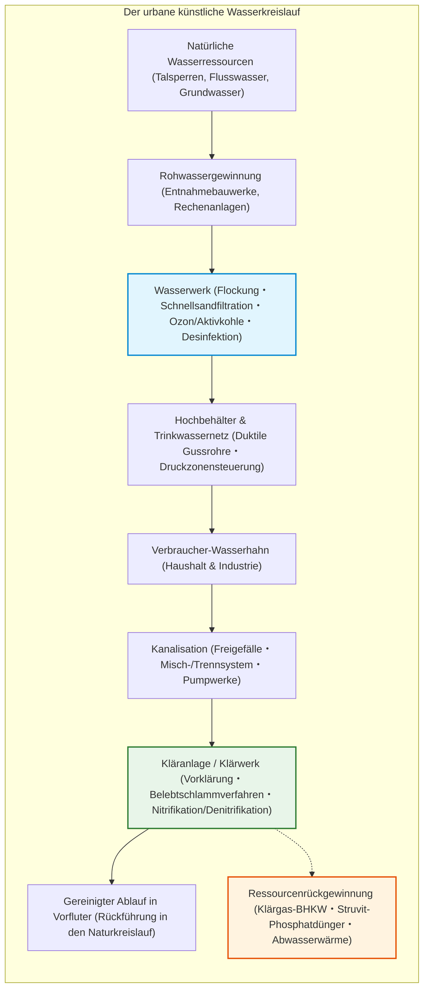
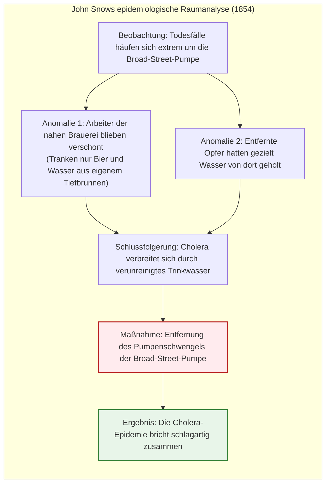
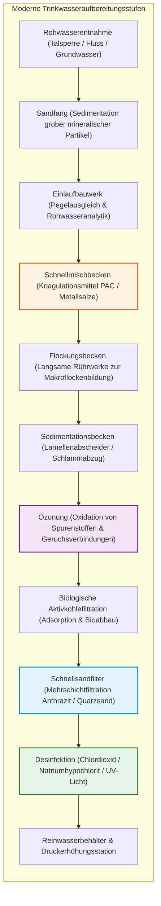
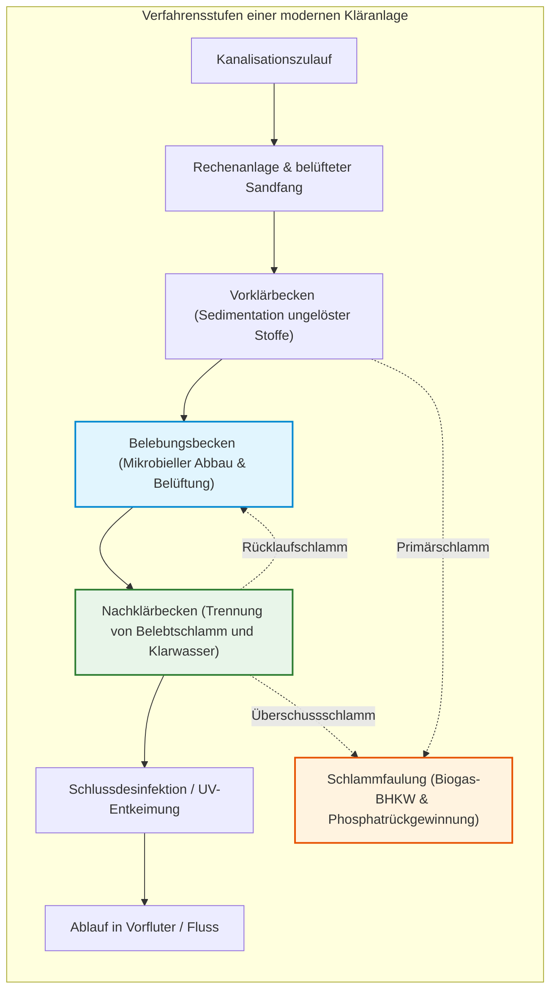

## Einleitung: Das alltägliche Wunder des Trinkwassers aus dem Hahn

Jeden Morgen drehen hunderte Millionen Menschen in modernen Metropolen den Wasserhahn auf, putzen sich die Zähne oder trinken ein Glas frisches Wasser, ohne einen Gedanken an die gewaltige Maschinerie dahinter zu verschwenden.

Dass aus einer Armatur in der eigenen Wohnung unbegrenzt farbloses, geruchloses, geschmacksneutrales und absolut keimfreies Trinkwasser fließt, gilt in entwickelten Industriegesellschaften als pure Selbstverständlichkeit. Doch aus der Perspektive der Menschheitsgeschichte und des globalen Vergleichs ist dieser Umstand **eines der kühnsten und komplexesten Meisterwerke des Bau- und Umweltingenieurwesens**.

Weltweit verfügen nur etwa ein Dutzend Länder – darunter Deutschland, die Schweiz, Österreich, Japan, Island und Australien – über flächendeckendes Leitungswasser von uneingeschränkter Trinkwasserqualität direkt aus dem Hahn. Über zwei Milliarden Menschen haben weltweit keinen Zugang zu sicher verwaltetem Trinkwasser. Durch Wasser übertragene Seuchen wie Cholera, Typhus und Ruhr fordern weiterhin jährlich hunderttausende Menschenleben.

Ebenso wenige Menschen wissen, welchen Weg das Schmutzwasser nimmt, sobald es im Abfluss verschwindet, und wie aus stinkender Brühe wieder biologisch intaktes, fischgerechtes Wasser wird. Unter den Straßen moderner Großstädte liegt ein unsichtbares Nervensystem aus hunderttausenden Kilometern Druckwasser- und Freispiegelleitungen, angetrieben von Strömungsmechanik, Grenzflächenchemie und biologischer Verfahrenstechnik.

---

## Kapitel 1: Stadtgeschichte und Wasserkunst – Von Rom über London bis Edo

Die Geschichte urbaner Zivilisationen ist untrennbar mit der Fähigkeit verbunden, Frischwasser heranzuschaffen und Fäkalien schnellstmöglich abzutransportieren. Jede antike Metropole, die diese ingenieurtechnische Gratwanderung nicht meisterte, ging binnen kürzester Zeit an Epidemien zugrunde.

### 1.1 Römische Aquädukte und die Cloaca Maxima

Den ersten Höhepunkt städtischer Wassertechnik markierte das Römische Reich. Beginnend 312 v. Chr. mit der Aqua Appia entstanden elf monumentale Aquädukte mit über 400 Kilometern Gesamtlänge.

Römische Baumeister beherrschten das **hydraulische Gefälle** meisterhaft. Sie führten kühles Gebirgsquellwasser aus den Apenninen über Dutzende Kilometer mit stetigem Minimalgefälle (oft nur wenige Dezimeter pro Kilometer) rein durch Gravitation heran und überbrückten Täler mit Arkaden wie dem berühmten Pont du Gard.

In Rom floss das Wasser in ein zentrales Wasserschloss (*Castellum Aquae*), von wo aus Bleirohre und Tonleitungen öffentliche Brunnen, luxuriöse Thermen und Privatvillen speisten. Das Abwasser wurde über die gewaltige **Cloaca Maxima** in den Tiber gespült.

> **Wissenschaftliche Entwarnung: Gingen die Römer an Bleirohren zugrunde?**  
> Die populäre These, Rom sei an Bleivergiftungen durch Wasserrohre untergegangen, gilt heute als widerlegt. Das kalkhaltige römische Wasser bildete innerhalb kürzester Zeit eine dicke Schicht aus Kalziumkarbonat (Kesselstein) im Rohrinneren, die das Trinkwasser physisch vollständig vom Blei isolierte.

### 1.2 Londons „Großer Gestank“ (1858) und John Snows Cholerakarte

Im 19. Jahrhundert explodierte Londons Einwohnerzahl durch die industrielle Revolution auf über zwei Millionen. Die Einführung des Wasserklosetts ohne Kläranlagen führte zur Katastrophe: Zehntausende Sickergruben liefen über und ergossen sich in die Themse, aus der private Wasserwerke gleichzeitig Trinkwasser für die Haushalte entnahmen.

Im Hitzesommer 1858 verfaulte der Fluss zu einer stinkenden Kloake – der **Große Gestank (The Great Stink)** verjagte beinahe das Parlament aus Westminster.

Damals glaubte die Medizin noch an die Miasmentheorie (Ansteckung durch faulige Luft). 1854 bewies der Arzt **John Snow** bei einem Cholera-Ausbruch im Stadtteil Soho anhand einer detaillierten Karte der Todesfälle, dass die Seuche wasserübertragen war.

Als Snow den Schwengel der verseuchten Pumpe entfernen ließ, erlosch die Epidemie. Daraufhin schuf Chefingenieur **Sir Joseph Bazalgette** ein unterirdisches Wunderwerk: über 1.800 Kilometer gemauerte Abfangsammler, die Londons Abwasser bis weit vor die Tore der Stadt leiteten.

---

## Kapitel 2: Der Weg zum Wasserhahn – Aufbereitungstechnik im Wasserwerk

Moderne Wasserwerke sind physikalisch-chemische Großreaktoren, die Schwebstoffe, Krankheitserreger und Mikroschadstoffe zuverlässig eliminieren.

### 2.1 Kolloidchemie: Koagulation und Flockung

Schwebstoffe und Tonpartikel tragen im Rohwasser eine negative Oberflächenladung (**Zeta-Potential: $\zeta \approx -15 \text{ bis } -30\text{ mV}$**) und stoßen sich elektrostatisch ab.

Durch Zugabe von dreiwertigen Metallsalzen (z. B. Polyaluminiumchlorid PAC) werden diese Ladungen neutralisiert. Die Partikel ballen sich zu millimetergroßen Flocken zusammen, deren Sinkgeschwindigkeit dem **Stokesschen Gesetz** folgt:

$$v_s = \frac{g (\rho_p - \rho_f) d^2}{18 \mu}$$

Da die Sinkgeschwindigkeit quadratisch mit dem Partikeldurchmesser ($d^2$) wächst, sinkt eine um den Faktor 1.000 vergrößerte Flocke **eine Million Mal schneller** zu Boden.

### 2.2 Desinfektionskinetik und das Chick-Watson-Gesetz

Gefiltertes Wasser wird durch Zugabe von Chlor oder Chlordioxid desinfiziert. Hypochlorige Säure ($\text{HOCl}$) diffundiert ungeladen durch bakterielle Zellmembranen und zerstört lebensnotwendige Stoffwechselenzyme. Die Absterbekinetik folgt dem **Chick-Watson-Gesetz**:

$$\ln\left(\frac{N}{N_0}\right) = -k \cdot C^n \cdot t$$

Wasserwerke steuern diesen Prozess über das Produkt aus Desinfektionsmittelkonzentration und Kontaktzeit ($C \cdot t$-Wert) und sichern so eine permanente Schutzwirkung bis zum letzten Verbraucher.

---

## Kapitel 3: Hydraulik der Rohrnetze und Druckzonen

Trinkwasser verteilt sich nach den Gesetzen der **Bernoulli-Gleichung**:

$$H = z + \frac{P}{\rho g} + \frac{v^2}{2g}$$

Hochbehälter nutzen die geodätische Höhe ($z$), um das Netz im Ruhezustand rein gravimetrisch auf einem optimalen Versorgungsdruck von 3 bis 6 bar zu halten.

Druckverluste durch Reibung an den Rohrwandungen werden über die **Darcy-Weisbach-Gleichung** bzw. die **Hazen-Williams-Formel** ermittelt:

$$h_f = 10.666 \cdot C_H^{-1.85} \cdot D^{-4.87} \cdot Q^{1.85} \cdot L$$

Aufgrund der extremen Abhängigkeit des Druckverlusts vom Rohrdurchmesser ($h_f \propto D^{-4.87}$) setzen Ingenieure auf duktile Gussrohre mit Zementmörtelauskleidung und flexible Schubsicherungen, um Wasserverluste zu minimieren und Rohrbrüche selbst bei Erschütterungen zu verhindern.

---

## Kapitel 4: Abwasserkanäle und Klärtechnik

Verbrauchtes Wasser verlässt Gebäude durch Geruchsverschlüsse (Siphons) und fließt in die Kanalisation. Freispiegelleitungen mit einem Mindestgefälle von 1:100 bis 1:500 garantieren eine Selbstreinigungsgeschwindigkeit von mindestens $0,6\ \text{m/s}$.

In der Kläranlage leistet das **Belebtschlammverfahren** (1914 von Ardern und Lockett erfunden) die eigentliche Reinigungsarbeit. In belüfteten Becken fressen Milliarden Bakterien, Glockentierchen und Rädertierchen die gelösten Schmutzstoffe auf und wandeln sie in Biomasse, Kohlendioxid und Wasser um.

Der biochemische Sauerstoffbedarf sinkt nach der Kinetik erster Ordnung ($BOD_t = L_0 (1 - e^{-k_1 t})$) und der Monod-Wachstumsgleichung:

$$\mu = \mu_{\max} \frac{S}{K_s + S}$$

Das **$A^2O$-Verfahren (Anaerob-Anoxisch-Oxisch)** eliminiert Stickstoff durch biologische Denitrifikation zu elementarem $\text{N}_2$-Gas und bindet Phosphat im Schlamm, um eine Eutrophierung der Gewässer zu verhindern.

---

## Kapitel 5: Die Kläranlage als urbane Rohstoffquelle

Moderne Klärwerke wandeln sich zu Bioraffinerien:
1. **Klärgasgewinnung**: Anaerobe Faulung bei 37°C erzeugt Methangas ($60\%\ \text{CH}_4$), das in Blockheizkraftwerken den Eigenstrombedarf zu 100 % decken kann.
2. **Phosphorrückgewinnung als Struvit (MAP)**:
   $$\text{Mg}^{2+} + \text{NH}_4^+ + \text{PO}_4^{3-} + 6\text{H}_2\text{O} \longrightarrow \text{MgNH}_4\text{PO}_4 \cdot 6\text{H}_2\text{O} \downarrow$$
   Gewinnung von reinem Langzeitdünger aus dem Klärschlamm.
3. **Abwasserwärmenutzung**: Wärmepumpen entziehen dem ganzjährig warmen Abwasser Energie zur CO2-neutralen Beheizung ganzer Stadtviertel.
4. **PFAS-Elimination**: Nicht abbaubare polyfluorierte Chemikalien (PFAS) werden durch Aktivkohle (GAC), Anionenaustauscherharze und Umkehrosmose (RO) restlos aus dem Wasserkreislauf entfernt.

## Fazit: Die Zivilisation im Spiegel des Wassers

Ein Dreh am Wasserhahn schenkt reines Leben; ein Druck auf die Spülung bannt Seuchen und Schmutz. Hinter dieser alltäglichen Selbstverständlichkeit steht die Summe jahrhundertelanger Pionierleistungen der Ingenieurskunst – das Fundament jeder zivilisierten Gesellschaft.
