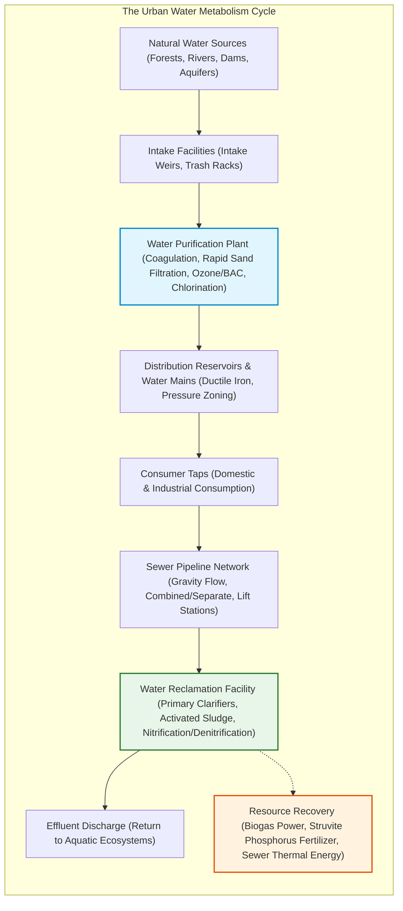
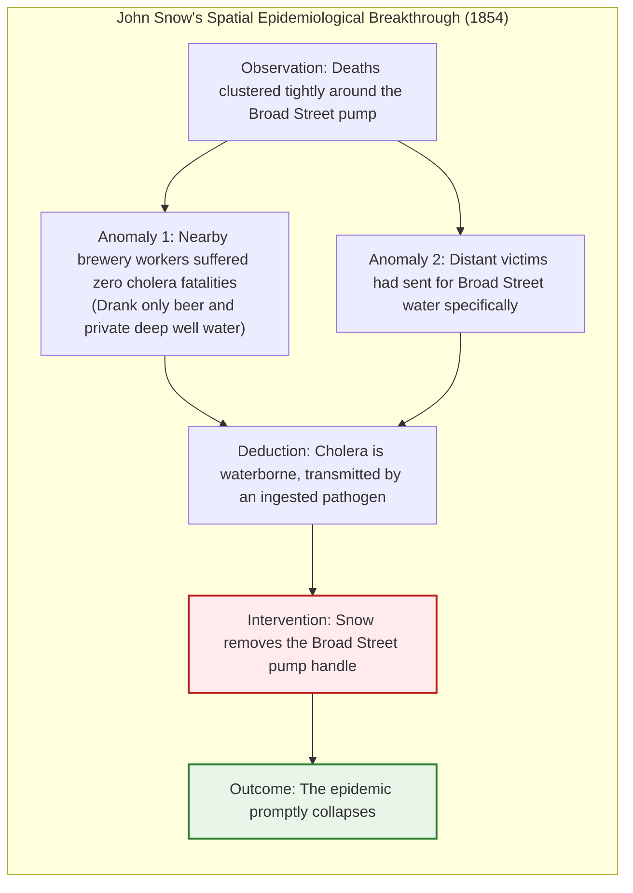
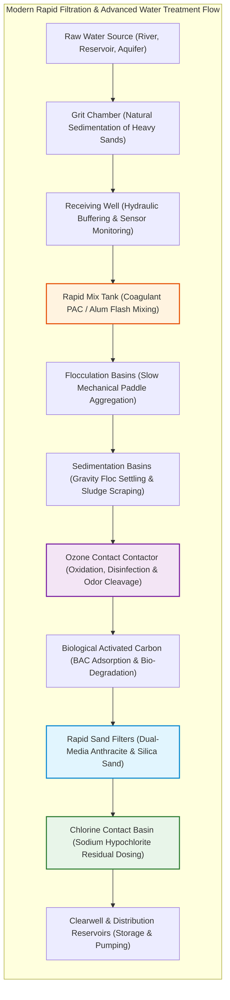
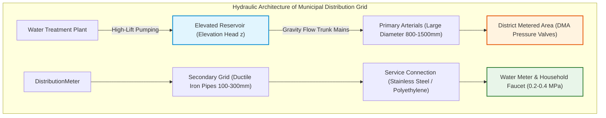
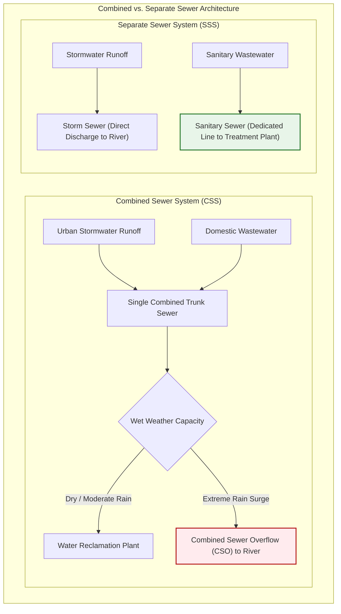
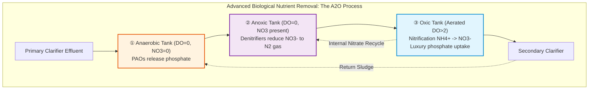
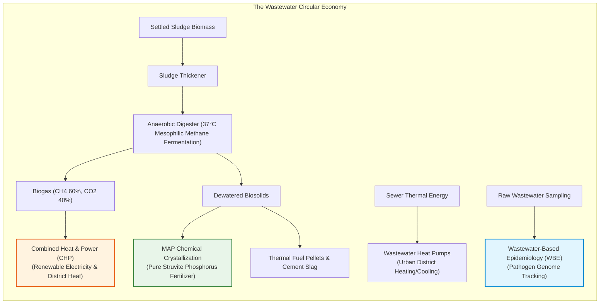
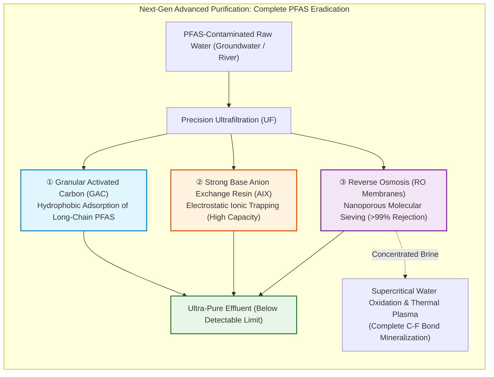

## Introduction: The Daily Miracle of Turning on the Tap

Every morning, millions of people turn on a bathroom faucet, brush their teeth, pour a glass of water, and drink without a second thought.

In advanced urban societies, having access to an infinite stream of colorless, odorless, tasteless, pathogen-free drinking water directly inside one's home is treated as a given fact of existence, as natural as breathing air. Yet viewed through the lens of human history or global geography, this routine convenience represents **one of the most breathtaking engineering triumphs ever achieved by our species**.

Today, out of approximately 190 nations worldwide, only about a dozen countries—such as Japan, Germany, Switzerland, Austria, Iceland, and Australia—can boast that tap water is universally safe to drink directly from the faucet without boiling or home filtration. Globally, more than two billion people lack access to safely managed drinking water services. Waterborne diseases such as cholera, typhoid, and dysentery still claim hundreds of thousands of lives every year.

Moreover, remarkably few citizens can explain where their used water goes once it swirls down the bathroom drain, the kitchen sink, or the toilet bowl. Beneath our feet lies an invisible labyrinth of hydraulic arteries far more extensive than our road and rail networks combined: hundreds of thousands of kilometers of pressurized drinking water pipes and gravity-driven sewer tunnels operating 24 hours a day, 365 days a year, driven by fluid mechanics, colloid interface chemistry, and microbial biotechnology.



---

## Chapter 1: The Rise and Fall of Cities and Water — Ancient Rome, London's Stink, and Edo's Aqueducts

Urban history is fundamentally the story of an existential struggle: how to import vast quantities of fresh water, and how to rapidly evacuate human waste. Any ancient settlement that grew beyond a few thousand inhabitants without addressing these dual hydraulic imperatives was swiftly extinguished by waterborne epidemics.

### 1.1 Roman Aqueducts and the Cloaca Maxima

The first great zenith of water engineering was achieved by ancient Rome. Beginning in 312 BCE with the Aqua Appia, the Romans constructed 11 major aqueduct systems spanning over 400 kilometers to supply the imperial capital.

Roman civil engineers mastered **hydraulic gradient leveling**, drawing pristine spring water from the Apennine mountains tens of kilometers away and maintaining a continuous, gentle downward slope (often as low as 1:1000 or a fraction of a meter per kilometer) entirely powered by gravity. They carved subterranean tunnels and erected soaring multi-tiered stone arch bridges such as the Pont du Gard.

Upon reaching the city, the water entered a central distribution tower (*castellum aquae*), which split the pressurized flow through lead and terracotta pipes to public fountains, imperial bath complexes (*thermae*), and private villas. Daily water delivery reached an estimated 1,000 liters per capita, exceeding modern urban averages.

Concurrently, Rome relied on the **Cloaca Maxima** (“Greatest Sewer”), originally excavated around 600 BCE to drain marshlands, which evolved into a monumental underground vaulted sewer flushing urban runoff, street filth, and public latrine waste into the Tiber River.

> **Debunking the Myth: Did Lead Poisoning Destroy Rome?**  
> While Roman plumbing used lead pipes (*plumbum*), modern archaeological chemistry demonstrates that lead poisoning was not the primary cause of the empire's downfall. The hard, alkaline water of the Roman region deposited a thick, protective internal crust of calcium carbonate (limescale) within months of operation, physically shielding the flowing water from direct contact with the toxic metal.

### 1.2 Edo’s Million-Inhabitant Hydro-Engineering: Kanda and Tamagawa Aqueducts

While medieval Europe lost its hydraulic legacy, throwing chamber pots into muddy streets and suffering recurring plagues, 17th-century Edo (modern Tokyo) flourished as one of the cleanest and largest cities in the world, with over one million inhabitants.

Because Edo was built on reclaimed coastal estuaries where shallow wells yielded salty, brackish groundwater, the Tokugawa shogunate commissioned the **Kanda Aqueduct** and, in 1653, the monumental **Tamagawa Aqueduct**—a 43-kilometer open canal carved from the upper Tama River at Hamura to the Yotsuya Gate in just eight months.

The Tamagawa Aqueduct traced the ridgeline of the Musashino Plateau with an astonishing average slope of **2 per 1,000 (a two-meter drop per kilometer)**. At Yotsuya, the water plunged underground into a network of interlocking wooden conduits (*mokuhi*), hollowed pine trunks, bamboo pipes, and stone aqueducts (*kakehi*) crossing urban rivers. Residents drew pristine drinking water using bucket wells (*tsurube-ido*) connected to this underground pressurized network.

Critically, Edo prevented river pollution through a **complete circular bio-economy of night soil**. Human waste was strictly segregated, purchased by neighboring farming villages as valuable organic fertilizer, and hauled away in specialized boats and barrels. Consequently, Edo’s waterways remained unpolluted by sewage, suppressing epidemics long before the bacteriological era.

```mermaid
flowchart TD
    subgraph EdoWaterSystem["The Tamagawa Aqueduct Distribution Network (17th Century Edo)"]
        Hamura["Hamura Intake Weir (Tama River)<br/>Elevation ~140m"] -->|43 km Open Canal (2:1000 gradient)| Yotsuya["Yotsuya Okido Water Station<br/>(Quality Monitoring & Sluice Gates)"]
        Yotsuya --> UnderNetwork["Subterranean Grid (Wooden & Stone Conduits)"]
        UnderNetwork --> Kakehi["Kanda River Kakehi Aqueduct Bridge<br/>Crosses above river into Nihonbashi"]
        UnderNetwork --> Wells["Common Neighborhood Wells<br/>(Bucket Drawing from Pressurized Conduits)"]
    end
    style Hamura fill:#e1f5fe,stroke:#0288d1,stroke-width:2px
    style Wells fill:#e8f5e9,stroke:#2e7d32,stroke-width:2px
```

### 1.3 The 1858 Great Stink of London and John Snow’s Epidemiological Map

During the 19th-century Industrial Revolution, London’s population exploded to over two million. The advent of the flush toilet, unconnected to any municipal treatment facility, created a disaster: hundreds of thousands of overflowing cesspools drained into the River Thames, from which commercial water companies pumped drinking water straight back to household taps.

In the blistering summer of 1858, the Thames transformed into a fermenting sludge of human feces, releasing an unbearable stench known as **The Great Stink**, which halted parliamentary debates.

At the time, the medical establishment subscribed to the **Miasma Theory**—the belief that epidemic diseases were spread by inhaling foul, toxic air. In 1854, during a ferocious cholera outbreak in Soho that killed over 600 people in days, Dr. **John Snow** pioneered spatial epidemiology by plotting deaths on a street map.



Snow discovered that:
1. Cholera deaths were tightly clustered around the **Broad Street public water pump**.
2. A nearby brewery with 70 workers had zero deaths; its employees were given an allowance of beer and drew water exclusively from an independent deep aquifer.
3. Snow persuaded the parish board to **remove the pump handle**. The outbreak abruptly ceased. Subsequent excavation revealed that a leaking cesspool from an adjacent house, where a cholera-infected infant's diapers were washed, had seeped into the well. Thirty years before Robert Koch isolated *Vibrio cholerae*, modern waterborne epidemiology was born.

### 1.4 Sir Joseph Bazalgette and the Modern Sewer System

Terrified by the Great Stink, the British Parliament empowered civil engineer **Sir Joseph Bazalgette** to build a subterranean wonder: the London Intercepting Sewer System.

Bazalgette constructed over 1,800 kilometers of underground brick sewers parallel to the Thames. These intercepted urban wastewater before it reached the river and conveyed it eastward, via gravity and massive steam pumping engines (such as the Crossness Pumping Station), to discharge points far downstream toward the sea.

Bazalgette calculated the maximum required pipe diameter based on population density, and then famously declared: **“Well, we're only going to do this once,” and doubled all dimensions.** Because of his foresight, Bazalgette's Victorian sewers continue to serve greater London today, permanently ending catastrophic cholera epidemics in the British capital.

---

## Chapter 2: The Journey to the Tap — The Chemical and Physical Engineering of Water Purification

Modern municipal water treatment plants are colossal chemical-physical engineering facilities that eliminate turbidity, biological pathogens, toxic heavy metals, and synthetic organic chemicals to meet stringent potable water standards.



### 2.1 Colloid Interface Chemistry: Coagulation and Flocculation

Raw surface water contains suspended clay, silt, and natural organic matter that make water turbid. These colloidal particles range from 1 nanometer to 10 micrometers in size and will never settle naturally due to their **negative surface charge (Zeta potential: $\zeta \approx -15 \text{ to } -30\text{ mV}$)**, which generates mutual electrostatic repulsion (DLVO theory).

To break this colloidal stability, plants use **rapid coagulation and flocculation**:
1. **Rapid Mixing**: Polyaluminum chloride (PAC: $[ \text{Al}_2(\text{OH})_n \text{Cl}_{6-n} ]_m$) or aluminum sulfate is injected and flash-mixed for 30–60 seconds. Multivalent aluminum cations neutralize the negative charges of colloids, collapsing the repulsive energy barrier.
2. **Flocculation**: The water flows into flocculation basins with rotating paddles. Gentle stirring allows destabilized micro-particles to collide via Brownian motion and van der Waals attraction, aggregating into macroscopic, gelatinous "flocs."
3. **Sedimentation**: The heavy flocs enter settling basins equipped with inclined lamella plates to settle out by gravity.

Floc settling velocity is governed by **Stokes' Law**:

$$v_s = \frac{g (\rho_p - \rho_f) d^2}{18 \mu}$$

where $v_s$ is settling velocity ($\text{m/s}$), $g$ is gravitational acceleration, $\rho_p$ is particle density, $\rho_f$ is fluid density, $d$ is particle diameter, and $\mu$ is dynamic viscosity.

Because settling velocity scales with the **square of the diameter ($d^2$)**, increasing particle size a thousandfold (from $1\ \mu\text{m}$ to $1\ \text{mm}$) increases settling speed by a factor of **one million**, transforming an imperceptible drift into rapid sedimentation.

### 2.2 Dual-Media Rapid Sand Filtration

Water leaving the sedimentation basin passes through **rapid sand filtration beds**. These feature a top layer of coarse, low-density **anthracite coal** (depth ~30 cm, grain size ~1.2 mm) over fine, high-density **silica sand** (depth ~50 cm, grain size ~0.6 mm).

Filtration is not merely physical sieving: physical impaction, sedimentation within pore throats, hydrodynamic interception, and electrostatic van der Waals adsorption pull suspended flocs and chlorine-resistant parasite cysts (*Cryptosporidium*, *Giardia*) onto the sand grain surfaces. Periodic **backwashing** with pressurized air and clean water scours the media clean.

### 2.3 Chlorine Disinfection Dynamics and the Chick-Watson Law

Filtration renders water crystal-clear, but chemical disinfection is essential to eradicate residual bacteria and viruses. Adding chlorine gas or sodium hypochlorite generates **hypochlorous acid ($\text{HOCl}$)**:

$$\text{Cl}_2 + \text{H}_2\text{O} \rightleftharpoons \text{HOCl} + \text{H}^+ + \text{Cl}^-$$

$$\text{HOCl} \rightleftharpoons \text{H}^+ + \text{OCl}^- \quad (\text{p}K_a \approx 7.54)$$

$\text{HOCl}$ is uncharged and rapidly penetrates negatively charged bacterial cell walls, oxidizing vital intracellular enzymes. It is **80 to 100 times more potent** as a disinfectant than the hypochlorite ion ($\text{OCl}^-$). Maintaining a neutral to slightly acidic pH is therefore critical.

The kinetics of pathogen inactivation obey the **Chick-Watson Law**:

$$\ln\left(\frac{N}{N_0}\right) = -k \cdot C^n \cdot t$$

where $N_0$ is the initial microbial count, $N$ is surviving count after time $t$, $k$ is the inactivation rate coefficient, and $C$ is disinfectant concentration. Water utilities manage disinfection using strict **$C \cdot t$ values (concentration $\times$ contact time)**, maintaining a mandatory minimum free chlorine residual (typically $\ge 0.1\text{ mg/L}$) at consumer taps to prevent bacterial regrowth in municipal distribution mains.

### 2.4 Advanced Water Treatment: Ozone and Biological Activated Carbon (BAC)

To combat taste-and-odor compounds (such as earthy geosmin and 2-methylisoborneol produced by cyanobacterial blooms) and endocrine-disrupting trace contaminants, modern mega-plants utilize **Ozone-BAC processes**:
- **Ozone Contactors**: Micro-bubbles of ozone gas ($\text{O}_3$) cleave persistent organic rings, oxidize pesticides, and lyse microbial cell structures.
- **Biological Activated Carbon**: Granular activated carbon adsorbs organic fragments inside its internal micropores while a biofilm of aerobic bacteria colonizing the carbon continuously bio-regenerates the media by digesting the trapped organics.

---

## Chapter 3: The Urban Hydraulic Capillaries — Reservoirs, Distribution Networks, and Pipe Mechanics

Purified water must travel tens of kilometers across variable topography to reach the upper floors of skyscrapers and remote suburbs while maintaining stable hydrostatic pressure.

### 3.1 Hydraulic Head and Bernoulli's Principle

The energy state of water moving through a pressurized conduit is dictated by **Bernoulli’s Principle**, quantified as **Total Head ($H$)**:

$$H = z + \frac{P}{\rho g} + \frac{v^2}{2g}$$

where $z$ is elevation head ($\text{m}$), $\frac{P}{\rho g}$ is pressure head ($\text{m}$), and $\frac{v^2}{2g}$ is velocity head ($\text{m}$).

Municipal systems store clean water in elevated **service reservoirs** situated on high ground. Gravity provides the baseline elevation head ($z$), ensuring that even during total electrical blackout, gravity alone maintains adequate pressure head ($\approx 0.15 \text{ to } 0.74\text{ MPa}$, equivalent to 15–74 meters of head) across urban distribution grids.



### 3.2 Friction Head Loss: Darcy-Weisbach and Hazen-Williams

As water flows through pipes, viscous shear stress against pipe walls causes energy loss, termed **friction head loss ($h_f$)**. The fundamental physical equation is the **Darcy-Weisbach Equation**:

$$h_f = \lambda \frac{L}{D} \frac{v^2}{2g}$$

In civil engineering practice, the empirical **Hazen-Williams Equation** is widely used:

$$h_f = 10.666 \cdot C_H^{-1.85} \cdot D^{-4.87} \cdot Q^{1.85} \cdot L$$

where $C_H$ is pipe roughness coefficient, $D$ is inner diameter, $Q$ is volumetric flow rate, and $L$ is length.

Crucially, friction loss is inversely proportional to the fifth power of pipe diameter ($h_f \propto D^{-4.87}$). Halving a pipe's diameter increases friction loss by roughly **29 times** for the same discharge, requiring sophisticated numerical network optimization (such as the Hardy Cross method) to balance pipe diameters across complex urban networks.

### 3.3 Earthquake-Resistant Pipe Engineering

Japan’s seismic water engineering has pioneered **seismic ductile iron pipe joints (NS/GX type)**. Unlike traditional joints that pull apart during ground liquefaction, seismic joints incorporate an internal alloy lock ring and rubber gasket that allow pipe segments to flex ($3^\circ\text{–}4^\circ$) and telescope by $\pm 1\%$ to absorb ground strain. When strained to the limit, the locking ring grips a raised welded ring on the spigot, withstanding extreme tensile forces (over 200 kN) without pulling apart. During major seismic events like the 2011 Tohoku earthquake, zero separations were recorded in pipeline sections equipped with NS-type joints.

---

## Chapter 4: Where Used Water Goes — Sewer Grids, Combined vs. Separate Networks

The moment water touches skin, soap, or food, it transitions from potable water to domestic wastewater.

### 4.1 Traps, Vents, and Gravity Sewer Hydraulics

Beneath every sink and toilet lies an S-shaped or P-shaped **fixture trap**. The curved pipe retains a permanent column of standing water (**water seal**, depth 50–100 mm) that creates an impenetrable barrier against toxic sewer gases (hydrogen sulfide, methane) and pests.

Once past the trap, wastewater enters gravity sewers. Sewer pipes are unpressurized and sloped downward with precise hydraulic gradients to ensure a **self-cleansing velocity of 0.6 to 0.8 m/s**, preventing solids from settling. Intermediate lift stations pump the sewage upward to shallower depths, allowing it to resume its downward gravitational journey toward the treatment plant.



### 4.2 Combined vs. Separate Sewers

- **Combined Sewer Systems (CSS)**: Stormwater and sewage flow through a single pipe. Common in historic urban cores (Tokyo, New York, London). Economical to construct, but during heavy deluges, flows exceed plant capacity, triggering **Combined Sewer Overflows (CSO)** where dilute untreated wastewater spills into waterways.
- **Separate Sewer Systems (SSS)**: Modern standard. Stormwater and sewage are segregated into two distinct pipe networks. Heavy rains never overwhelm sanitary treatment plants, preventing raw sewage discharges.

To prevent inland flooding in paved cities, engineering marvels like Tokyo’s **Metropolitan Area Outer Underground Discharge Channel** (the "Subterranean Temple") divert floodwaters 50 meters below ground into a colossal chamber supported by 500-ton concrete pillars, pumped into the Edogawa River by jet-engine-derived turbines at 200 cubic meters per second.

---

## Chapter 5: The Microscopic Bioreactor — The Science of Wastewater Treatment

The true miracle of wastewater purification is performed not by synthetic chemicals, but by **trillions of living microorganisms** working inside the **Activated Sludge Process**, invented in 1914 by Edward Ardern and William Lockett.

```mermaid
flowchart TD
    subgraph WastewaterTreatment["Comprehensive Wastewater Reclamation Plant Lifecycle"]
        direction TB
        Influent["Raw Wastewater Inflow"] --> Screen["Bar Screens & Grit Chambers"]
        Screen --> PrimarySed["Primary Clarifier (Heavy Suspended Solids Gravitational Settling)"]
        PrimarySed --> Aeration["Aeration Basin (Activated Sludge Microbiome & Forced Air Injection)"]
        Aeration --> SecondarySed["Secondary Clarifier (Biomass Floc Settling & Clarified Effluent)"]
        SecondarySed --> DisinfectionTank["Disinfection Tank (Chlorination / Ultraviolet UV Radiative Lysis)"]
        DisinfectionTank --> Effluent["Discharge into Natural River / Ocean"]
        
        SecondarySed -.->|Return Activated Sludge (RAS)| Aeration
        SecondarySed -.->|Waste Activated Sludge (WAS)| SludgeTreatment["Sludge Processing (Anaerobic Digestion & Resource Extraction)"]
        PrimarySed -.->|Primary Sludge| SludgeTreatment
    end
    
    style Aeration fill:#e1f5fe,stroke:#0288d1,stroke-width:2px
    style SecondarySed fill:#e8f5e9,stroke:#2e7d32,stroke-width:2px
    style SludgeTreatment fill:#fff3e0,stroke:#e65100,stroke-width:2px
```

### 5.1 Primary Settling and the Aeration Basin Ecosystem

1. **Primary Clarifiers**: Wastewater rests for 2–3 hours. About 30–40% of particulate organic matter settles as primary sludge.
2. **Aeration Basins**: The liquid moves to the biological core. Huge blowers blast compressed air through floor diffusers, keeping dissolved oxygen (DO) at 2–3 mg/L.
3. **The Microscopic Food Web**:
   - **Bacteria (*Zoogloea*, etc.)**: Secrete extracellular polymeric substances (EPS) that bind bacteria into flocs. They consume dissolved carbohydrates, proteins, and fats, converting them into biomass, carbon dioxide, and water.
   - **Ciliates (*Vorticella*, *Aspidisca*)**: Graze on free-swimming dispersed bacteria, clarifying the surrounding water.
   - **Rotifers and Nematodes**: Higher-order metazoans that feed on older flocs, consolidating the sludge for rapid settling.

### 5.2 Reaction Kinetics: BOD and Monod Growth Dynamics

The primary metric of water pollution is **Biochemical Oxygen Demand (BOD)**—the mass of dissolved oxygen consumed by aerobic microorganisms to oxidize organic matter. First-order BOD exertion follows:

$$BOD_t = L_0 \left(1 - e^{-k_1 t}\right)$$

where $L_0$ is ultimate BOD and $k_1$ is the deoxygenation rate constant.

Bacterial growth rate $\mu$ as a function of substrate concentration $S$ is expressed by **Monod Kinetics**:

$$\mu = \mu_{\max} \frac{S}{K_s + S}$$

Over 6 to 8 hours of aeration, microbial digestion slashes influent BOD from 200 mg/L down to **less than 10 mg/L (over 95% removal)**.

### 5.3 Biological Nutrient Removal: The $A^2O$ Process

Discharging nitrogen and phosphorus into lakes and oceans causes devastating **eutrophication** and toxic algal blooms. To combat this, advanced facilities use the **Anaerobic-Anoxic-Oxic ($A^2O$) Process**:



1. **Anaerobic Zone**: In the absence of oxygen and nitrate, **Polyphosphate Accumulating Organisms (PAOs)** break down cellular polyphosphate, releasing inorganic phosphate ($\text{PO}_4^{3-}$) into the water while storing volatile fatty acids inside their cells.
2. **Anoxic Zone**: Free oxygen is absent, but nitrate-rich liquid is recycled from the downstream aerobic tank. Facultative **denitrifying bacteria** use nitrate ($\text{NO}_3^-$) as an electron acceptor, reducing it to harmless **nitrogen gas ($\text{N}_2$)** that vents into the atmosphere.
3. **Oxic Zone**: Heavy aeration promotes nitrification: nitrifying bacteria (*Nitrosomonas*, *Nitrobacter*) oxidize ammonia ($\text{NH}_4^+$) to nitrate ($\text{NO}_3^-$). Simultaneously, stressed PAOs undergo **"luxury uptake,"** absorbing far more dissolved phosphorus than they originally released.

By wasting a fraction of this phosphorus-saturated sludge in the secondary clarifier, phosphorus and nitrogen are permanently extracted from the water cycle.

---

## Chapter 6: Wastewater as an Urban Mine — The Circular Bio-Economy

Modern reclamation facilities are evolving from pollution-abatement plants into urban resource biorefineries.



### 6.1 Biogas Generation and Phosphorus Mining

- **Anaerobic Digestion**: Concentrated sludge is fed into heated anaerobic digesters where methanogenic archaea ferment the biomass into **biogas (60% $\text{CH}_4$, 40% $\text{CO}_2$)**. Burned in combined heat and power (CHP) generators, this biogas supplies 30% to 100% of the plant’s electrical power.
- **Struvite Recovery (MAP Method)**: Phosphorus is an irreplaceable mineral facing global exhaustion. By dosing magnesium into sludge dewatering centrate at alkaline pH, dissolved phosphorus precipitates as crystalline **struvite (magnesium ammonium phosphate, MAP)**:

$$\text{Mg}^{2+} + \text{NH}_4^+ + \text{PO}_4^{3-} + 6\text{H}_2\text{O} \longrightarrow \text{MgNH}_4\text{PO}_4 \cdot 6\text{H}_2\text{O} \downarrow$$

These pure white crystals are recovered as high-grade, slow-release agricultural fertilizer.

- **Sewer Thermal Energy**: In winter, sewer water is warmer than the freezing air (~15°C); in summer, it is cooler than ambient air (~25°C). Industrial heat pumps harness this thermal differential to heat and cool neighboring commercial districts.
- **Wastewater-Based Epidemiology (WBE)**: Testing sewage inflows using quantitative RT-PCR detects viral pathogens (such as SARS-CoV-2, poliovirus, influenza) shed by infected populations days before clinical hospital admissions rise.

---

## Chapter 7: The 2026 Crisis and Future — Aging Pipes, Megathrust Earthquakes, and PFAS

Urban water systems today face their greatest modern inflection point: aging infrastructure, climate extremes, and persistent chemical contamination.



### 7.1 The Aging Pipe Crisis and Trenchless Rehabilitation

Pipelines installed during post-WWII economic booms have crossed their 40-to-50-year statutory lifespans. Pipe bursts and street sinkholes are surging. Utilities are adopting **Cured-in-Place Pipe (CIPP)** trenchless technology—inserting resin-impregnated textile liners into old mains and curing them with steam without excavating roads—along with satellite radar (SAR) soil-moisture analysis to detect subterranean leaks before catastrophic failure occurs.

### 7.2 The Challenge of "Forever Chemicals" (PFAS)

Per- and polyfluoroalkyl substances (**PFAS**, including PFOS and PFOA) are synthetic chemicals engineered with indestructible carbon-fluorine ($\text{C}-\text{F}$) bonds. Bioaccumulative and linked to kidney cancer, immune suppression, and thyroid disease, they cannot be degraded by conventional biological or chlorine treatments.

Advanced municipal facilities are implementing three-tier defense systems:
1. **Granular Activated Carbon (GAC)**: Traps hydrophobic fluorocarbon tails.
2. **Anion Exchange Resins (AIX)**: Electrostatically locks negatively charged PFAS head-groups.
3. **Reverse Osmosis (RO)**: High-pressure semi-permeable membranes that physically reject over 99% of PFAS molecules, followed by supercritical water oxidation to mineralize fluorinated waste into harmless inorganic fluoride.

---

## Conclusion: Clean Water as the Indisputable Seal of Civilization

Turn the faucet, and crystal water pours out; pull the lever, and waste vanishes instantly.

Behind this effortless everyday magic lie Roman surveying ingenuity, Edo's circular bio-economy, John Snow's epidemiological breakthroughs, Bazalgette's heroic civil engineering, and the ceaseless vigil of modern environmental engineers monitoring microbial bio-reactors around the clock.

Water is both the source of life and the circulatory blood of our cities. Borrowing water from nature, enjoying its life-giving sustenance, purging every toxin through science, and returning it pristine to the natural world—the subterranean water grid is the truest, most enduring measure of civilized human dignity.
