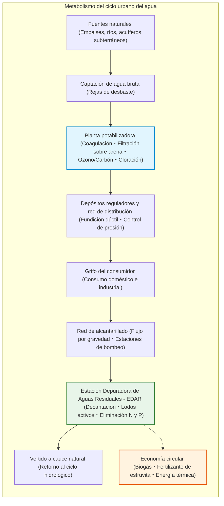
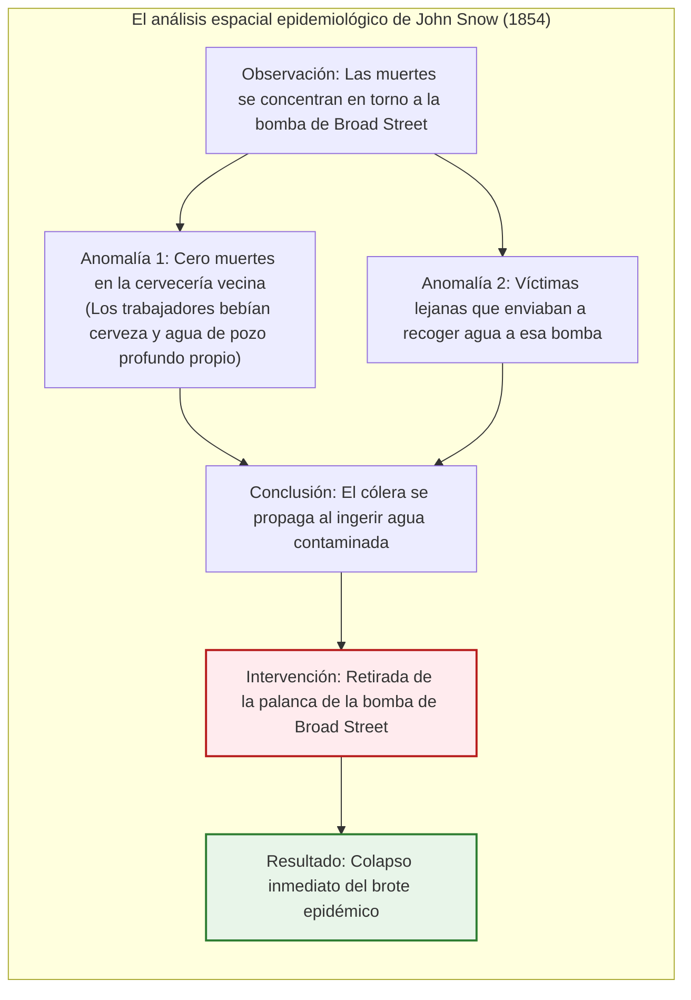
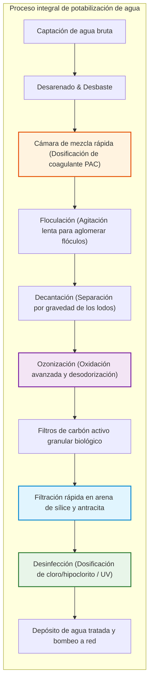
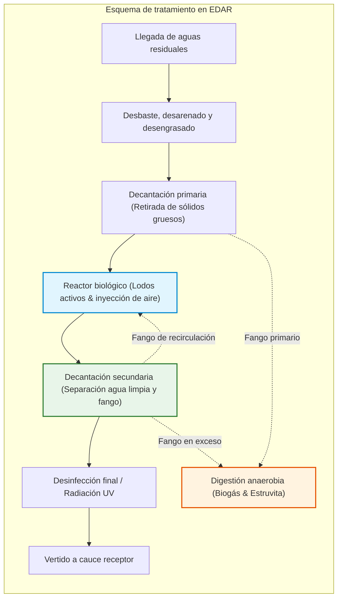

## Introducción: El milagro cotidiano de abrir el grifo y beber agua pura

Cada mañana, millones de personas abren el grifo en sus hogares, se lavan la cara o beben un vaso de agua fresca sin detenerse a pensar en el inmenso sistema técnico que lo hace posible.

Tener acceso continuo a agua incolora, inodora, insípida y 100 % libre de gérmenes patógenos directamente dentro de casa se percibe en las urbes desarrolladas como un hecho tan natural como respirar. Sin embargo, en el contexto de la historia humana, **representa uno de los mayores triunfos de la ingeniería civil, química y biológica**.

Solo una quincena de países en todo el mundo garantizan agua de grifo potable en todo su territorio. Más de 2.000 millones de personas carecen de agua gestionada de forma segura, y enfermedades como el cólera o la fiebre tifoidea siguen cobrándose cientos de miles de vidas al año.

Bajo el asfalto de nuestras ciudades discurre una red invisible de tuberías a presión y colectores de gravedad que supera con creces las redes de carreteras y ferrocarriles, funcionando ininterrumpidamente gracias a la mecánica de fluidos, la química coloidal y la biotecnología ambiental.

---

## Capítulo 1: Agua y civilización — De Roma al Gran Hedor de Londres

Las urbes históricas que no lograron resolver el suministro de agua limpia y la rápida evacuación de excretas sucumbieron inevitablemente ante las epidemias.

### 1.1 Acueductos romanos y la Cloaca Máxima

Roma construyó 11 grandes acueductos que sumaban más de 400 kilómetros. Aprovechando el **gradiente hidráulico natural**, transportaban agua de manantial desde los Apeninos mediante gravedad con pendientes mínimas de pocos decímetros por kilómetro, salvando valles con obras cumbre como el Pont du Gard.

En Roma, el agua entraba en el *castellum aquae* para distribuirse hacia termas, fuentes y villas. Al mismo tiempo, la **Cloaca Máxima** vertía las aguas residuales al Tíber.

> **¿El plomo destruyó a Roma?**  
> La arqueoquímica moderna desmiente que el envenenamiento por plomo causara la caída del imperio. El agua romana era tan rica en carbonato de calcio que en pocas semanas formaba una gruesa capa de cal interior que aislaba el agua del metal tóxico.

### 1.2 El «Gran Hedor» de Londres (1858) y el mapa del cólera de John Snow

En el siglo XIX, la superpoblación de Londres y el uso de retretes sin depuradoras colapsaron el Támesis con aguas fecales. En 1858, el hedor pestilente obligó a suspender las sesiones del Parlamento.

En 1854, el doctor **John Snow** cartografió los fallecimientos por cólera en el barrio de Soho, demostrando que la enfermedad se transmitía por el agua de la bomba pública de Broad Street y no por el aire (desmontando la teoría de los miasmas).

Tras retirar la palanca de la bomba, el brote cesó. El ingeniero **Sir Joseph Bazalgette** construyó entonces más de 1.800 km de alcantarillado interceptor, desterrando el cólera de Londres.

---

## Capítulo 2: El proceso de potabilización en la planta potabilizadora

Las plantas potabilizadoras (ETAP) eliminan coloides y patógenos mediante procesos de coagulación, sedimentación, filtración y desinfección.

Las partículas coloidales en suspensión tienen potencial zeta negativo ($\zeta \approx -15 \text{ a } -30\text{ mV}$) que impide su sedimentación. La adición de coagulantes neutraliza las cargas y permite la formación de flóculos cuya velocidad de sedimentación obedece a la **ley de Stokes**:

$$v_s = \frac{g (\rho_p - \rho_f) d^2}{18 \mu}$$

Aumentar el diámetro de la partícula mil veces incrementa su velocidad de caída **un millón de veces**, permitiendo clarificar el agua en minutos. La desinfección mediante cloro elimina los gérmenes según la **ley de Chick-Watson**:

$$\ln\left(\frac{N}{N_0}\right) = -k \cdot C^n \cdot t$$

---

## Capítulo 3: Redes de distribución bajo presión y saneamiento biológico

El agua potable se distribuye según el **principio de Bernoulli** ($H = z + \frac{P}{\rho g} + \frac{v^2}{2g}$) manteniendo presiones de 2 a 5 bares. Las pérdidas de carga se calculan mediante la fórmula de **Hazen-Williams**:

$$h_f = 10.666 \cdot C_H^{-1.85} \cdot D^{-4.87} \cdot Q^{1.85} \cdot L$$

El agua residual fluye por alcantarillas con velocidades de autolimpieza ($> 0,6\ \text{m/s}$) hasta las depuradoras (EDAR). Allí, el **proceso de lodos activos** utiliza bacterias aerobias y protozoos para metabolizar los contaminantes orgánicos.

El proceso **$A^2O$ (Anaeróbico-Anóxico-Óxico)** elimina nitrógeno transformándolo en gas $\text{N}_2$ y fósforo acumulándolo en las células microbianas.

---

## Capítulo 4: La depuradora como fábrica de recursos

1. **Biogás para energía**: La digestión anaerobia de lodos a 37 °C produce metano ($60\%\ \text{CH}_4$) que abastece la demanda eléctrica de la planta.
2. **Fósforo como estruvita (MAP)**:
   $$\text{Mg}^{2+} + \text{NH}_4^+ + \text{PO}_4^{3-} + 6\text{H}_2\text{O} \longrightarrow \text{MgNH}_4\text{PO}_4 \cdot 6\text{H}_2\text{O} \downarrow$$
   Obtención de fertilizante agrícola de alta pureza.
3. **Energía térmica del alcantarillado**: Aprovechamiento de la temperatura estable de las aguas residuales mediante bombas de calor urbanas.
4. **Eliminación de PFAS**: Filtración por carbón activo granular (GAC), resinas de intercambio iónico y membranas de ósmosis inversa (RO) para erradicar contaminantes persistentes.

## Conclusión: El agua limpia como sello de la civilización

Un simple giro de grifo ofrece vida y salud; presionar una cisterna destierra la enfermedad. Detrás de este gesto milagroso laten siglos de ciencia, ingeniería civil y microbiología: el cimiento indiscutible de la dignidad urbana.
