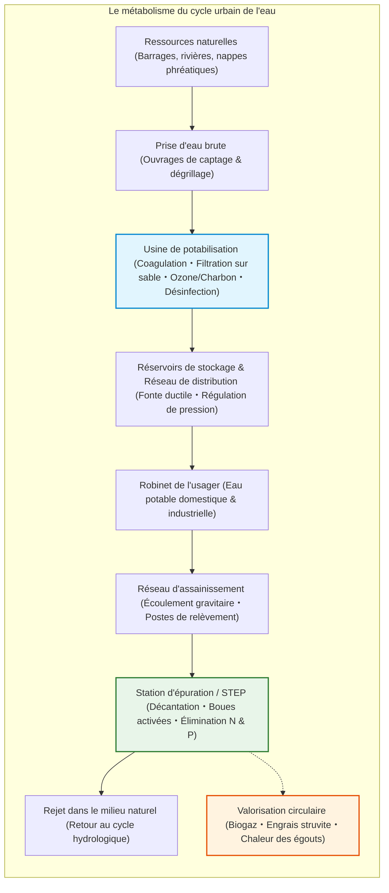
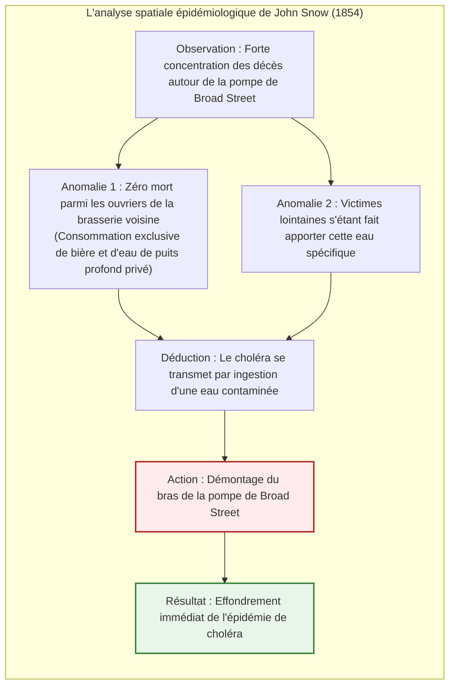
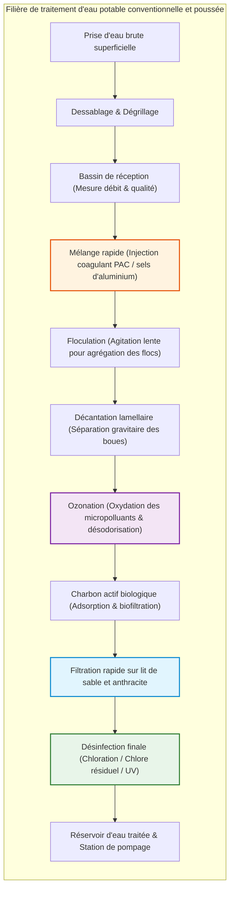
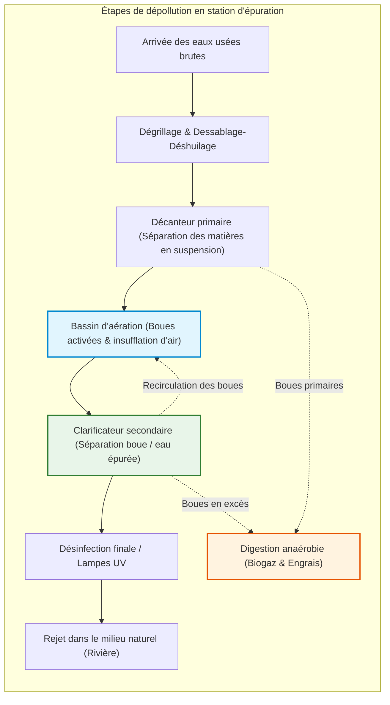

## Introduction : Le prodige quotidien de l'eau potable au robinet

Chaque jour, des centaines de millions de citadins tournent un robinet pour se laver, cuisiner ou étancher leur soif sans jamais douter de la pureté du liquide qui s'en écoule.

Dans nos sociétés modernes, disposer à domicile et à volonté d'une eau limpide, inodore, savoureuse et totalement exempte de germes pathogènes est un geste aussi naturel que respirer. Pourtant, à l'échelle de l'histoire et de la géographie mondiale, **ce confort constitue l'un des exploits techniques les plus prodigieux jamais accomplis par l'humanité**.

Seuls une quinzaine de pays dans le monde peuvent garantir une eau du robinet directement buvable sur l'ensemble de leur territoire. Plus de deux milliards d'êtres humains sont encore privés d'un approvisionnement en eau salubre, et les maladies hydriques (choléra, typhoïde, dysenterie) tuent encore des centaines de milliers de personnes par an.

Parallèlement, bien peu savent où s'écoulent les eaux usées et par quelle magie chimique et biologique elles sont dépolluées avant d'être rejetées dans les rivières. Sous nos pas s'étend un gigantesque réseau de centaines de milliers de kilomètres de canalisations sous pression et d'émissaires gravitaires, où la mécanique des fluides, la chimie colloïdale et les biotechnologies bactériennes œuvrent jour et nuit sans interruption.

---

## Chapitre 1 : Une histoire d'eau et de villes — De Rome à la Grande Puanteur de Londres

L'histoire des métropoles est celle d'un combat perpétuel pour amener l'eau pure et évacuer sans délai les déjections. Toute cité antique incapable de relever ce défi voyait sa population décimée dès qu'elle franchissait le cap de quelques dizaines de milliers d'âmes.

### 1.1 Aqueducs romains et Cloaca Maxima

Le premier apogée du génie hydraulique fut romain. Dès 312 av. J.-C., Rome édifia 11 grands aqueducs totalisant plus de 400 kilomètres.

Les ingénieurs romains maîtrisaient la **pente hydraulique** : puisant l'eau de source à des dizaines de kilomètres dans les Apennins, ils la faisaient s'écouler par la seule force de gravité sur des pentes infimes (quelques décimètres par kilomètre), franchissant les vallées grâce à des ponts-aqueducs comme le Pont du Gard.

À Rome, l'eau parvenait dans un château d'eau central (*castellum aquae*), d'où des canalisations de plomb et de terre cuite alimentaient fontaines publiques, thermes colossaux et villas. La consommation dépassait 1 000 litres par habitant et par jour. Simultanément, la **Cloaca Maxima** évacuait les boues urbaines vers le Tibre.

> **Le mythe réfuté du saturnisme romain**  
> L'idée que Rome s'est effondrée à cause de ses tuyaux en plomb (*plumbum*) est contredite par l'archéochimie. L'eau romaine, très dure et calcaire, déposait en quelques semaines un épais tartre de carbonate de calcium qui isolait parfaitement l'eau du métal.

### 1.2 La « Grande Puanteur » de Londres (1858) et la carte de John Snow

Au XIXe siècle, la révolution industrielle fit exploser la population londonienne. L'usage du tout-à-l'égout sans traitement déversa les fosses d'aisances dans la Tamise, d'où les compagnies privées pompaient l'eau potable.

Lors de l'été caniculaire de 1858, le fleuve en fermentation dégagea une puanteur insoutenable qui fit fuir les députés de Westminster : ce fut la **Grande Puanteur (The Great Stink)**.

Alors que les médecins croyaient à la théorie des miasmes (maladie causée par l'air vicié), le docteur **John Snow** étudia l'épidémie de choléra de Soho en 1854 en cartographiant méticuleusement chaque décès.

En faisant retirer le bras de la pompe incriminée, Snow stoppa net l'épidémie. Peu après, l'ingénieur **Sir Joseph Bazalgette** construisit plus de 1 800 kilomètres d'égouts collecteurs maçonnés, éliminant définitivement le choléra de la capitale britannique.

---

## Chapitre 2 : La transformation en eau potable dans l'usine de traitement

Les usines de potabilisation modernes éliminent la turbidité, les germes et les micropolluants par une succession de barrières physiques et chimiques.

### 2.1 Coagulation, floculation et loi de Stokes

Les particules d'argile en suspension possèdent un potentiel zêta négatif ($\zeta \approx -15 \text{ à } -30\text{ mV}$) qui empêche leur sédimentation naturelle.

L'injection de coagulants métalliques (polychlorure d'aluminium PAC) neutralise ces charges. Les micro-particules s'agglomèrent en flocs dont la vitesse de chute obéit à la **loi de Stokes** :

$$v_s = \frac{g (\rho_p - \rho_f) d^2}{18 \mu}$$

Multiplier la taille des particules par 1 000 accélère leur sédimentation par **un million**, permettant de clarifier l'eau en quelques minutes.

### 2.2 Filtration, désinfection et loi de Chick-Watson

L'eau traverse ensuite des filtres bicouches d'anthracite et de sable avant d'être désinfectée au chlore ou dioxyde de chlore. L'acide hypochloreux ($\text{HOCl}$) pénètre les parois cellulaires bactériennes et détruit leurs enzymes. La désinfection suit la **loi de Chick-Watson** :

$$\ln\left(\frac{N}{N_0}\right) = -k \cdot C^n \cdot t$$

---

## Chapitre 3 : Hydraulique des réseaux de distribution sous pression

L'eau circule selon le **théorème de Bernoulli** :

$$H = z + \frac{P}{\rho g} + \frac{v^2}{2g}$$

Les châteaux d'eau et réservoirs surélevés garantissent par gravité une pression constante de 3 à 5 bars sur le réseau. Les pertes de charge par frottement sont calculées par la formule de **Hazen-Williams** :

$$h_f = 10.666 \cdot C_H^{-1.85} \cdot D^{-4.87} \cdot Q^{1.85} \cdot L$$

Les réseaux modernes s'appuient sur la fonte ductile et des joints verrouillés pour résister aux mouvements de terrain et aux coups de bélier.

---

## Chapitre 4 : Assainissement et traitement par boues activées

L'eau souillée s'écoule par gravité dans les égouts (vitesse d'autocurage $> 0,6\ \text{m/s}$). En station d'épuration, les **boues activées** (procédé créé en 1914) utilisent des milliards de bactéries aérobies et protozoaires pour digérer les matières organiques dissoutes.

La cinétique de dégradation de la DBO suit le modèle de **Monod** :

$$\mu = \mu_{\max} \frac{S}{K_s + S}$$

Le procédé **$A^2O$ (Anaérobie-Anoxie-Aérobie)** élimine l'azote par dénitrification en azote gazeux ($\text{N}_2$) et le phosphore par assimilation biologique poussée.

---

## Chapitre 5 : L'usine d'assainissement comme mine de ressources

Les stations modernes deviennent des bio-raffineries :
1. **Méthanisation** : fermentation des boues produisant du biométhane pour la production d'électricité verte.
2. **Récupération du phosphore sous forme de struvite (MAP)** :
   $$\text{Mg}^{2+} + \text{NH}_4^+ + \text{PO}_4^{3-} + 6\text{H}_2\text{O} \longrightarrow \text{MgNH}_4\text{PO}_4 \cdot 6\text{H}_2\text{O} \downarrow$$
3. **Chaleur des égouts** : valorisation thermique par pompes à chaleur pour le chauffage urbain.
4. **Piégeage des PFAS** : adsorption sur charbon actif, résines échangeuses d'ions et osmose inverse.

## Conclusion : L'eau pure, socle de la civilisation

Ouvrir le robinet et voir couler une eau pure, c'est contempler le chef-d'œuvre invisible de milliers d'ingénieurs et de biologistes veillant jour et nuit sur le bien le plus précieux de l'humanité.
