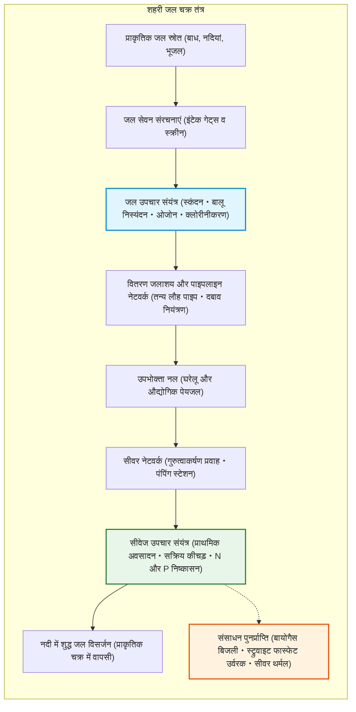
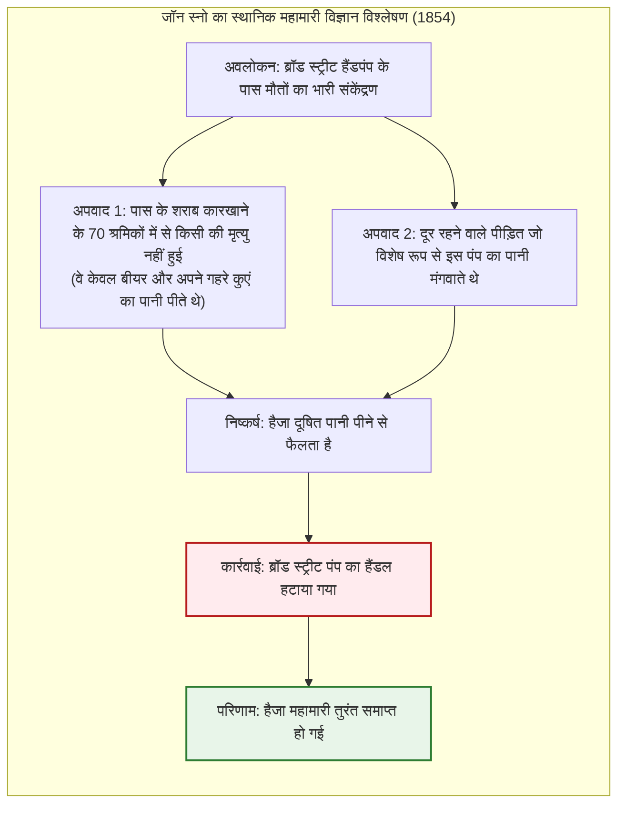
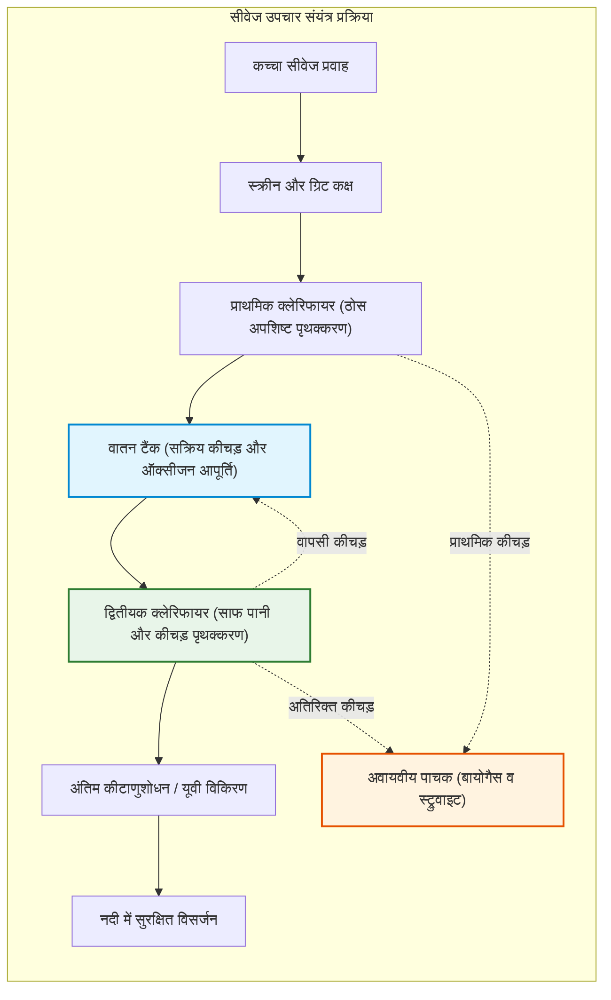

## प्रस्तावना: नल से शुद्ध पीने के पानी का दैनिक चमत्कार

हर सुबह आधुनिक शहरों में करोड़ों लोग बिना किसी हिचकिचाहट के वॉशबेसिन का नल खोलते हैं, ब्रश करते हैं और ताजा पानी पीते हैं।

विकसित शहरी समाज में घर के भीतर चौबीसों घंटे पारदर्शी, गंधहीन, स्वादयुक्त और रोगजनकों से 100% मुक्त पेयजल मिलना हवा में सांस लेने जैसा स्वाभाविक माना जाता है। लेकिन मानव इतिहास के संदर्भ में, **यह मानव सभ्यता द्वारा निर्मित सबसे शानदार इंजीनियरिंग चमत्कारों में से एक है**।

दुनिया के केवल 15 देशों में नल का पानी सीधे पूरे देश में पीने योग्य है। दुनिया भर में 2 अरब से अधिक लोगों के पास सुरक्षित पेयजल की कमी है, और हैजा तथा टाइफाइड जैसी जलजनित बीमारियां आज भी हर साल लाखों जानें लेती हैं।

शहरों की सड़कों के नीचे पानी की पाइपलाइनों और सीवर का विशाल नेटवर्क सड़कों से भी लंबा है, जो द्रव यांत्रिकी, कोलाइडल रसायन विज्ञान और माइक्रोबियल जैव प्रौद्योगिकी के दम पर 24 घंटे लगातार संचालित होता है।

---

## अध्याय 1: पानी और शहरों का इतिहास — रोम से लंदन की 'ग्रेट स्टिंक' तक

जो प्राचीन शहर साफ पानी लाने और सीवेज निकालने में असमर्थ रहे, वे महामारियों की चपेट में आकर नष्ट हो गए।

### 1.1 रोमन एक्वाडक्ट्स और क्लोअका मैक्सिमा

रोमन साम्राज्य ने 400 किमी से अधिक लंबे 11 एक्वाडक्ट्स बनाए। प्राकृतिक गुरुत्वाकर्षण ढलान का उपयोग करके, वे पोंट डू गार्ड जैसे मेहराबदार पुलों के माध्यम से पहाड़ों से पानी लाते थे। रोम का सीवेज **क्लोअका मैक्सिमा (Cloaca Maxima)** के जरिए टाइबर नदी में बहाया जाता था।

> **रोमन सीसा विषाक्तता का सच**  
> आधुनिक पुरातत्व रसायन विज्ञान ने साबित किया है कि सीसे के पाइपों से रोम नष्ट नहीं हुआ। रोम के चूनेदार कठोर पानी ने पाइपों के भीतर कैल्शियम कार्बोनेट की मोटी परत जमा दी थी, जिसने पानी को सीसे से पूरी तरह अलग रखा।

### 1.2 1858 लंदन की 'ग्रेट स्टिंक' और जॉन स्नो का हैजा मानचित्र

19वीं शताब्दी में टेम्स नदी में सीवेज बहाए जाने से नदी सड़ गई, जिससे 1858 में असहनीय दुर्गंध फैली, जिसे **'ग्रेट स्टिंक'** कहा गया।

1854 में डॉ. **जॉन स्नो** ने सोहो में हैजा पीड़ितों का नक्शा तैयार किया और साबित किया कि यह ब्रॉड स्ट्रीट के सार्वजनिक पंप के गंदे पानी से फैला था।

पंप का हैंडल हटाते ही बीमारी रुक गई। बाद में इंजीनियर **सर जोसेफ बजलगैट** ने 1,800 किमी लंबा सीवर नेटवर्क बनाकर लंदन को सुरक्षित किया।

---

## अध्याय 2: जल उपचार इंजीनियरिंग

कच्चे पानी में मिट्टी के कणों पर नकारात्मक ज़ेटा क्षमता ($\zeta \approx -15 \dots -30\text{ mV}$) होती है, जिससे वे तैरते रहते हैं। फिटकरी या PAC मिलाने पर कण आपस में जुड़ते हैं, जिनकी बैठने की गति **स्टोक्स के नियम** द्वारा निर्धारित होती है:

$$v_s = \frac{g (\rho_p - \rho_f) d^2}{18 \mu}$$

कण का आकार 1,000 गुना बढ़ाने से तलछट की गति **10 लाख गुना** तेज हो जाती है। क्लोरीन द्वारा कीटाणुशोधन **चिक-वाटसन नियम** का पालन करता है:

$$\ln\left(\frac{N}{N_0}\right) = -k \cdot C^n \cdot t$$

---

## अध्याय 3: पाइपलाइन हाइड्रोलिक्स और सक्रिय कीचड़ उपचार

पानी **बरनौली सिद्धांत** ($H = z + \frac{P}{\rho g} + \frac{v^2}{2g}$) और **हेज़ेन-विलियम्स समीकरण** के अनुसार बहता है:

$$h_f = 10.666 \cdot C_H^{-1.85} \cdot D^{-4.87} \cdot Q^{1.85} \cdot L$$

सीवेज प्लांट में **सक्रिय कीचड़ प्रक्रिया (Activated Sludge Process)** में अरबों बैक्टीरिया एरोबिक रूप से कार्बनिक कचरे को साफ करते हैं। माइक्रोबियल विकास **मोनॉड कैनेटीक्स** का पालन करता है:

$$\mu = \mu_{\max} \frac{S}{K_s + S}$$

**$A^2O$ प्रक्रिया** नाइट्रोजन को गैस ($\text{N}_2$) में बदलकर और फास्फोरस को अवशोषित करके नदियों को सुरक्षित रखती है।

---

## अध्याय 4: सीवेज से संसाधन पुनर्प्राप्ति

1. **बायोगैस बिजली उत्पादन**: 37 डिग्री सेल्सियस पर मीथेन गैस ($60\%\ \text{CH}_4$) बनाकर संयंत्र को आत्मनिर्भर बनाना।
2. **स्ट्रुवाइट (MAP) उर्वरक**:
   $$\text{Mg}^{2+} + \text{NH}_4^+ + \text{PO}_4^{3-} + 6\text{H}_2\text{O} \longrightarrow \text{MgNH}_4\text{PO}_4 \cdot 6\text{H}_2\text{O} \downarrow$$
3. **PFAS निष्कासन**: सक्रिय कार्बन और रिवर्स ऑस्मोसिस (RO) द्वारा खतरनाक रसायनों को पूरी तरह नष्ट करना।

## निष्कर्ष: स्वच्छ जल ही सभ्यता की वास्तविक पहचान है

नल से बहता शुद्ध जल और सीवर द्वारा गंदगी का सुरक्षित निष्कासन मानव इतिहास की सबसे मौन लेकिन सबसे अमूल्य वैज्ञानिक विजय है।
