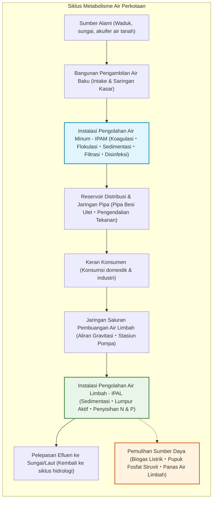
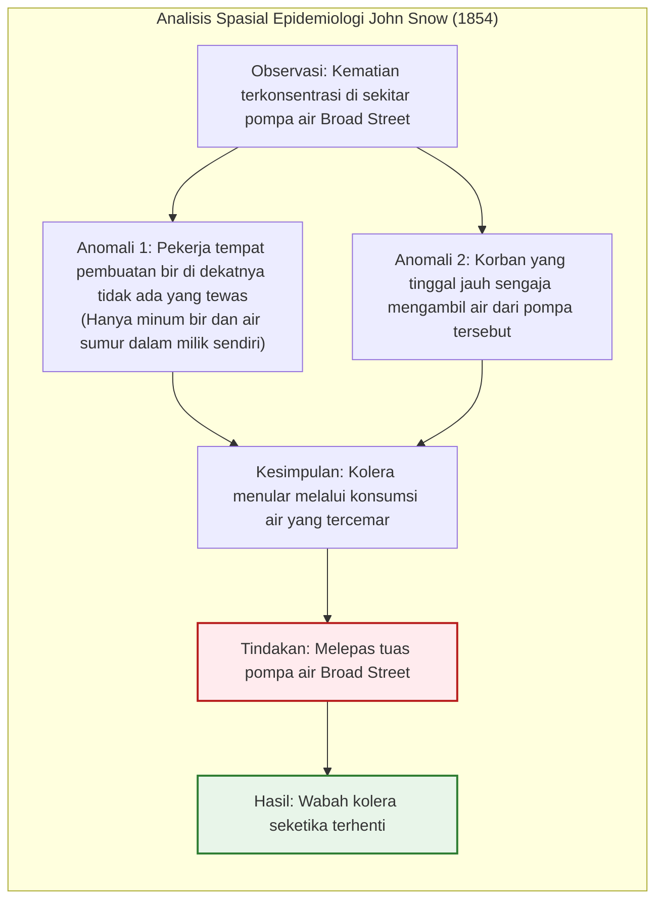
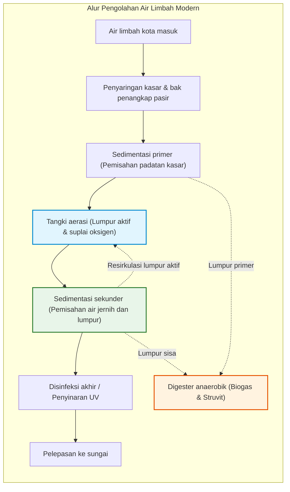

## Pendahuluan: Keajaiban Sehari-hari Air Bersih dari Keran

Setiap pagi, ratusan juta warga kota modern memutar keran wastafel, menggosok gigi, atau menuangkan segelas air segar tanpa ragu sedikit pun akan kebersihannya.

Di negara-negara maju, memiliki akses instan ke air minum yang jernih, tanpa bau, tanpa rasa, dan steril di dalam rumah dianggap sebagai hal yang lumrah layaknya bernapas. Namun, dalam kacamata sejarah dan geografi global, **kenyamanan ini adalah salah satu pencapaian rekayasa paling menakjubkan yang pernah dibangun umat manusia**.

Hanya sekitar belasan negara di dunia yang menjamin air kerannya aman diminum langsung di seluruh pelosok wilayahnya. Lebih dari dua miliar manusia masih kekurangan akses air minum yang dikelola secara aman, dan penyakit bawaan air seperti kolera dan tifus masih merenggut ratusan ribu jiwa setiap tahunnya.

Di bawah aspal kota modern terbentang jejaring pipa air minum bertekanan dan saluran pembuangan gravitasi yang panjangnya melebihi jaringan jalan raya, beroperasi tanpa henti 24 jam sehari berkat mekanika fluida, kimia koloid, dan bioteknologi mikroba.

---

## Bab 1: Sejarah Air dan Kota — Dari Roma Kuno hingga Wabah London

Kota-kota kuno yang gagal mengatasi penyediaan air bersih dan pembuangan tinja yang cepat pasti runtuh diterpa wabah penyakit menular.

### 1.1 Akuaduk Romawi Kuno dan Cloaca Maxima

Kekaisaran Romawi membangun 11 jalur **akuaduk (saluran air bertingkat)** sepanjang lebih dari 400 kilometer. Mengandalkan **gradien hidrolik alami**, air pegunungan dialirkan puluhan kilometer hanya dengan gravitasi pada kemiringan sangat landai, melintasi lembah melalui jembatan lengkung batu seperti Pont du Gard. Limbah kota kemudian dialirkan ke Sungai Tiber melalui saluran raksasa **Cloaca Maxima**.

> **Mitos Keracunan Timbal Romawi**  
> Studi arkeokimia modern membantah bahwa Roma runtuh akibat pipa timbal (*plumbum*). Air Romawi yang kaya kapur segera melapisi bagian dalam pipa dengan kerak kalsium karbonat tebal, mengisolasi air dari kontak langsung dengan logam timbal.

### 1.2 «Bau Busuk Raya» London (1858) dan Peta Kolera John Snow

Revolusi Industri memicu lonjakan populasi London hingga 2 juta jiwa. Kotoran manusia yang dibuang langsung ke Sungai Thames mencemari air minum kota. Pada musim panas 1858, pembusukan limbah menghasilkan bau menyengat tak tertahankan yang dikenal sebagai **The Great Stink**.

Pada tahun 1854, dr. **John Snow** memetakan titik kematian akibat kolera di distrik Soho dan membuktikan bahwa penyakit tersebut ditularkan melalui air tercemar dari pompa umum Broad Street, mematahkan teori miasma (udara busuk).

Setelah tuas pompa dilepas, wabah mereda seketika. Selanjutnya, insinyur **Sir Joseph Bazalgette** membangun lebih dari 1.800 km saluran pembuangan bawah tanah, melenyapkan kolera dari London untuk selamanya.

---

## Bab 2: Rekayasa Pemurnian Air Minum di IPAM

Partikel koloid tanah liat dalam air baku memiliki potensial zeta negatif ($\zeta \approx -15 \text{ hingga } -30\text{ mV}$) yang saling tolak-menolak. Penambahan koagulan (PAC) menetralkan muatan listrik partikel, membentuk flok yang laju pengendapannya mengikuti **Hukum Stokes**:

$$v_s = \frac{g (\rho_p - \rho_f) d^2}{18 \mu}$$

Memperbesar ukuran partikel 1.000 kali mempercepat pengendapannya **satu juta kali lebih cepat**. Disinfeksi dengan klorin membasmi patogen sesuai **Hukum Chick-Watson**:

$$\ln\left(\frac{N}{N_0}\right) = -k \cdot C^n \cdot t$$

---

## Bab 3: Distribusi Pipa Bertekanan dan Pengolahan Biologis Lumpur Aktif

Air bersih dialirkan mengikuti **Prinsip Bernoulli** ($H = z + \frac{P}{\rho g} + \frac{v^2}{2g}$) dan rumus **Hazen-Williams**:

$$h_f = 10.666 \cdot C_H^{-1.85} \cdot D^{-4.87} \cdot Q^{1.85} \cdot L$$

Di IPAL, **proses lumpur aktif** memanfaatkan miliaran bakteri aerob dan protozoa dalam tangki aerasi untuk mencerna polutan organik. Kinetika pertumbuhan biomassa mengikuti **Persamaan Monod**:

$$\mu = \mu_{\max} \frac{S}{K_s + S}$$

Proses **$A^2O$ (Anaerobik-Anoksik-Oksik)** menyisihkan nitrogen menjadi gas nitrogen ($\text{N}_2$) dan fosfor ke dalam sel mikroba guna mencegah eutrofikasi perairan.

---

## Bab 4: Pengolahan Limbah sebagai Sumber Daya

1. **Biogas Listrik**: Fermentasi lumpur menghasilkan gas metana ($60\%\ \text{CH}_4$) untuk pembangkit listrik mandiri.
2. **Pemulihan Fosfat sebagai Struvit (MAP)**:
   $$\text{Mg}^{2+} + \text{NH}_4^+ + \text{PO}_4^{3-} + 6\text{H}_2\text{O} \longrightarrow \text{MgNH}_4\text{PO}_4 \cdot 6\text{H}_2\text{O} \downarrow$$
3. **Penyisihan PFAS**: Filtrasi karbon aktif granular (GAC), resin penukar anion, dan osmosis terbalik (RO) untuk mengeliminasi senyawa sintetis berbahaya.

## Kesimpulan: Air Bersih sebagai Martabat Peradaban

Memutar keran dan menikmati air jernih adalah anugerah yang ditopang oleh keringat para insinyur dan ilmuwan selama berabad-abad. Jaringan air bawah tanah adalah bukti nyata peradaban manusia yang bermartabat.
