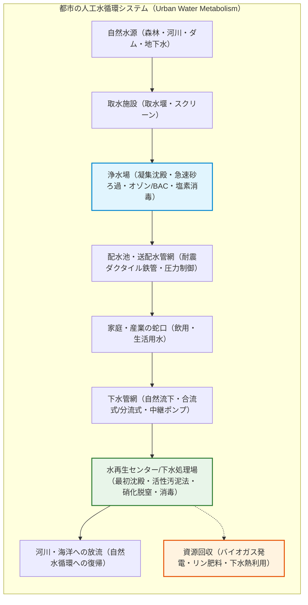
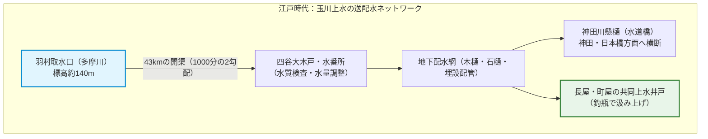
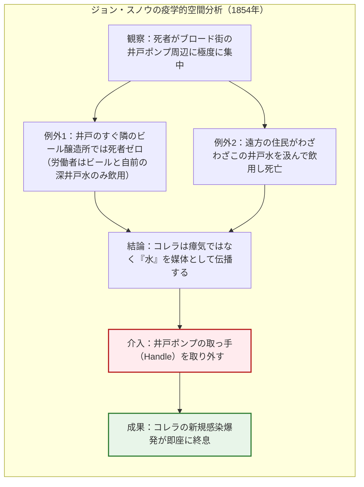
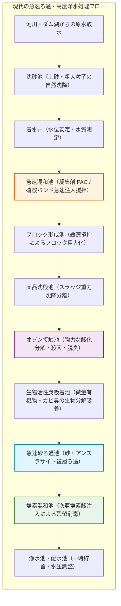
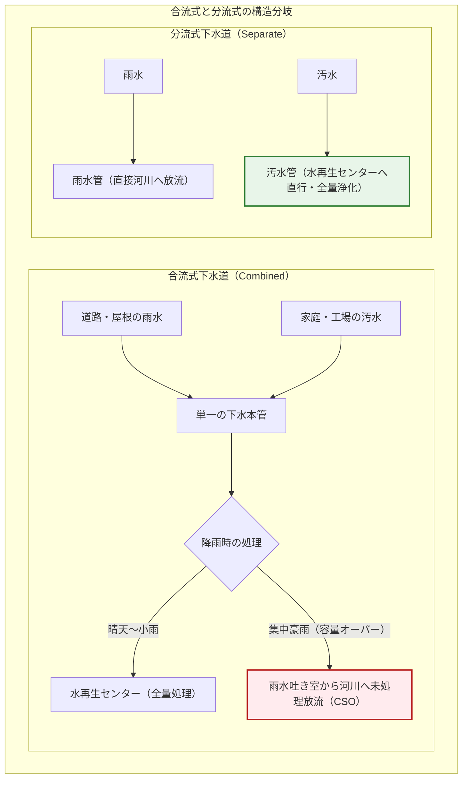
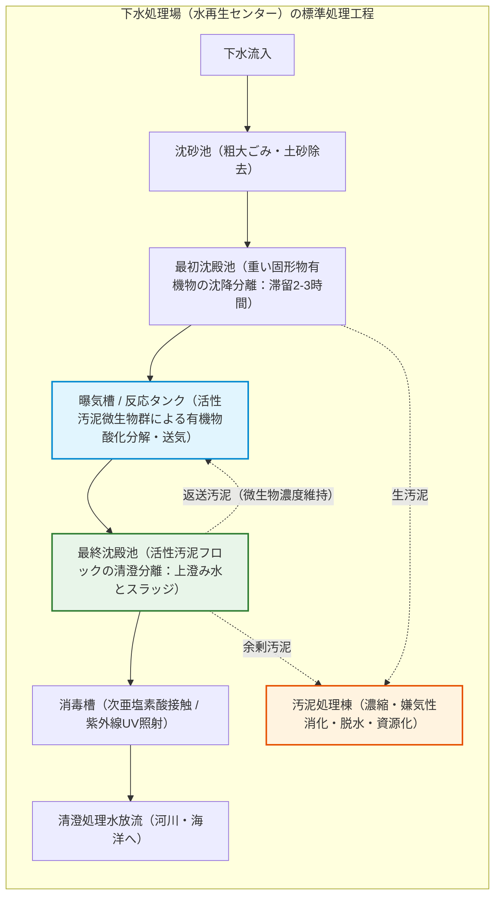
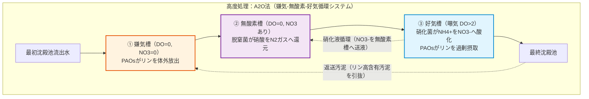
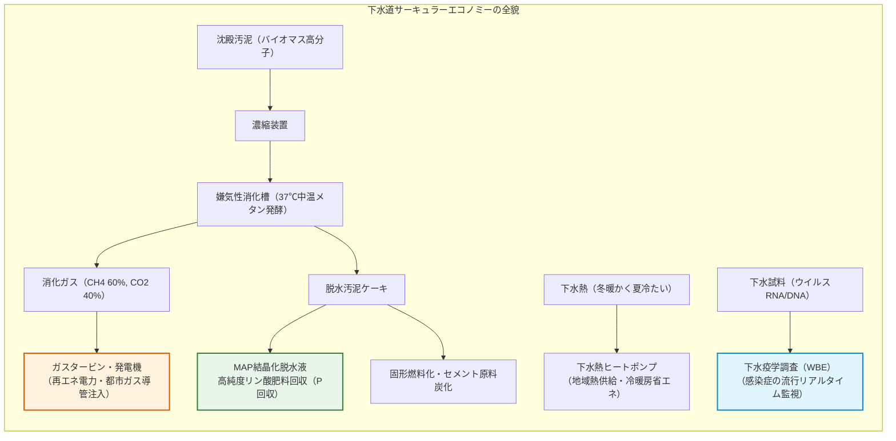
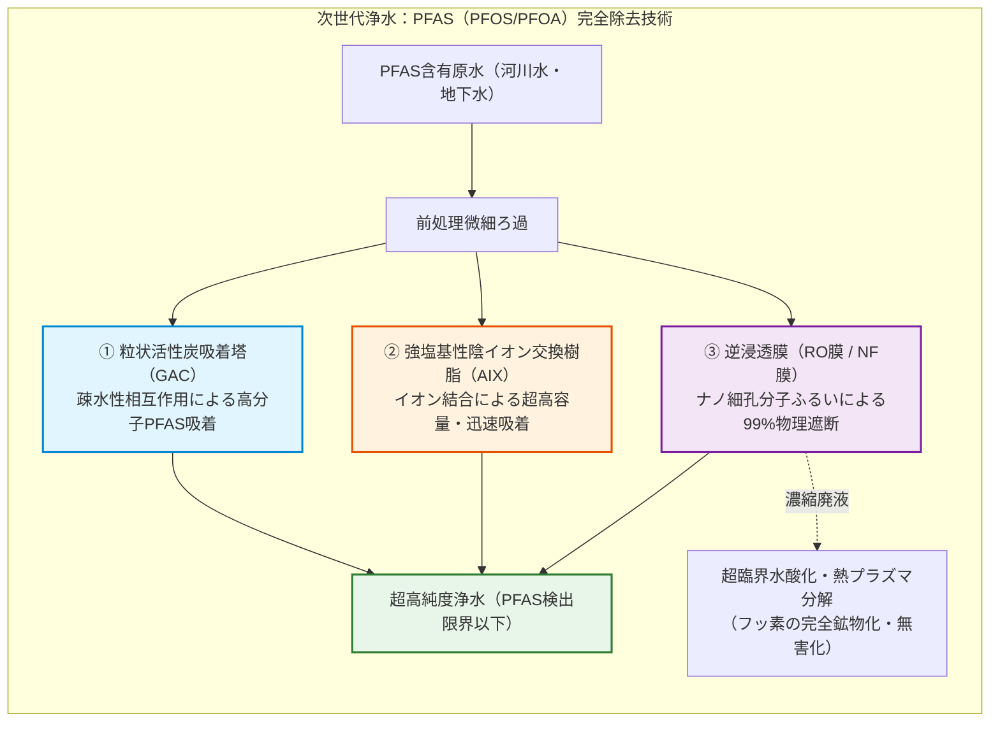

## はじめに：蛇口をひねれば「飲める水」が出るという奇跡

朝起きて洗面台の蛇口をひねる。あるいは台所でグラスに水を注ぎ、何の疑いもなく喉を潤す。

現代の日本や先進国の都市に生きる私たちにとって、蛇口から無色透明で無味無臭、病原菌が皆無の「清浄な水」が無尽蔵に流れ出すことは、呼吸することと同じくらい自明の日常である。しかし、地球規模の視点、あるいは数千年の人類史のスケールで見つめ直したとき、この日常は**人類工学が到達した最も精緻で壮大な奇跡**であることに気づかされる。

現在、世界約190カ国の中で「水道水をそのまま蛇口から直接飲める国」は、日本、ドイツ、スイス、オーストリア、アイスランド、オーストラリアなど、わずか十数カ国（国際連合等の統計による）に過ぎない。世界人口の4人に1人にあたる約20億人が安全に管理された飲料水を利用できず、不衛生な水に起因する感染症（コレラ、チフス、赤痢など）によって、今なお毎年数十万人もの命が失われている。

さらに、私たちが使い終えた水——トイレを流し、風呂の栓を抜き、洗濯機から排出された濁った汚水——が、どこを通り、どのようにして魚の棲める清流へと浄化され自然界へと還流していくのかを、正確に思い描ける人は極めて少ない。

都市の地下には、道路網や鉄道路線よりも遥かに長大で複雑な「水のハイウェイ」が張り巡らされている。日本全国の上水道管の総延長は約74万キロメートル（地球約18周分）、下水道管の総延長は約49万キロメートル（地球約12周分）に達する。地上の喧騒の下で、24時間365日、1秒の停止も許されず、重力と流体力学、コロイド化学と微生物工学が織りなす巨大な浄化サイクルが脈打っている。

本稿では、水源から蛇口、そして下水処理を経て自然へと至る水の全旅路を、水理学・界面化学・生物化学工学・都市公衆衛生史のあらゆる側面から徹底的に解剖する。



---

## 第1章：水と都市の興亡史——古代ローマからロンドンの悪臭、江戸の上水まで

都市の歴史とは、すなわち「いかにして安全な水を引いてくるか」、そして「いかにして汚れた水を速やかに排除するか」という、水との格闘の歴史そのものである。十分な水供給と排水機構を持たない都市は、人口が数万人を超えた瞬間に自らの排泄物と伝染病によって自滅する運命にあった。

### 1.1 古代ローマの水道橋と「クロアカ・マキシマ」の遺産

水インフラの最初の頂点を築いたのは古代ローマ帝国であった。紀元前312年に完成した最初のアッピア水道を皮切りに、ローマ市内には計11系統、総延長400キロメートルを超える**水道橋（Aquaeductus）**が建設された。

ローマの土木技師たちは、遠く数十キロ離れたアペニン山脈の清冽な湧水を水源とし、高低差わずか数百メートルという極めて緩やかな**動水勾配（数千分の一の勾配）**を保ちながら、山をくり抜くトンネルと谷を跨ぐ連続アーチ水道橋（ポン・デュ・ガールなど）を建設した。ポンプなどの動力が存在しない時代、水を運ぶ駆動力は純粋な「重力」のみであった。

市内に入った水は、**カステルム・アクアエ（Castellum Aquae：分水塔）**に集められ、落差を利用した圧力によって公共噴水、公衆浴場（テルマエ）、貴族の私邸へと鉛管や素焼きパイプを通じて配水された。当時のローマ市民1人あたりの日給水量は1,000リットル近くに達したとされ、これは現代の先進国都市の消費量（約200〜300リットル/日）を遥かに上回っていた。

同時に、ローマは紀元前6世紀から建設が始まった巨大下水道**クロアカ・マキシマ（Cloaca Maxima）**を擁していた。湿地帯の排水と雨水排除を主目的として作られたこの大暗渠は、やがて公衆トイレや浴場からの排水を受け入れ、テヴェレ川へと一括放流した。

> **【歴史の真相：ローマ滅亡＝鉛中毒説の虚構】**  
> 「ローマ貴族は水道管に鉛管（Plumbum）を使用していたため鉛中毒になり帝国が滅びた」という通説があるが、近年の考古水理学の研究によってこれはほぼ否定されている。ローマの水は極めて硬度の高い石灰質（炭酸カルシウム等）を多く含んでいたため、通水開始からわずか数ヶ月でパイプ内壁に厚い炭酸カルシウム（スケール）の結晶層が沈着し、水と鉛が直接接触することは物理的に遮断されていたからである。

### 1.2 江戸百万人を潤した「神田上水」「玉川上水」の土木工学

西洋中世が暗黒時代に入り、上下水道技術が退行して糞尿が路上に投棄される不衛生な都市へと堕落していった頃、17〜18世紀の東洋において世界最大級の清潔な百万都市を維持していたのが日本の「江戸」であった。

徳川家康が幕府を開いた江戸は、日比谷入江などを埋め立てた低地が多く、井戸を掘っても塩分混じりの海水や泥水が湧き出るため、生活飲料水の確保が致命的な課題であった。そこで開削されたのが、日本最古の都市水道とされる**神田上水**（小石川上水）、そして承応2年（1653年）に玉川庄右衛門・清右衛門兄弟がわずか8ヶ月で開削した全長約43キロメートルに及ぶ**玉川上水**である。

玉川上水は、羽村の取水堰（東京都羽村市）から多摩川の水を取り入れ、武蔵野台地の尾根筋（最も高い標高部分）を巧みにトレースしながら四谷大木戸（現在の新宿区四谷）まで自然流下させた。その平均勾配は**1000分の2（1キロメートル進んでわずか2メートルの落差）**という、測量機器の乏しい江戸初期としては驚異的な土木技術の結晶であった。

四谷大木戸の水番所からは地下へと潜り、**木樋（もくひ：ヒノキやマツをくり抜いた木製パイプ）**や**石樋（いしひ）**、竹管によって網の目のように江戸市中の地下へ配水された。谷を越える場所では**懸樋（かけひ）**と呼ばれる木造の水道橋（水道橋の地名の由来）が架けられた。配水された水は、長屋の路地などに設置された共同の「釣瓶井戸（上水井戸）」の底に接続され、住民は地下水ではなく上水道から湧き出る水を釣瓶で汲み上げていたのである。

さらに江戸の下水生態系を語る上で欠かせないのが、**屎尿（しにょう）の完全資源循環システム**である。江戸市中の人糞尿は下水に流されるのではなく、近郊の農民が野菜と物々交換、あるいは金銭で購入して農地の貴重な下肥（肥料）として徹底利用された。このため、江戸の川や堀には有機汚濁物質が流れ込まず、コレラなどの水系感染症の蔓延が最小限に抑えられていた。



### 1.3 19世紀ロンドンの大悪臭とジョン・スノウの疫学調査

19世紀の産業革命は、爆発的な人口集中を都市にもたらした。その震源地である英ロンドンにおいて、上下水道の欠如は地獄のような公衆衛生のカタストロフィを引き起こした。

当時、水洗トイレ（Water Closet）が普及し始めたものの、近代的な下水道が存在しなかったため、約20万基の浸透便槽（Cesspool）から溢れ出た糞尿は雨水溝を経てすべてテムズ川へと垂れ流されていた。そして、水道会社はその汚濁極まるテムズ川から下流で取水し、濁った水を市民の飲料水として供給していたのである。

1858年の猛暑期、テムズ川は腐敗した糞尿のヘドロで発酵し、国会議事堂の議事進行が不可能になるほどの凄まじい悪臭を放った。歴史に名高い**「大悪臭（The Great Stink）」**である。

当時の医学界は、感染症は腐敗した空気から発生する毒気によって伝染するという**「瘴気説（Miasma Theory）」**を盲信していた。この迷信を科学的実証によって粉砕したのが、医師**ジョン・スノウ（John Snow）**であった。

1854年、ロンドンのソーホー地区ブロード・ストリート周辺で突如コレラが大流行し、わずか数日で600人以上が死亡した。スノウは患者が発生した家を1軒ずつ訪問し、街角の地図上に死亡者の発生地点を棒グラフ状にプロットしていった（歴史上最初の空間疫学マップ）。



スノウの調査は驚くべき事実を暴き出した。
1. 死亡者はすべて**ブロード・ストリートの公営給水ポンプ**から水を汲んでいた。
2. 井戸のすぐ隣にあったビール醸造所の作業員70名からは、コレラ患者が1人も出なかった（作業員は支給されるビールと敷地内の独立深井戸水しか飲んでいなかった）。
3. 遠隔地で死亡した女性の遺族を調査したところ、「ブロード・ストリートのポンプ水がおいしい」という理由でわざわざ水を取り寄せて飲んでいた。

スノウは行政を説得し、ポンプの**「取っ手（Handle）」**を取り外させた。その瞬間から感染爆発は劇的に鎮静化した。後の発掘調査で、この井戸の地下石積みの隙間に、コレラに感染した乳児の布おむつを洗っていた隣家の汚水槽（Cesspool）の汚水が浸透していたことが証明された。ロベルト・コッホがコレラ菌を発見する30年も前に、「水系感染症」の病態がデータと論理によって暴かれた瞬間であった。

### 1.4 ジョセフ・バザルゲットと近代下水道の誕生

大悪臭とコレラの惨禍に直面した英国議会は、首都土木委員会（Metropolitan Board of Works）の主任技術者**ジョセフ・バザルゲット（Sir Joseph Bazalgette）**に、ロンドン全域の抜本的下水道網の構築を委託した。

バザルゲットの設計思想は圧倒的に先見的であった。彼はロンドンの地形の高低差を計算し尽くし、テムズ川と平行に走る3本の巨大な**幹線遮集下水道（Interceptors）**を建設した。市中から川へ流れ落ちる汚水をすべて途中でインターセプト（遮集）し、重力と巨大な蒸気ポンプ揚水所（クロスネス揚水所など）を組み合わせて、ロンドン市街地から遥か下流の河口域（テムズ東部エセックス側）まで一気に流し去る計画であった。

特筆すべきは管径の設計である。バザルゲットは当時の人口増加予測から必要な管径を算出した後、**「人は一度しか下水道を作らない。すべての数値を2倍にしろ」**と命じた。

1865年に完成したこの全長約1,800キロメートルにおよぶ巨大レンガ造り下水道網は、現在もロンドンの地下で現役で稼働し続けている。下水道の整備以降、ロンドンで水系感染症による大規模なコレラ流行が再発することは二度となかった。

---

## 第2章：蛇口までの旅路——浄水場の超精密プロセス工学

現代都市の浄水場は、自然界の濁りや細菌、ウイルス、化学物質を完全に取り除き、化学薬品による消毒を施して無害な水を作り出す巨大な「化学・物理工学プラント」である。

日本の水道法第4条に基づく「水質基準省令」では、大腸菌群（検出されないこと）、一般細菌（100CFU/mL以下）、重金属（ヒ素、鉛、カドミウム等）、有機フッ素化合物（PFOS/PFOA）、消毒副生成物（トリハロメタン等）など、**51項目に及ぶ極めて厳格な水質基準**が定められており、常時監視されている。



### 2.1 水源の多様性と原水水質

浄水処理のプロセスは、取り入れる原水（Raw Water）の水質によって大きく異なる。
1. **ダム・河川表流水**: 濁度（土砂）、細菌、農薬、藻類由来のカビ臭物質（ジェオスミン等）を含むため、最も高度な浄水処理プロセスを要する。
2. **伏流水（ふくりゅうすい）**: 河川の川底の下層（砂礫層）を流れる水。天然の砂利層で自然ろ過されているため濁度が低く水質が極めて安定している。
3. **深井戸地下水**: 不透水層の下から汲み上げる地下水。地中深くで長い年月をかけてろ過されており無菌に近いが、地質由来の鉄・マンガン・ヒ素などが溶存している場合がある。

### 2.2 凝集沈殿のコロイド界面化学

河川から取り入れた水には、泥や粘土粒子、微生物、有機コロイドが浮遊している。これらの粒子は直径数ナノメートルから数十マイクロメートルという極微小サイズであり、水中で沈降することなく濁り続ける。

なぜコロイド粒子は沈殿しないのか。それは、水中の粘土鉱物や有機物粒子の表面が**強い負（マイナス）の電荷（ゼータ電位：$\zeta \approx -15 \sim -30\text{ mV}$）**を帯びており、粒子同士が静電反発力によって反発し合っているからである（DLVO理論）。さらに、粒子の質量が極めて小さいため、水分子の熱運動による衝突（ブラウン運動）に支えられて沈降しない。

この反発を打ち破り、濁りを沈める技術が**「急速凝集沈殿（Coagulation and Flocculation）」**である。

1. **急速混和池（Rapid Mixing）**:
   水中に無機凝集剤として**ポリ塩化アルミニウム（PAC: $[ \text{Al}_2(\text{OH})_n \text{Cl}_{6-n} ]_m$）**や**硫酸バンド（硫酸アルミニウム: $\text{Al}_2(\text{SO}_4)_3 \cdot 18\text{H}_2\text{O}$）**を注入し、強力な撹拌機で数十秒間激しく混和する。アルミニウムイオンが加水分解して生じた多核錯体（高電荷のプラスイオン）が、コロイド表面の負電荷を瞬時に電気的中和し、反発力を消失させる（凝結作用）。
2. **フロック形成池（Flocculation）**:
   中和された微細粒子を、今度は回転翼（パドル）を用いて毎分数十回転という「緩やかな撹拌」で接触させる。粒子同士がファンデルワールス力によって合体・成長し、直径数ミリメートルの綿くず状の塊**「フロック（Floc）」**へと成長する。
3. **薬品沈殿池（Sedimentation Basin）**:
   大きく重くなったフロックは、傾斜板（スラッジブランケットや傾斜管セトラー）を設置した沈殿池をゆっくり流れる間に、重力によって池の底へと沈降していく。沈降した泥はスラッジとして掻き寄せられ、底から引き抜かれて脱水処理される。

フロックの沈降現象は、流体力学における**ストークスの法則（Stokes' Law）**によって記述される：

$$v_s = \frac{g (\rho_p - \rho_f) d^2}{18 \mu}$$

ここで、$v_s$ は粒子の沈降速度（$\text{m/s}$）、$g$ は重力加速度（$\text{m/s}^2$）、$\rho_p$ はフロックの密度（$\text{kg/m}^3$）、$\rho_f$ は水の密度（$\text{kg/m}^3$）、$d$ はフロックの粒子径（$\text{m}$）、$\mu$ は水の粘性係数（$\text{Pa}\cdot\text{s}$）である。

沈降速度 $v_s$ は**粒子径 $d$ の2乗に比例する**。単体のコロイド粒子（$d = 1\ \mu\text{m}$）では水深1メートル沈降するのに数日〜数ヶ月を要するが、凝集によってフロック径を1,000倍（$d = 1\ \text{mm}$）に巨大化させれば、沈降速度は $1,000^2 = 100\text{万倍}$ に跳ね上がり、わずか数分で池底へと落下・分離されるのである。

### 2.3 急速砂ろ過池の物理・生物学的メカニズム

薬品沈殿を経てもなお水中に残留する微細なフロックやクリプトスポリジウム等の耐塩素性病原体原虫（オーシスト）を物理的に完全に捕捉するのが、**急速砂ろ過池（Rapid Sand Filter）**である。

ろ過池は、上層に比重が小さく粒径の大きい**アンスラサイト（無煙炭破砕物：厚さ約20〜30cm、粒径約1.2mm）**、下層に比重が大きく粒径の細かい**珪砂（ろ過砂：厚さ約45〜60cm、粒径約0.6mm）**を敷き詰めた複層ろ過構造となっている。

ろ過の原理は、単なる「ふるい分け（篩別効果）」だけではない。アンスラサイトや砂粒の表面には、複雑な水流による衝突、沈降、ブラウン拡散、そして砂表面の電位による静電引力（ファンデルワールス吸着）が重層的に働き、砂粒の間隙よりも遥かに微小な粒子までもが砂の表面に強固に捕捉される。ろ過速度は通常、日量120〜150メートルという高速で処理される。

長時間のろ過によって砂層に捕捉された不純物が堆積すると、圧力損失（水頭損失）が増大するため、定期的に下から圧縮空気と清浄な水を高圧で逆流噴射させて砂を洗浄する**「逆洗（Backwashing）」**が行われ、ろ過機能が半永久的に維持される。

### 2.4 塩素消毒の化学平衡とチック・ワトソンの法則

ろ過を終えた澄み切った水にも、目に見えない病原性微生物（チフス菌、コレラ菌、赤痢菌、各種ウイルス）が残存している危険性がある。これを確実に殺菌・不活化し、末端の蛇口まで無菌状態を保つための必須工程が**塩素消毒（Chlorination）**である。

浄水場では、水中に塩素ガス（$\text{Cl}_2$）または次亜塩素酸ナトリウム（$\text{NaOCl}$）を注入する。塩素が水と反応すると、速やかに加水分解を起こして**次亜塩素酸（$\text{HOCl}$）**と**次亜塩素酸イオン（$\text{OCl}^-$）**が生成される：

$$\text{Cl}_2 + \text{H}_2\text{O} \rightleftharpoons \text{HOCl} + \text{H}^+ + \text{Cl}^-$$

$$\text{HOCl} \rightleftharpoons \text{H}^+ + \text{OCl}^- \quad (\text{p}K_a \approx 7.54\ \text{at}\ 25^\circ\text{C})$$

水中において、殺菌作用の主役となるのは電気的に中性な**次亜塩素酸（$\text{HOCl}$）**である。微生物の細胞膜は負に帯電しているため、負電荷を持つ次亜塩素酸イオン（$\text{OCl}^-$）は静電反発によって細胞膜を通過しにくい。これに対し、無電荷の $\text{HOCl}$ は細胞膜を容易に透過し、細菌内部の必須呼吸酵素（グルコース酸化酵素等）のチオール基（$-\text{SH}$）を酸化して不可逆的に破壊し、細胞を死滅させる。

$\text{HOCl}$ の殺菌力は $\text{OCl}^-$ の**約80〜100倍**に達する。したがって、水道水のpHが弱酸性〜中性（pH 6.5〜7.5）に維持されていることが、高い消毒効果を担保する上で極めて決定的な化学工学的要件となる。

微生物の消毒速度は、消毒剤濃度 $C$ と接触時間 $t$ の関係を記述した**チック・ワトソンの法則（Chick-Watson Law of Disinfection）**によって定量化される：

$$\ln\left(\frac{N}{N_0}\right) = -k \cdot C^n \cdot t$$

ここで、$N_0$ は初期の生菌数、$N$ は時間 $t$ 経過後の残存菌数、$k$ は殺菌速度定数、$C$ は消毒剤の有効濃度、$n$ は希釈係数（通常 $n \approx 1$）である。

上水道工学では、この濃度と時間の積である**「$C \cdot t$ 値（mg·min/L）」**が消毒設計の基準として厳格に運用されている。日本の水道法では、配水管の末端蛇口において**遊離残留塩素が「0.1 mg/L 以上」（結合残留塩素の場合は0.4 mg/L以上）**保持されていることが義務付けられており、これにより配水管内での二次汚染や細菌の再増殖（Regrowth）が鉄壁の体制で阻止されている。

### 2.5 オゾンと生物活性炭による高度浄水処理

近年、利根川や淀川水系など富栄養化した河川水を水源とする大都市の浄水場（東京都金町浄水場、大阪府村野浄水場など）では、従来の凝集沈殿・砂ろ過に加えて**「高度浄水処理（Advanced Water Treatment）」**が標準配備されている。

1. **オゾン接触池（Ozone Contactor）**:
   無声放電によって酸素から生成された強力な酸化剤である**オゾン（$\text{O}_3$）**を水中に微細気泡として吹き込む。オゾンは、塩素では分解できない藍藻類由来の頑固なカビ臭原因物質（2-メチルイソボルネオール〈2-MIB〉やジェオスミン）の環状エーテル結合を瞬時に酸化分解し、さらにクリプトスポリジウム等の原虫やトリハロメタン前駆物質（フミン質）を分子レベルで断ち切る。
2. **生物活性炭吸着池（Biological Activated Carbon, BAC）**:
   オゾン処理水は、ヤシ殻や石炭から作られた微細孔を持つ**粒状活性炭層**を通過する。活性炭の無数のマイクロ孔が有機物を強力に物理吸着するだけでなく、活性炭表面に自然定着した好気性微生物群が吸着された微量有機物を分解・資化する。この「吸着＋生物分解」のハイブリッド作用により、活性炭の吸着寿命は飛躍的に延び、極限まで無臭で澄んだ水が生み出される。

---

## 第3章：都市の毛細血管——配水池・送配水管網と水理解析

浄水場で作られた水は、いかにして都市全域、高層マンションの最上階から山の手の住宅街まで、適切な圧力と流量を保って送り届けられるのだろうか。ここには、ニュートン力学と流体水理学の精密な制御システムが張り巡らされている。

### 3.1 ベルヌーイの定理と水頭（Head）の概念

管路を流れる水のエネルギー保存則を支配するのが、流体力学の基礎である**ベルヌーイの定理（Bernoulli's Theorem）**である。水理学では、流体の持つ全エネルギーを水柱の高さ（メートル）に換算した**「水頭（Total Head: $H$）」**で計算する：

$$H = z + \frac{P}{\rho g} + \frac{v^2}{2g}$$

ここで、$z$ は基準面からの高さ（**位置水頭**：$\text{m}$）、$\frac{P}{\rho g}$ は水圧による高さ（**圧力水頭**：$\text{m}$）、$\frac{v^2}{2g}$ は流速による動圧の高さ（**速度水頭**：$\text{m}$）である（$P$: 圧力、$\rho$: 水の密度、$g$: 重力加速度、$v$: 管内流速）。

上水道システムは、高台に設置された**配水池（Service Reservoir）**の位置水頭 $z$ を利用した「自然流下方式」を理想とする。標高の高い配水池に水を貯留しておくことで、停電時であっても重力だけで市街地の配水管に十分な圧力水頭（通常、直結給水に必要な水圧として**0.15〜0.74 MPa**、水頭換算で約15〜74メートル）を維持し続けることができる。

```mermaid
flowchart LR
    subgraph WaterDistribution["送配水ネットワークの水理構造"]
        direction LR
        PurificationPlant["浄水場"] -->|送水ポンプ加圧| ServiceReservoir["高台の配水池（位置水頭 z の蓄積）"]
        ServiceReservoir -->|重力自然流下・基幹送水管| DistributionMain["配水本管（大口径 800-1500mm）"]
        DistributionMain --> DistrictMeter["配水ブロック・減圧弁（圧力コントロール）"]
        DistrictMeter --> DistributionSub["配水支管（耐震ダクタイル鋳鉄管 100-300mm）"]
        DistributionSub --> ServicePipe["給水引き込み管（ステンレス・耐震ポリエチレン管）"]
        ServicePipe --> Meter["水道メーター・宅内蛇口（0.2-0.4 MPa）"]
    end
    
    style ServiceReservoir fill:#e1f5fe,stroke:#0288d1,stroke-width:2px
    style DistrictMeter fill:#fff3e0,stroke:#e65100,stroke-width:2px
    style Meter fill:#e8f5e9,stroke:#2e7d32,stroke-width:2px
```



### 3.2 管摩擦損失の計算：ダルシー・ワイスバッハとハーゼン・ウィリアムス

水が配水管の中を流れるとき、パイプの内壁との摩擦や水の粘性によってエネルギーが熱として散逸し、下流に向かって圧力水頭が失われていく。これを**摩擦損失水頭（Friction Head Loss: $h_f$）**という。

円形圧力管路における摩擦損失を表す厳密な基礎式が、**ダルシー・ワイスバッハの式（Darcy-Weisbach Equation）**である：

$$h_f = \lambda \frac{L}{D} \frac{v^2}{2g}$$

ここで、$\lambda$ は管摩擦係数、$L$ はパイプの長さ（$\text{m}$）、$D$ はパイプの内径（$\text{m}$）、$v$ は平均流速（$\text{m/s}$）である。

一方、実務上の上水道配水管網の計算において世界中で最も広く使われている実用式が、**ハーゼン・ウィリアムスの式（Hazen-Williams Equation）**である：

$$v = 0.84935 \cdot C_H \cdot R^{0.63} \cdot I^{0.54}$$

動水勾配（損失勾配）$I = \frac{h_f}{L}$ について解き、流量 $Q = \frac{\pi D^2}{4} v$ を代入して整理すると、摩擦損失水頭は以下の実用計算式となる：

$$h_f = 10.666 \cdot C_H^{-1.85} \cdot D^{-4.87} \cdot Q^{1.85} \cdot L$$

ここで、$C_H$ はパイプ内面の滑らかさを表す「流速係数（新管のダクタイル鋳鉄管で約130〜140）」である。

この式が示す決定的な物理事実は、管内径 $D$ の影響の大きさである。管摩擦損失 $h_f$ は**管径の約5乗（$D^{-4.87}$）に反比例する**。管径を半分（例：200mmから100mm）に絞ると、同じ流量を流すために必要な水頭損失は約29倍に激増する。水道技術者は都市の末端まで必要な水圧を確保するため、ハーディ・クロス法などの数値流体ネットワーク解析プログラムを用いて、数万本に及ぶパイプの口径と圧力を最適設計している。

### 3.3 管路素材の進化と地震大国日本の「耐震継手（NS形/GX形）」

配水管の材質は、歴史とともに進化を遂げてきた：
1. **鉛管**: 古代〜近代初期。加工性に優れるが鉛毒性のため現代では全面撤去。
2. **普通鋳鉄管**: 明治〜昭和初期。脆性（もろさ）があり衝撃に弱く、錆瘤（さびこぶ）による赤水が発生しやすい。
3. **ダクタイル鋳鉄管（Ductile Iron Pipe）**: 1950年代以降。球状黒鉛鋳鉄を用いることで、鋼鉄に匹敵する引張強度と強靭な粘り（延性）を獲得。現在、日本の基幹配水管の主力。
4. **水道用ポリエチレン管**: 口径の小さい給水管用。柔軟で腐食せず、地震動に追従。

特に世界屈指の地震国である日本が誇る最高峰の土木技術が、**耐震継手（NS形・GX形ダクタイル鋳鉄管）**である。

従来のパイプの継手（ジョイント）は、地震による地盤変動で引き抜かれたり脱落したりして大規模な漏水・断水を引き起こしていた。これに対し耐震継手は、管の内部に特殊な合金製ロックリングとゴム輪が組み込まれている。地震の揺れに対しては**伸縮・屈曲（最大1%の伸縮と約3〜4度の屈曲）して地盤の歪みを吸収**し、限界まで引き伸ばされた瞬間にはロックリングが管端の突部にガッチリと爪を立てて噛み合い、**3D（管径の3倍：75mm管なら約22.5トン）以上の強大な引張力に耐えて絶対に抜けない構造**になっている。

2011年の東日本大震災や2016年の熊本地震においても、この耐震継手管が布設されていた区間では管路の継手脱落破損率は「ゼロ」を記録し、その圧倒的な耐震信頼性が世界的に証明された。

---

## 第4章：使った水はどこへ行くのか——下水管網と分流式・合流式の相克

蛇口から流れ出て、手や食器を洗い、風呂を満たし、あるいはトイレを流した水は、その瞬間に「上水」から「下水（汚水）」へとステータスを変える。

### 4.1 排水口のトラップと重力流の迷宮

家庭の洗面台やキッチンの下を覗くと、排水管がS字やP字に曲がりくねっているのが見える。これは**「排水トラップ（Trap）」**と呼ばれる、極めて重要かつ洗練された衛生機構である。

管の湾曲部に常に一定量の水（**封水：ウォーターシール**、深さ50〜100mm）が溜まる構造になっており、下水本管から上がってくる強烈な硫化水素ガスやアンモニアなどの腐敗悪臭、そして下水道に棲息するネズミやゴキブリなどの害虫が室内に侵入するのを、水の壁によって100%遮断している。

トラップを抜けた汚水は、敷地内の**インバート枡（ます）**を経て道路下の公共下水道本管へと流れ込む。

下水道網の最大の特徴は、ポンプ動力による圧送ではなく、管自体に傾斜をつけて水が自らの重さで自然に流れ落ちる**「自然流下（Gravity Flow）」**を基本としている点である。下水管には、土砂や汚物が管底に沈殿・堆積しないよう、**最低流速 0.6〜0.8 m/s**（自浄流速）を確保するための厳密な動水勾配（下流に向かって100分の1から数百分の1の勾配）が刻まれている。

深く埋設されすぎた下水管は、途中に設けられた**中継ポンプ場**で一度浅い位置まで汲み上げられ、再び次の処理場へと向かって重力で転がり落ちていく。

### 4.2 合流式下水道 vs 分流式下水道の歴史的ジレンマ

都市の下水道には、雨水と汚水をどのように排除するかによって2つの根本的な構造方式が存在する。

| 方式 | 構造 | メリット | デメリット・課題 | 主な採用都市 |
| :--- | :--- | :--- | :--- | :--- |
| **合流式下水道（Combined Sewer）** | 雨水と家庭汚水を**1本の同一パイプ**で集水・流送 | 道路下に埋設する管が1本で済み、建設費が安く急速な普及が可能。管が太いため詰まりにくい。 | 豪雨時に管の容量を超えると、未処理の糞尿混じりの汚水が雨水とともに河川や海へ溢れ出す（合流式越流：CSO問題）。 | 東京23区（約82%）、大阪市、ロンドン、ニューヨーク等の歴史的過密都市 |
| **分流式下水道（Separate Sewer）** | トイレや台所の「汚水管」と、道路や屋根の「雨水管」を**完全に2本の別系統**として埋設 | 豪雨時でも下水処理場に過大な負荷がかからず、未処理汚水が河川へ溢れ出ることがない。水再生効率が高い。 | 道路下に2本の管を平行埋設するため工事費・期間が2倍近くかかる。誤接続（雨水を汚水管へ、汚水を雨水管へ誤接続）のリスク。 | 昭和30〜40年代以降に開発された郊外都市、ニュータウン、全国の地方都市 |

合流式を採用している大都市（東京など）では、降雨初期の極めて汚れた雨水を一時的に地下に貯留する「雨水調整池」の整備や、マンホール内に設置する雨水吐室の改良など、**合流改善事業**に巨額の投資を続けている。



### 4.3 ゲリラ豪雨を呑み込む巨大地下放水路

アスファルトとコンクリートで地面が覆い尽くされた現代都市では、降った雨が土壌に浸透せず、短時間で一気に下水道へと流れ込む「都市型水害（内水氾濫）」のリスクが極限まで高まる。

これを受け止めるために建設された現代土木の驚異が、日本の**首都圏外郭放水路（地下神殿）**や**環状七号線地下調節池**である。

埼玉県春日部市の地下50メートルに構築された首都圏外郭放水路は、中川・倉松川などの中小河川の洪水を地下トンネル（直径10.6メートル、総延長6.3キロメートル）に取り込み、重量500トンの巨大柱が林立する調圧水槽を経て、航空機用ガスタービンを転用した超巨大ポンプにより、毎秒200立方メートル（25mプールを約1秒で空にする能力）の勢いで大河川・江戸川へと強制排水する。都市の直下には、水害から人命を守るためのSFのような地下空間が張り巡らされている。

---

## 第5章：微生物の超巨大バイオリアクター——下水処理の科学

家庭や工場から集められたドス黒い汚水は、いかにして透き通った無害な水へと生まれ変わるのか。その主役は、ハイテク化学フィルターではなく、**数千兆匹もの「生きている微生物群」**である。

近代下水処理の中核をなす**活性汚泥法（Activated Sludge Process）**は、1914年に英国のアードン（Edward Ardern）とロケット（William Lockett）によって開発された、人類史上最も成功したバイオテクノロジーの一つである。



### 5.1 最初沈殿池：重力による物理的荒分け

下水処理場に到着した水は、まず**沈砂池**で空き缶やプラスチックゴミ、小石や砂をスクリーンと比重差で除去される。

続いて送り込まれる**最初沈殿池（Primary Clarifier）**では、水を2〜3時間かけて極めてゆっくりと流す。水中の懸濁物質（SS）のうち、比較的重い有機物粒子が重力によって自然沈降し、底に溜まる「生汚泥」として掻き集められる。水面に浮いた油脂（スカム）はスキマーで除去される。この物理的分離だけで、水中の汚濁物質の約30〜40%がカットされる。

### 5.2 反応タンク（曝気槽）と活性汚泥フロックの生態系

最初沈殿池を通過した水には、なお水に溶け込んだ大量の有機物（タンパク質、脂質、炭水化物、尿素など）が含まれている。これを処理するのが、下水処理場の心臓部である**曝気槽（ばっきそう：Aeration Tank）**である。

曝気槽の中は、褐色の泥のような液体で満たされている。この泥こそが**「活性汚泥（Activated Sludge）」**であり、1ミリリットル中に数億〜数十億匹の微生物が高密度に凝集した**生物フロック（Microbial Floc）**の集合体である。

槽の底からは、超巨大ブロワー（送風機）によって大量の圧縮空気が無数の微細気泡となって絶え間なく吹き込まれている（曝気）。水中の溶存酸素濃度（DO）を2〜3 mg/L程度に保つことで、好気性微生物の代謝を爆発的に活性化させる。

活性汚泥フロックの中では、精緻な食物連鎖が成立している：
1. **細菌類（バクテリア）**: *Zoogloea* 属などが粘液質の菌体外多糖類（EPS）を分泌し、自らを核としてフロックを形成。水中の可溶性有機物を細胞内に取り込み、呼吸によって水（$\text{H}_2\text{O}$）と二酸化炭素（$\text{CO}_2$）へと完全酸化分解する。
2. **原生動物（繊毛虫・肉質虫）**: ツリガネムシ（*Vorticella*）、アスピディスカ（*Aspidisca*）、アメーバなどが、フロックの周りに浮遊する単独細菌を捕食して水を透明に清澄化させる。
3. **後生動物（微小多細胞生物）**: ワムシ（*Rotifer*）やクマムシ、貧毛類などが、成熟したフロックや老化した微生物を貪食し、汚泥の引き締めと沈降性の向上に寄与する。

処理場の熟練オペレーターは、顕微鏡でツリガネムシやワムシの活動状態を観察するだけで、反応タンク内の微生物の健康状態や処理水質の安定度を瞬時に見極めることができる。

```
【活性汚泥内のミクロ生態系ピラミッド】
      ▲
     / \     後生動物（ワムシ、線虫）: 汚泥フロックの最終捕食者
    /   \
   /     \   原生動物（ツリガネムシ、アスピディスカ）: 浮遊バクテリアを捕食し水を清澄化
  /       \
 /         \ 細菌群（Zoogloea等）: 可溶性有機物を酸化分解しフロックを形成
-------------
下水中の有機物（炭水化物・タンパク質・油脂等のBOD成分）
```

### 5.3 有機物分解の反応動力学：BODとモノーの式

水中の有機汚濁物質の濃度を表す最も重要な指標が、**生物化学的酸素要求量（BOD: Biochemical Oxygen Demand）**である。これは、水中の好気性微生物が有機物を酸化分解・無害化するために消費する酸素の量を表す。

BODの消費速度は、残存する有機物量に比例する**一次反応動力学**に従う：

$$\frac{dL}{dt} = -k_1 L$$

これを積分すると、時間 $t$ における残存BOD $L_t$、および消費された酸素量 $BOD_t$ は以下の式で表される：

$$BOD_t = L_0 \left(1 - e^{-k_1 t}\right)$$

ここで、$L_0$ は全生化学的酸素要求量（Ultimate BOD）、$k_1$ は脱酸素速度定数（$\text{day}^{-1}$）である。通常の環境測定では、微生物の培養に十分な期間として**20℃で5日間**培養した消費量である「$\text{BOD}_5$」が公定規格として用いられる。

また、活性汚泥中のバクテリアの比増殖速度 $\mu$ と、槽内の基質（有機物）濃度 $S$ の関係は、酵素反応のミカエリス・メンテン式と相同な**モノーの式（Monod Kinetics）**によって美しく定式化される：

$$\mu = \mu_{\max} \frac{S}{K_s + S}$$

ここで、$\mu_{\max}$ は最大比増殖速度（$\text{h}^{-1}$）、$K_s$ は半飽和定数（比増殖速度が $\frac{1}{2}\mu_{\max}$ となる基質濃度、$\text{mg/L}$）である。

流入した下水のBODが 200 mg/L であった場合、曝気槽を6〜8時間通過する間に微生物が有機物を食い尽くし、処理水が曝気槽を出る頃にはBODは **5〜10 mg/L以下（除去率95%以上）**へと劇的に低減される。

### 5.4 富栄養化を阻止する「A2O法」（高度窒素・リン除去）

従来の標準活性汚泥法は有機物（炭素源）の除去には極めて優れていたが、農業肥料や生活排水に含まれる**窒素（N）**や**リン（P）**を除去することは苦手であった。これらが海や湖沼にそのまま放流されると、プランクトンが異常増殖して赤潮やアオコを発生させ、水中の酸素を奪って魚介類を窒息死させる「富栄養化（Eutrophication）」を引き起こす。

これを解決するために開発されたのが、**嫌気-無酸素-好気法（A2O法: Anaerobic-Anoxic-Oxic Process）**に代表される高度下水処理技術である。



1. **嫌気槽（Anaerobic Tank：分子状酸素も結合酸素も存在しない無酸素状態）**:
   ポリリン酸蓄積細菌（PAO: Polyphosphate Accumulating Organisms）は、エネルギー源として体内に溜め込んでいたポリリン酸を加水分解し、**リン酸イオン（$\text{PO}_4^{3-}$）を一端水中に大量に吐き出す**。同時に、水中の易分解性有機物を取り込んで細胞内にPHA（ポリヒドロキシアルカン酸）として蓄積する。
2. **無酸素槽（Anoxic Tank：溶存酸素DOはゼロだが、好気槽から硝酸態窒素 $\text{NO}_3^-$ が循環送液される）**:
   通性嫌気性細菌である**脱窒菌（Denitrifiers）**が、有機物を炭素源とし、酸素の代わりに硝酸イオン（$\text{NO}_3^-$）を使って呼吸（硝酸塩呼吸）を行う。これにより、水中の有害な硝酸は無害な**窒素ガス（$\text{N}_2$）へと還元され、大気中へと放散・除去**される。
3. **好気槽（Oxic Tank：大量の空気を曝気する好気環境）**:
   - **硝化反応**: 独立栄養細菌であるアンモニア酸化細菌（*Nitrosomonas*）がアンモニア（$\text{NH}_4^+$）を亜硝酸（$\text{NO}_2^-$）へ、亜硝酸酸化細菌（*Nitrobacter*）がそれを硝酸（$\text{NO}_3^-$）へと徹底酸化する。
   - **リンの過剰摂取**: 最初の嫌気槽で飢餓状態に追い込まれリンを吐き出したPAO細菌群は、好気槽に至ると猛烈な勢いで水中のリンを取り込み、元の数倍のポリリン酸として体内に蓄積する（**リンの過剰摂取現象**）。

最終沈殿池で、リンを限界まで細胞内に詰め込んだ汚泥を「余剰汚泥」として系外へ抜き取ることで、水中のリンを80〜90%以上除去することに成功する。微生物の生理反応を極限までハックした、生化学工学の最高傑作である。

### 5.5 最終沈殿池と最終滅菌

曝気槽から流出した混合液は、**最終沈殿池（Secondary Clarifier）**へと導かれる。

ここで活性汚泥フロックは自重によってゆっくりと沈降し、池の上部には驚くほど透き通った無色透明の「上澄み水」が現れる。沈降した汚泥の大部分は、曝気槽内の微生物濃度を常に一定（MLSS 2,000〜4,000 mg/L）に維持するため、**「返送汚泥」**として再び曝気槽の入口へと循環される。増殖しすぎた余剰分のみが「余剰汚泥」として引き抜かれる。

上澄み水は最後に**消毒槽**を通過する。ここでは配水管のような長時間の残留性は不要であるため、川の魚や水生生物への毒性を最小限に抑えつつ大腸菌群を殺菌するため、低濃度の次亜塩素酸ナトリウム注入、あるいは**紫外線（UV）照射装置**を通過させて遺伝子（DNA）を破壊し、安全基準を満たした清澄水として河川や海へと放流される。

---

## 第6章：下水は「ゴミ」ではない——循環型社会を拓く資源回収フロンティア

かつて下水処理は、汚水をきれいにして捨てるだけの「環境防御インフラ」であった。しかし21世紀の現在、下水道はエネルギー、枯渇性資源、そして公衆衛生データを回収する**「都市の鉱山」「資源循環の中枢ハブ」**へとドラスティックに変貌を遂げている。



### 6.1 汚泥メタン発酵とバイオガス発電

沈殿池から引き抜かれた汚泥は、水分99%のドロドロの液体である。これを濃縮器で脱水した後、巨大な卵型をした**嫌気性消化槽（Digester）**へと投入する。

消化槽内部は酸素を完全に遮断し、約37℃（中温発酵）または約55℃（高温発酵）に保温されている。ここで嫌気性古細菌群（メタン生成菌: *Methanogen*）が、汚泥中の有機物を数週間かけて分解し、**メタン（$\text{CH}_4$ 約60%）と二酸化炭素（$\text{CO}_2$ 約40%）を主成分とする「バイオガス（消化ガス）」**を大量に発生させる。

このバイオガスは、脱硫装置で硫化水素を除去した後、ガスタービンやガスエンジン発電機に送られ、クリーンなカーボンニュートラル電力として利用される。大規模な水再生センターでは、自立分散型電源として処理場全体の消費電力の30〜50%以上を自前で賄い、余剰電力は固定価格買取制度（FIT）を通じて電力会社へと売電されている。

### 6.2 枯渇性重要資源「リン（P）」の結晶化回収（MAP法）

現代の工業的農業において、窒素・カリウムと並ぶ三大肥料要素の一つが**リン（Phosphorus）**である。しかし、原料となるリン鉱石は有限の天然鉱物資源であり、中国やモロッコなど特定の数カ国に偏在している。高品質なリン鉱石は今世紀中にも枯渇の危機に瀕すると警告されている。

人間が食事から摂取したリンは、その大半が尿や糞便として排出され、下水処理場に集まってくる。下水は、日本のような資源小国にとって最大の「未利用国産リン鉱山」なのである。

下水からリンを取り出す先端工学が、**MAP（リン酸マグネシウムアンモニウム）結晶化法**である。汚泥の脱水ろ液にマグネシウム塩（塩化マグネシウム等）を添加し、pHをアルカリ性（pH 8.2〜8.8）に調整して穏やかに撹拌する：

$$\text{Mg}^{2+} + \text{NH}_4^+ + \text{PO}_4^{3-} + 6\text{H}_2\text{O} \longrightarrow \text{MgNH}_4\text{PO}_4 \cdot 6\text{H}_2\text{O} \downarrow\ (\text{MAP})$$

この反応により、水中に溶けていたリンが美しい白色の結晶（ストラバイト）となって析出し、砂粒のように沈降回収される。回収されたMAP結晶は、重金属などの有害成分を一切含まない高純度の緩効性化学肥料として、そのまま農地へと還元される。

### 6.3 下水熱利用：都市の隠れた未利用エネルギー

都市を流れる下水には、もう一つの巨大な隠れた資源が眠っている。それは**「温度差エネルギー（下水熱）」**である。

下水管の中を流れる下水の水温は、外気温度に比べて極めて安定している。
- **冬期**: 外気温が氷点下近くまで下がっても、家庭の温水や風呂排水を含む下水は**約15℃前後**を保っており、大気より遥かに「温かい」。
- **夏期**: 猛暑で外気温が35℃を超えても、地中を流れる下水は**約25℃前後**にとどまり、大気より遥かに「冷たい」。

この温度差に着目し、ヒートポンプシステムを用いて下水の熱を熱交換器で取り出すことで、ビルの空調や給湯のエネルギー消費を大気熱利用ヒートポンプに比べて20〜30%も削減できる。都心の再開発地区（東京スカイツリー周辺や虎ノ門など）では、下水熱を利用した地域冷暖房システムが相次いで稼働している。

### 6.4 下水疫学（Wastewater-Based Epidemiology: WBE）

COVID-19パンデミック以降、下水道の価値を一変させたのが**「下水疫学調査」**である。

感染症に罹患した患者は、発熱や咳などの臨床症状が現れる数日前から、排泄物中にウイルスRNAを大量に排出する。下水処理場に集まる下水試料を定期的に採取し、濃縮・超高感度PCR検査や次世代シーケンサーにかけることで、**都市全体のウイルス感染者数の増減トレンドを、病院の受診データよりも約1週間〜10日早くリアルタイムで予測・検知**することができる。

個人のプライバシーを完全に保護した上で、無症状感染者を含めた都市住民全体の健康状態を網羅的にスクリーニングできる公衆衛生モニタリング網として、下水道は現代都市の「健康診断センサー」となっている。

---

## 第7章：2026年の危機と未来——老朽化インフラ・巨大地震・PFAS汚染・スマート水循環

古代ローマ以来の知恵と現代先端工学が結晶した上下水道システムは今、未曾有の危機と歴史的転換点に立たされている。

### 7.1 日本全国を襲う「管路老朽化」の更新爆弾

高度経済成長期（1960〜1970年代）に集中的に布設された日本全国の水道管と下水管が、法定耐用年数である**40年**を一斉に超え始めている。

厚生労働省および国土交通省の統計によれば、全国の上水道管のうち法定耐用年数を超過した管路の割合（経年化率）は既に**20%を超過**しており、更新が追いついていない。人口減少と過疎化に伴う料金収入の減少、技術職員の激減という「三重苦」の中で、道路陥没や突発的断水事故が全国で年間数千件発生している。

この危機を打開するため、近年では地下を掘削せずに古くなった管の内側に樹脂を含浸させたライナー材を反転挿入して蒸気硬化させる**「非開削更生工法（CIPP工法）」**や、配水音をAI解析して漏水箇所を数メートル単位で遠隔検知する音響センサー技術、衛星合成開口レーダー（SAR）による地中水分解析など、デジタルツインを活用したアセットマネジメントへの移行が急速に進められている。

### 7.2 巨大地震と耐震化の死活的課題

2024年1月に発生した能登半島地震では、能登全域で道路の寸断とともに上下水道が壊滅的打撃を受け、数ヶ月におよぶ過酷な断水が住民生活と医療、復興を麻痺させた。

地震による配水管の破損は、単に「水が出ない」という不便にとどまらない。トイレが使えなくなることによる避難所での脱水症、エコノミークラス症候群、感染症の蔓延など、直接の死因を上回る甚大な災害関連死を招く。

首都直下地震や南海トラフ巨大地震を見据え、浄水場から重要拠点（救急病院・避難所・行政庁舎）を結ぶ基幹管路の耐震継手化、配水池の緊急遮断弁（震度5強以上で自動閉鎖し管路破壊による池内の水流出を防ぎ応急給水拠点とする機構）、可搬式海水淡水化装置の配備が急ピッチで進められている。

### 7.3 有機フッ素化合物（PFAS: PFOS/PFOA）汚染という新たな脅威

2020年代半ば、世界中の水道事業体を揺るがしている最大の新興環境汚染物質が、**有機フッ素化合物（PFAS: ピーファス）**、特にペルフルオロオクタンスルホン酸（PFOS）とペルフルオロオクタン酸（PFOA）である。

PFASは、撥水剤、消火薬剤、半導体製造プロセスなどで長年多用されてきた人工化学物質であるが、炭素-フッ素結合（$\text{C}-\text{F}$）の結合エネルギーが極めて強固であるため、自然界で半永久的に分解されない**「永遠の化学物質（Forever Chemicals）」**と呼ばれる。人体への蓄積性があり、発がん性、コレステロール値の上昇、免疫力低下、胎児への影響などが懸念されている。

従来の急速ろ過や生物処理では、この強固な化学結合を持つ微小分子を分解・除去することは原理的に不可能である。水道インフラにおけるPFASの完全捕捉・除去のため、以下の先端高度処理プロセスが導入されつつある：



1. **強塩基性陰イオン交換樹脂（Anion Exchange Resins: AIX）**:
   親水性のアニオン性官能基を持つ樹脂ビーズ。負に帯電したPFAS分子を静電引力と疎水性相互作用のダブルトラップで吸着し、活性炭の数倍の吸着容量を発揮する。
2. **逆浸透膜（Reverse Osmosis: RO膜）**:
   水分子（約0.3nm）しか通過できない超微細高分子複合膜。高圧（数MPa）を印加して浸透圧差を逆転させ、PFAS分子を99%以上の除去率で物理遮断する。

### 7.4 結語：一杯の清潔な水が語る文明の尊厳

蛇口をひねれば、いつでも冷たく澄んだ水があふれ出す。
トイレのレバーを倒せば、汚れは一瞬にして視界から消え去る。

この当たり前の光景の背後には、古代ローマの石工たちの汗、江戸の測量技術者たちの執念、ロンドンの疫学者たちの冷徹な科学的洞察、そして現代の浄水場と下水処理場で24時間体制で水質を監視し続ける技術者たちの不断の奮闘が凝縮されている。

水は、地球上のあらゆる生命の根源であると同時に、都市という巨大生命体の血液である。自然界から清らかな水を借り受け、その命の恵みを享受し、科学の力で完全に無害化して再び母なる自然へと戻す——上下水道という目に見えない地下のインフラ網こそが、人間が野蛮を脱し、健康で文化的な都市生活を営み続けるための**「文明の最も確かな証」**なのである。
