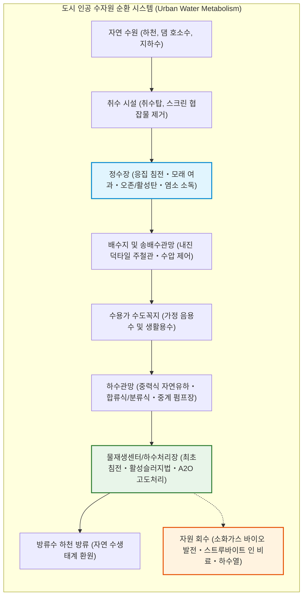
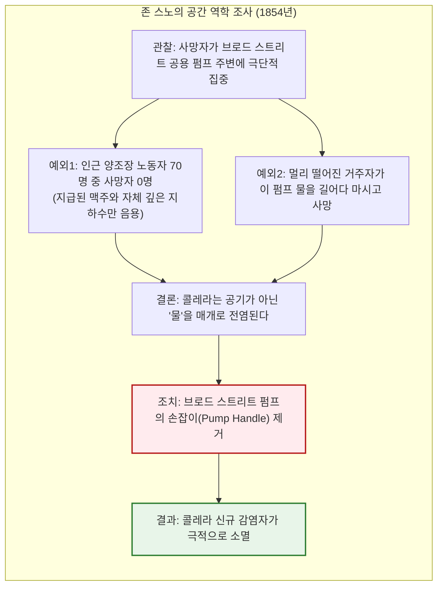
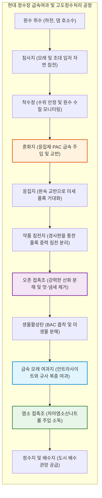

## 서론: 수도꼭지를 틀면 '마실 수 있는 물'이 나오는 기적

매일 아침 세면대의 수도꼭지를 틀어 이를 닦고, 주방에서 유리잔에 물을 받아 아무런 의심 없이 마신다.

현대 도시를 살아가는 이들에게 수도꼭지에서 무색투명하고 냄새가 없으며 병원균이 완전히 제거된 물이 끊임없이 쏟아져 나오는 것은 공기를 호흡하는 것만큼이나 당연한 일상이다. 그러나 수천 년의 인류 문명사와 지구촌 전체의 시야에서 바라볼 때, 이 일상은 **인류 공학이 일구어낸 가장 정교하고 위대한 기적** 중 하나다.

현재 전 세계 약 190개국 중 수돗물을 그대로 직접 마실 수 있는 국가는 한국, 일본, 독일, 스위스, 오스트리아, 호주 등 10여 개국 남짓에 불과하다. 전 세계 인구의 4분의 1에 달하는 20억 명 이상이 안전한 식수를 공급받지 못하고 있으며, 콜레라나 장티푸스 같은 수인성 감염병으로 여전히 매년 수십만 명이 목숨을 잃고 있다.

더욱이 우리가 사용하고 버린 물이 어디로 흘러가 어떻게 물고기가 살 수 있는 맑은 물로 정화되어 자연으로 돌아가는지 정확히 알고 있는 사람은 드물다. 도시 지하에는 도로망이나 지하철보다 훨씬 더 방대하고 복잡한 수리 배관망이 거미줄처럼 얽혀 있다. 중력과 유체역학, 콜로이드 화학과 미생물 생명공학이 24시간 365일 단 1초의 멈춤도 없이 거대한 정화 사이클을 가동하고 있다.

---

## 제1장: 물과 도시의 흥망사——고대 로마 수도교부터 런던 대악취, 에도의 상수도까지

도시의 역사는 곧 안전한 물을 끌어오고 더러워진 물을 얼마나 신속하게 배출하느냐의 투쟁사였다. 상하수도 인프라가 결여된 고대 도시는 인구가 수만 명을 넘어서는 순간 배설물과 전염병으로 인해 자멸의 길을 걸었다.

### 1.1 고대 로마의 수도교와 클로아카 막시마

물 인프라의 첫 정점은 고대 로마 제국이었다. 기원전 312년 아피아 가도와 함께 건설된 아쿠아 아피아를 시작으로, 로마 시내에는 총 11개 노선, 400킬로미터가 넘는 **수도교(Aquaeductus)**가 건설되었다.

로마의 토목 기술자들은 아펜니노 산맥의 수원에서 수십 킬로미터 떨어진 로마까지, 펌프 동력 없이 오직 **중력과 미세한 경사(수천 분의 일 경사)**만을 이용해 물을 흘려보냈다. 프랑스의 퐁 뒤 가르와 같은 다층 아치 석조 수도교는 수리학적 완벽함의 상징이다.

도시에 도달한 물은 **카스텔룸 아콰에(Castellum Aquae, 분수탑)**로 모여 위치에너지를 활용한 수압으로 공공 분수, 대형 공중목욕탕(테르마에), 귀족 저택으로 공급되었으며, 당시 로마 시민의 1인당 하루 물 소비량은 1,000리터에 달했다.

동시에 로마는 기원전 6세기부터 건설된 거대 하수관로 **클로아카 막시마(Cloaca Maxima)**를 통해 도시의 빗물과 공중화장실 오물을 테베레강으로 씻어냈다.

### 1.2 17세기 에도 100만 명의 상수도 인프라: 간다 상수와 다마가와 상수

유럽 중세가 오물을 길거리에 투척하며 페스트와 콜레라로 신음할 때, 17~18세기 일본 에도(지금의 도쿄)는 인구 100만 명이 넘는 청결한 대도시를 유지했다.

해안 매립지여서 염분이 섞인 지하수밖에 나오지 않던 에도에 1653년 개설된 **다마가와 상수(玉川上水)**는 총 43킬로미터의 개수로를 **1000분의 2(1킬로미터당 2미터 낙차)**라는 정밀한 자연유하 경사로 뚫어냈다.

요츠야 관문에서 지하로 들어간 물은 소나무와 노송나무를 파내어 연결한 **목통(木樋, 나무 파이프)** 암거망을 통해 도시 지하 전역으로 배수되었으며, 하천을 건널 때는 상수도 다리(가케히)를 설치했다. 더욱이 에도는 도시의 인분을 인근 농가에 비료로 유상 공급하는 완벽한 자원순환 시스템을 갖추어 하천 오염과 수인성 전염병을 원천 차단했다.

### 1.3 1858년 런던 '대악취'와 존 스노의 역학 지도

19세기 산업혁명으로 인구가 200만 명 이상으로 폭발한 런던은 하수도 결핍으로 지옥과 같은 위생 참사를 겪었다. 수세식 변기의 보급으로 분뇨가 템스강으로 쏟아져 들어갔고, 수도 회사들은 그 오염된 강 하류에서 물을 퍼 올려 가정에 공급했다.

1858년 여름, 폭염 속에 템스강의 오물이 부패하며 의회 의사진행이 마비될 정도의 악취를 풍긴 사건이 바로 **'대악취(The Great Stink)'**다.

당시 의학계는 전염병이 나쁜 공기에서 비롯된다는 '장기설(Miasma Theory)'을 맹신하고 있었다. 1854년 런던 소호 소호지구에서 콜레라가 창궐하자, 의사 **존 스노(John Snow)**는 사망자의 발생 지점을 지도에 점으로 표시하며 공간 역학 조사를 단행했다.

스노의 발견으로 콜레라가 수인성 전염병임이 입증되었고, 펌프 손잡이를 떼어내자 감염이 종식되었다. 이후 토목기사 **조지프 바잘게트(Sir Joseph Bazalgette)**는 런던 전역에 1,800킬로미터가 넘는 벽돌제 차집하수도망을 건설하여 런던에서 수인성 전염병의 위협을 영구히 종식시켰다.

---

## 제2장: 수도꼭지까지의 정밀 화학공학——정수장의 정화 프로세스

수돗물 생산은 취수된 하천수에서 탁도 물질, 미생물, 바이러스를 물리・화학적으로 제거하는 거대한 연속 반응 공정이다.

### 2.1 콜로이드 화학과 응집 침전

물속의 흙탕물과 점토 콜로이드 입자는 **음(-)의 표면 전하(제타 전위: $\zeta \approx -15 \sim -30\text{ mV}$)**를 띠고 있어 서로 밀어내며 영구히 가라앉지 않는다.

정수장에서는 **폴리염화알루미늄(PAC)**을 급속 혼화지에 주입하여 전기적 반발력을 중화시킨 뒤, 완속 교반을 통해 수 밀리미터 크기의 '플록(Floc)'으로 뭉치게 만든다.

입자의 침강 속도는 **스토크스의 법칙(Stokes' Law)**을 따른다:

$$v_s = \frac{g (\rho_p - \rho_f) d^2}{18 \mu}$$

침강 속도가 입자 직경의 제곱($d^2$)에 비례하므로, 입자를 1,000배 키우면 가라앉는 속도는 **100만 배** 빨라져 몇 분 만에 바닥으로 침전된다.

### 2.2 급속 여과와 염소 소독 동역학

침전수를 상층의 무연탄(안트라사이트)과 하층의 규사 여과층에 통과시켜 미세 불순물을 걸러낸 후 **염소 소독**을 실시한다. 차아염소산($\text{HOCl}$)은 중성 분자 상태로 박테리아 세포벽을 침투하여 호흡 효소를 산화 파괴한다. 소독 속도는 **칙-왓슨 법칙(Chick-Watson Law)**을 따른다:

$$\ln\left(\frac{N}{N_0}\right) = -k \cdot C^n \cdot t$$

정수장은 소독 농도와 접촉 시간의 곱($C \cdot t$)을 엄격히 통제하고 배수관 말단 수도꼭지에서 유리잔류염소 0.1 mg/L 이상을 유지하여 관망 내 세균 재증식을 원천 방지한다.

---

## 제3장: 도시의 혈관망——배수 수리학과 내진관망

정수된 물은 베르누이 정리($H = z + \frac{P}{\rho g} + \frac{v^2}{2g}$)에 따라 고지대의 배수지에서 중력 낙차를 이용해 자연유하 방식으로 도시 전역에 0.15~0.4 MPa의 수압을 유지하며 공급된다.

배수관로의 마찰 손실은 **헤이즌-윌리엄스 공식(Hazen-Williams Equation)**에 의해 계산되며:

$$h_f = 10.666 \cdot C_H^{-1.85} \cdot D^{-4.87} \cdot Q^{1.85} \cdot L$$

지진 발생 시 파이프 이탈을 막기 위해 3~4도 굴곡과 신축을 허용하면서도 수십 톤의 인장력에 빠지지 않는 **내진형 닥타일 주철관**이 현대 도시 배수망의 핵심을 이룬다.

---

## 제4장: 하수도망과 활성슬러지 바이오 반응기

가정에서 배출된 하수는 유화 수소 악취를 막는 트랩 봉수를 거쳐 중력식 하수관으로 흐른다.

하수처리장(물재생센터)의 핵심은 **활성슬러지법(Activated Sludge Process)**이다. 폭기조에 거대한 송풍기로 공기를 불어넣어 박테리아와 원생동물(종벌레 등)의 미생물 플록이 물속의 유기물을 이산화탄소와 물로 분해한다.

유기물 분해는 1차 반응식($BOD_t = L_0 (1 - e^{-k_1 t})$)과 미생물 증식을 설명하는 **모노드 식(Monod Kinetics)**:

$$\mu = \mu_{\max} \frac{S}{K_s + S}$$

을 따른다. 나아가 **A2O 공법(혐기-무산소-호기)**을 통해 질소를 질소가스($\text{N}_2$)로 방출하고 인을 미생물 세포 내에 과잉 축적시켜 수계 부영양화를 방지한다.

---

## 제5장: 하수의 자원화와 2026년 미래 과제

현대 하수처리는 '오염 제거'를 넘어 자원 생산 기지로 탈바꿈하고 있다:
1. **슬러지 혐기성 소화 메탄가스 발전**: 메탄균 발효로 바이오가스를 생산하여 처리장 전력의 50% 이상을 자급.
2. **스트루바이트(MAP) 결정화 인(P) 비료 회수**: 고갈 위기의 필수 자원인 인을 고순도 완효성 비료로 회수.
3. **하수열 히트펌프**: 외기보다 여름엔 시원하고 겨울엔 따뜻한 하수열을 이용한 친환경 지역 냉난방.
4. **PFAS(과불화화합물) 정밀 제거**: 분해되지 않는 영구 오염물질 PFAS를 입상활성탄(GAC), 이온교환수지(AIX), 역삼투압(RO) 막의 3단계 복합 공정으로 완벽 포집.

## 결론: 맑은 물 한 잔이 말해주는 문명의 존엄

수도꼭지를 틀면 맑은 물이 쏟아지고, 화장실 레버를 내리면 오물이 사라진다. 이 당연한 일상은 수천 년에 걸친 인류 토목공학, 콜로이드 화학, 미생물 공학이 일구어낸 문명의 가장 굳건한 기초다.
