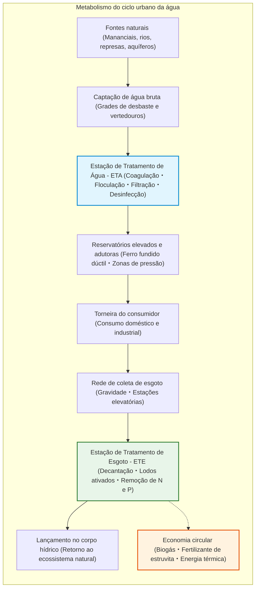
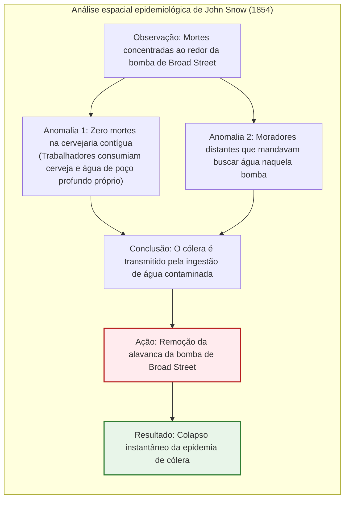
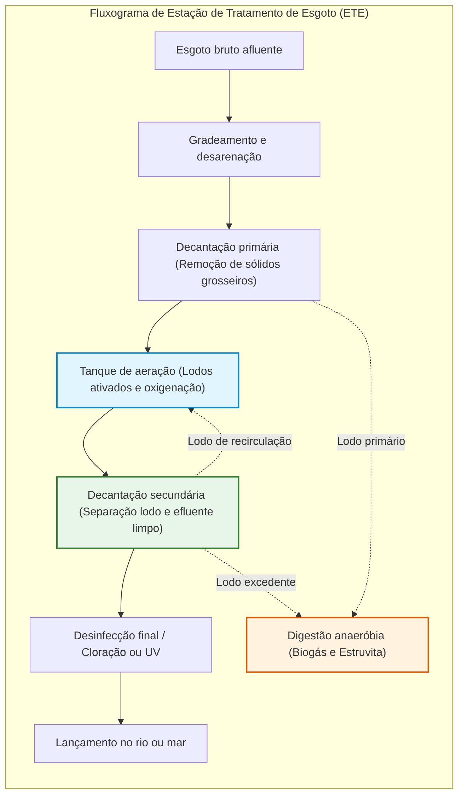

## Introdução: O milagre diário de abrir a torneira e beber água limpa

Todas as manhãs, milhões de pessoas abrem a torneira do banheiro, escovam os dentes ou bebem um copo d'água fresca sem hesitação.

Nas cidades desenvolvidas, ter acesso instantâneo e contínuo a uma água incolor, inodora, insípida e 100% isenta de patógenos dentro de casa é considerado algo tão elementar quanto respirar. No entanto, sob a ótica da história humana e do panorama global, **esse conforto é uma das maiores façanhas científicas e de engenharia já concretizadas pela humanidade**.

Apenas cerca de quinze países no mundo garantem que a água da torneira possa ser bebida com segurança direta em todo o território. Mais de dois bilhões de pessoas ainda sofrem sem acesso a serviços de água potável geridos com segurança. Doenças de veiculação hídrica, como cólera, febre tifoide e disenteria, ainda ceifam centenas de milhares de vidas por ano.

Sob as calçadas das cidades modernas, existe um formidável sistema de canais e adutoras que supera em extensão as redes viárias e metroviárias, operando ininterruptamente 24 horas por dia graças à mecânica dos fluidos, química coloidal e biotecnologia microbiana.

---

## Capítulo 1: A epopeia urbana da água — De Roma ao Grande Fedor de Londres

As civilizações urbanas do passado que não solucionaram a adução de água limpa e a rápida drenagem de dejetos foram inevitavelmente devastadas por surtos pestilentos.

### 1.1 Aquedutos de Roma e a Cloaca Maxima

Roma construiu 11 grandes aquedutos com mais de 400 quilômetros de extensão. Tirando proveito do **gradiente hidráulico natural**, conduziam água pura das montanhas por dezenas de quilômetros usando apenas a gravidade em declives sutis de poucos decímetros por quilômetro, transpondo vales com monumentos como a Pont du Gard. Em Roma, o esgoto era evacuado para o rio Tibre através da **Cloaca Maxima**.

> **O mito do saturnismo romano**  
> Estudos comprovam que os romanos não sucumbiram ao envenenamento pelo chumbo das canalizações. A água romana, extremamente dura e calcária, revestia rapidamente os canos com uma espessa camada de carbonato de cálcio, isolando o fluxo de qualquer contato metálico direto.

### 1.2 O «Grande Fedor» de Londres (1858) e o mapa de John Snow

No século XIX, o descarte de fossas no rio Tâmisa transformou o rio em um esgoto a céu aberto. Em 1858, a fermentação das fezes provocou o **Grande Fedor (The Great Stink)**.

Em 1854, o médico **John Snow** mapeou os óbitos de cólera no bairro do Soho, provando que a doença se propagava pela água contaminada da bomba pública de Broad Street, sepultando a teoria dos miasmas.

Com a remoção da alavanca da bomba, o surto cessou. Posteriormente, **Sir Joseph Bazalgette** projetou mais de 1.800 km de interceptores subterrâneos de esgoto em alvenaria, erradicando o cólera em Londres.

---

## Capítulo 2: Tratamento de água potável na ETA

Nas ETAs, processos químicos e físicos limpam a água bruta. As partículas coloidais em suspensão possuem potencial zeta negativo ($\zeta \approx -15 \text{ a } -30\text{ mV}$) que impede a sedimentação natural. A adição de coagulantes (PAC) neutraliza as cargas, formando flocos cuja taxa de decantação segue a **lei de Stokes**:

$$v_s = \frac{g (\rho_p - \rho_f) d^2}{18 \mu}$$

Aumentar o tamanho do floco em 1.000 vezes acelera a decantação em **um milhão de vezes**. A desinfecção segue a **lei de Chick-Watson**:

$$\ln\left(\frac{N}{N_0}\right) = -k \cdot C^n \cdot t$$

---

## Capítulo 3: Redes pressurizadas e saneamento biológico

A distribuição segue o **princípio de Bernoulli** ($H = z + \frac{P}{\rho g} + \frac{v^2}{2g}$) e a fórmula de **Hazen-Williams**:

$$h_f = 10.666 \cdot C_H^{-1.85} \cdot D^{-4.87} \cdot Q^{1.85} \cdot L$$

Nas ETEs, o processo de **lodos ativados** aproveita bactérias aeróbias para degradar a matéria orgânica (DBO) conforme a equação de **Monod**:

$$\mu = \mu_{\max} \frac{S}{K_s + S}$$

O processo **$A^2O$ (Anaeróbio-Anóxico-Óxico)** remove nitrogênio transformando-o em gás nitrogênio ($\text{N}_2$) e fósforo acumulando-o nos micro-organismos.

---

## Capítulo 4: ETE como refinaria de recursos e remoção de PFAS

1. **Biogás para geração de eletricidade**: Fermentação a 37°C gerando gás rico em metano ($60\%\ \text{CH}_4$).
2. **Precipitação de estruvita (MAP)** para recuperação de fósforo mineral como adubo agrícola:
   $$\text{Mg}^{2+} + \text{NH}_4^+ + \text{PO}_4^{3-} + 6\text{H}_2\text{O} \longrightarrow \text{MgNH}_4\text{PO}_4 \cdot 6\text{H}_2\text{O} \downarrow$$
3. **Energia térmica do esgoto**: Bombas de calor usam a estabilidade térmica das galerias para aquecimento e refrigeração distrital.
4. **Remoção de PFAS**: Adsorção em carvão ativado granular (GAC), resinas de troca aniônica e osmose reversa (RO).

## Conclusão: A água pura como baluarte da civilização

Abrir a torneira e beber com serenidade é o resultado sublime de milênios de engenharia sanitária e dedicação contínua. Sob as ruas, essas águas limpas e canais silenciosos formam a garantia inquebrantável da vida urbana.
