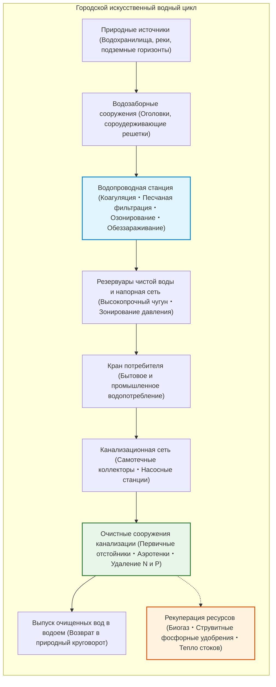
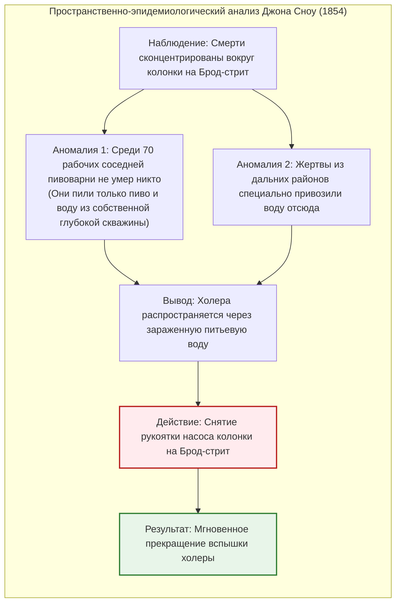
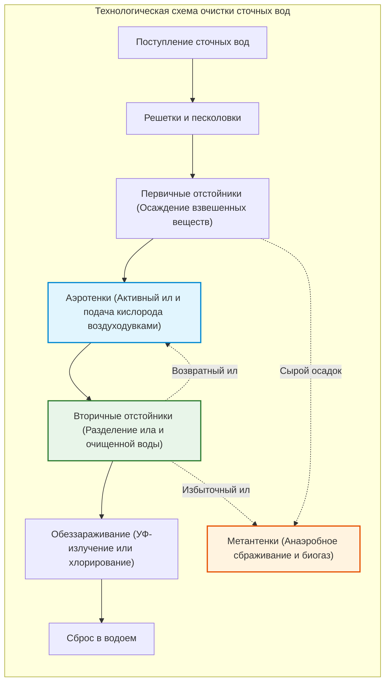

## Введение: Ежедневное чудо чистой воды из-под крана

Каждое утро миллионы людей открывают водопроводный кран, чистят зубы или наливают стакан чистой воды, совершенно не задумываясь о скрывающемся за этим гигантском инженерном комплексе.

Бесперебойный доступ к прозрачной, вкусной и абсолютно свободной от патогенов воде прямо в собственной квартире воспринимается жителями развитых мегаполисов как нечто само собой разумеющееся. Однако в масштабах всемирной истории **это одно из самых поразительных и сложных технологических достижений цивилизации**.

В настоящее время лишь около 15 стран мира гарантируют полную пригодность водопроводной воды для питья без кипячения на всей своей территории. Более двух миллиардов человек на планете до сих пор лишены безопасной питьевой воды, а водные инфекции (холера, брюшной тиф, дизентерия) ежегодно уносят сотни тысяч жизней.

Под улицами городов проложены сотни тысяч километров напорных водоводов и самотечных канализационных коллекторов, в которых гидродинамика, коллоидная химия и микробная биотехнология круглосуточно поддерживают искусственный водный метаболизм.

---

## Глава 1: Вода и рождение мегаполисов — От Рима до «Великого зловония» в Лондоне

История городов — это история поиска чистой воды и борьбы с собственными отходами. Любой древний город с населением более нескольких десятков тысяч человек без централизованных систем водоснабжения и водоотведения быстро вымирал от эпидемий.

### 1.1 Римские акведуки и Большая Клоака

Римская империя построила 11 акведуков общей протяженностью свыше 400 км. Используя **гидравлический уклон**, римляне самотеком доставляли родниковую воду из Апеннин за десятки километров, возводя арочные мосты, такие как Пон-дю-Гар. В Риме вода поступала в распределительные башни (*castellum aquae*), откуда распределялась по термам, фонтанам и домам. Сточные воды отводились через легендарную **Клоаку Максима (Cloaca Maxima)** в реку Тибр.

> **Опровержение мифа: Погиб ли Рим от свинцовых труб?**  
> Археохимия доказала несостоятельность гипотезы гибели Рима от отравления свинцом. Жесткая карбонатная вода Рима за считанные недели покрывала внутренние стенки труб плотным слоем известкового налета (накипи), полностью изолируя металл от воды.

### 1.2 «Великое зловоние» (1858) и карта холеры Джона Сноу

В XIX веке сброс нечистот в Темзу привел к катастрофе: река превратилась в открытую сточную канаву. В жаркое лето 1858 года вонь парализовала работу британского парламента — этот эпизод вошел в историю как **«Великое зловоние» (The Great Stink)**.

В 1854 году во время вспышки холеры в Сохо врач **Джон Сноу** нанес случаи смертей на карту района и доказал, что источником инфекции была общественная водоразборная колонка на Брод-стрит, опровергнув господствовавшую теорию миазмов.

После снятия рукоятки насоса эпидемия прекратилась. Вскоре инженер **сэр Джозеф Базалджетт** построил более 1 800 км кирпичных перехватывающих коллекторов, навсегда избавив Лондон от эпидемий холеры.

---

## Глава 2: Водоподготовка на станциях очистки

Взвешенные глинистые частицы имеют отрицательный дзета-потенциал ($\zeta \approx -15 \dots -30\text{ мВ}$) и взаимно отталкиваются. Добавление коагулянтов нейтрализует заряд, способствуя образованию хлопьев, скорость оседания которых подчиняется **закону Стокса**:

$$v_s = \frac{g (\rho_p - \rho_f) d^2}{18 \mu}$$

Увеличение размера хлопьев в 1 000 раз ускоряет их гравитационное осаждение в **миллион раз**. Обеззараживание воды хлором рассчитывается по **закону Чика-Уотсона**:

$$\ln\left(\frac{N}{N_0}\right) = -k \cdot C^n \cdot t$$

---

## Глава 3: Гидравлика распределительных сетей и биоочистка стоков

Движение воды описывается **уравнением Бернулли** ($H = z + \frac{P}{\rho g} + \frac{v^2}{2g}$) и эмпирической формулой **Хейзена-Вильямса**:

$$h_f = 10.666 \cdot C_H^{-1.85} \cdot D^{-4.87} \cdot Q^{1.85} \cdot L$$

На станциях аэрации сточные воды очищаются с помощью **активного ила** — сложного биоценоза микроорганизмов, окисляющих растворенные органические загрязнения. Кинетика роста биомассы подчиняется **уравнению Моно**:

$$\mu = \mu_{\max} \frac{S}{K_s + S}$$

Технология **$A^2O$ (анаэробно-аноксидно-аэробная)** удаляет азот в виде газа $\text{N}_2$ и связывает избыточный фосфор в активном иле.

---

## Глава 4: Очистные станции как фабрики ресурсов

1. **Биогаз**: Метановое сбраживание осадка при 37°C вырабатывает биогаз ($60\%\ \text{CH}_4$), обеспечивая автономную электрогенерацию станций.
2. **Фосфорное удобрение (струвит / MAP)**:
   $$\text{Mg}^{2+} + \text{NH}_4^+ + \text{PO}_4^{3-} + 6\text{H}_2\text{O} \longrightarrow \text{MgNH}_4\text{PO}_4 \cdot 6\text{H}_2\text{O} \downarrow$$
3. **Тепло сточных вод**: Тепловые насосы утилизируют энергию стабильно теплых стоков для отопления городских кварталов.
4. **Удаление ПФАС**: Применение гранулированного активированного угля, ионообменных смол и обратного осмоса для полного задержания «вечных химикатов».

## Заключение: Чистая вода как основа цивилизации

Возможность в любой момент повернуть кран и налить стакан чистой воды — результат вековых усилий ученых и инженеров. Невидимый подземный круговорот воды был и остается главным материальным фундаментом здоровой городской жизни.
