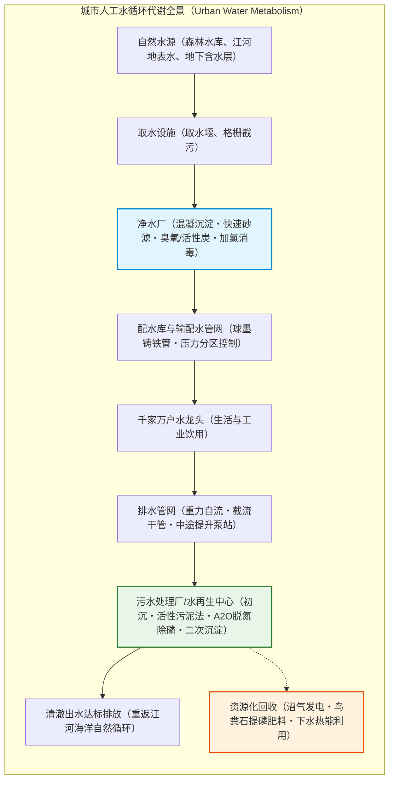
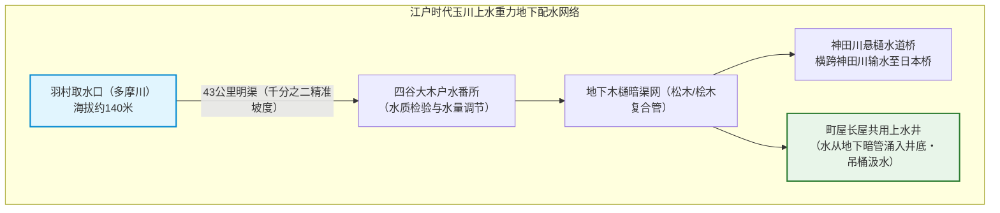
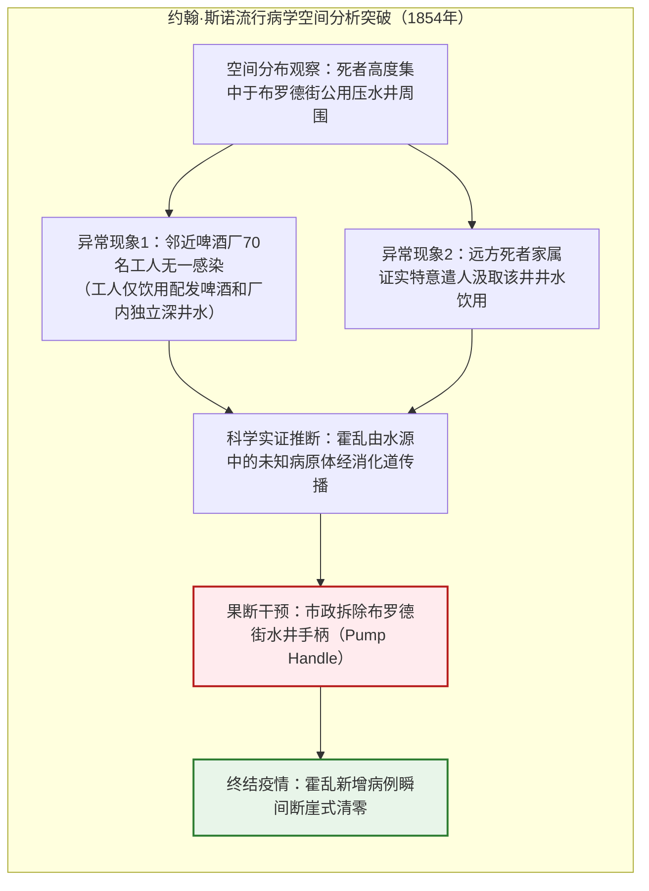
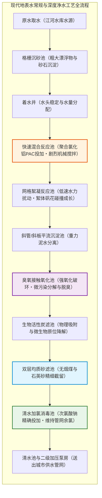
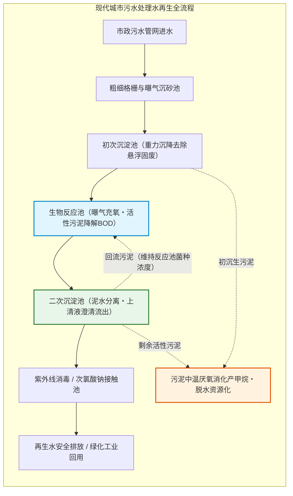
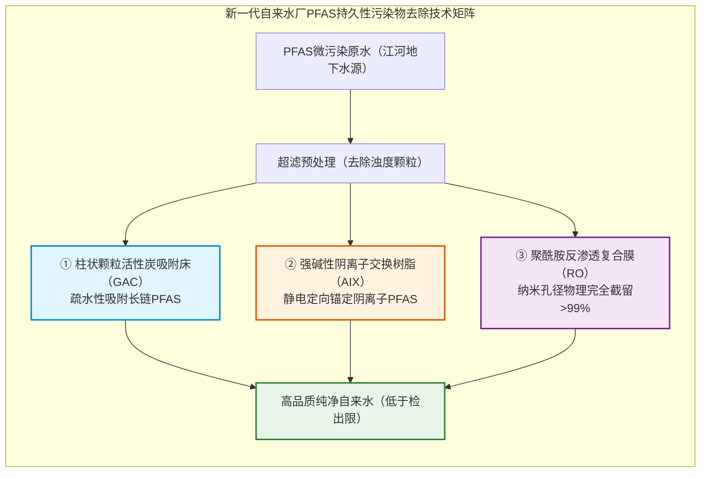

## 引言：拧开水龙头即可直接饮用的现代奇迹

每天清晨，我们拧开洗手间的水龙头洗漱，或者在厨房接满一杯清水一饮而尽。

在现代发达城市中，水龙头中能够源源不断地流出无色透明、无味无臭、零致病菌的“清洁饮用水”，早已如同呼吸空气一般被视为理所当然的日常。然而，若将视野拉升至全球乃至整个人类文明史的宏大坐标，这项日常便会展现出其真正的本质——**它是人类工程学所创造出的最精妙、最宏伟的物理与生化奇迹**。

目前在全世界近200个国家和地区中，自来水能够达到直接生饮标准的国家仅有日本、德国、瑞士、奥地利、冰岛、澳大利亚等十几个国家。全球仍有超过20亿人口无法获得安全管理的饮用水；每年仍有数十万人因霍乱、伤寒、痢疾等水介传染病而丧生。

更鲜有人能够准确描述：当我们冲洗马桶、拔掉浴缸塞、洗衣机排出浑浊污水之后，这股脏水究竟流经何处，又是如何在深不可测的地下被一步步净化为能够让鱼类畅游的清澈水流并回归大自然的？

城市地面之下，铺设着规模远超公路与铁路总和的“液体高速公路”。仅在中国与日本等主要国家，地下管网总里程便动辄数十万至数百万公里，足以绕地球数十圈。在地面繁华喧嚣之下，流体力学、胶体化学与微生物工程正以永不停歇的律动，维系着数以亿计人口的生命循环。

---

## 第一章：水与城市的兴衰史——从古罗马引水渠、伦敦大恶臭到江户玉川上水

城市的历史，本质上是人类如何引入洁净水源并迅速排泄污水的斗争史。任何古代聚落一旦人口突破数万人而无法解决给排水问题，都会在短时间内被自身的排泄物与水系疫病彻底毁灭。

### 1.1 古罗马水道桥与马克西姆大下水道的传奇

人类供排水工程的第一个高峰出现在古罗马帝国。自公元前312年修建第一条阿庇亚引水道起，罗马城内陆续兴建了11条高架**引水渠（Aquaeductus）**，总长度超过400公里。

罗马工程师精通**水力坡降控制**，从数十公里外的亚平宁山脉泉水引水，在没有水泵动力的条件下，仅凭重力以极平缓的坡度（每公里落差仅数十厘米）穿山越岭，建造了诸如法国加尔桥（Pont du Gard）等宏伟的三层拱桥结构。

引水入城后进入**分水塔（Castellum Aquae）**，利用蓄水落差形成的水压，通过铅管与陶管分流至公共喷泉、公共浴场（Thermae）与贵族府邸，使罗马市民人均日用水量高达1,000升。

与此同时，罗马于公元前6世纪建造了著名的**马克西姆大下水道（Cloaca Maxima）**。这条巨大的拱形地下排水廊道将暴雨地表积水与公共厕所污水一并冲刷入台伯河。

> **历史真相辟谣：铅中毒导致罗马帝国覆灭？**  
> 现代考古水力化学证实，“罗马贵族因铅质水管中毒而亡国”纯属夸大其词。罗马引水含极高浓度的钙质硬水，管道通水数月内壁便沉积出厚重的碳酸钙水垢（Scale），物理隔绝了流水与铅壁的直接接触。

### 1.2 江户百万人的给水奇迹：神田上水与玉川上水

在中世纪欧洲倒退为粪水横流的瘟疫温床时，17至18世纪的东方却维持着一座拥有百万人口且极度洁净的巨型城市——日本江户（今东京）。

江户地处沿海填海盐碱地，浅井咸苦无法饮用。德川幕府于1653年由玉川庄右卫门兄弟仅耗时8个月便开凿完成了全长43公里的**玉川上水**。

玉川上水巧妙利用武藏野台地脊线，从羽村取水口到四谷大木户维持着**千分之二（1公里仅落差2米）**的高超自然流下坡度。在四谷进入地下后，清水通过精密的**木樋（刳木水管）**、石樋与竹管构成复杂的地下供水网络，甚至在跨越河道时架设了“悬樋”（水道桥地名由此而来）。

江户城市卫生不发生大瘟疫的核心还在于**粪溺的彻底资源闭环**：全城排泄物均被郊区农民以农副产品或银两收购作为高级有机农肥。江户护城河从未遭受排泄物污染，展现了惊人的古代生态循环智慧。

### 1.3 1858年伦敦“大恶臭”与约翰·斯诺的霍乱地图

19世纪工业革命导致伦敦人口暴增至两百万人以上。水冲厕所的普及在缺乏城市下水道的背景下演变为环境浩劫：数十万个渗水粪坑满溢并汇入泰晤士河，而各大自来水公司又直接从污染惨重的泰晤士河下游抽水供应市民饮用。

1858年盛夏，泰晤士河在暴晒下彻底腐酵，恶臭熏天导致英国议会无法办公，史称**“大恶臭（The Great Stink）”**。

当时医学界普遍信奉“瘴气说（Miasma Theory）”，认为瘟疫是由污浊空气传播。在1854年苏豪区布罗德街爆发的烈性霍乱中，医生**约翰·斯诺（John Snow）**在街道地图上标注死亡病例分布，开创了现代空间流行病学。

斯诺查明：
1. 几乎所有死者都饮用了**布罗德街水井**的水；
2. 邻近啤酒厂工人因只喝啤酒和厂内私有深井水，无一人死亡；
3. 斯诺说服地方教区**拆除了该水井的压水手柄**，疫情随之戏剧性平息。后续挖掘证实，该水井旁数英尺处的私人污水池渗透破裂，污染了地下水。这是人类首次用实证数据击败水介传染病。

### 1.4 巴泽尔杰特与现代截流下水道系统的诞生

大恶臭促使英国政府授权天才工程师**约瑟夫·巴泽尔杰特（Sir Joseph Bazalgette）**。他主持修建了长达1,800公里的伦敦地下截流下水道系统（Combined Sewers），利用精密计算的水力高差，将全城横流的污水全部“截流”，输送至伦敦东部远离城区的泰晤士河下游入海口。

巴泽尔杰特在计算出所需管道尺寸后霸气下令：**“此工程百年唯建一次，将所有管道截面全部加倍！”**正是这一远见，使这套维多利亚时代的砖砌下水道网至今仍在为当代伦敦高效服役。

---

## 第二章：通往水龙头的旅程——现代净水厂的超精密工程

现代自来水厂是一座极其严密的物理与化学连续反应工业装置。中国《生活饮用水卫生标准》（GB 5749）与国际先进标准均设立了包含浑浊度、菌落总数、重金属、PFAS等在内的近百项严苛检测指标。

### 2.1 胶体化学：混凝与絮凝动力学

地表天然水中悬浮的黏土与有机质胶体微粒（粒径 $1\ \text{nm} \sim 10\ \mu\text{m}$）具有很强的负电荷（**Zeta电位：$\zeta \approx -15 \sim -30\text{ mV}$**）。静电排斥力使它们始终分散在水中，无法自行沉降。

净水厂通过**混凝工艺**消除静电屏障：
1. **急速混合**：投加**聚合氯化铝（PAC: $[ \text{Al}_2(\text{OH})_n \text{Cl}_{6-n} ]_m$）**。高价铝水解多核阳离子快速压缩胶体双电层，电中和脱稳。
2. **絮凝反应**：在絮凝池中慢速搅拌，促使脱稳胶体在范德华力作用下碰撞聚合成数毫米大小的肉眼可见“矾花（Floc）”。
3. **沉淀分离**：矾花在沉淀池中受重力沉降。

颗粒在水中的沉降末速度由**斯托克斯公式（Stokes' Law）**严格决定：

$$v_s = \frac{g (\rho_p - \rho_f) d^2}{18 \mu}$$

沉降速度 $v_s$ 与**粒径的平方（$d^2$）成正比**。将微米级胶体聚合成毫米级矾花，粒径扩大千倍，沉降速度瞬间提高**一百万倍**，浑浊颗粒在几分钟内即可彻底沉入池底。

### 2.2 双层快速滤料过滤与反冲洗

沉淀出水进入**快速砂滤池**。上层采用低密度大粒径**无烟煤**（厚度约30 cm），下层采用高密度小粒径**石英砂**（厚度约50 cm）。水流穿过滤层时，机械截留、水力接触沉降与颗粒表面吸附协同作用，将极微小漏网微粒及隐孢子虫包囊彻底拦截。滤层阻力升高后，通过高压气水反冲洗使滤料沸腾清洗，循环再生。

### 2.3 氯化消毒化学平衡与奇克-沃森定律

水经过滤后虽然清澈，仍必须通过化学消毒杀灭潜在致病微生物。投加液氯或次氯酸钠生成的**次氯酸（$\text{HOCl}$）**在水中建立平衡：

$$\text{HOCl} \rightleftharpoons \text{H}^+ + \text{OCl}^- \quad (\text{p}K_a \approx 7.54)$$

次氯酸分子呈电中性，能够轻易穿透带负电的细菌细胞壁，不可逆氧化破坏细胞酶系。其杀菌效力是次氯酸根（$\text{OCl}^-$）的**80至100倍**。消毒反应符合**奇克-沃森定律（Chick-Watson Law）**：

$$\ln\left(\frac{N}{N_0}\right) = -k \cdot C^n \cdot t$$

净水工程中通过严格监控浓度与接触时间的乘积（$C \cdot t$ 值），并在末梢管网中维持不低于 0.05~0.1 mg/L 的游离余氯，彻底杜绝管道中细菌二次滋生。

---

## 第三章：城市的水力毛细血管——配水管网流体力学与耐震工程

净水厂生产出的合格自来水，必须在严密的**伯努利流体能量守恒**法则下送抵千家万户：

$$H = z + \frac{P}{\rho g} + \frac{v^2}{2g}$$

水厂利用地势高处的配水库储存位置水头 $z$，使整个城市管网维持 0.15~0.35 MPa 的稳定水压。

管路沿程水头损失 $h_f$ 遵循**海森-威廉姆斯公式（Hazen-Williams Equation）**：

$$h_f = 10.666 \cdot C_H^{-1.85} \cdot D^{-4.87} \cdot Q^{1.85} \cdot L$$

水头损失与管径的近五次方（$D^{-4.87}$）反比，这要求管网设计必须通过环状水力模型进行精细口径分配。现代城市全面采用**球墨铸铁管（Ductile Iron）**与**抗震耐脱柔性接口**，接口可在地震错动中自由伸缩摆动并被锁环死死锁住，确保强震下供水生命线不断裂。

```mermaid
flowchart LR
    subgraph WaterDistribution["输配水管网水力拓扑架构"]
        direction LR
        PurificationPlant["净水厂二级泵站"] -->|提升扬程| ServiceReservoir["高位配水池（储存位置水头 z）"]
        ServiceReservoir -->|重力干管输配水| DistributionMain["主干输水管道（DN800-DN1500）"]
        DistributionMain --> DistrictMeter["分区计量DMA系统・减压阀组"]
        DistrictMeter --> DistributionSub["分支配水管（球墨铸铁管 DN100-DN300）"]
        DistributionSub --> ServicePipe["入户供水支管（食品级不锈钢/PE管）"]
        ServicePipe --> Meter["水表及用户水龙头（工作水压0.2-0.3MPa）"]
    end
    
    style ServiceReservoir fill:#e1f5fe,stroke:#0288d1,stroke-width:2px
    style DistrictMeter fill:#fff3e0,stroke:#e65100,stroke-width:2px
    style Meter fill:#e8f5e9,stroke:#2e7d32,stroke-width:2px
```

---

## 第四章：用过的水流向何方——重力下水管网与合流分流之争

生活污水在水封存水弯的物理隔臭保护下排出，进入城市地下排水管网。下水道依靠**重力自流（坡度 1:100 ~ 1:500）**运行，保证流速大于 $0.6\ \text{m/s}$ 以冲刷淤泥。

- **合流制**：雨水与污水共用一管，暴雨期易产生溢流污染（CSO）；
- **分流制**：雨水管直排河道，污水管独立输往污水处理厂，是现代城市标准配置。

针对城市内涝，地下深层调蓄隧道（如日本首都圈外郭放水路）以超大直径地下盾构隧洞和航空发动机改型水泵，在暴雨时形成城市地下蓄洪长城。

---

## 第五章：微观世界的生物巨型反应器——活性污泥污水处理科学

污水处理的绝对核心是**活性污泥法（Activated Sludge Process）**。在曝气池中，人工鼓入大量空气，培养高浓度微生物菌胶团（*Zoogloea*、钟虫、轮虫等构成的微生态食物链），将溶解性有机污染物彻底吞噬转化为水和二氧化碳。

有机物消耗动力学由一阶BOD方程决定：

$$BOD_t = L_0 \left(1 - e^{-k_1 t}\right)$$

微生物生长速率遵循**莫诺德方程（Monod Kinetics）**：

$$\mu = \mu_{\max} \frac{S}{K_s + S}$$

通过**A2O工艺（厌氧-缺氧-好氧）**，聚磷菌在厌氧段释磷、在好氧段“超量吸磷”，脱氮菌在缺氧段利用硝酸根呼吸将氮还原为氮气（$\text{N}_2$）释放，实现水体富营养化元素的高效脱除。

---

## 第六章：污水是都市矿山——循环经济新范式

现代水再生中心正在全面迈向“资源工厂”：
1. **污泥厌氧发酵沼气发电**：中温37℃下产甲烷古菌分解有机质生成沼气（$60\%\ \text{CH}_4$），热电联产提供全厂50%以上清洁能源。
2. **鸟粪石沉淀法回收战略磷资源（MAP）**：
   $$\text{Mg}^{2+} + \text{NH}_4^+ + \text{PO}_4^{3-} + 6\text{H}_2\text{O} \longrightarrow \text{MgNH}_4\text{PO}_4 \cdot 6\text{H}_2\text{O} \downarrow$$
   析出高纯度缓释化肥，破解全球磷矿石枯竭危机。
3. **下水热源热泵**：利用下水道冬暖夏凉的巨大温差能量，为周边建筑提供低碳区域供暖制冷。
4. **污水流行病学监测（WBE）**：通过下水病原核酸定量检测，比临床诊断提前一周预警疫情波动。

---

## 第七章：2026年的前沿挑战——管网更新、极值灾害与PFAS全氟化合物治理

面向未来，供排水体系面临老朽化管网翻新与“永久性化学品”**PFAS（全氟和多氟烷基物质）**的双重挑战。

由于碳氟键（$\text{C}-\text{F}$）极高的结合能，传统净水工艺无法去除PFAS。现代化水厂正构建“**粉末/颗粒活性炭（GAC）+ 阴离子交换树脂（AIX）+ 纳滤/反渗透（RO）膜**”三道阻击防线，配合超临界水氧化等末端技术，彻底矿化全氟污染物。

## 结语：一杯清水丈量文明的高度

拧开龙头清泉流淌，按下按钮污垢尽散。

这项看似平常的体验，凝聚着从古罗马石匠、江户测绘工、约翰·斯诺的实证医学到现代万千水务工程师日夜守护的全部智慧。向下水道望去，那条沉默奔涌的地下江河，正是人类远离野蛮、坚守城市尊严的最坚固磐石。
