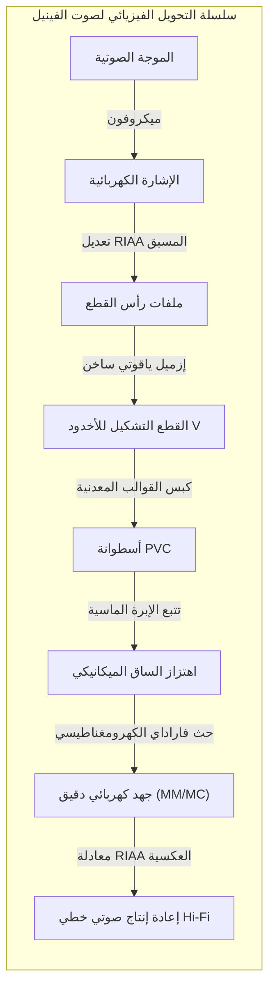
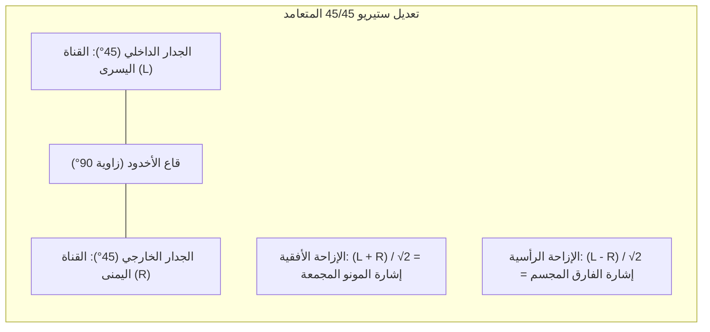

## مقدمة: الكون الصوتي الدقيق المحفور في الفينيل الأسود

في عصر البث الرقمي عالي الدقة وسماعات الأذن اللاسلكية، يشهد العالم ظاهرة مدهشة: **النهضة العالمية الكبرى لأسطوانات الفينيل (LP)**.

لا يقتصر الأمر على الحنين إلى الماضي؛ فمن منظور الفيزياء التطبيقية والهندسة الميكانيكية الدقيقة، تمثل أسطوانة الفينيل قمة **التحكم الفيزيائي التناظري والتحويل الكهرومغناطيسي**.



على قرص من مادة PVC بوزن 180 غراماً، يمتد أخدود حلزوني دقيق بعرض 50 ميكرومتراً وعمق 30 ميكرومتراً. تتراوح تموجات جدرانه من عشرات الميكرونات في الترددات المنخفضة إلى **أجزاء من النانومتر** في النغمات التوافقية العالية. تتعرض الإبرة لتسارعات هائلة وضغوط تلامس هيرتز تفوق **600 ميغاباسكال (6,000 ضغط جوي)**.

---

## 1. هندسة التسجيل المجسم (ستيريو) 45/45

يعد **نظام 45/45** الذي وضعته شركة Westrex عام 1957 المعيار العالمي للأسطوانات المجسمة:
- زاوية الأخدود V تساوي 90 درجة؛
- **الجدار الداخلي (بزاوية 45° نحو المركز): القناة اليسرى (L)**؛
- **الجدار الخارجي (بزاوية 45° نحو المحيط): القناة اليمنى (R)**.



معادلات الإزاحة:

$$x(t) = \frac{S_L(t) + S_R(t)}{\sqrt{2}}, \quad y(t) = \frac{S_L(t) - S_R(t)}{\sqrt{2}}$$

التعامد الهندسي يلغي التداخل بين القناتين تماماً ($\vec{v}_L \cdot \vec{v}_R = 0$). وعند تشغيل إشارة أحادية الصوت متطابقة الطور ($S_L = S_R$)، تنعدم الإزاحة الرأسية ($y=0$)، مما يوفر توافقاً تاماً مع أجهزة المونو القديمة.

---

## 2. مخرطة النقش ونظام الخطوة المتغيرة

- **الإزميل الساخن**: يُسخن الإزميل الياقوتي كهربائياً إلى **$100^\circ\text{C} \sim 120^\circ\text{C}$** لتليين الورنيش حرارياً، مما ينتج جدراناً مصقولة بلا نتوءات لتقليل الضجيج السطحي.
- **الخطوة المتغيرة بالكمبيوتر**: يقرأ رأس استباقي الإشارة الصوتية قبل ثانية كاملة لمباعدة الأخاديد عند المقاطع الصوتية العالية ومقاربتها عند الهدوء، متيحاً تسجيل 30 دقيقة لكل وجه.

---

## 3. الضرورة الفيزيائية لمنحنى معادلة RIAA

```mermaid
xychart-beta
    title "منحنيات معادلة RIAA: التسجيل مقابل إعادة التشغيل"
    x-axis "التردد (هرتز)" [20, 50, 100, 500, 1000, 2122, 10000, 20000]
    y-axis "الكسب النسبي (ديسيبل)" -25 --> 25
    series "التسجيل (Pre-emphasis)" [-19.3, -17.0, -13.1, -2.7, 0.0, 2.9, 13.7, 19.6]
    series "التشغيل الفونو (De-emphasis)" [19.3, 17.0, 13.1, 2.7, 0.0, -2.9, -13.7, -19.6]
```

بما أن الرؤوس المغناطيسية تستجيب للسرعة ($v = 2\pi f A$)، فإن السعة الميكانيكية $A$ تتناسب عكسياً مع التردد:

$$A = \frac{V_0}{2\pi f} \propto \frac{1}{f}$$

- عند $50\text{ هرتز}$، ستتضاعف السعة 20 مرة ($+26\text{ ديسيبل}$)، مما يدمر الأخاديد المجاورة؛
- عند $20\text{ كيلوهرتز}$، ستضيع السعة في الضجيج السطحي للمادة.

يقوم منحنى RIAA بخفض الترددات المنخفضة وتضخيم العالية أثناء التسجيل. وفي مرحلة التشغيل، يعكس المضخم الأولي المنحنى، **مما يقلل من ضوضاء السطح والفرقعات بمقدار 20 ديسيبل (تخفيض قدرة الضوضاء 100 مرة)**!

---

## 4. ميكانيكا التلامس وتطور أشكال الإبر

تحت قوة ضغط $1.5\text{ غرام}$، يصل أقصى ضغط تلامس لهيرتز إلى:

$$P_0 = \frac{3 F_v}{2 \pi a^2} \approx \mathbf{604\text{ ميغاباسكال}} \quad (\approx \mathbf{6,160\text{ كغ/سم}^2})$$

تعمل أشكال الإبر المتطورة مثل **Shibata** و**MicroRidge** على إطالة خط التلامس رأسياً إلى $75\ \mu\text{م}$، مما يقلل الضغط إلى $150\text{ ميغاباسكال}$ ويتيح قراءة ترددات تصل إلى $60\text{ كيلوهرتز}$.

---

## 5. هندسة ذراع النغم وقوة الانزلاق للداخل (Skating)


يولد الاحتكاك مع زاوية الإزاحة قوة تدفع الذراع نحو المركز ($F_{\text{skate}} = \mu F_v \tan \phi$). تقوم آلية منع الانزلاق بموازنة هذا المتجه لتساوي ضغط الإبرة على كلا الجدارين.

---

## 6. المحولات الكهرومغناطيسية: لاقطات MM مقابل MC

- **MM (المغناطيس المتحرك)**: جهد خرج مرتفع ($3 \sim 5\text{ مللي فولت}$)، إبرة قابلة للاستبدال، وكتلة متحركة أكبر نسبياً.
- **MC (الملف المتحرك)**: ملفات متناهية الصغر، كتلة متحركة بالغة الضآلة ($<0.1\text{ مغ}$)، استجابة عابرة لا مثيل لها، لكنها تنتج جهداً منخفضاً ($0.2 \sim 0.5\text{ مللي فولت}$) يستلزم محول رفع للجهد.

---

## الخلاصة

أسطوانة الفينيل هي التجسيد المادي الحي للموجة الصوتية، حيث تندمج ميكانيكا التلامس والكهرومغناطيسية في لوحة فنية دائمة الخلود.
