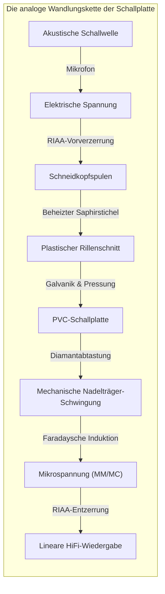
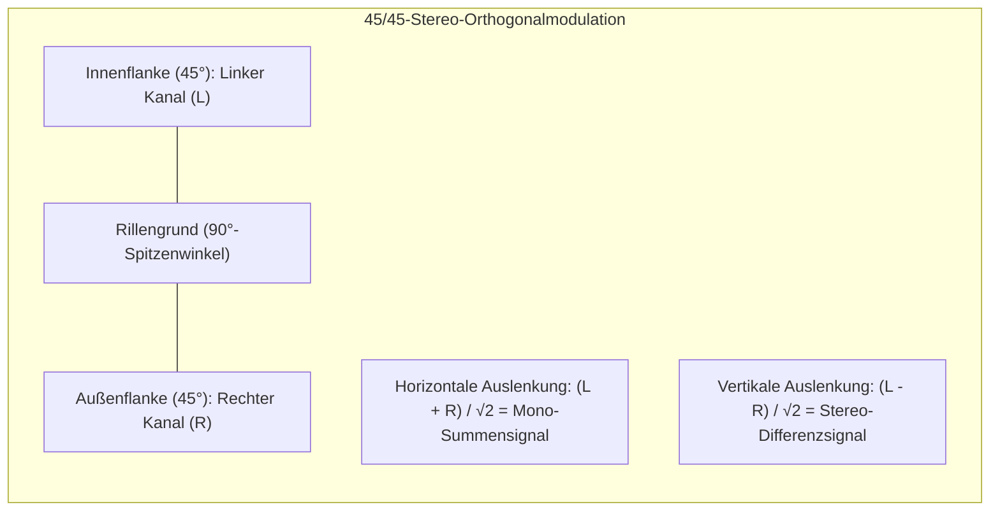

## Einleitung: Der akustische Mikrokosmos im schwarzen Vinyl

Im Zeitalter hochauflösender Streaming-Dienste und drahtloser Kopfhörer erleben wir ein erstaunliches Phänomen: **die weltweite Renaissance der analogen Schallplatte (Vinyl LP)**.

Aus der Perspektive der technischen Akustik und des Präzisionsmaschinenbaus ist die Schallplatte jedoch weit mehr als pure Nostalgie: Sie ist ein Meisterwerk der **mechanisch-elektrodynamischen Wandlung**.



Auf einer 180 Gramm schweren PVC-Scheibe windet sich eine durchgehende V-förmige Mikrorille von etwa $50\ \mu\text{m}$ Breite und $30\ \mu\text{m}$ Tiefe. Die Auslenkungen reichen von einigen Dutzend Mikrometern im Tiefbass bis in den **Sub-Nanometerbereich** bei feinsten Obertönen. Die Nadelspitze erfährt bei der Abtastung Beschleunigungen von mehreren hundert G und Hertzsche Kontaktspannungen von über **600 MPa (ca. 6.000 Bar)**.

---

## 1. Geometrie des 45/45-Stereoschnitts

1957 standardisierte Westrex das **45/45-System**:
- 90-Grad-V-Rille;
- **Innenflanke (zum Plattenzentrum, 45° Neigung): Linker Kanal (L)**;
- **Außenflanke (zum Außenrand, 45° Neigung): Rechter Kanal (R)**.



Die Auslenkungsvektoren lauten:

$$x(t) = \frac{S_L(t) + S_R(t)}{\sqrt{2}}, \quad y(t) = \frac{S_L(t) - S_R(t)}{\sqrt{2}}$$

Durch die orthogonale Entkopplung ($\vec{v}_L \cdot \vec{v}_R = 0$) ist das theoretische Übersprechen null. Bei reinem Monosignal ($S_L = S_R$) ist die vertikale Auslenkung null ($y=0$), wodurch die Rille nur seitlich moduliert wird – die perfekte Abwärtskompatibilität zu alten Mono-Abtastern.

---

## 2. Schneidstichel und variable Rillengeometrie

- **Beheizter Stichel**: Ein Platindraht heizt den Schneidsaphir auf **$100^\circ\text{C} \sim 120^\circ\text{C}$**, wodurch der Lack beim Schneiden erweicht und spiegelglatte Rillenflanken ohne Rauschen entstehen.
- **Computergesteuerter variabler Vorschub (Groove Computer)**: Ein Vorhörkopf berechnet das Signal eine Sekunde im Voraus, weitet den Rillenabstand bei lauten Bässen auf und komprimiert ihn bei leisen Passagen.

---

## 3. Die physikalische Notwendigkeit der RIAA-Entzerrung

```mermaid
xychart-beta
    title "RIAA-Schneidkennlinie (Aufnahme) und Entzerrerkennlinie (Wiedergabe)"
    x-axis "Frequenz (Hz)" [20, 50, 100, 500, 1000, 2122, 10000, 20000]
    y-axis "Relative Verstärkung (dB)" -25 --> 25
    series "Aufnahme (Pre-emphasis)" [-19.3, -17.0, -13.1, -2.7, 0.0, 2.9, 13.7, 19.6]
    series "Wiedergabe (De-emphasis)" [19.3, 17.0, 13.1, 2.7, 0.0, -2.9, -13.7, -19.6]
```

Da Schneidköpfe und Tonabnehmer **schnelleproportionale Wandler** sind ($v = 2\pi f A$), verhält sich die mechanische Rillenauslenkung $A$ umgekehrt proportional zur Frequenz:

$$A = \frac{V_0}{2\pi f} \propto \frac{1}{f}$$

- Ohne Dämpfung wäre ein $50\text{ Hz}$-Ton um das 20-fache ($+26\text{ dB}$) größer als ein $1\text{ kHz}$-Ton und würde die Nachbarrillen zerstören.
- Bei $20\text{ kHz}$ würde das Nutzsignal im PVC-Oberflächenrauschen untergehen.

Die RIAA-Norm (drei Zeitkonstanten: $\tau_1 = 3.180\ \mu\text{s}$, $\tau_2 = 318\ \mu\text{s}$, $\tau_3 = 75\ \mu\text{s}$) dämpft Bässe beim Schnitt um $\sim 20\text{ dB}$ und hebt Höhen um $\sim 20\text{ dB}$ an. Bei der Wiedergabe senkt der Entzerrervorverstärker die Höhen wieder um 20 dB ab und **reduziert das Plattenknistern und Rauschen zeitgleich um das Hundertfache an Leistung**!

---

## 4. Kontaktmechanik und Nadelschliffe

Bei $1,5\text{ g}$ Auflagekraft beträgt der Kontaktradius $a$ zwischen Rundnadel und PVC etwa $3,4\ \mu\text{m}$. Der maximale Druck erreicht:

$$P_0 = \frac{3 F_v}{2 \pi a^2} \approx \mathbf{604\text{ MPa}} \quad (\approx \mathbf{6.160\text{ bar}})$$

Spezialschliffe wie **Shibata** und **MicroRidge** vergrößern die vertikale Kontaktlinie auf $75\ \mu\text{m}$, senken die Flächenpressung auf $150\text{ MPa}$ und tasten Frequenzen bis $60\text{ kHz}$ sauber ab.

---

## 5. Tonarmgeometrie und Skating-Kraft


Durch den Kröpfungswinkel des Tonarms erzeugt die Rillenreibung eine nach innen gerichtete Kraftkomponente:

$$F_{\text{skate}} = F_f \sin \phi \approx \mu F_v \tan \phi$$

Ein Antiskating-Mechanismus gleicht diesen Vektor aus, um eine symmetrische Belastung beider Flanken sicherzustellen.

---

## 6. Wandlerprinzipien: MM vs. MC

- **MM (Moving Magnet)**: Magnet am Nadelträger, hohe Ausgangsspannung ($3 \sim 5\text{ mV}$), Nadel wechselbar, aber höhere bewegte Masse.
- **MC (Moving Coil)**: Kleinstspulen direkt am Nadelträger, extrem geringe bewegte Masse ($<0,1\text{ mg}$), überragende Impulstreue, erfordert jedoch Übertrager oder MC-Vorverstärker ($0,2 \sim 0,5\text{ mV}$).

---

## Fazit

Die Schallplatte ist die physische Manifestation des Schalls. In jeder Rille vollzieht sich eine mikroskopische Symbiose aus Kontinuumsmechanik, Geometrie und Elektromagnetismus.
