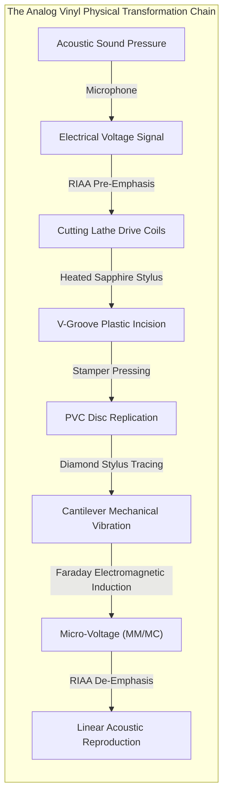
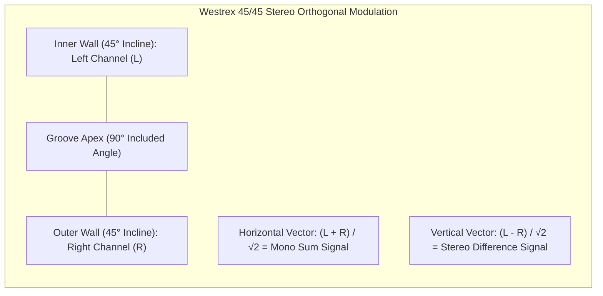
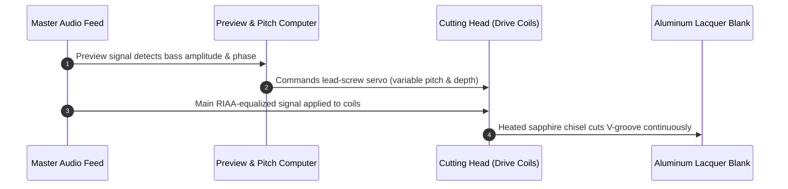
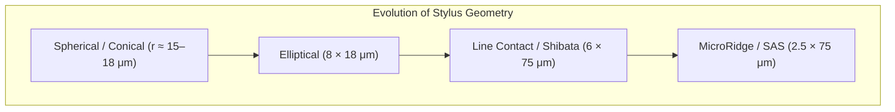
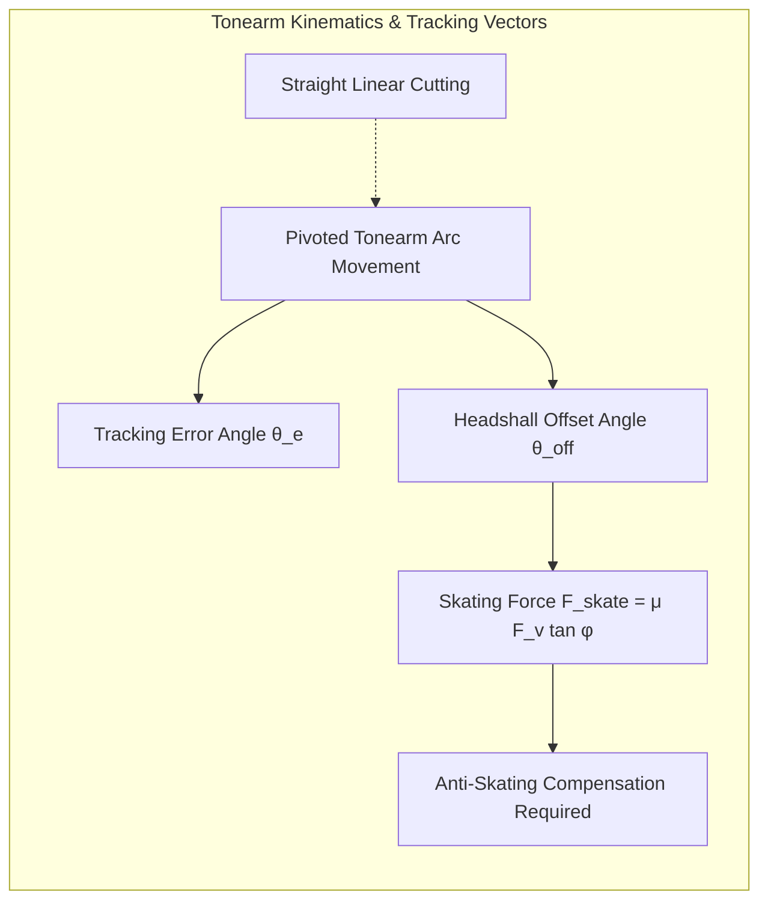
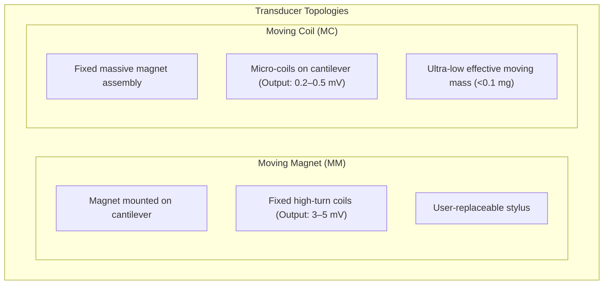
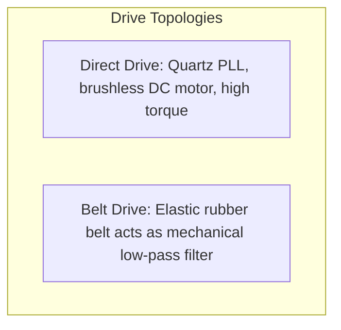

## Introduction: The Acoustic Microcosm Etched in Black PVC

In an era dominated by high-resolution digital audio streaming, lossless codecs, and wireless DSP earbuds, an extraordinary counter-revolution has taken hold: **the global resurgence of the vinyl record**. Vinyl LP sales have surpassed compact discs in major global markets, captivating both seasoned audiophiles and younger generations.

Beyond nostalgia and cover-art aesthetics lies a profound technological truth: the vinyl record is an astounding triumph of **precision mechanical engineering, continuum contact mechanics, and electromagnetic transduction**.



Consider the physical dimensions: a 12-inch disc of polyvinyl chloride (PVC) weighing 180 grams. Spiraling across its surface is a continuous V-shaped microgroove roughly $50\ \mu\text{m}$ wide and $30\ \mu\text{m}$ deep. The physical modulations carved into its walls range from tens of microns at low frequencies down to **fractions of a nanometer** for delicate overtone harmonics.

When a diamond stylus races through this undulating canyon at linear speeds up to $50\text{ cm/s}$, it experiences accelerations reaching hundreds of Gs. Concurrently, Hertzian contact pressures between the stylus tip and the vinyl exceed **600 MPa (over 6,000 atmospheres)**.

How does such a primitive-looking mechanical interface reproduce high-fidelity stereophonic sound with negligible crosstalk? Why must audio be intentionally distorted before being pressed onto vinyl? This treatise explores the complete physical framework governing analog record reproduction.

---

## 1. 45/45 Stereo Microgroove Geometry

Before stereophonic recording, monaural discs utilized lateral modulation (horizontal cutting), where groove depth remained constant while the groove undulated laterally.



### 1.1 The Orthogonal Resolution Vector
In 1957, the Westrex Corporation standardized the **45/45 system**. The groove forms a 90-degree V-trough. The inner wall (facing the spindle) carries the Left channel, inclined at $45^\circ$ to the record surface; the outer wall carries the Right channel, inclined at an orthogonal $45^\circ$.

Defining horizontal displacement as $x$ and vertical displacement as $y$ (downward positive), the spatial coordinate vector of the stylus is:

$$x(t) = \frac{S_L(t) + S_R(t)}{\sqrt{2}}$$

$$y(t) = \frac{S_L(t) - S_R(t)}{\sqrt{2}}$$

This geometric arrangement yields three critical advantages:
1. **Geometric Symmetry**: Both channels share identical moving mass, compliance, and frequency response characteristics.
2. **Zero Theoretical Crosstalk**: Because the modulation planes are perpendicular ($\vec{v}_L \cdot \vec{v}_R = 0$), mechanical deflection on one wall induces zero orthogonal motion on the other.
3. **Monophonic Backward Compatibility**: When playing a mono signal ($S_L = S_R$), vertical displacement $y = 0$, meaning the groove modulates purely horizontally. A mono cartridge can play a stereo disc without vertical skipping.

---

## 2. The Mechanics of the Cutting Lathe

Vinyl records begin on a master cutting lathe (e.g., Neumann VMS-70/80), where audio signals drive heavy electromagnetic cutterheads.



### 2.1 Electromagnetic Chisel and Stylus Heating
The cutting head uses powerful voice coils operating within intense permanent magnetic fields:

$$F = B \cdot I \cdot L$$

To slice cleanly through nitrocellulose lacquer without tearing or leaving micro-burrs, the sapphire cutting chisel is wrapped with a platinum heater wire. Current heats the cutting tip to **$100^\circ\text{C} \sim 120^\circ\text{C}$**, locally softening the lacquer during incision to ensure mirror-smooth groove walls with minimal surface noise.

### 2.2 Variable Pitch Computer Control
Without active pitch control, loud bass passages would cause adjacent grooves to collide (**groove overcut**). The **groove computer** reads a preview audio signal 1 second in advance, calculating instantaneous peak lateral ($X_{\max}$) and vertical ($Y_{\max}$) amplitudes.

It dynamically expands the spiral lead screw pitch during explosive crescendos and tightens it down to tens of microns during quiet passages. This dynamic spatial optimization expanded LP playing times from 10 minutes to over 25–30 minutes per side.

---

## 3. The RIAA Equalization Curve: Thermodynamic and Geometric Necessity

Every commercial vinyl record is cut with an aggressively warped frequency response: bass is heavily cut, and treble is massively boosted.

```mermaid
xychart-beta
    title "RIAA Pre-Emphasis (Recording) vs De-Emphasis (Playback) Curves"
    x-axis "Frequency (Hz)" [20, 50, 100, 500, 1000, 2122, 10000, 20000]
    y-axis "Relative Gain (dB)" -25 --> 25
    series "Cutting Pre-emphasis" [-19.3, -17.0, -13.1, -2.7, 0.0, 2.9, 13.7, 19.6]
    series "Phono Playback De-emphasis" [19.3, 17.0, 13.1, 2.7, 0.0, -2.9, -13.7, -19.6]
```

### 3.1 Velocity Response and Bass Amplitude Explosion
Magnetic cutterheads and phono cartridges are **velocity-sensitive devices**. For a displacement $x(t) = A \sin(\omega t)$, the recorded velocity is:

$$v(t) = \frac{dx}{dt} = 2\pi f A \cos(2\pi f t)$$

Under constant recording velocity ($V_0 = 2\pi f A = \text{const}$), groove displacement $A$ is inversely proportional to frequency:

$$A = \frac{V_0}{2\pi f} \propto \frac{1}{f}$$

At $50\text{ Hz}$, maintaining equal recording velocity compared to $1,000\text{ Hz}$ requires **20 times larger physical amplitude ($+26\text{ dB}$)**. If uncorrected, low frequencies would tear across the disc, making tracking physically impossible.

### 3.2 High-Frequency Surface Noise Masking
At $10\text{ kHz} \sim 20\text{ kHz}$, amplitude shrinks to nanometer scales, dropping below the surface roughness of PVC polymer chains. High frequencies would be swallowed by hiss.

### 3.3 The Three RIAA Time Constants
In 1954, the RIAA standardized three precise time constants:

| Parameter | Time Constant $\tau$ | Transition Frequency $f = \frac{1}{2\pi \tau}$ | Physical Role |
| :--- | :--- | :--- | :--- |
| **$\tau_1$** | $3,180\ \mu\text{s}$ | $\approx 50.05\text{ Hz}$ | Bass attenuation shelf limit |
| **$\tau_2$** | $318\ \mu\text{s}$ | $\approx 500.5\text{ Hz}$ | Turnover from bass cut to flat midrange |
| **$\tau_3$** | $75\ \mu\text{s}$ | $\approx 2,122\text{ Hz}$ | Treble pre-emphasis shelf onset |

The playback transfer function $H_{\text{playback}}(s)$ in the Laplace domain is:

$$H_{\text{playback}}(s) = \frac{1 + s \tau_2}{(1 + s \tau_1)(1 + s \tau_3)}$$

During playback, attenuating treble by $\sim 20\text{ dB}$ restores flat response while simultaneously **knocking down vinyl surface hiss and clicks by $20\text{ dB}$ (a 100-fold reduction in noise power)**.

---

## 4. Contact Mechanics and Stylus Profiles



### 4.1 Hertzian Contact Stress: Tons per Square Centimeter
A tracking force of $1.5\text{ g}$ ($F_v \approx 0.0147\text{ N}$) on a spherical diamond stylus ($R = 15\ \mu\text{m}$) pressing against PVC yields an equivalent modulus:

$$E^* \approx 4.17\text{ GPa}$$

The contact radius $a$ is:

$$a = \left( \frac{3 F_v R}{4 E^*} \right)^{1/3} \approx 3.41\ \mu\text{m}$$

The peak center pressure $P_0$ is:

$$P_0 = \frac{3 F_v}{2 \pi a^2} \approx \mathbf{604\text{ MPa}} \quad (\approx \mathbf{6,160\text{ kgf/cm}^2})$$

This immense local stress momentarily exceeds the elastic limit of PVC, causing transient viscoelastic flow. The vinyl recovers elastically, but frictional flash-heating momentarily spikes to hundreds of degrees Celsius at the contact boundary.

### 4.2 Stylus Profiles: From Spherical to MicroRidge
Advanced profiles like **Shibata** and **MicroRidge** elongate the contact patch vertically along the groove wall ($75\ \mu\text{m}$) while narrowing the horizontal scanning radius ($2.5\ \mu\text{m}$). This expands contact area by 400%, lowering contact stress to $\sim 150\text{ MPa}$ to preserve vinyl longevity and accurately resolve $60\text{ kHz}$ harmonics.

---

## 5. Tonearm Geometry and Skating Force



### 5.1 Baerwald Optimal Alignment Mathematics
Pivoted tonearms swing in an arc, causing the cartridge axis to deviate from the groove tangent by **tracking error angle $\theta_e$**. Because tracking distortion is weighted by groove linear velocity $v = \omega r$:

$$D_{\text{tracking}} \propto \frac{\theta_e}{r}$$

H.G. Baerwald derived the optimal geometry by minimizing peak distortion across the disc, creating two zero-error **null points**:

$$r_1 = 66.04\text{ mm}, \quad r_2 = 120.89\text{ mm}$$

The required overhang $D$ and offset angle $\theta_{\text{offset}}$ for effective length $L$ are given by:

$$D = L - \sqrt{L^2 - r_1 r_2}$$

$$\sin \theta_{\text{offset}} = \frac{r_1 + r_2}{2 L \sqrt{1 - \frac{r_1 r_2}{L^2}}}$$

By selecting an exact overhang ($D \approx 15 \sim 18\text{ mm}$) and headshell offset angle ($\theta_{\text{offset}} \approx 21^\circ \sim 25^\circ$), distortion across the playing surface remains below $0.5\%$.

### 5.2 Skating Force Vector Decomposition
Because the groove friction force $F_f = \mu F_v$ acts along the tangent, while the arm pivot is offset, a lateral vector component pulls the arm toward the center:

$$F_{\text{skate}} = F_f \sin \phi \approx \mu F_v \tan \phi$$

Without **anti-skating compensation**, the stylus rides hard against the inner wall (Left channel) and loses contact with the outer wall (Right channel), inducing severe distortion and asymmetric record wear.

### 5.3 Inner Groove Distortion (IGD) and the Pinch Effect
A fundamental constraint of vinyl is the radial gradient of linear surface velocity:

$$v = \omega r = 2\pi \left(\frac{33.33}{60}\right) r$$

At the outer edge ($r \approx 145\text{ mm}$), $v \approx 50.6\text{ cm/s}$. At the inner groove ($r \approx 60\text{ mm}$), $v$ plummets to $20.9\text{ cm/s}$—a $58\%$ reduction!
Because physical wavelength is $\lambda = v / f$, a $15\text{ kHz}$ tone has a physical wavelength of $33.7\ \mu\text{m}$ at the lead-in groove, but shrinks to just $13.9\ \mu\text{m}$ near the label. If the wavelength approaches the physical curvature of the stylus, the stylus is forced upward rather than laterally, generating severe second-harmonic distortion known as the **Pinch Effect**.

---

## 6. Transducer Electrodynamics: MM vs MC Cartridges



- **Moving Magnet (MM)**: Large stationary coils allow high turns, generating $3 \sim 5\text{ mV}$. However, moving mass is relatively high ($0.4 \sim 0.8\text{ mg}$), limiting high-frequency resonance.
- **Moving Coil (MC)**: Miniature hand-wound coils on the cantilever slash effective tip mass to under $0.1\text{ mg}$. High-frequency resonance is pushed past $50\text{ kHz}$, yielding pristine transient speed. However, output is tiny ($0.2 \sim 0.5\text{ mV}$), demanding step-up transformers or ultra-low-noise preamps.

---

## 7. Turntable Drive Mechanics and Resonance Isolation

A turntable must achieve two opposing physical requirements: **absolute constant rotational velocity** and **absolute isolation from mechanical vibration**.



- **Belt Drive**: An elastic rubber belt couples the high-speed motor to the heavy platter. The belt's compliance ($C_{\text{belt}}$) and platter inertia ($M_{\text{platter}}$) form a low-pass mechanical filter with cutoff:
  $$f_c = \frac{1}{2\pi} \sqrt{\frac{k_{\text{belt}}}{M_{\text{platter}}}}$$
  filtering out high-frequency motor cogging before reaching the vinyl.
- **Direct Drive**: Technics pioneered quartz-crystal phase-locked loop (PLL) direct-drive motors. Hall-effect sensors detect rotor position with micro-degree precision, adjusting stator drive current to eliminate cogging and achieve wow & flutter under $0.015\%$.

---

## Conclusion: The Endurance of Mechanical Sound

Vinyl is not merely stored data—it is **the tangible physical embossment of sound itself**. Every nuance of acoustic pressure, captured across 45-degree orthogonal axes, equalized through thermodynamic necessity, and traced under gigapascal contact pressures, represents an immortal synthesis of physics, acoustics, and mechanical craftsmanship.
