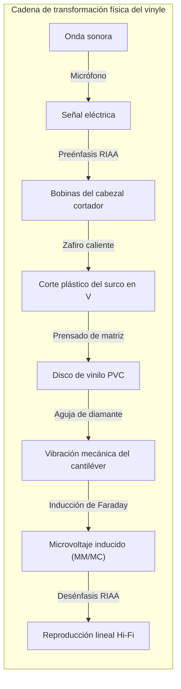
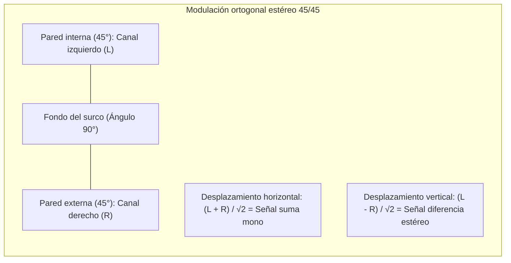

## Introducción: El microcosmos acústico grabado en PVC negro

En plena era del audio digital de alta resolución y auriculares inalámbricos, asistimos a una sorprendente contrarrevolución: **el renacimiento global del disco de vinilo (LP)**.

Lejos de ser simple nostalgia, la reproducción analógica representa la cúspide del **control físico de precisión y la transducción electromagnética**.



En un disco de PVC de 180 gramos se traza un microsurco helicoidal de $50\ \mu\text{m}$ de ancho y $30\ \mu\text{m}$ de profundidad. Las ondulaciones varían desde decenas de micras en graves hasta **fracciones de nanómetro** en los sobretonos agudos. La aguja de diamante experimenta aceleraciones de cientos de G y presiones de contacto de Hertz superiores a **600 MPa (6.000 atmósferas)**.

---

## 1. Geometría del surco estéreo 45/45

Normalizado en 1957 por Westrex, el **sistema 45/45** es el estándar estéreo mundial:
- Surco en V con ángulo de 90°;
- **Pared interna (hacia el centro, 45°): Canal izquierdo (L)**;
- **Pared externa (hacia el exterior, 45°): Canal derecho (R)**.



Ecuaciones de desplazamiento:

$$x(t) = \frac{S_L(t) + S_R(t)}{\sqrt{2}}, \quad y(t) = \frac{S_L(t) - S_R(t)}{\sqrt{2}}$$

La perpendicularidad ($\vec{v}_L \cdot \vec{v}_R = 0$) anula la diafonía entre canales. Con señales mono en fase ($S_L = S_R$), el desplazamiento vertical es nulo ($y=0$), garantizando compatibilidad total con fonocaptores monofónicos antiguos.

---

## 2. Torno de corte y paso variable

- **Corte con aguja caliente**: Un hilo de platino calienta el zafiro cortador a **$100^\circ\text{C} \sim 120^\circ\text{C}$**, ablandando el acetato para dejar paredes pulidas y libres de ruido.
- **Control por ordenador de paso variable**: Anticipa la señal de audio para separar los surcos en pasajes atronadores y juntarlos en silencios, permitiendo hasta 30 minutos de música por cara.

---

## 3. Necesidad física de la ecualización RIAA

```mermaid
xychart-beta
    title "Curvas de ecualización RIAA: Grabación vs Reproducción"
    x-axis "Frecuencia (Hz)" [20, 50, 100, 500, 1000, 2122, 10000, 20000]
    y-axis "Ganancia relativa (dB)" -25 --> 25
    series "Grabación (Pre-emphasis)" [-19.3, -17.0, -13.1, -2.7, 0.0, 2.9, 13.7, 19.6]
    series "Reproducción (De-emphasis)" [19.3, 17.0, 13.1, 2.7, 0.0, -2.9, -13.7, -19.6]
```

Como la velocidad de grabación $v = 2\pi f A$ es constante, la amplitud física $A$ es inversamente proporcional a la frecuencia:

$$A = \frac{V_0}{2\pi f} \propto \frac{1}{f}$$

- A $50\text{ Hz}$, la amplitud sería 20 veces mayor ($+26\text{ dB}$), destruyendo el disco;
- A $20\text{ kHz}$, el sonido quedaría sepultado en el ruido de fondo del plástico.

La norma RIAA atenúa los graves y amplifica los agudos al grabar. En la reproducción, el previo phono invierte la curva, **reduciendo el siseo y chasquidos en 20 dB (100 veces menos potencia de ruido)**.

---

## 4. Mecánica de contacto y perfiles de aguja

Con $1,5\text{ g}$ de fuerza vertical, la presión de Hertz máxima alcanza:

$$P_0 = \frac{3 F_v}{2 \pi a^2} \approx \mathbf{604\text{ MPa}} \quad (\approx \mathbf{6.160\text{ kgf/cm}^2})$$

Los perfiles **Shibata** y **MicroRidge** ensanchan la línea de contacto vertical a $75\ \mu\text{m}$, reduciendo la presión a $150\text{ MPa}$ y alcanzando frecuencias de $60\text{ kHz}$.

---

## 5. Cinemática del brazo y fuerza de patinaje (Skating)


La fricción y el ángulo de desfase generan una fuerza hacia el centro ($F_{\text{skate}} = \mu F_v \tan \phi$). El mecanismo de antiskating contrarresta este vector para igualar la presión en ambas paredes.

---

## 6. Transductores: Cápsulas MM frente a MC

- **MM (Imán móvil)**: Salida alta ($3 \sim 5\text{ mV}$), aguja reemplazable, pero mayor masa móvil.
- **MC (Bobina móvil)**: Microbobinas en el cantiléver, masa móvil ínfima ($<0,1\text{ mg}$), velocidad de respuesta inigualable, pero salida diminuta ($0,2 \sim 0,5\text{ mV}$) que requiere transformadores elevadores.

---

## Conclusión

El vinilo es la escultura física de la onda sonora: una armoniosa convergencia de física del contacto, electromagnetismo y precisión mecánica inmortal.
