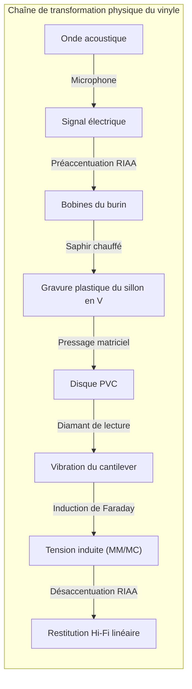
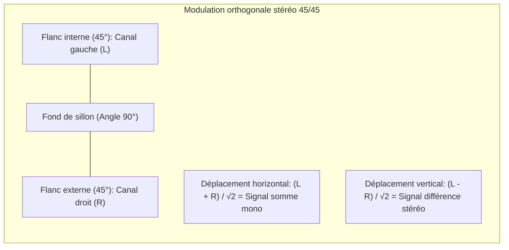
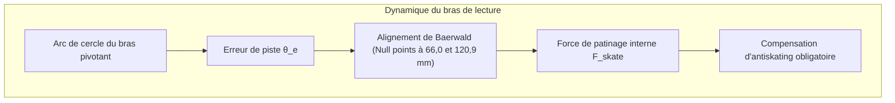

## Introduction : Le microcosme acoustique gravé dans le vinyle noir

À l'ère de la musique dématérialisée et du streaming sans perte, la **renaissance planétaire du disque vinyle (LP)** fascine autant les mélomanes que les physiciens.

Loin d'un simple caprice vintage, la lecture d'un disque microsillon est un chef-d'œuvre de **mécanique de contact, de géométrie spatiale et d'électromagnétisme**.



Sur une galette de polychlorure de vinyle (PVC) de 180 grammes, un microsillon d'environ $50\ \mu\text{m}$ de largeur et $30\ \mu\text{m}$ de profondeur serpente en spirale. Les ondulations oscillent entre quelques dizaines de microns pour les basses et **des fractions de nanomètre** pour les harmoniques aiguës. Le diamant de lecture y subit des accélérations de plusieurs centaines de G et des pressions locales atteignant **600 MPa (6 000 atmosphères)**.

---

## 1. Géométrie de gravure stéréo 45/45

Standardisé en 1957 par Westrex, le **système 45/45** est la norme universelle :
- Sillon en V à angle de 90° ;
- **Flanc interne (vers le centre, incliné à 45°) : Canal gauche (L)** ;
- **Flanc externe (vers l'extérieur, incliné à 45°) : Canal droit (R)**.



Formules de projection vectorielle :

$$x(t) = \frac{S_L(t) + S_R(t)}{\sqrt{2}}, \quad y(t) = \frac{S_L(t) - S_R(t)}{\sqrt{2}}$$

Grâce à l'orthogonalité ($\vec{v}_L \cdot \vec{v}_R = 0$), la diaphonie théorique est nulle. Pour un signal monophonique en phase ($S_L = S_R$), la composante verticale s'annule ($y=0$) : le sillon ondule uniquement de gauche à droite, assurant une parfaite compatibilité rétroactive.

---

## 2. Le tour de gravure et le pas variable

- **Burin chauffant** : Un fil de platine chauffe le saphir à **$100^\circ\text{C} \sim 120^\circ\text{C}$**, ramollissant la laque d'acétate pour tailler des parois lisses sans bavures.
- **Pas variable assisté par ordinateur** : Une tête de lecture préliminaire lit le signal 1 seconde à l'avance, écartant les spires lors des crescendos pour éviter les chevauchements de sillons.

---

## 3. Nécessité physique de l'égalisation RIAA

```mermaid
xychart-beta
    title "Courbes d'égalisation RIAA : Gravure (Préaccentuation) vs Lecture"
    x-axis "Fréquence (Hz)" [20, 50, 100, 500, 1000, 2122, 10000, 20000]
    y-axis "Gain relatif (dB)" -25 --> 25
    series "Gravure (Pre-emphasis)" [-19.3, -17.0, -13.1, -2.7, 0.0, 2.9, 13.7, 19.6]
    series "Lecture phono (De-emphasis)" [19.3, 17.0, 13.1, 2.7, 0.0, -2.9, -13.7, -19.6]
```

La vitesse de gravure $v = 2\pi f A$ étant constante, l'amplitude géométrique $A$ varie en $1/f$ :

$$A = \frac{V_0}{2\pi f} \propto \frac{1}{f}$$

- À $50\text{ Hz}$, l'amplitude serait 20 fois trop grande ($+26\text{ dB}$), détruisant le disque ;
- À $20\text{ kHz}$, elle serait masquée par le bruit granulaire du plastique.

La norme RIAA (constantes de temps : $3180\ \mu\text{s}$, $318\ \mu\text{s}$, $75\ \mu\text{s}$) atténue le grave à la gravure et booste l'aigu. À la lecture, l'étage phono applique la courbe inverse, **réduisant le souffle et les craquements de 20 dB (un facteur 100 en puissance de bruit)** !

---

## 4. Tribologie et profils de diamant

Sous $1,5\text{ g}$ de force d'appui, la pression de contact centrale de Hertz atteint :

$$P_0 = \frac{3 F_v}{2 \pi a^2} \approx \mathbf{604\text{ MPa}} \quad (\approx \mathbf{6 160\text{ kgf/cm}^2})$$

Les profils **Shibata** et **MicroRidge** étirent la surface de contact verticalement le long du flanc ($75\ \mu\text{m}$), abaissant la pression à $150\text{ MPa}$ et prolongeant la bande passante jusqu'à $60\text{ kHz}$.

---

## 5. Géométrie du bras et force de centripète (Skating)



L'angle de coude du porte-cellule dévie le frottement de sillon, créant une force centripète :

$$F_{\text{skate}} = F_f \sin \phi \approx \mu F_v \tan \phi$$

L'antiskating compense cette dérive pour équilibrer la pression sur les deux flancs.

---

## 6. Générateurs : Cellules MM vs MC

- **MM (Aimant mobile)** : Niveau de sortie élevé ($3 \sim 5\text{ mV}$), diamant interchangeable, masse mobile plus importante.
- **MC (Bobine mobile)** : Micro-bobines sur le cantilever, masse équivalente infime ($<0,1\text{ mg}$), réponse transitoire absolue, mais tension de sortie minime ($0,2 \sim 0,5\text{ mV}$) requérant un transformateur élévateur.

---

## Conclusion

Le vinyle est la sculpture physique de l'onde sonore, où la thermodynamique et la micromécanique s'unissent pour immortaliser la musique.
