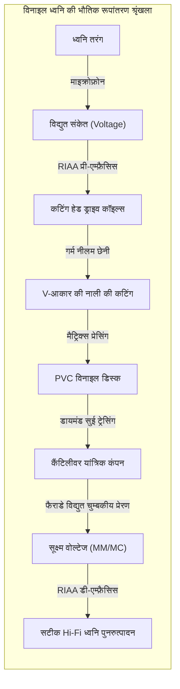
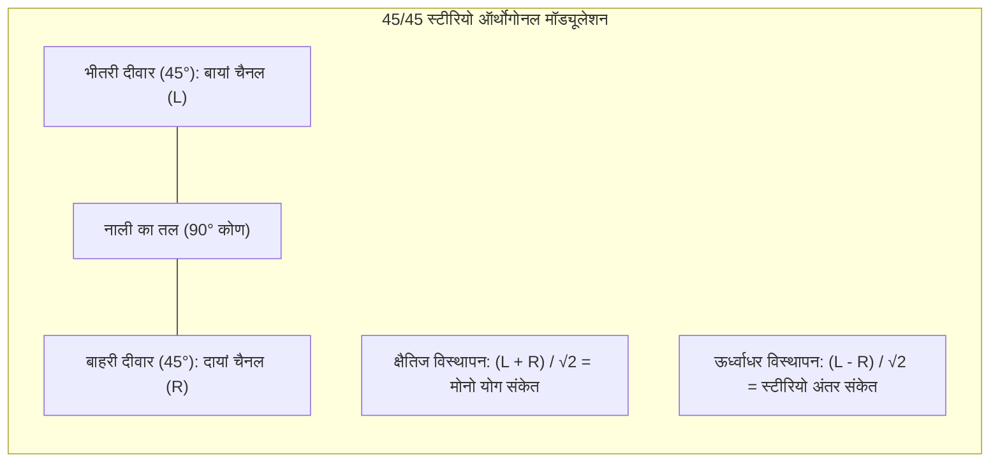
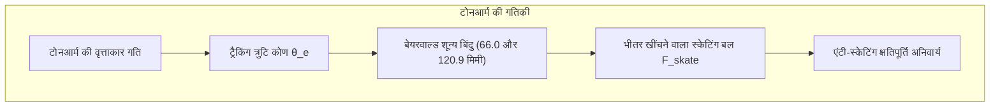

## प्रस्तावना: काले विनाइल रिकॉर्ड में बसा सूक्ष्म ध्वनि-ब्रह्मांड

हाई-रेजोल्यूशन डिजिटल स्ट्रीमिंग और वायरलेस ईयरबड्स के इस युग में दुनिया एक अनोखी क्रांति देख रही है: **एनालॉग विनाइल रिकॉर्ड (LP) की वैश्विक वापसी**।

यह केवल पुरानी यादों का आकर्षण नहीं है; अनुप्रयुक्त भौतिकी और सटीक मैकेनिकल इंजीनियरिंग के नजरिए से विनाइल रिकॉर्ड **चरम एनालॉग भौतिक नियंत्रण और विद्युत चुम्बकीय ट्रांसडक्शन का शिखर** है।



180 ग्राम की पीवीसी डिस्क पर लगभग $50\ \mu\text{m}$ चौड़ी और $30\ \mu\text{m}$ गहरी V-आकार की सर्पिलाकार नाली खुदी होती है। इसकी दीवारों पर दर्ज कंपन बेस में कुछ माइक्रोन से लेकर उच्च आवृत्तियों पर **सब-नैनोमीटर पैमाने** तक होते हैं। नाली में दौड़ते समय हीरे की सुई सैकड़ों G के त्वरण और **600 MPa (6,000 वायुमंडलीय दबाव)** से अधिक के संपर्क दबाव का अनुभव करती है।

---

## 1. 45/45 स्टीरियो माइक्रोग्रूव की ज्यामिति

1957 में वेस्ट्रेक्स (Westrex) द्वारा मानकीकृत **45/45 प्रणाली** आधुनिक स्टीरियो विनाइल का आधार है:
- नाली का कोण 90 डिग्री V-आकार;
- **भीतरी दीवार (केंद्र की ओर 45° झुकाव): बायां चैनल (L)**;
- **बाहरी दीवार (बाहर की ओर 45° झुकाव): दायां चैनल (R)**।



विस्थापन वेक्टर समीकरण:

$$x(t) = \frac{S_L(t) + S_R(t)}{\sqrt{2}}, \quad y(t) = \frac{S_L(t) - S_R(t)}{\sqrt{2}}$$

लंबवतता (ऑर्थोगोनैलिटी) के कारण दोनों चैनलों में कोई क्रॉसटॉक नहीं होता ($\vec{v}_L \cdot \vec{v}_R = 0$)। समान मोनो सिग्नल ($S_L = S_R$) में ऊर्ध्वाधर विस्थापन शून्य ($y=0$) हो जाता है, जिससे पुराने मोनो प्लेयर पर भी बिना सुई उछले यह आसानी से बजता है।

---

## 2. कटिंग लेथ और वेरिएबल ग्रूव पिच

- **गर्म छेनी कटिंग**: नीलम की छेनी को प्लैटिनम तार से **$100^\circ\text{C} \sim 120^\circ\text{C}$** तक गर्म किया जाता है, जिससे लैकर नरम होकर कटता है और सतह का शोर न्यूनतम हो जाता है।
- **कंप्यूटर वेरिएबल पिच**: प्रिव्यू हेड 1 सेकंड पहले सिग्नल को पढ़कर भारी बेस पर नालियों के बीच की दूरी बढ़ा देता है, जिससे एक तरफ 30 मिनट तक की रिकॉर्डिंग संभव होती है।

---

## 3. RIAA इक्वलाइज़ेशन कर्व की भौतिक आवश्यकता

```mermaid
xychart-beta
    title "RIAA इक्वलाइज़ेशन वक्र: रिकॉर्डिंग बनाम प्लेबैक"
    x-axis "आवृत्ति (Hz)" [20, 50, 100, 500, 1000, 2122, 10000, 20000]
    y-axis "सापेक्ष लाभ (dB)" -25 --> 25
    series "कटिंग रिकॉर्डिंग (Pre-emphasis)" [-19.3, -17.0, -13.1, -2.7, 0.0, 2.9, 13.7, 19.6]
    series "फोनो प्लेबैक (De-emphasis)" [19.3, 17.0, 13.1, 2.7, 0.0, -2.9, -13.7, -19.6]
```

चूंकि कार्ट्रिज वेग-संवेदनशील होते हैं ($v = 2\pi f A$), भौतिक आयाम $A$ आवृत्ति के व्युत्क्रमानुपाती होता है:

$$A = \frac{V_0}{2\pi f} \propto \frac{1}{f}$$

- $50\text{ Hz}$ पर आयाम 20 गुना बड़ा ($+26\text{ dB}$) होकर नाली को तोड़ देगा;
- $20\text{ kHz}$ पर आयाम पीवीसी की सतह के शोर में दब जाएगा।

RIAA मानक रिकॉर्डिंग के समय बेस को दबाता है और ट्रेबल को बढ़ाता है। प्लेबैक के समय फोनो प्रीएम्प इसे उलट देता है, जिससे **सतह की सरसराहट और शोर 20 dB (100 गुना कम पावर) दब जाता है**!

---

## 4. संपर्क यांत्रिकी और सुई के आकार

$1.5\text{ g}$ ट्रैकिंग बल पर हर्ट्ज़ियन संपर्क दबाव का शिखर पहुंचता है:

$$P_0 = \frac{3 F_v}{2 \pi a^2} \approx \mathbf{604\text{ MPa}} \quad (\approx \mathbf{6,160\text{ kgf/cm}^2})$$

**शिबाता (Shibata)** और **माइक्रोरिज (MicroRidge)** प्रोफाइल संपर्क रेखा को ऊर्ध्वाधर रूप से $75\ \mu\text{m}$ तक बढ़ाकर दबाव को $150\text{ MPa}$ तक घटाते हैं और $60\text{ kHz}$ तक की आवृत्ति पढ़ सकते हैं।

---

## 5. टोनआर्म ज्यामिति और स्केटिंग बल



घर्षण और ऑफसेट कोण के कारण टोनआर्म केंद्र की ओर खिंचता है ($F_{\text{skate}} = \mu F_v \tan \phi$)। एंटी-स्केटिंग तंत्र विपरीत बल लगाकर दोनों दीवारों पर दबाव समान बनाए रखता है।

---

## 6. विद्युत चुम्बकीय ट्रांसड्यूसर: MM बनाम MC कार्ट्रिज

- **MM (मूविंग मैग्नेट)**: उच्च आउटपुट ($3 \sim 5\text{ mV}$), सुई बदलना आसान, लेकिन गतिशील द्रव्यमान अधिक।
- **MC (मूविंग कॉइल)**: सूक्ष्म कॉइल्स, गतिशील द्रव्यमान अत्यंत कम ($<0.1\text{ mg}$), अद्भुत ट्रांजिएंट रिस्पॉन्स, लेकिन आउटपुट कम ($0.2 \sim 0.5\text{ mV}$) जिसके लिए स्टेप-अप ट्रांसफॉर्मर चाहिए।

---

## निष्कर्ष

विनाइल रिकॉर्ड ध्वनि तरंग का एक भौतिक शिल्प है। संपर्क यांत्रिकी और विद्युत चुम्बकत्व का यह अद्भुत संगम संगीत को अमर बना देता है।
