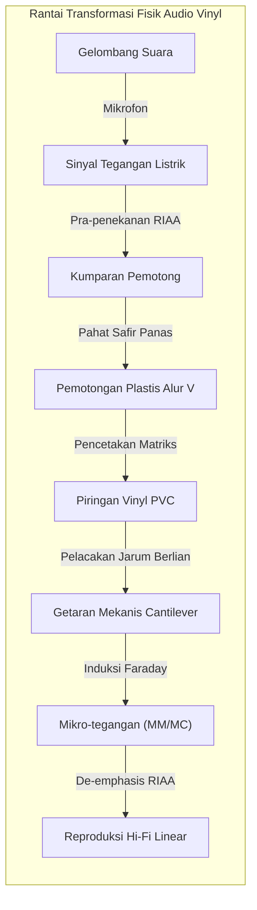
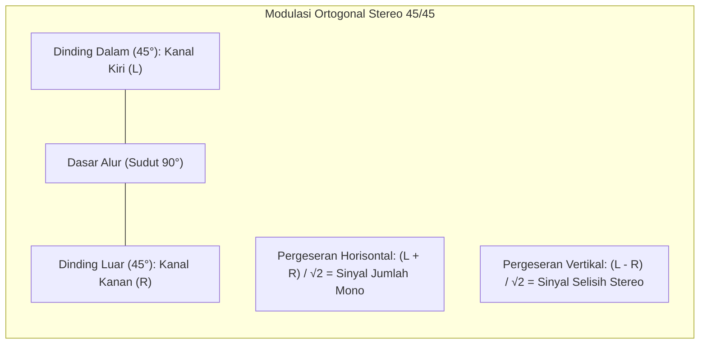

## Pendahuluan: Mikrokosmos Akustik pada Piringan PVC Hitam

Di era streaming musik digital nir-rugi dan penyuara telinga pintar, dunia menyaksikan fenomena luar biasa: **kebangkitan global piringan hitam (vinyl LP)**.

Ini bukan sekadar tren retro, melainkan bukti keunggulan **rekayasa presisi mekanis, mekanika kontak kontinum, dan transduksi elektromagnetik**.



Di atas piringan PVC seberat 180 gram, terukir alur mikro berbentuk V selebar $50\ \mu\text{m}$ dan sedalam $30\ \mu\text{m}$. Modulasi dinding alur berkisar dari puluhan mikron pada nada bas hingga **skala sub-nanometer** pada nada harmonik tinggi. Jarum berlian mengalami percepatan hingga ratusan G serta tekanan kontak Hertz melampaui **600 MPa (6.000 atmosfer)**.

---

## 1. Geometri Alur Stereo 45/45

Ditetapkan pada tahun 1957 oleh Westrex, **sistem 45/45** adalah standar piringan hitam stereo:
- Sudut alur V sebesar 90°;
- **Dinding dalam (miring 45° ke poros tengah): Kanal Kiri (L)**;
- **Dinding luar (miring 45° ke tepi luar): Kanal Kanan (R)**.



Vektor simpangan jarum:

$$x(t) = \frac{S_L(t) + S_R(t)}{\sqrt{2}}, \quad y(t) = \frac{S_L(t) - S_R(t)}{\sqrt{2}}$$

Ortogonalitas menjamin nol crosstalk secara teori ($\vec{v}_L \cdot \vec{v}_R = 0$). Saat memutar sinyal mono sefasa ($S_L = S_R$), simpangan vertikal bernilai nol ($y=0$), sehingga alur bergelombang murni secara horisontal, menjamin kompatibilitas mundur yang sempurna.

---

## 2. Mesin Bubut Pemotong dan Kendali Alur Variabel

- **Pahat Safir Berpemanas**: Pahat dipanaskan kawat platina ke suhu **$100^\circ\text{C} \sim 120^\circ\text{C}$**, melunakkan pernis asetat saat dipotong sehingga dinding alur sehalus cermin bebas derau.
- **Komputer Ulir Variabel (Variable Pitch)**: Menghitung amplitudo audio 1 detik sebelumnya untuk merenggangkan jarak alur saat bas keras berdentum dan merapatkannya saat senyap.

---

## 3. Keharusan Fisika Kurva Ekualisasi RIAA

```mermaid
xychart-beta
    title "Kurva Ekualisasi RIAA: Perekaman vs Pemutaran"
    x-axis "Frekuensi (Hz)" [20, 50, 100, 500, 1000, 2122, 10000, 20000]
    y-axis "Penguatan Relatif (dB)" -25 --> 25
    series "Perekaman (Pre-emphasis)" [-19.3, -17.0, -13.1, -2.7, 0.0, 2.9, 13.7, 19.6]
    series "Pemutaran phono (De-emphasis)" [19.3, 17.0, 13.1, 2.7, 0.0, -2.9, -13.7, -19.6]
```

Karena pemotong dan kartrid bersifat responsif terhadap kecepatan ($v = 2\pi f A$), simpangan fisik $A$ berbanding terbalik dengan frekuensi:

$$A = \frac{V_0}{2\pi f} \propto \frac{1}{f}$$

- Pada $50\text{ Hz}$, simpangan alur membesar 20 kali lipat ($+26\text{ dB}$), merusak alur sebelah;
- Pada $20\text{ kHz}$, simpangan alur tenggelam dalam derau material PVC.

Kurva RIAA memotong bas dan mendongkrak nada tinggi saat rekaman. Pada tahap pemutaran, preamp phono membalikkan kurva, **menekan derau desis permukaan piringan hingga 20 dB (penurunan 100 kali lipat daya derau)**!

---

## 4. Mekanika Kontak dan Profil Jarum

Di bawah gaya pelacakan $1,5\text{ g}$, tekanan kontak Hertz maksimum mencapai:

$$P_0 = \frac{3 F_v}{2 \pi a^2} \approx \mathbf{604\text{ MPa}} \quad (\approx \mathbf{6.160\text{ kgf/cm}^2})$$

Profil khusus seperti **Shibata** dan **MicroRidge** memperpanjang garis kontak vertikal ke $75\ \mu\text{m}$, memangkas tekanan menjadi $150\text{ MPa}$ dan melacak frekuensi hingga $60\text{ kHz}$.

---

## 5. Geometri Tonearm dan Gaya Luncur (Skating Force)


Gesekan alur menghasilkan vektor gaya yang menarik lengan ke poros tengah ($F_{\text{skate}} = \mu F_v \tan \phi$). Mekanisme anti-skating mengimbangi gaya ini agar tekanan pada kedua dinding alur seimbang sempurna.

---

## 6. Transduser: Kartrid MM vs MC

- **MM (Moving Magnet)**: Output tinggi ($3 \sim 5\text{ mV}$), jarum dapat diganti mandiri, massa bergerak lebih besar.
- **MC (Moving Coil)**: Kumparan mikro pada cantilever, massa bergerak amat ringan ($<0,1\text{ mg}$), kecepatan transien sangat unggul, memerlukan penguat awal khusus ($0,2 \sim 0,5\text{ mV}$).

---

## Kesimpulan

Piringan hitam adalah ukiran fisik gelombang suara itu sendiri—perpaduan abadi mekanika kontak, kinematika, dan keindahan akustik.
