## はじめに：黒い塩ビ盤に宿るミクロの音響宇宙

現代の音楽再生環境は、スマートフォン、ストリーミングサービス、Bluetooth、そして完全ワイヤレスイヤホンによって完全にデジタル化されている。音波は毎秒44,100回（あるいはそれ以上）の速度でサンプリングされ、16ビットや24ビットのデジタルコード（0と1の二値信号）としてクラウドから光の速度でパケット伝送される。

しかし、そのデジタル全盛の21世紀において、世界的な規模で驚異的な逆転現象が起きている。**アナログレコード（Vinyl Record / LP盤）の劇的な復権**である。音楽愛好家や若い世代がこぞってレコードプレーヤーを購入し、米国や英国ではLP盤の売上高がCDを上回る逆転現象が現実のものとなった。

この現象を単なる「レトロなノスタルジー」や「ジャケット所有のファッション性」として片付けることは容易である。しかし、レコード再生という営みを**物理学、応用音響学、精密機械工学**の視点から厳密に見つめ直したとき、私たちはそこに、現代のハイテク技術をも凌駕するほどの**「極限のアナログ物理制御」**が集約されていることに息を呑むことになる。

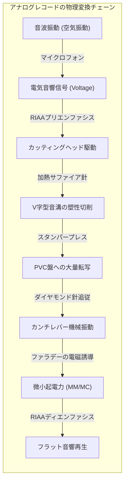

直径30センチメートル、厚さ約1.5ミリメートル、重さわずか180グラム前後のポリ塩化ビニル（PVC）の円盤。その表面には、幅約50マイクロメートル（髪の毛の半分程度）、深さ約30マイクロメートルの**「V字型の微小な溝（Microgroove）」**が、外周から内周へ向かって一本の連続したらせんを描いて刻まれている。

その溝の壁面に刻まれた波打ちは、最も激しい低音部でも振幅わずか数十マイクロメートル、最も繊細な高域の倍音成分に至っては**ナノメートル（100万分の1ミリメートル）オーダー**の微細な凹凸にすぎない。
重さわずか数ミリグラムのダイヤモンド針先が、その微小な山谷を秒速数十センチメートルの猛スピードで駆け抜けるとき、針先には数Gから数百Gに及ぶ激しい加速度が加わり、接触面には**1平方センチメートルあたり数十トン**に達する超高圧力が局所的に発生している。

なぜ、針で溝をなぞるという極めて原始的に見える機械的接触から、歪みの極めて少ないハイファイ（高忠実度）ステレオサウンドが再生できるのか？ 
なぜ、溝の深さと幅が有限であるにもかかわらず、左右2つの完全に独立した音声信号を1本の溝に同時に記録できるのか？
そしてなぜ、レコードはあらかじめ「歪んだ周波数特性」で音を刻まなければならないのか？

本稿では、レコードという名のミクロな機械音響システムに隠された幾何学、材料力学、電磁気学、そして音響心理学の全貌を、数式と力学モデルを用いて徹底的に解き明かしていく。

---

## 1. 音の物理刻印：45/45方式ステレオの幾何学

レコードが音を記録する原理の基礎は、エジソンの錫箔蓄音機（1877年）やエミール・ベルリナーの円盤式グラモフォン（1887年）にまで遡る。しかし、現代のハイファイステレオLP盤（1950年代後半に規格化）が成立するためには、空間幾何学の天才的なブレイクスルーが必要であった。

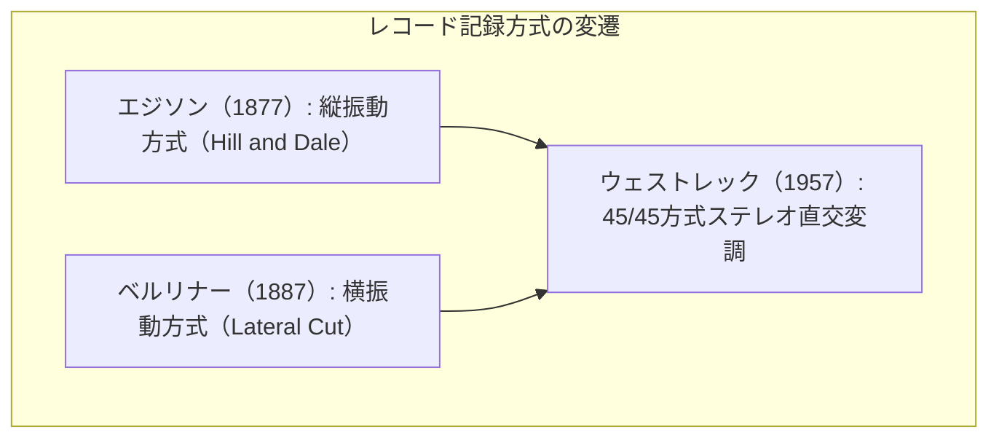

### 1.1 モノラルからステレオへの壁：1本の溝に2つの信号をどう刻むか？
初期のモノラルレコードは、音波の波形を**溝の左右への横揺れ（水平振動：Lateral cut）**として刻んでいた。深さは一定であり、針が左右に振れることで音を再生する。
1950年代、ステレオ録音の普及に伴い、1本の溝に左（Left）と右（Right）の独立した音響信号を混信（クロストーク）なく記録する手法が求められた。

もし「左チャンネルを水平振動、右チャンネルを垂直振動（深さの変化）」として記録した場合、水平方向と垂直方向でピックアップの機械的コンプライアンス（追従性）や歪み率が非対称になり、左右で著しく音質が異なってしまう。さらに、垂直振動の大きな部分では針が溝から飛び出す（針飛び）リスクが跳ね上がる。

### 1.2 45/45度方式（Westrex 45/45 System）の幾何学的解決
1957年、米ウェストレック（Westrex）社が開発し、世界標準となったのが**「45/45方式」**である。
断面が90度のV字型をした溝に対し、**内側の壁面（レコードの中心側）に左チャンネル（L）、外側の壁面（外周側）に右チャンネル（R）を、盤面からそれぞれ45度の傾斜角を持たせて独立に変調（刻印）する**手法である。

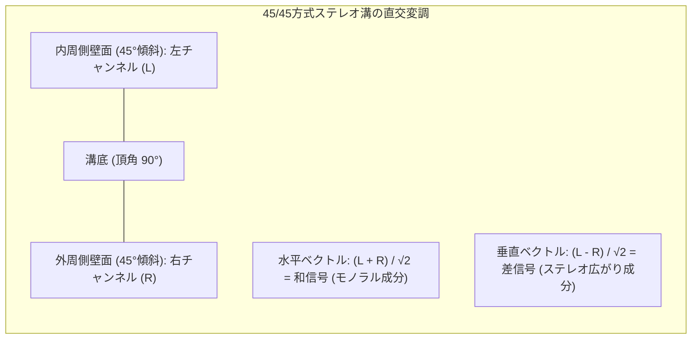

二次元デカルト座標系において、水平方向の変位を $x$、垂直方向の変位を $y$（下向きを正）と定義すると、左チャンネル信号 $S_L(t)$ と右チャンネル信号 $S_R(t)$ によるスタイラスの変位ベクトル $\vec{D} = (x, y)$ は、直交座標の45度回転変換によって以下のように記述される。

$$x(t) = \frac{S_L(t) + S_R(t)}{\sqrt{2}}$$

$$y(t) = \frac{S_L(t) - S_R(t)}{\sqrt{2}}$$

この数式は、極めて深遠な工学的調和を内包している。

1. **完全な左右対称性**：左壁面と右壁面は幾何学的にまったく等価であり、左右チャンネルの歪み率、周波数特性、感度は完全に一致する。
2. **直交性によるゼロ・クロストーク**：左チャンネル（内壁45度）の変調方向と、右チャンネル（外壁45度）の変調方向は空間的に**直交（$90^\circ$）**している。ベクトル空間において直交する成分の内積はゼロ（$\vec{v}_L \cdot \vec{v}_R = 0$）であるため、理想的なトランスデューサーにおいては左の振動が右に漏れず、理論上無限大のチャンネルセパレーションが得られる。
3. **下位互換性（モノラル盤との完全な親和性）**：
   モノラル信号は左右同一の信号である（$S_L = S_R$）。このとき、垂直変位は $y = (S_L - S_R)/\sqrt{2} = 0$ となり、水平変位のみ $x = \sqrt{2} S_L$ が発生する。
   つまり、**ステレオレコードに同位相のモノラル音源を記録すると、溝は完全に水平方向のみに波打ち、深さは一切変化しない**。これにより、当時の既存のモノラルレコードプレーヤーでステレオ盤を再生しても、針飛びを起こさずに完全なモノラル音声として安全に再生できるという、奇跡的な下位互換性が担保されたのである。

---

## 2. カッティングレースの極限制御：音を「削る」機械工学

レコードは、プラスチックの板に針を直接押し込んで作られるのではない。巨大なマスター旋盤（カッティングレース：Cutting Lathe）を用いて、極小のダイヤモンドまたはサファイアのバイトで音溝を1本ずつミクロン精度で切削（切削加工）することからすべてが始まる。

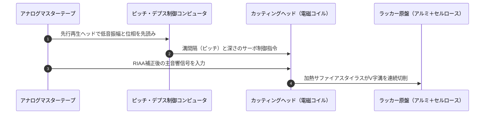

### 2.1 カッティングヘッドの電磁気力と冷却の物理
カッティングレース（ノイマン社の名機 VMS-70 や VMS-80 など）の心臓部であるカッティングヘッド（Neumann SX-74など）は、巨大な動電型アクチュエータ（ムービングコイル）である。
アンプから数百ワットの強大な音声電力信号が送り込まれ、強力な磁界の中で駆動コイルにローレンツ力が発生する。

$$F = B \cdot I \cdot L$$

ここで $B$ は磁束密度、$I$ は駆動電流、$L$ はコイルの有効長である。
カッティングスタイラスは、毎秒数万回という猛烈な速度で振動しながら、回転するラッカー盤（アルミニウムディスクの表面に酢酸セルロースラッカーを均一に塗布した原盤）の表面を削り取っていく。

この切削抵抗により、スタイラスには強大な摩擦熱と応力が発生する。高域の微小な波形を鏡のように滑らかに切り落とすため、カッティング針の先端には極細のプラチナヒーター線が巻かれており、電流を流して針先を**約100℃〜120℃に加熱（Stylus Heat）**している。熱によってセルロースラッカーを熱軟化（可塑化）させながら切削することで、切削面（音溝の壁面）の微小な粗さを排除し、バックグラウンドノイズ（ヒスノイズ・スクラッチノイズ）を劇的に低減させている。

### 2.2 可変ピッチ制御（Groove Computer）の数学
初期のSP盤や固定ピッチのレコードでは、溝と溝の間隔（送りピッチ）は一定であった。しかし、固定ピッチでは以下のような致命的ジレンマに直面する。
- 低音の大太鼓やベースが鳴ると、振幅が大きくなり隣の溝を突き破る（グルーヴ・オーバーカット）。
- 突き破りを防ぐためにピッチを広げると、盤面に記録できる溝の本数が減り、収録時間が10分程度に激減してしまう。

この問題を解決したのが**「コンピューター制御可変ピッチ（Variable Pitch and Depth）」**である。
カッティングレースに音声を送る際、再生ヘッドの手前に「プレビューヘッド（先読みヘッド）」を配置する。音響信号がカッティングヘッドに届く約1秒前に信号を先読みし、信号の振幅と位相から、これから刻まれる溝の最大横振幅 $X_{\max}$ と最大垂直振幅 $Y_{\max}$ をリアルタイムで高速演算する。

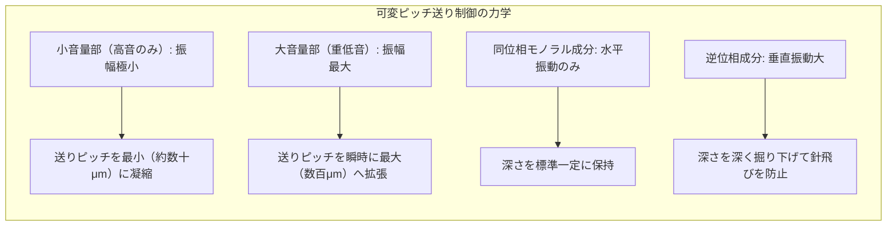

このサーボ制御によって、無音部や静かなパッセージでは溝同士を限界まで密集させ、ダイナミックな爆発音の瞬間だけ溝の間隔をサーボモーターで瞬時に押し広げる。この幾何学的最適化により、LP（Long Playing）盤は片面約25分〜30分という驚異的な長時間・高ダイナミックレンジ収録を達成したのである。

---

## 3. RIAAイコライゼーションカーブの必然性：なぜ音を歪ませて記録するのか

レコードを語る上で最も美しく、かつ最も誤解されやすい物理工学が**「RIAA（Recording Industry Association of America）イコライゼーション」**である。
市販されているすべてのレコードは、**「低音を極端に減衰させ、高音を極端にブーストした、極めていびつな周波数特性」**であらかじめ溝に刻まれている。
なぜ、原音を忠実に記録すべきメディアにおいて、意図的に周波数を歪ませてカッティングしなければならないのか？

```mermaid
xychart-beta
    title "RIAA 録音（プリエンファシス）と再生（ディエンファシス）特性曲線"
    x-axis "周波数 (Hz)" [20, 50, 100, 500, 1000, 2122, 10000, 20000]
    y-axis "利得 Relative Gain (dB)" -25 --> 25
    series "カッティング録音特性 (Pre-emphasis)" [-19.3, -17.0, -13.1, -2.7, 0.0, 2.9, 13.7, 19.6]
    series "フォノ再生特性 (De-emphasis)" [19.3, 17.0, 13.1, 2.7, 0.0, -2.9, -13.7, -19.6]
```

### 3.1 速度比例カッティングと低音の「振幅爆発」
電磁型のカッティングヘッドおよび再生カートリッジは、**「速度比例型（Velocity Responsive）」**のトランスデューサーである。
針の変位を $x(t) = A \sin(\omega t)$ とすると、針の振動速度 $v(t)$ はその時間微分となる。

$$v(t) = \frac{dx}{dt} = A \omega \cos(\omega t) = 2\pi f A \cos(2\pi f t)$$

カッティングヘッドに一定の電圧（フラットなエネルギー）を入力した場合、カッター針の**振動速度振幅 $V_0 = 2\pi f A$ が一定**になるように制御される（定速度記録特性）。
ここで、溝の幾何学的な横振幅 $A$ について解くと、衝撃的な反比例関係が現れる。

$$A = \frac{V_0}{2\pi f} \propto \frac{1}{f}$$

周波数 $f$ が下がるにつれて、必要な振幅 $A$ は周波数に反比例して爆発的に増大する。
例えば、$1,000\text{ Hz}$ の基準音に対して、$50\text{ Hz}$ の低音は周波数が $1/20$ であるため、**振幅は20倍（約 $+26\text{ dB}$）**にも達してしまう。
もしフラットな特性のまま重低音をレコードに刻もうとすれば、針先はミリメートル単位で左右に大暴れし、溝は隣の溝を何本も薙ぎ払い、盤面は数分で刻み尽くされてしまう。

### 3.2 高音の「ノイズ埋没」問題
逆に、周波数 $f$ が $10,000\text{ Hz} \sim 20,000\text{ Hz}$ の超高域になると、振幅 $A$ は $1/10 \sim 1/20$（数ナノメートル）へと極小化する。
しかし、レコードの基材であるポリ塩化ビニル樹脂には、高分子の分子鎖の粒状性や、成形時の微小な表面粗さ（サーフェス・ラフネス）が存在する。高音の振幅がこの微小な物質粗さのレベルまで小さくなると、音楽信号は完全に「サー」という摩擦雑音（サーフェスノイズ・ヒスノイズ）の中に埋もれて消失してしまう。

### 3.3 RIAAネットワークの伝達関数
この「低音の振幅過大」と「高音のノイズ埋没」という二重の物理的限界を打破するために1954年に制定されたのが、RIAAイコライゼーション規格である。

RIAA特性は、以下の**3つの時定数**を持つアナログ複素伝達関数 $H(s)$（ラプラス変数 $s = j\omega$）として厳密に定義されている。

| 時定数記号 | 時定数値 $\tau$ | 対応する折れ点周波数 $f = \frac{1}{2\pi \tau}$ | 物理的役割 |
| :--- | :--- | :--- | :--- |
| **$\tau_1$** | $3,180\ \mu\text{s}$ | 約 $50.05\text{ Hz}$ | 超低域の利得発散を抑える低域ブースト上限 |
| **$\tau_2$** | $318\ \mu\text{s}$ | 約 $500.5\text{ Hz}$ | 低域減衰から中域平坦へ移行するターンオーバー周波数 |
| **$\tau_3$** | $75\ \mu\text{s}$ | 約 $2,122\text{ Hz}$ | 高域を積極的にブーストするプリエンファシス開始周波数 |

再生用フォノイコライザー（ディエンファシス回路）の正規化伝達関数 $H_{\text{playback}}(s)$ は次式で表される。

$$H_{\text{playback}}(s) = \frac{(1 + s \tau_2)}{(1 + s \tau_1)(1 + s \tau_3)}$$

周波数応答の絶対値 $|H(f)|$（$1\text{ kHz}$ を $0\text{ dB}$ とした相対利得）は以下のようになる。

$$|H(f)|_{\text{dB}} = 10 \log_{10} \left[ \frac{1 + (2\pi f \tau_2)^2}{\left(1 + (2\pi f \tau_1)^2\right)\left(1 + (2\pi f \tau_3)^2\right)} \right] - \text{Offset}_{1\text{kHz}}$$

- **カッティング時（プリエンファシス）**：
  $50\text{ Hz}$ の低域音を約 $-17\text{ dB}$（$20\text{ Hz}$ では約 $-19.3\text{ dB}$）まで極限まで減衰させて溝の振幅を抑制し、$20\text{ kHz}$ の高域音を約 $+19.6\text{ dB}$ まで大胆にブーストして溝に刻み込む。
- **再生時（フォノイコライザー）**：
  カートリッジから出力された信号に対し、カッティングと**完全に鏡像（対称）となる逆特性**を適用する。減衰されていた低域を約 $+20\text{ dB}$ 増幅して豊かな低音を蘇らせ、ブーストされていた高域を約 $-20\text{ dB}$ 減衰させて平坦な周波数特性に戻す。

この再生時の「高域減衰プロセス」によって、盤面から発生した**サーフェスノイズや高周波スクラッチノイズも同時に約 $20\text{ dB}$（振幅比で $1/10$、電力比で $1/100$）叩き落とされる**。
幾何学的な振幅抑制と、熱雑音・材料雑音の電気音響的抑圧を両立させた、工学史上最もエレガントなS/N比改善技術がここにある。

---

## 4. スタイラスの接触力学：超高圧の世界と針先形状

レコードの再生とは、重量わずか数ミリグラムのダイヤモンドの結晶が、ポリ塩化ビニルという弾塑性体（有機高分子）の上を滑走しながら、ナノメートル単位の振動を感知する**「トライボロジー（摩擦・摩耗・潤滑工学）」**の極限現象である。

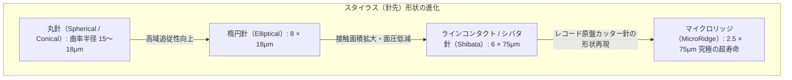

### 4.1 ヘルツの接触応力（Hertzian Contact Stress）
レコード愛好家は、トーンアームの針圧（Vertical Tracking Force: VTF）を「1.5グラム」や「2.0グラム」といった極めて微小な値に設定する。
「たった2グラムの重みなら、塩化ビニールが傷つくはずがない」と直感的には思える。しかし、接触面積の極小性を計算すると、驚愕の物理的真実が浮き彫りになる。

弾性論における**ヘルツの点接触理論（Hertzian Contact Theory）**を適用してみよう。
球状のダイヤモンド針先（ヤング率 $E_1 \approx 1,050\text{ GPa}$、ポアソン比 $\nu_1 \approx 0.1$、先端半径 $R_1 = 15\ \mu\text{m}$）が、平坦なポリ塩化ビニル盤（ヤング率 $E_2 \approx 3.5\text{ GPa}$、ポアソン比 $\nu_2 \approx 0.4$）に垂直荷重 $F_v = 1.5\text{ gf} \approx 0.0147\text{ N}$ で接触しているとする。

等価弾性率 $E^*$ は：

$$\frac{1}{E^*} = \frac{1 - \nu_1^2}{E_1} + \frac{1 - \nu_2^2}{E_2} \approx \frac{1 - 0.16}{3.5 \times 10^9} \approx 0.24 \times 10^{-9}\ \text{Pa}^{-1} \implies E^* \approx 4.17\text{ GPa}$$

接触円の半径 $a$ は：

$$a = \left( \frac{3 F_v R_1}{4 E^*} \right)^{1/3} = \left( \frac{3 \times 0.0147 \times 15 \times 10^{-6}}{4 \times 4.17 \times 10^9} \right)^{1/3} \approx 3.41 \times 10^{-6}\text{ m} = 3.41\ \mu\text{m}$$

接触面積 $A = \pi a^2 \approx \pi \times (3.41 \times 10^{-6})^2 \approx 3.65 \times 10^{-11}\text{ m}^2$。
この微小な面積に $0.0147\text{ N}$ の荷重がかかるため、接触面における最大中心圧力 $P_0$ は：

$$P_0 = \frac{3 F_v}{2 \pi a^2} \approx \frac{3 \times 0.0147}{2 \times 3.65 \times 10^{-11}} \approx 6.04 \times 10^8\text{ Pa} \approx \mathbf{604\text{ MPa}} \quad (\approx \mathbf{6,160\text{ kgf/cm}^2})$$

なんと、針先とレコードの接触界面には、**1平方センチメートルあたり約6トン**という、潜水艇が深海1万メートルの海底で受ける水圧（約1,000気圧 $\approx 100\text{ MPa}$）の6倍もの超巨大圧力が加わっている。

この巨大な面圧下において、ポリ塩化ビニルは局所的に弾性限度を超え、瞬間的に塑性流動（粘弾性変形）を起こしている。針が通過した直後、PVCの自己回復性（弾性回復）によって溝は元の形状に戻るが、針が通過した瞬間、接触点境界の温度は摩擦熱によって瞬間的に**数百度に達している**ことが赤外線分光計測などで確認されている。

### 4.2 針先形状の進化：丸針からマイクロリッジへ
この過酷な接触面圧を下げ、かつ高周波の微小波形を正確にトレースするために、針先形状（スタイラス・プロファイル）は長年にわたり進化を遂げてきた。

| 針先プロファイル | 接触面の短径 $\times$ 長径 | 接触面積 | 等価面圧 | 高域再生限界 | レコード摩耗 |
| :--- | :--- | :--- | :--- | :--- | :--- |
| **丸針（Spherical）** | 半径 $R \approx 15 \sim 18\ \mu\text{m}$（円形接触） | 最小 | 極めて高い（約600 MPa） | 約 $15\text{ kHz}$ | 比較的大 |
| **楕円針（Elliptical）** | 短径 $r \approx 5 \sim 8\ \mu\text{m}$、長径 $R \approx 18\ \mu\text{m}$ | 中程度 | 高い（約400 MPa） | 約 $20\text{ kHz}$ | 中程度 |
| **シバタ針（Shibata）** | 短径 $r \approx 6\ \mu\text{m}$、長径 $R \approx 75\ \mu\text{m}$ | 広い（長楕円） | 低い（約200 MPa） | 約 $45\text{ kHz}$（CD-4対応） | 極小 |
| **マイクロリッジ（MicroRidge）** | 短径 $r \approx 2.5\ \mu\text{m}$、長径 $R \approx 75\ \mu\text{m}$ | 最大（リボン状） | 最も低い（約150 MPa） | 約 $60\text{ kHz}$ | 最低・超寿命 |

- **シバタ針（Shibata Stylus）**：1970年代初頭、日本ビクター（JVC）の柴田憲男らによって、4チャンネルステレオレコード（CD-4方式：搬送波 $30\text{ kHz}$）を再生するために開発された。針先を縦方向に細長く研磨することで、溝壁との接触ラインを縦に引き伸ばし、**接触面積を丸針の約4倍に拡大**した。これにより面圧を半減させてレコードの寿命を延ばすと同時に、微小な高域波形への追従性を飛躍的に高めた。
- **マイクロリッジ（MicroRidge / SAS）**：カッティング針の形状に極限まで近づけた、厚さわずか数マイクロメートルの帯状の刃型突起を持つ究極の針先。研磨が摩耗しても接触面の短径が理論上変化しないため、数千時間の再生寿命を通じて全く同一の周波数レスポンスを維持できる。

---

## 5. トラッキングエラーとインサイドフォースの幾何学

レコード再生における機械的な歪みの最大の原因は、**「音溝を切削したカッティングヘッドの運動軌跡」と「音溝を読み取るトーンアームの運動軌跡」の幾何学的乖離**にある。

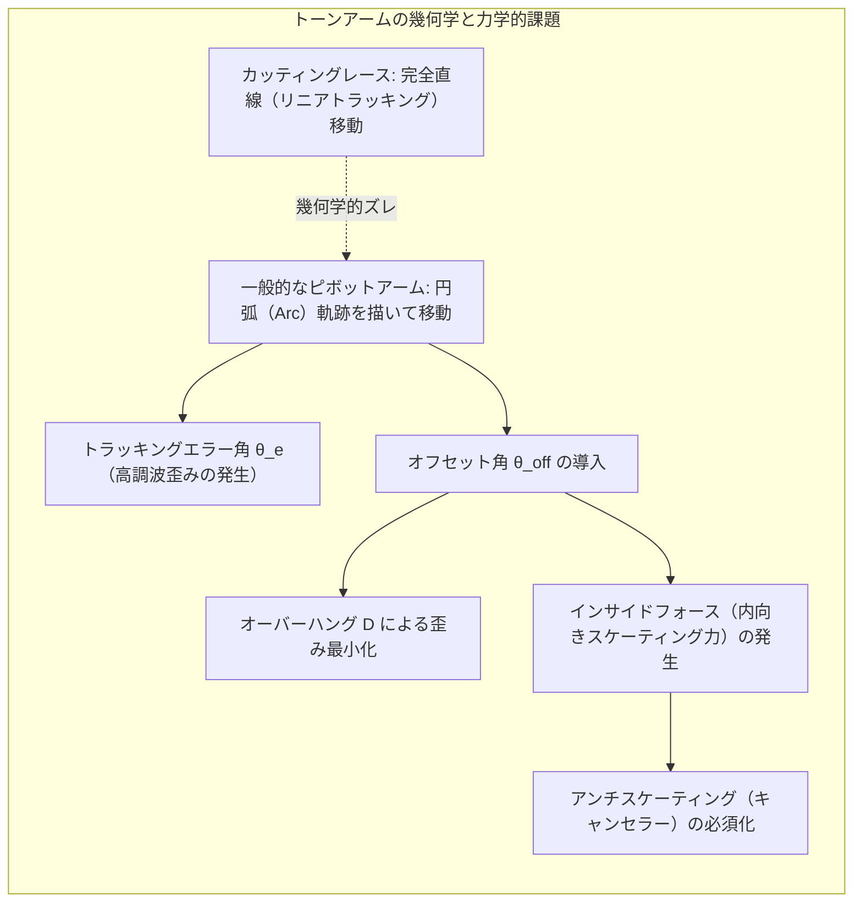

### 5.1 トラッキングエラー角とベアワルド（Baerwald）の幾何学
レコードの原盤を削るカッティングレースは、レコードの中心に向かって完全に直線運動（平行移動）する**リニアトラッキング（Tangential）**である。溝の接線方向に対して、カッティング針の振動軸は常に正確に**90度**を保っている。

しかし、一般のレコードプレーヤーで用いられる**ピボット型（回転軸支持型）トーンアーム**は、アーム回転軸（ピボット）を中心とした円弧（Arc）を描いて移動する。このため、針先が溝の接線に対して平行にならず、角度のズレが生じる。この角度のズレを**トラッキングエラー角（Tracking Error Angle：$\theta_e$）**と呼ぶ。

トラッキングエラー角 $\theta_e$ が存在すると、本来直交しているはずの左右の45度変調軸が傾き、重大な二次高調波歪みとクロストークが発生する。
歪み率 $D_{\text{tracking}}$ は、盤面の回転半径 $r$ における記録波形の線速度 $v = \omega r$ に反比例するため、次式に比例する。

$$D_{\text{tracking}} \propto \frac{\theta_e}{r}$$

半径 $r$ が小さくなる（内周に行く）ほど同一のエラー角でも歪みが激増するため、トーンアームの設計では単に $\theta_e$ をゼロにするのではなく、**「$\frac{\theta_e}{r}$ の重み付き二乗誤差を演奏面全体で最小化する」**という最適化問題を解く必要がある。

1930年代から40年代にかけて、H.G.ベアワルド（Baerwald）やB.B.レフグレン（Löfgren）は、アームの実効長 $L$、オーバーハング $D$、およびオフセット角 $\theta_{\text{offset}}$ の関係について厳密な解析解を導出した。

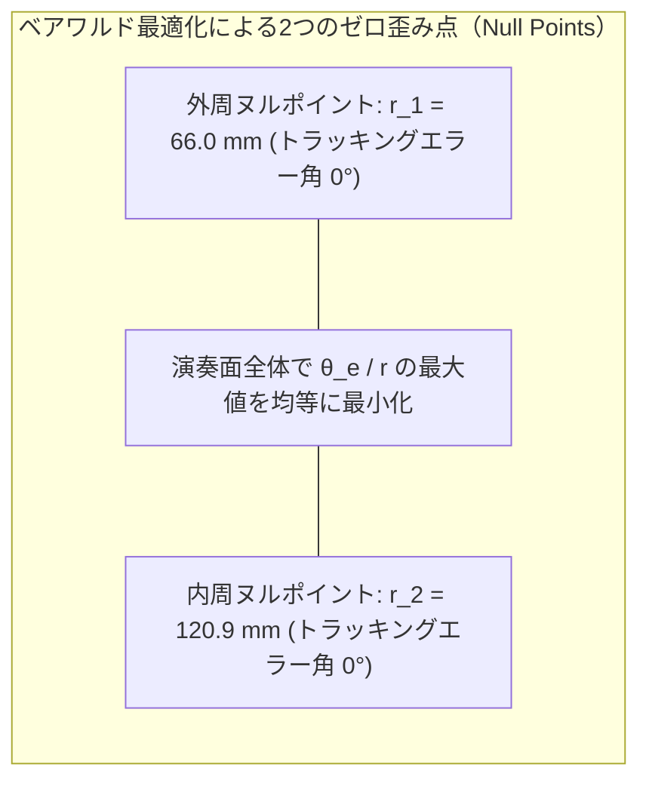

ベアワルドのアライメント手法では、LP盤の有効記録半径（最内周 $r_{\min} \approx 60.325\text{ mm}$、最外周 $r_{\max} \approx 146.05\text{ mm}$）において、エラー角が完全にゼロになる「ヌルポイント（Null Points）」を以下の2点に設定する。

$$r_1 = 66.04\text{ mm}, \quad r_2 = 120.89\text{ mm}$$

アームをアームベースに対してわずかに前方へ突き出させ（オーバーハング $D \approx 15 \sim 18\text{ mm}$）、ヘッドシェルを内側へ傾ける（オフセット角 $\theta_{\text{offset}} \approx 21^\circ \sim 25^\circ$）ことで、全周にわたる歪み率を $0.5\%$ 以下に抑え込んでいるのである。

### 5.2 インサイドフォース（スケーティングフォース）の発生力学
しかし、トラッキングエラーを最小化するためにヘッドシェルに「オフセット角 $\theta_{\text{offset}}$」を設けた瞬間、物理学は容赦なく新たな代償を要求する。それが**インサイドフォース（内向きに引き寄せられる力）**である。

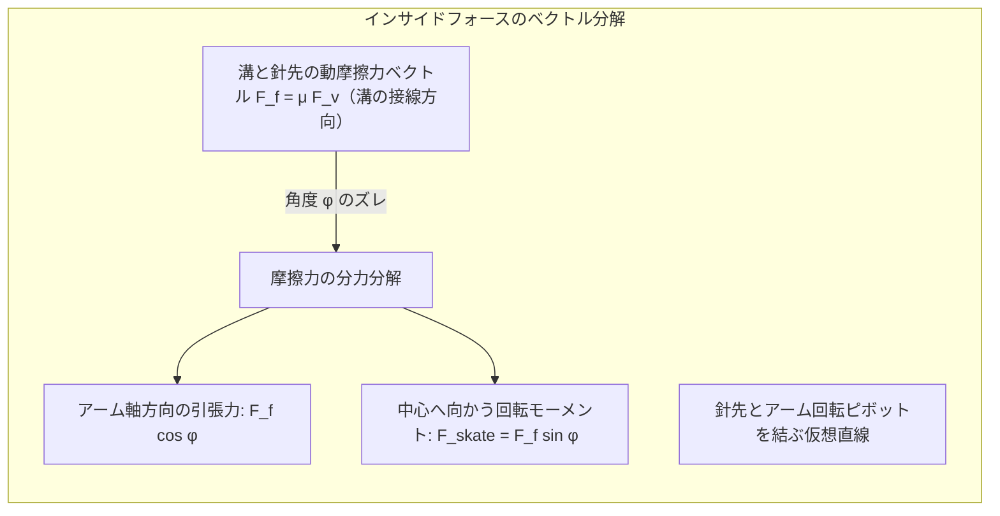

針先が溝を通過する際、針先には回転するレコード盤との間に動摩擦力 $F_f$ が発生する。
摩擦係数を $\mu$、針圧を $F_v$ とすると、摩擦力は溝の接線方向（前方）に向かって作用する。

$$F_f = \mu F_v$$

もし、針先とアームの回転軸（ピボット）が一直線上に並んでいれば、この摩擦力は単にアームを前方に引っ張るだけであり、アームを回転させるトルクは生じない。
しかし、トーンアームはオフセット角を持っているため、**「摩擦力ベクトルの方向（溝の接線）」と「針先とピボットを結ぶ直線」との間には、必ず角度 $\phi$（オフセット角とトラッキングエラー角の合成角）のズレが生じる**。

この角度 $\phi$ の存在により、摩擦力 $F_f$ の一部がアームをターンテーブルの内周方向へ旋回させる分力（インサイドフォース $F_{\text{skate}}$）へと変換される。

$$F_{\text{skate}} = F_f \sin \phi = \mu F_v \sin \phi \approx \mu F_v \tan \phi$$

このインサイドフォースを放置すると、スタイラスは常に**溝の内側壁面（左チャンネル壁）に強く押し付けられ、外側壁面（右チャンネル壁）から浮き上がる**状態になる。
その結果：
1. 右チャンネルで高域のトレーシング歪みや音割れが発生する。
2. 左壁面ばかりが異常摩耗し、針先が片減りする。
3. 激しい音溝で針が内側に向かってジャンプする（針飛び）。

これを相殺するために装備されているのが**「アンチスケーティング機構（インサイドフォースキャンセラー）」**である。
トーンアームの根元に、吊り下げウェイト、スプリング、あるいは反発マグネットを配置し、インサイドフォースと完全に反対方向（外周向き）の精密な逆トルクを印加することで、針先が左右の45度壁面に**完全に均等な圧力（$F_v / \sqrt{2}$）**で接触し続けるよう調停している。

---

## 6. 発電機構の物理：MM型とMC型の決定的な差

スタイラスが拾い上げた微小な機械的振動を、オーディオアンプが処理できる電気信号（起電力）へと変換するトランスデューサーが**カートリッジ（Phono Cartridge）**である。
その基本原理は、1831年にマイケル・ファラデーが発見した**「電磁誘導の法則（Faraday's Law of Induction）」**そのものである。

磁束 $\Phi$ が鎖交する巻き数 $N$ のコイルにおいて、誘導起電力 $e$ は磁束の時間変化率に比例する。

$$e = -N \frac{d\Phi}{dt} = -N \frac{d}{dt} \left( B \cdot A \cos \theta \right)$$

この電磁誘導をいかに具現化するかによって、現代のカートリッジは**MM型（ムービングマグネット）**と**MC型（ムービングコイル）**という、2つの全く異なる流派へと分化している。

```mermaid
graph TD
    subgraph TransducerTopology["カートリッジの電磁構造比較"]
        subgraph MM["MM型（Moving Magnet）"]
            M1["カンチレバー後端に微小永久磁石を固定"]
            M2["固定された高ターン数コイルが起電力を発生"]
            M3["高出力電圧（約3〜5 mV）/ ユーザーによる針交換が可能"]
        end
        subgraph MC["MC型（Moving Coil）"]
            C1["強力な固定永久磁石の磁気ギャップ"]
            C2["カンチレバー後端に手巻きの極小コイルを固定"]
            C3["極小等価質量 / 超低出力電圧（約0.2〜0.5 mV）"]
        end
    end
```

### 6.1 MM型（Moving Magnet）の構造と力学
カンチレバー（針先を支えるアルミニウムやボロンの細管）の後端に、強力な微小磁石（サマリウムコバルトやネオジム磁石）を固定し、カートリッジ本体側に大容量の固定コイルを配置する構造。

- **長所**：
  本体側にコイルがあるため、コイルの巻き数を数千ターン（$N \gg 1,000$）まで増やせる。これにより、出力電圧が**$3\text{ mV} \sim 5\text{ mV}$**と高く、一般的なアンプのフォノ入力（MMポジション）に直結できる。また、カンチレバーユニットごとユーザー自身の手で簡単に針交換（スタイラス交換）ができる。
- **力学的限界**：
  磁石そのものが金属の塊であるため、振動系の**等価可動質量（Effective Tip Mass）**が比較的大きくなる（約 $0.4 \sim 0.8\text{ mg}$）。可動質量が大きいと、超高域（$15\text{ kHz}$ 以上）において針先が溝壁から離脱する高周波共振周波数が可聴帯域近くまで低下しやすく、超微細な倍音の過渡応答（トランジェント特性）に制約が生じる。

### 6.2 MC型（Moving Coil）の極限設計
デンマークのオルトフォン（Ortofon）社が確立したMC型は、MM型と完全に逆の構造をとる。
永久磁石はカートリッジ本体側に強固に固定し、カンチレバーの後端には**極細の銅線（または純銀線）を手作業で十数ターンだけ巻いた、重さ数ミリグラム以下の極小コイル**を配置する。

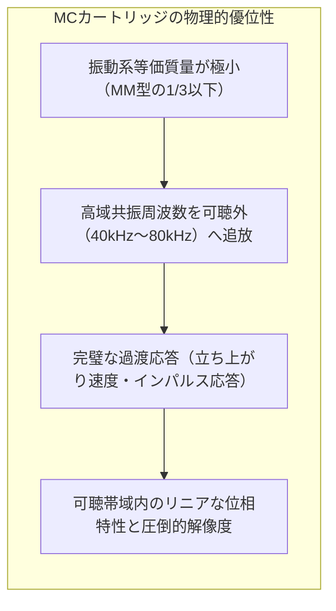

コイルの巻き数を極限まで減らしているため、振動系等価質量は**$0.1\text{ mg}$ 前後**という驚異的な軽さを達成している。慣性モーメント（$I = \int r^2 dm$）が極小であるため、盤面に刻まれたナノメートルオーダーの微細な突起に対しても、遅延やエネルギー損失なしに瞬時に追従する。

- **代償と技術的挑戦**：
  コイルの巻き数が極めて少ないため、発生する起電力は**$0.2\text{ mV} \sim 0.5\text{ mV}$（MM型の約10分の1〜20分の1）**へと低下する。
  この極小信号をノイズに埋もれさせずに増幅するためには、パーマロイやアモルファス合金のコアを用いた高品位な**MC昇圧トランス（Step-Up Transformer）**や、超低ノイズFETで組まれた**ヘッドアンプ**が不可欠となる。また、コイルのリード線がカンチレバーから直接引き出されているため、ユーザーによる針交換は不可能であり、摩耗時はメーカーでの本体ごとの針交換（リビルド）が必要となる。

---

## 7. ターンテーブル工学：回転の慣性と振動アイソレーション

どれほど優れた針先とカートリッジを用意しても、それを支えるターンテーブルの回転がふらつき、あるいは外部の振動が伝われば、アナログの音響空間は一瞬で崩壊する。ターンテーブルとは、**「絶対的な角速度一定運動」と「絶対的な振動遮断」**を追求する機械工学の結晶である。

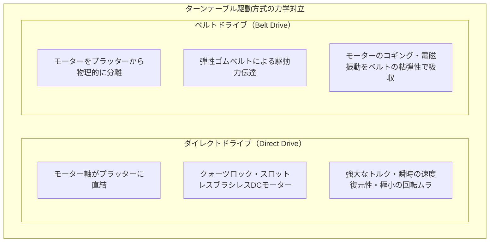

### 7.1 回転の安定性：ワウ・フラッター（Wow & Flutter）の物理
レコード盤が回転する際、回転速度が周期的に変動すると、再生される音のピッチ（音程）が揺らぐ。
- **ワウ（Wow）**：$0.5\text{ Hz} \sim 6\text{ Hz}$ 程度の比較的遅い回転速度変動（周期的な音のうねり）。
- **フラッター（Flutter）**：$6\text{ Hz} \sim 200\text{ Hz}$ 程度の高速な回転速度変動（濁りやザラつき）。

回転の均一性を物理的に担保する最大の武器は、**プラッター（回転台）の慣性モーメント（Moment of Inertia：$I$）**である。
半径 $R$、質量 $M$ の均一な円盤プラッターの慣性モーメントは次式で与えられる。

$$I = \frac{1}{2} M R^2$$

外周部に重量を集中させた特殊形状プラッター（重さ数キログラム〜十数キログラム）を用いることで、フライホイール効果を最大化し、針先の摩擦抵抗の変動や外部負荷の乱れを運動エネルギー（$E_k = \frac{1}{2} I \omega^2$）によって強力にねじ伏せる。

### 7.2 ハウリングとメカニカル・アイソレーション
スピーカーから放射された強大な音波（空気振動）がターンテーブルを揺らし、その振動を針先が拾って再びアンプで増幅され、発振に至る現象を**ハウリング（Acoustic Feedback）**と呼ぶ。
高級ターンテーブルでは、振動工学に基づいた徹底的なアイソレーションが施されている。

- **インシュレーター（脚部）**：スプリングと粘弾性エラストマー（ソルボセイン等）を複合し、固有振動数 $f_0$ を可聴帯域以下の**数Hz（約 $3 \sim 5\text{ Hz}$）**に設定する。これにより、建物の揺れやスピーカーからの空気振動を高域遮断フィルターのように減衰させる。
- **リジッド構造 vs フローティング構造**：
  重量級の金属や積層ウッドで全体を固めて振動エネルギーを散逸させる「リジッド（高剛性）思想」と、プラッターとトーンアームのみをサブシャーシに載せてスプリングで中空に浮かせる「フローティング（三点懸架）思想」の2大流派が存在する。

---

## 8. なぜデジタル全盛期にレコードの音が愛されるのか：音響心理学と物理の交差点

最後に、最も根源的な問いに向き合おう。
歪み率 $0.0001\%$、ダイナミックレンジ $120\text{ dB}$ を誇るデジタルハイレゾ音源が存在する現代において、なぜSN比 $60\text{ dB}$ 程度、高調波歪み数パーセントのアナログレコードが「よりリアルで、温かく、心に響く」と評価されるのか？
そこには、人間の聴覚メカニズムと物理現象の幸福な調和が存在する。

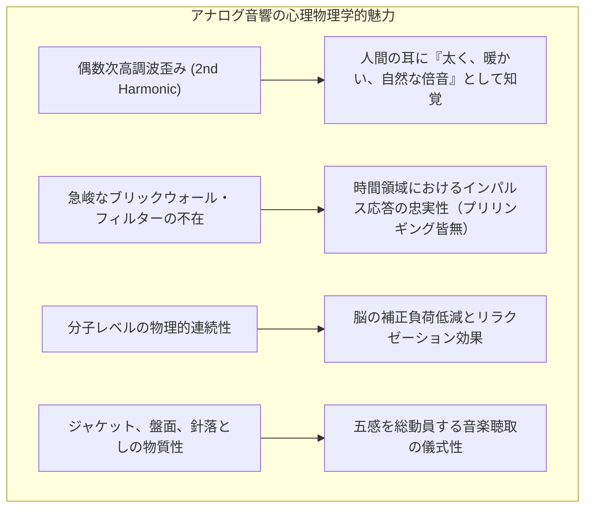

1. **偶数次高調波歪みの音楽性**：
   レコードの物理トレースや真空管アンプの伝達関数からは、主として**二次高調波（$2f$）などの偶数次高調波**が発生する。音響心理学において、偶数次倍音は楽器の響きそのものであり、人間の聴覚系はこれを不快な歪みではなく「音の厚み」「艶やかさ」「暖かみ」として肯定的に解釈する。
2. **時間領域におけるプリリンギングの皆無**：
   デジタルオーディオ（PCM）では、ナイキスト周波数（$22.05\text{ kHz}$ 等）以上の折り返しノイズを遮断するために、急峻なローパスフィルター（Brickwall Filter）を通過させる。このフィルターは、時間領域において原音の立ち上がり直前に不自然な先行振動（プリリンギング）を発生させる。
   一方、アナログレコードには急峻なデジタルフィルターが存在しないため、**インパルスの立ち上がり波形が物理的に極めて自然**であり、人間の脳は空間の奥行きや定位感をよりリアルに再構築できる。
3. **超高周波成分とハイパーソニック・エフェクト**：
   レコードのカッティングヘッドと高級MCカートリッジは、$50\text{ kHz} \sim 100\text{ kHz}$ に及ぶ超音波領域まで物理的に振動を刻み、再生する能力を持つ。近年の脳科学研究（大橋力らの研究等）では、人間の耳には直接聞こえない $20\text{ kHz}$ 以上の超高周波成分が、体幹皮膚や骨伝導を通じて脳の基底核や報酬系を刺激し、リラクゼーション効果をもたらす「ハイパーソニック・エフェクト」の存在が示唆されている。

---

## 結論：ミクロの幾何学が紡ぎ出す永遠の響き

ポリ塩化ビニルの溝に刻まれた音は、データではなく**「物質の形態そのもの」**である。
それは、100年前の演奏者が震わせた空気の波が、カッティング針の熱と圧力を経てプラスチックの谷間に冷凍保存され、現代のダイヤモンドの針先によって再び空気の波へと解凍される、純粋な物理現象のリレーである。

1本の微小な溝に、45度の直交幾何学で左右の空間を織り込み、RIAAという熱力学的イコライゼーションでノイズを制し、数トンの超高圧接触の中でナノメートルの波を読み取る。
次にレコード盤に針を落とすとき、あの「プチッ」という静けさの後に立ち上がる芳醇な音楽の裏で繰り広げられている、崇高な物理法則のシンフォニーに耳を澄ませてほしい。
