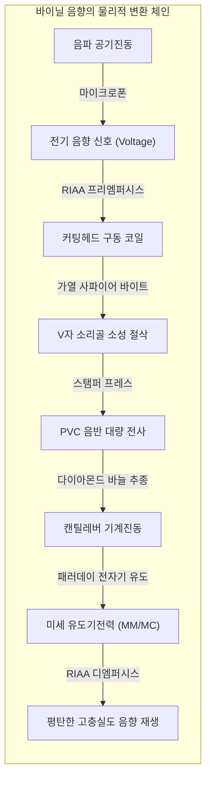
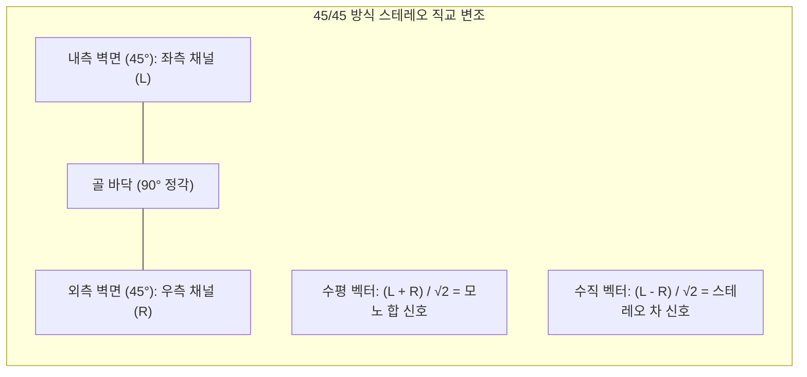

## 서론: 검은 PVC 음반에 깃든 미시 음향의 우주

고해상도 디지털 스트리밍과 무선 이어폰이 지배하는 21세기, 전 세계적으로 경이로운 역전 현상이 일어나고 있습니다. 바로 **아날로그 바이닐 레코드(LP)의 극적인 부활**입니다.

단순한 복고풍 유행을 넘어 응용물리학과 정밀 기계공학의 시선으로 바라볼 때, 레코드는 **극한의 아날로그 물리 제어가 집약된 공학적 기적**입니다.



직경 30cm, 무게 180g 남짓의 폴리염화비닐(PVC) 원반 위에 폭 약 $50\ \mu\text{m}$, 깊이 $30\ \mu\text{m}$의 V자형 미세 소리골(Microgroove)이 나선형으로 새겨져 있습니다. 그 골의 벽면에 각인된 진폭은 저음의 수십 마이크로미터에서 고음 배음의 **나노미터(100만 분의 1밀리미터) 단위**에 불과합니다.

초속 수십 센티미터로 질주하는 다이아몬드 바늘 끝에는 수백 G의 가속도와 **600 MPa(약 6,000기압)**에 달하는 헤르츠 접촉 압력이 집중됩니다.

---

## 1. 45/45 스테레오 소리골의 기하학

1957년 미국 웨스트렉스(Westrex)사가 확립한 **45/45 방식**은 오늘날 스테레오 LP의 절대 표준입니다.
- 단면 90도의 V자 홈에서,
- **안쪽 벽면(턴테이블 중심 방향 45도 기울기)에 좌측 채널(L)**,
- **바깥쪽 벽면(외주 방향 45도 기울기)에 우측 채널(R)**을 각각 독립적으로 변조합니다.



바늘의 2차원 변위 벡터는 다음과 같습니다:

$$x(t) = \frac{S_L(t) + S_R(t)}{\sqrt{2}}, \quad y(t) = \frac{S_L(t) - S_R(t)}{\sqrt{2}}$$

두 축이 90도 직교하므로 이론적으로 크로스토크(혼신)가 0입니다. 또한 좌우 동위상 모노 신호($S_L = S_R$)에서는 수직 변위 $y=0$이 되어 골 깊이가 변하지 않고 순수 수평 진동만 발생하므로, 기존 모노 재생기와의 완벽한 하위 호환성을 갖습니다.

---

## 2. 커팅 레이스의 극세 절삭 기술

- **가열 바이트 절삭**: 사파이어 바이트에 열선을 감아 **$100^\circ\text{C} \sim 120^\circ\text{C}$**로 가열하여 래커를 연화시키며 깎아내 거친 표면 노이즈를 획기적으로 낮춥니다.
- **컴퓨터 가변 피치(Variable Pitch)**: 예비 헤드가 1초 앞의 신호를 읽어 대음량 저음에서는 골 간격을 넓히고 조용한 곳에서는 좁혀, 한 면당 25~30분의 장시간 수록을 가능하게 합니다.

---

## 3. RIAA 이퀄라이제이션의 물리적 필연성

```mermaid
xychart-beta
    title "RIAA 녹음 특성(프리엠퍼시스) 및 재생 특성(디엠퍼시스)"
    x-axis "주파수 (Hz)" [20, 50, 100, 500, 1000, 2122, 10000, 20000]
    y-axis "이득 Relative Gain (dB)" -25 --> 25
    series "커팅 녹음 특성" [-19.3, -17.0, -13.1, -2.7, 0.0, 2.9, 13.7, 19.6]
    series "포노 재생 특성" [19.3, 17.0, 13.1, 2.7, 0.0, -2.9, -13.7, -19.6]
```

카트리지는 속도 비례형 소자이므로, 진동 속도 $v = 2\pi f A$가 일정하면 물리적 진폭 $A$는 주파수에 반비례합니다:

$$A = \frac{V_0}{2\pi f} \propto \frac{1}{f}$$

- $50\text{ Hz}$ 저음은 $1,000\text{ Hz}$보다 진폭이 20배($+26\text{ dB}$) 폭증하여 소리골을 파괴합니다.
- 반대로 $20\text{ kHz}$ 고음은 나노미터 수준으로 줄어들어 PVC 표면 잡음에 묻힙니다.

RIAA 표준(3개 시정수: $3180\ \mu\text{s}, 318\ \mu\text{s}, 75\ \mu\text{s}$)에 따라,
**녹음 시 저음을 약 -20 dB 깎고 고음을 +20 dB 증폭**하며,
**재생 시 포노 앰프에서 정반대로 복원**합니다. 이 과정에서 고역 잡음이 20 dB(전력비 100분의 1) 감쇄되어 경이로운 S/N비를 얻습니다.

---

## 4. 접촉 역학과 스타일러스 형상

$1.5\text{ g}$의 침압에서 원형 바늘과 PVC의 접촉 반경은 $3.4\ \mu\text{m}$에 불과하며, 중심 압력 $P_0$는:

$$P_0 = \frac{3 F_v}{2 \pi a^2} \approx \mathbf{604\text{ MPa}} \quad (\approx \mathbf{6,160\text{ kgf/cm}^2})$$

헤르츠 접촉 압력은 6,000기압에 달합니다. 바늘 형상은 원형(Spherical)에서 타원형(Elliptical), 시바타(Shibata), 마이크로리지(MicroRidge)로 진화하며 접촉면을 세로로 확장하여 면압을 $150\text{ MPa}$로 낮추고 고역 한계를 $60\text{ kHz}$까지 끌어올렸습니다.

---

## 5. 톤암 트래킹 지오메트리와 스케이팅 포스


오프셋 각도로 인해 회전 마찰력의 일부가 톤암을 중심부로 끄는 **스케이팅 포스($F_{\text{skate}} = \mu F_v \tan \phi$)**로 전환됩니다. 이를 정밀하게 상쇄하는 안티스케이팅 기구를 통해 양쪽 벽면의 접촉 압력을 완벽하게 균등화합니다.

---

## 6. 발전 방식: MM형과 MC형 카트리지

- **MM형(Moving Magnet)**: 캔틸레버 끝에 자석 장착. 출력 전압이 높고($3 \sim 5\text{ mV}$) 바늘 교체가 쉬우나 등가 가동 질량이 큼.
- **MC형(Moving Coil)**: 캔틸레버 끝에 초소형 코일 권선. 가동 질량이 $0.1\text{ mg}$ 이하로 극히 가벼워 고역 응답이 압도적이나 출력이 낮아($0.2 \sim 0.5\text{ mV}$) 승압 트랜스가 필수.

---

## 결론

바이닐 레코드는 단순한 데이터가 아니라 소리의 물리적 조각 그 자체입니다. 미크론 단위의 역학과 전자기학이 만들어낸 아날로그 음향의 기적을 경험해 보시기 바랍니다.
