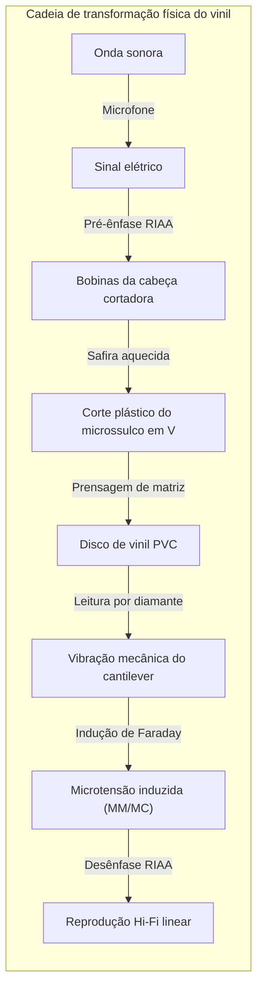
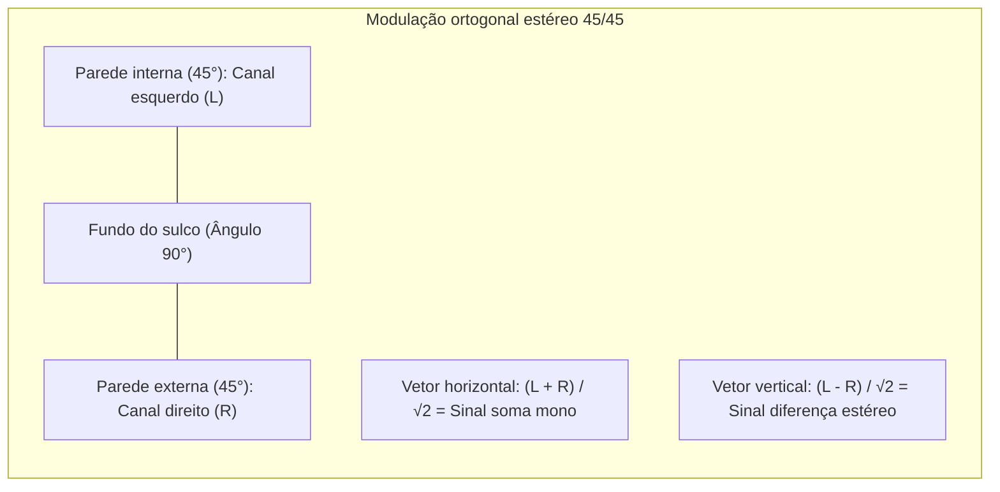

## Introdução: O microcosmo acústico cravado no PVC negro

Na era do streaming digital sem perdas, o mundo testemunha um fenômeno fascinante: **o renascimento estrondoso do disco de vinil (LP)**.

Longe de ser mera nostalgia, o vinil é uma obra-prima da **mecânica dos meios contínuos, geometria espacial e transdução eletromagnética**.



Em um disco de PVC de 180 gramas, serpenteia um sulco de cerca de $50\ \mu\text{m}$ de largura por $30\ \mu\text{m}$ de profundidade. As ondulações variam de dezenas de micrômetros nos graves a **frações de nanômetro** nos sobretons agudos. A aguja suporta acelerações de centenas de G e pressões de contato de Hertz que superam **600 MPa (6.000 atmosferas)**.

---

## 1. Geometria do sulco estéreo 45/45

O **sistema 45/45** da Westrex (1957) é o padrão estéreo mundial:
- Sulco em V a 90°;
- **Parede interna (45° para o centro): Canal esquerdo (L)**;
- **Parede externa (45° para fora): Canal direito (R)**.



Equações de deslocamento:

$$x(t) = \frac{S_L(t) + S_R(t)}{\sqrt{2}}, \quad y(t) = \frac{S_L(t) - S_R(t)}{\sqrt{2}}$$

A ortogonalidade elimina a diafonia entre canais. Com sinais mono idênticos ($S_L = S_R$), o deslocamento vertical é nulo ($y=0$), garantindo compatibilidade reversa com toca-discos monofônicos.

---

## 2. Torno de corte e passo variável

- **Buril aquecido**: O estilete de safira é aquecido a **$100^\circ\text{C} \sim 120^\circ\text{C}$**, amolecendo a laca para produzir paredes perfeitamente lisas e silenciosas.
- **Passo variável computadorizado**: Um cabeçote de leitura prévia antecipa o sinal sonoro em 1 segundo, expandindo o passo em passagens de graves intensos para evitar colisões entre sulcos.

---

## 3. A necessidade física da equalização RIAA

```mermaid
xychart-beta
    title "Curvas de equalização RIAA: Gravação vs Reprodução"
    x-axis "Frequência (Hz)" [20, 50, 100, 500, 1000, 2122, 10000, 20000]
    y-axis "Ganho relativo (dB)" -25 --> 25
    series "Gravação (Pre-emphasis)" [-19.3, -17.0, -13.1, -2.7, 0.0, 2.9, 13.7, 19.6]
    series "Reprodução phono (De-emphasis)" [19.3, 17.0, 13.1, 2.7, 0.0, -2.9, -13.7, -19.6]
```

Como os cabeçotes magnéticos respondem à velocidade ($v = 2\pi f A$), a amplitude $A$ é inversamente proporcional à frequência:

$$A = \frac{V_0}{2\pi f} \propto \frac{1}{f}$$

- A $50\text{ Hz}$, a amplitude seria 20 vezes maior ($+26\text{ dB}$), destruindo o vinil;
- A $20\text{ kHz}$, o sinal sumiria no ruído de fundo da resina.

A curva RIAA corta os graves e reforça os agudos na gravação. No pré-amplificador phono, a curva inversa atenua os agudos em 20 dB, **reduzindo simultaneamente o ruído e estalos do vinil em 100 vezes de potência sonora**!

---

## 4. Tribologia e perfis de agulha

Sob força de rastreamento de $1,5\text{ g}$, a pressão de contato no centro atinge:

$$P_0 = \frac{3 F_v}{2 \pi a^2} \approx \mathbf{604\text{ MPa}} \quad (\approx \mathbf{6.160\text{ kgf/cm}^2})$$

Perfis avançados como **Shibata** e **MicroRidge** estendem o contato verticalmente para $75\ \mu\text{m}$, reduzindo a pressão a $150\text{ MPa}$ e estendendo a resposta a $60\text{ kHz}$.

---

## 5. Cinemática do braço e força de deslizamento (Skating)


O atrito gera uma força para dentro do disco ($F_{\text{skate}} = \mu F_v \tan \phi$). O antiskating anula essa componente para assegurar pressões perfeitamente simétricas nas duas paredes do sulco.

---

## 6. Transdutores: Cápsulas MM vs MC

- **MM (Ímã móvel)**: Tensão de saída alta ($3 \sim 5\text{ mV}$), agulha substituível, maior massa móvel.
- **MC (Bobina móvel)**: Microbobinas no cantilever, massa móvel ínfima ($<0,1\text{ mg}$), resposta transitória impecável, exigindo pré-amplificadores de altíssimo ganho ($0,2 \sim 0,5\text{ mV}$).

---

## Conclusão

O disco de vinil é o relevo palpável da própria música: um monumento à engenharia mecânica, à física de contato e à acústica eletrodinâmica.
