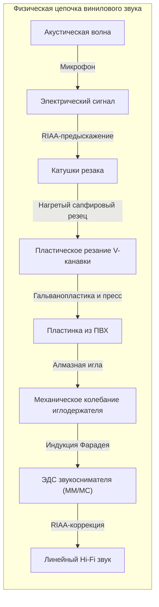
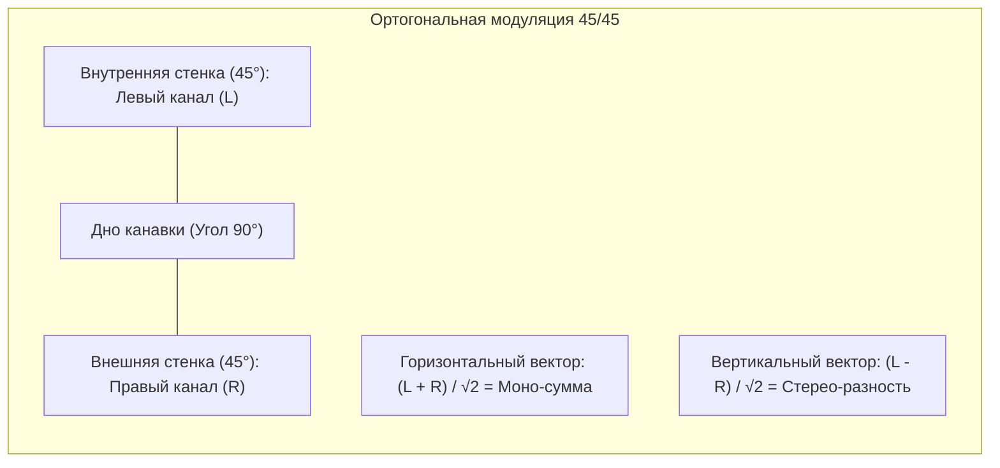

## Введение: Акустический микрокосмос в черном виниле

В век цифрового звука высокого разрешения мы наблюдаем удивительный парадокс: **глобальный ренессанс виниловых пластинок (LP)**.

Это не просто эстетика ретро: виниловая запись представляет собой **триумф прикладной механики, теории контактного взаимодействия и электромагнетизма**.



На диске из поливинилхлорида весом 180 граммов нарезана непрерывная V-образная спиральная микроканавка шириной около $50\ \mu\text{м}$ и глубиной $30\ \mu\text{м}$. Амплитуда колебаний стенок варьируется от десятков микронов на басах до **долей нанометра** на высших гармониках. Игла испытывает ускорения в сотни G и контактное давление Герца свыше **600 МПа (6 000 атмосфер)**.

---

## 1. Геометрия стереоканавки 45/45

Стандарт **Westrex 45/45** (1957 год) — основа всей мировой стереофонии на виниле:
- Угол профиля канавки 90 градусов;
- **Внутренняя стенка (под углом 45° к центру): Левый канал (L)**;
- **Внешняя стенка (под углом 45° к краю): Правый канал (R)**.



Векторы смещения:

$$x(t) = \frac{S_L(t) + S_R(t)}{\sqrt{2}}, \quad y(t) = \frac{S_L(t) - S_R(t)}{\sqrt{2}}$$

Благодаря ортогональности каналы физически развязаны ($\vec{v}_L \cdot \vec{v}_R = 0$). При синфазном монофоническом сигнале ($S_L = S_R$) вертикальное смещение $y = 0$, канавка модулируется строго горизонтально, гарантируя идеальную обратную совместимость с моно-проигрывателями.

---

## 2. Технология нарезки и переменный шаг

- **Горячий резец**: Сапфировый резец подогревается платиновой спиралью до **$100^\circ\text{C} \sim 120^\circ\text{C}$**, пластифицируя лаковый диск и формируя зеркально гладкие стенки без микрозаусенцев.
- **Компьютерный переменный шаг (Variable Pitch)**: Упреждающая считывающая головка за 1 секунду анализирует пиковые амплитуды, раздвигая витки на мощных басах и сжимая их в тихих паузах, что обеспечивает до 30 минут записи на стороне.

---

## 3. Физическая необходимость кривой RIAA

```mermaid
xychart-beta
    title "Характеристики коррекции RIAA: Запись и Воспроизведение"
    x-axis "Частота (Гц)" [20, 50, 100, 500, 1000, 2122, 10000, 20000]
    y-axis "Относительный уровень (дБ)" -25 --> 25
    series "Запись (Pre-emphasis)" [-19.3, -17.0, -13.1, -2.7, 0.0, 2.9, 13.7, 19.6]
    series "Фонокорректор (De-emphasis)" [19.3, 17.0, 13.1, 2.7, 0.0, -2.9, -13.7, -19.6]
```

Так как электромагнитные головки чувствительны к скорости ($v = 2\pi f A$), механическая амплитуда $A$ обратно пропорциональна частоте:

$$A = \frac{V_0}{2\pi f} \propto \frac{1}{f}$$

- На $50\text{ Гц}$ амплитуда без коррекции была бы в 20 раз больше ($+26\text{ дБ}$), разрушая соседние дорожки;
- На $20\text{ кГц}$ амплитуда утонула бы в собственном шуме структуры пластика.

Кривая RIAA ослабляет басы и задирает верха при нарезке. При воспроизведении фонокорректор зеркально восстанавливает АЧХ, **подавляя поверхностный шум и щелчки винила на 20 дБ (в 100 раз по мощности шума)**!

---

## 4. Контактная механика и профили иглы

При прижимной силе $1,5\text{ г}$ пиковое давление Герца в центре контакта достигает:

$$P_0 = \frac{3 F_v}{2 \pi a^2} \approx \mathbf{604\text{ МПа}} \quad (\approx \mathbf{6 160\text{ кгс/см}^2})$$

Профили **Шибата (Shibata)** и **Микроридж (MicroRidge)** вытягивают линию контакта вертикально вдоль стенки ($75\ \mu\text{м}$), снижая давление до $150\text{ МПа}$ и позволяя считывать частоты до $60\text{ кГц}$.

---

## 5. Геометрия тонарма и скатывающая сила


Трение и угол смещения шелла создают силу, тянущую тонарм к центру ($F_{\text{skate}} = \mu F_v \tan \phi$). Антискейтинг прикладывает обратный момент, обеспечивая строго одинаковый прижим к левой и правой стенкам.

---

## 6. Звукосниматели: MM против MC

- **MM (Подвижный магнит)**: Высокий выход ($3 \sim 5\text{ мВ}$), простая замена иглы, но большая подвижная масса.
- **MC (Подвижная катушка)**: Микрокатушки на иглодержателе, подвижная масса менее $0,1\text{ мг}$, непревзойденная переходная характеристика, но микроскопический выход ($0,2 \sim 0,5\text{ мВ}$), требующий повышающего трансформатора.

---

## Заключение

Виниловая пластинка — это физический слепок звуковой волны в материале. В микроне контакта оживает подлинная гармония механики и акустики.
