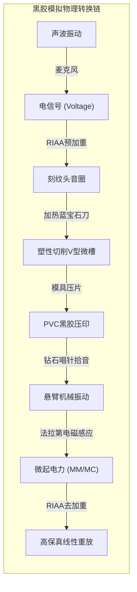
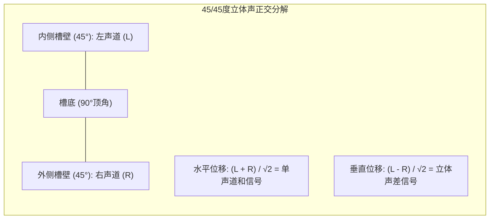
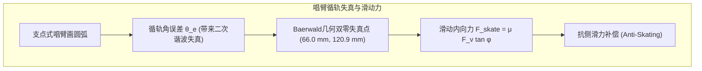

## 引言：黑胶盘上的微观声学宇宙

在数字流媒体与无线降噪耳机一统天下的今天，**黑胶唱片（Vinyl LP）的全球性复兴**堪称工业奇迹。在欧美市场，黑胶唱片的销售额已反超CD光盘。

这不仅是怀旧情怀，从应用物理与精密机械的角度审视，黑胶唱片代表了**人类模拟物理控制的巅峰**。



一张直径30厘米、重约180克的聚氯乙烯（PVC）唱盘上，刻有宽约50微米、深约30微米的V型连续螺旋微槽。其刻录的振幅从重低音的数十微米到极高频倍音的**亚纳米（百万分之一毫米）级**。钻石针尖以每秒几十厘米的高速划过凹凸沟槽时，承受着数百G的加速度和高达**600兆帕（约6,000个大气压）**的赫兹接触压强。

---

## 1. 45/45立体声正交刻纹几何学

1957年美国西电（Westrex）确立的 **45/45方式** 成为全球立体声黑胶的基石：
- 沟槽夹角为90度；
- **内壁（朝向轴心）倾斜45度刻录左声道（L）**；
- **外壁（朝向外缘）倾斜45度刻录右声道（R）**。



位移向量公式为：

$$x(t) = \frac{S_L(t) + S_R(t)}{\sqrt{2}}, \quad y(t) = \frac{S_L(t) - S_R(t)}{\sqrt{2}}$$

正交性保证了左、右声道互不串扰（$\vec{v}_L \cdot \vec{v}_R = 0$）。当输入单声道同相信号时（$S_L = S_R$），垂直位移为零，仅产生纯水平振动，实现了与老式单声道唱机的完美兼容。

---

## 2. 刻纹机极限制程与可变螺距

刻纹头（如Neumann SX-74）是重载动圈换能器：
- **热刀切削**：蓝宝石切刀缠绕微型电热丝，加热至 **$100^\circ\text{C} \sim 120^\circ\text{C}$**，使漆盘受热软化，切出如镜面般光滑的槽壁，大幅降低表面本底噪。
- **电脑动态可变螺距（Variable Pitch）**：预读磁头提前1秒计算信号振幅，大动态爆棚时自动拉开进给螺距防止破壁（Overcut），静音处缩小螺距至数十微米，使单面录音时长突破25~30分钟。

---

## 3. RIAA均衡曲线的物理必然性

```mermaid
xychart-beta
    title "RIAA 录音预加重与放音去加重曲线"
    x-axis "频率 (Hz)" [20, 50, 100, 500, 1000, 2122, 10000, 20000]
    y-axis "相对增益 (dB)" -25 --> 25
    series "刻录预加重 (Pre-emphasis)" [-19.3, -17.0, -13.1, -2.7, 0.0, 2.9, 13.7, 19.6]
    series "唱放去加重 (De-emphasis)" [19.3, 17.0, 13.1, 2.7, 0.0, -2.9, -13.7, -19.6]
```

电磁刻纹机与唱头均属于**速度响应型换能器**。振动速度 $v = 2\pi f A$ 恒定时，物理振幅反比于频率：

$$A = \frac{V_0}{2\pi f} \propto \frac{1}{f}$$

- **低频振幅暴增**：$50\text{ Hz}$ 振幅是 $1,000\text{ Hz}$ 的20倍（$+26\text{ dB}$），不衰减刻录将彻底撕裂唱片。
- **高频噪音掩埋**：$20\text{ kHz}$ 振幅极小，易被PVC材料分子粗糙度噪音淹没。

RIAA标准确立了三大时间常数：
- $\tau_1 = 3,180\ \mu\text{s}$ ($50.05\text{ Hz}$)
- $\tau_2 = 318\ \mu\text{s}$ ($500.5\text{ Hz}$)
- $\tau_3 = 75\ \mu\text{s}$ ($2,122\text{ Hz}$)

放音时将高频大幅衰减约 $20\text{ dB}$，在恢复平坦频响的同时，**将盘面划痕与颗粒高频底噪同步压低了20分贝（功率衰减100倍）**！

---

## 4. 针尖接触力学与磨损演进

在 $1.5\text{ g}$ 针压下，圆针尖与PVC接触面半径仅 $3.4\ \mu\text{m}$，峰值压强高达：

$$P_0 = \frac{3 F_v}{2 \pi a^2} \approx \mathbf{604\text{ MPa}} \quad (\approx \mathbf{6,160\text{ kgf/cm}^2})$$

针尖形状从**圆针**（接触面积小、面压极高）、**椭圆针**进化到**柴田针（Shibata）**与**微脊针（MicroRidge）**。微脊针将接触线沿槽壁纵向拉长，使接触面积扩大4倍，面压降至 $150\text{ MPa}$，高频响应延伸至 $60\text{ kHz}$。

---

## 5. 唱臂循轨几何学与内周失真



由于支点臂沿圆弧移动，唱头偏置角与摩擦力产生将唱臂拉向盘心的**滑动力（Skating Force）**：

$$F_{\text{skate}} = \mu F_v \sin \phi \approx \mu F_v \tan \phi$$

必须通过唱臂基部的抗侧滑配重或弹簧施加反向力矩，确保针尖对称接触左右两壁。

---

## 6. MM型与MC型唱头发电电磁学

- **MM型（动磁）**：磁铁随针杆振动，线圈固定，输出高（$3 \sim 5\text{ mV}$），可自换唱针，但振动等效质量大。
- **MC型（动圈）**：超微型线圈直接绕在针杆末端，等效质量低于 $0.1\text{ mg}$，高频瞬态无敌；但输出仅 $0.2 \sim 0.5\text{ mV}$，需外接升压牛（Step-up Transformer）。

---

## 结论

黑胶不是抽象的数据流，而是声波刻在物质世界里的真实浮雕。在纳秒与微米的机械舞蹈中，物理定律谱写了最动人的人类声学诗篇。
