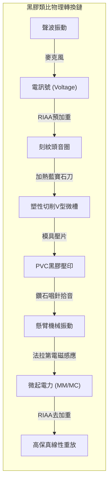
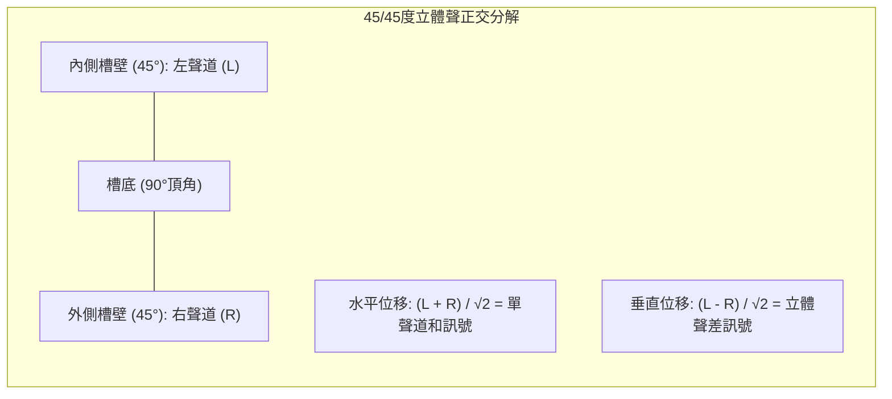

## 引言：黑膠盤上的微觀聲學宇宙

在數位串流與無線降噪耳機一統天下的今天，**黑膠唱片（Vinyl LP）的全球性復興**堪稱工業奇蹟。在歐美市場，黑膠唱片的銷售額已反超CD光碟。

這不僅是懷舊情懷，從應用物理與精密機械的角度審視，黑膠唱片代表了**人類類比物理控制的巔峰**。



一張直徑30公分、重約180克的聚氯乙烯（PVC）唱盤上，刻有寬約50微米、深約30微米的V型連續螺旋微槽。其刻錄的振幅從重低音的數十微米到極高頻倍音的**亞奈米（百萬分之一毫米）級**。鑽石針尖以每秒幾十公分的高速劃過凹凸溝槽時，承受著數百G的加速度和高達**600兆帕（約6,000個大氣壓）**的赫茲接觸壓強。

---

## 1. 45/45立體聲正交刻紋幾何學

1957年美國西電（Westrex）確立的 **45/45方式** 成為全球立體聲黑膠的基石：
- 溝槽夾角為90度；
- **內壁（朝向軸心）傾斜45度刻錄左聲道（L）**；
- **外壁（朝向外緣）傾斜45度刻錄右聲道（R）**。



位移向量公式為：

$$x(t) = \frac{S_L(t) + S_R(t)}{\sqrt{2}}, \quad y(t) = \frac{S_L(t) - S_R(t)}{\sqrt{2}}$$

正交性保證了左、右聲道互不串擾（$\vec{v}_L \cdot \vec{v}_R = 0$）。當輸入單聲道同相訊號時（$S_L = S_R$），垂直位移為零，僅產生純水平振動，實現了與老式單聲道唱機的完美相容。

---

## 2. 刻紋機極限制程與可變螺距

刻紋頭（如Neumann SX-74）是重載動圈換能器：
- **熱刀切削**：藍寶石切刀纏繞微型電熱絲，加熱至 **$100^\circ\text{C} \sim 120^\circ\text{C}$**，使漆盤受熱軟化，切出如鏡面般光滑的槽壁，大幅降低表面本底噪。
- **電腦動態可變螺距（Variable Pitch）**：預讀磁頭提前1秒計算訊號振幅，大動態爆棚時自動拉開進給螺距防止破壁（Overcut），靜音處縮小螺距至數十微米，使單面錄音時長突破25~30分鐘。

---

## 3. RIAA等化曲線的物理必然性

```mermaid
xychart-beta
    title "RIAA 錄音預加重與放音去加重曲線"
    x-axis "頻率 (Hz)" [20, 50, 100, 500, 1000, 2122, 10000, 20000]
    y-axis "相對增益 (dB)" -25 --> 25
    series "刻錄預加重 (Pre-emphasis)" [-19.3, -17.0, -13.1, -2.7, 0.0, 2.9, 13.7, 19.6]
    series "唱放去加重 (De-emphasis)" [19.3, 17.0, 13.1, 2.7, 0.0, -2.9, -13.7, -19.6]
```

電磁刻紋機與唱頭均屬於**速度響應型換能器**。振動速度 $v = 2\pi f A$ 恆定時，物理振幅反比於頻率：

$$A = \frac{V_0}{2\pi f} \propto \frac{1}{f}$$

- **低頻振幅暴增**：$50\text{ Hz}$ 振幅是 $1,000\text{ Hz}$ 的20倍（$+26\text{ dB}$），不衰減刻錄將徹底撕裂唱片。
- **高頻噪音掩埋**：$20\text{ kHz}$ 振幅極小，易被PVC材料分子粗糙度噪音淹沒。

RIAA標準確立了三大時間常數：
- $\tau_1 = 3,180\ \mu\text{s}$ ($50.05\text{ Hz}$)
- $\tau_2 = 318\ \mu\text{s}$ ($500.5\text{ Hz}$)
- $\tau_3 = 75\ \mu\text{s}$ ($2,122\text{ Hz}$)

放音時將高頻大幅衰減約 $20\text{ dB}$，在恢復平坦頻響的同時，**將盤面刮痕與顆粒高頻底噪同步壓低了20分貝（功率衰減100倍）**！

---

## 4. 針尖接觸力學與磨損演進

在 $1.5\text{ g}$ 針壓下，圓針尖與PVC接觸面半徑僅 $3.4\ \mu\text{m}$，峰值壓強高達：

$$P_0 = \frac{3 F_v}{2 \pi a^2} \approx \mathbf{604\text{ MPa}} \quad (\approx \mathbf{6,160\text{ kgf/cm}^2})$$

針尖形狀從**圓針**（接觸面積小、面壓極高）、**橢圓針**進化到**柴田針（Shibata）**與**微脊針（MicroRidge）**。微脊針將接觸線沿槽壁縱向拉長，使接觸面積擴大4倍，面壓降至 $150\text{ MPa}$，高頻響應延伸至 $60\text{ kHz}$。

---

## 5. 唱臂循軌幾何學與內周失真


由於支點臂沿圓弧移動，唱頭偏置角與摩擦力產生將唱臂拉向盤心的**滑動力（Skating Force）**：

$$F_{\text{skate}} = \mu F_v \sin \phi \approx \mu F_v \tan \phi$$

必須透過唱臂基部的抗側滑配重或彈簧施加反向力矩，確保針尖對稱接觸左右兩壁。

---

## 6. MM型與MC型唱頭發電電磁學

- **MM型（動磁）**：磁鐵隨針桿振動，線圈固定，輸出高（$3 \sim 5\text{ mV}$），可自換唱針，但振動等效質量大。
- **MC型（動圈）**：超微型線圈直接繞在針桿末端，等效質量低於 $0.1\text{ mg}$，高頻瞬態無敵；但輸出僅 $0.2 \sim 0.5\text{ mV}$，需外接升壓牛（Step-up Transformer）。

---

## 結論

黑膠不是抽象的數據流，而是聲波刻在物質世界裡的真實浮雕。在奈秒與微米的機械舞蹈中，物理定律譜寫了最動人的人類聲學詩篇。
