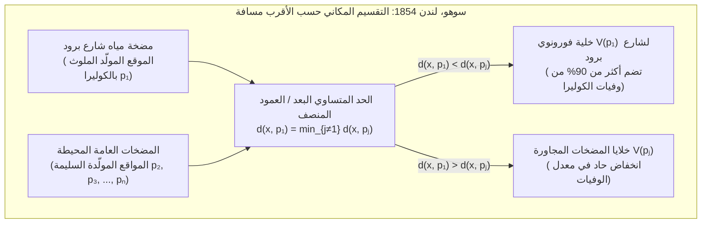

في كل جزء من الألف من الثانية أثناء سيرنا في شوارع المدينة حاملين هواتفنا الذكية، تقوم بروتوكولات الاتصال اللاسلكي بحساب أي محطة قاعدة خلوية توفر أقصر مسار للإشارة، وتُجري عمليات تسليم سلسة (*Handovers*) عبر حدود إقليمية غير مرئية. وعند ورود مكالمة طوارئ، تقوم أنظمة التوجيه فوراً بتقسيم شبكة الطرق لتحديد أي سيارة إسعاف أو مستشفى يمكنه الوصول إلى المريض في أقل زمن ممكن. وفي الطبيعة — بدءاً من النقوش الشبكية لجلد الزرافة، وتعرق أجنحة اليعسوب، والأعمدة البازلتية السداسية في «ممر العمالقة»، وصولاً إلى الشبكة الكونية للعناقيد المجرية الفائقة المحيطة بالفراغات الكونية العملاقة — تنتظم المادة تلقائياً في فسيفساء مضلعة متشابهة بشكل مذهل.

خلف كل هذه الظواهر في علم الأوبئة المكاني، والتخطيط العمراني، وشبكات الجيل الخامس 5G، وتوليد الشبكات لطريقة العناصر المحدودة (FEM)، وفيزياء الحالة الصلبة، والتشكل الحيوي، تكمن البنية الثنائية الأكثر أصالة في الهندسة الحسابية (*Computational Geometry*): <strong>مخطط فورونوي (Voronoi Diagram)</strong> وبيانه الثنائي المستوي <strong>تثليث ديلوني (Delaunay Triangulation)</strong>.

---

## 1. وباء الكوليرا في شارع برود بلندن (1854) وولادة الحدود غير المرئية

في أواخر أغسطس 1854، تفشى وباء كوليرا مدمر في حي سوهو (Soho) بوسط لندن حول شارع برود (Broad Street)، مما أودى بحياة أكثر من 500 شخص خلال عشرة أيام (616 إجمالاً). كانت الأوساط الطبية آنذاك تؤمن بـ«نظرية الميازما» (انتقال العدوى عبر الهواء الفاسد)، غير أن الطبيب الرائد <strong>جون سنو (Dr. John Snow, 1813–1858)</strong> لاحظ أن الأعراض تهاجم الجهاز الهضمي حصرياً، فافترض أن الكوليرا تنتقل عبر <strong>مياه الشرب</strong> الملوثة.

رسم سنو كل حالة وفاة كعمود أسود على خريطة سوهو وحدد مواقع جميع مضخات المياه العامة. ولدحض المشككين وتفسير نجاة نزلاء إصلاحية الفقراء المجاورة (*Workhouse*، التي كانت تمتلك بئراً خاصة) وعمال مصنع الجعة (*Lion Brewery*، الذين كانوا يشربون الجعة مجاناً ولديهم بئر عميقة)، رسم سنو خطاً هندسياً فاصلاً على خريطته: <strong>المحل الهندسي للنقاط التي تتساوى عندها مسافة المشي إلى مضخة شارع برود مع مسافة المشي إلى أقرب مضخة مياه عامة بديلة</strong>.



كان هذا المضلع هو <strong>خلية فورونوي</strong> لمضخة شارع برود، وقد احتوى داخله أكثر من 90% من وفيات الكوليرا! وعندما أُزيل مقبض المضخة في 8 سبتمبر 1854، توقف الوباء فوراً. وقد اكتُشف هذا المفهوم الهندسي مستقلاً عدة مرات: عام 1644 على يد <strong>رينيه ديكارت</strong> في دواماته الكونية (*Principia Philosophiae*)، وعام 1850 على يد <strong>بيتر غوستاف لوجون ديريكليه</strong> (مجالات ديريكليه أو خلايا فيغنر-سايتس في فيزياء البلورات)، وعام 1908 على يد عالم الرياضيات الأوكراني <strong>جورجي فورونوي</strong> في الفضاء الإقليدي النوني $\mathbb{R}^d$، وعام 1911 على يد عالم الأرصاد <strong>ألفريد ثيسن</strong>.

---

## 2. التعريف الرياضي والتعقيد الخطي لمخطط فورونوي $\text{Vor}(P)$

### 2.1 تقاطع أنصاف المستويات المغلقة والتحدب

لتكن $P = \{p_1, p_2, \dots, p_n\} \subset \mathbb{R}^2$ ($n \ge 3$) مجموعة منتهية من $n$ نقاط متمايزة (تُسمى <strong>المواقع</strong> أو <strong>المولدات</strong>) في المستوي الإقليدي. لأي موقعين متمايزين $p_i, p_j \in P$ ($i \ne j$)، يقسم العمود المنصف $B(p_i, p_j) = \{x \in \mathbb{R}^2 \mid \|x - p_i\|_2 = \|x - p_j\|_2\}$ المستوي إلى نصفي مستويين مغلقين. نصف مستوي الهيمنة $H(p_i, p_j)$ يُعطى بالعلاقة:

$$H(p_i, p_j) = \left\{ x \in \mathbb{R}^2 \;\middle|\; \|x - p_i\|_2 \le \|x - p_j\|_2 \right\} = \left\{ x \in \mathbb{R}^2 \;\middle|\; 2(p_j - p_i)^\top x \le \|p_j\|_2^2 - \|p_i\|_2^2 \right\}$$

تُعرَّف <strong>خلية فورونوي</strong> $\mathcal{V}(p_i)$ المرتبطة بالموقع $p_i$ بأنها تقاطع $n-1$ من أنصاف المستويات المغلقة في مواجهة جميع المواقع الأخرى $p_j$ ($j \ne i$):

$$\mathcal{V}(p_i) = \left\{ x \in \mathbb{R}^2 \;\middle|\; \|x - p_i\|_2 \le \|x - p_j\|_2 \;\;\forall j \ne i \right\} = \bigcap_{j \ne i} H(p_i, p_j)$$

بما أن تقاطع المجموعات المحدبة هو مجموعة محدبة دائماً، فإن كل خلية فورونوي إقليدية $\mathcal{V}(p_i)$ هي <strong>مضلع محدب</strong>. وتكون الخلية $\mathcal{V}(p_i)$ غير محدودة إذا وفقط إذا وقع الموقع $p_i$ على محيط الغلاف المحدب $\text{CH}(P)$.

### 2.2 إثبات التعقيد الخطي عبر صيغة أويلر: $V \le 2n - 5$ و $E \le 3n - 6$

رغم وجود $\binom{n}{2} = \Theta(n^2)$ زوجاً من المواقع، فإن عدد الرؤوس $V$ وعدد الحواف $E$ لمخطط فورونوي المستوي خطي تماماً بالنسبة إلى $n$.
<strong>【البرهان】</strong>: نُدمج المستوي $\mathbb{R}^2$ على الكرة الطوبولوجية $\mathbb{S}^2$ بإضافة <strong>رأس عند اللانهاية</strong> $v_\infty$ تتصل به جميع أشعة فورونوي غير المحدودة. نحصل على بيان مستوٍ متصل $G' = (V', E', F')$ عدد رؤوسه $V' = V + 1$، وعدد حوافه $E' = E$، وعدد وجوهه $F' = n$. بتطبيق <strong>صيغة أويلر</strong> $V' - E' + F' = 2$:

$$(V + 1) - E + n = 2 \iff E = V + n - 1$$

وبما أن كل رأس فورونوي منتهٍ وكذلك $v_\infty$ هو نقطة التقاء 3 خلايا على الأقل، فإن درجة كل رأس من الرؤوس $V + 1$ تحقق $\deg(v) \ge 3$. ومن توطئة المصافحة (Handshaking Lemma):

$$2E = \sum_{v \in V \cup \{v_\infty\}} \deg(v) \ge 3(V + 1) \implies V \le \frac{2}{3}E - 1$$

بالتعويض في $E = V + n - 1$ نجد $E \le 3n - 6$ و $V \le 2n - 5$. ولأن كل حافة تفصل بين خليتين بالضبط، فإن <strong>متوسط عدد الحواف لكل خلية فورونوي</strong> هو:

$$\bar{k} = \frac{2E}{n} \le \frac{2(3n - 6)}{n} = 6 - \frac{12}{n} < 6$$

أياً كان عدد ملايين النقاط في المستوي، فإن <strong>متوسط عدد أضلاع خلية فورونوي أقل دائماً وبصرامة من 6 أضلاع!</strong>

| نوع مخطط فورونوي | دالة المسافة $d(x, p_i)$ | هندسة المنصفات | التحدب والطوبولوجيا | الحجم في أسوأ حالة | التطبيقات العلمية والهندسية |
| :--- | :--- | :--- | :--- | :--- | :--- |
| الإقليدي القياسي ($L_2$) | $\|x - p_i\|_2$ | خط مستقيم (عمود منصف) | محدب ومتصل دائماً | $\Theta(n)$ | طوارئ المستشفيات، الأرصاد الجوية (ثيسن)، البحث عن الأقرب |
| مانهاتن ($L_1$) | $\|x_1 - x_i\| + \|x_2 - y_i\|$ | خط منكسر أفقي ورأسي وبزاوية $\pm 45^\circ$ | نجمي (غير محدب بالضرورة) | $\Theta(n)$ | لوجستيات المدن الشبكية، تصميم رقائق VLSI |
| تشيبيشيف ($L_\infty$) | $\max(\|x_1 - x_i\|, \|x_2 - y_i\|)$ | خط منكسر أفقي ورأسي وبزاوية $\pm 45^\circ$ | نجمي | $\Theta(n)$ | رافعات المستودعات الآلية، تخطيط مسار الروبوتات |
| <strong>الموزون جمعياً (AW)</strong> | $\|x - p_i\|_2 - w_i$ | أقواس قطع زائد | نجمي ومتصل | $\Theta(n)$ | نمو البلورات غير المتزامن (جونسون-ميل)، تحديد المواقع TDOA |
| <strong>الموزون ضربياً (أبولونيوس)</strong> | $\|x - p_i\|_2 / w_i$ | أقواس دائرية (دوائر أبولونيوس) | غير محدب، قد ينفصل | $\Theta(n^2)$ | خلايا 5G بقدرات بث متفاوتة، مناطق الجذب التجاري |
| <strong>مخطط القوة (لاغير / Power)</strong> | $\|x - p_i\|_2^2 - r_i^2$ | خط مستقيم (المحور الجذري لدائرتين) | محدب دائماً (قد يكون فارغاً) | $\Theta(n)$ | المعادن متعددة البلورات، فيزياء الرغوة، النقل الأمثل (OT) |

---

## 3. البيان الثنائي: تثليث ديلوني $\text{DT}(P)$ ونظريات التكافؤ الثلاث

في عام 1934، عرّف عالم الرياضيات الروسي <strong>بوريس ديلوني (Boris Delaunay / Delone)</strong> البيان الثنائي المستوي لمخطط $\text{Vor}(P)$ بوصل كل موقعين $p_i, p_j \in P$ بقطعة مستقيمة إذا وفقط إذا اشتركت خليتاهما $\mathcal{V}(p_i)$ و $\mathcal{V}(p_j)$ في حافة فورونوي. في الوضع العام، ينتج عن ذلك <strong>تثليث ديلوني $\text{DT}(P)$</strong> الذي يتميز بثلاث نظريات متكافئة:

1. <strong>خاصية الدائرة المحيطة الفارغة (Empty Circumcircle Property)</strong>: يكون التثليث $\mathcal{T}$ تثليث ديلوني إذا وفقط إذا كانت الدائرة المحيطة $C(\triangle p_i p_j p_k)$ بكل مثلث خالية تماماً في داخلها الصريح من أي موقع آخر $p_l \in P$ (لأن مركز الدائرة المحيطة هو رأس فورونوي الثنائي). ويُختبر ذلك جبرياً عبر محدد $4 \times 4$: $\text{InCircle}(p_i, p_j, p_k, p_l) > 0$.
2. <strong>أمثلية تعظيم الزاوية الصغرى (Max-Min Angle Optimality — سيبسون 1978 وقلب الحواف للوسون 1972)</strong>: في طريقة العناصر المحدودة (FEM)، تؤدي المثلثات الإبرية المسطحة (*sliver triangles*) إلى تدهور عدد الشرط لمصفوفة الصلابة $\kappa(K) \propto 1/\sin(\theta_{\min})$. ومن بين جميع التثليثات الممكنة للمجموعة $P$، يعظم $\text{DT}(P)$ معجمياً متجه الزوايا الداخلية المرتب تصاعدياً $\alpha(\mathcal{T})$، وبوجه خاص يعظم أصغر زاوية داخلية $\theta_{\min}$! وتتقارب خوارزمية <strong>قلب الحواف للوسون (*Edge Flip*)</strong> إلى $\text{DT}(P)$ في $O(n^2)$ خطوة على الأكثر.
3. <strong>الرفع إلى المجسم المكافئ ثلاثي الأبعاد (Edelsbrunner & Seidel 1986)</strong>: عند إسقاط كل نقطة ثنائية الأبعاد $(x, y)$ عمودياً على المجسم المكافئ الدوراني $\mathcal{P}: z = x^2 + y^2$ في $\mathbb{R}^3$ عبر التطبيق $\Phi(x, y) = (x, y, x^2 + y^2)$، تتحول معادلة الدائرة $(x-a)^2 + (y-b)^2 = R^2$ إلى معادلة مستوٍ خطي ثلاثي الأبعاد $z = 2ax + 2by - (a^2 + b^2 - R^2)$. وبالتالي، فإن تثليث ديلوني $\text{DT}(P)$ هو بالضبط المسقط العمودي على المستوي $xy$ للغلاف المحدب السفلي (*Lower Convex Hull*) لمجموعة النقاط المرفوعة $\Phi(P)$ في $\mathbb{R}^3$!

---

## 4. خوارزمية خط المسح و«خط الشاطئ» لستيفن فورتشن (1986) في زمن $\Theta(n \log n)$

يفشل المسح المستوي الساذج لأن نقطة فوق خط المسح $\ell: y = y_{\text{sweep}}$ قد تكون أقرب إلى موقع لم يُكتشف بعد تحت $\ell$. وفي عام 1986، حلّ <strong>ستيفن فورتشن (Steven Fortune)</strong> هذه المفارقة عبر صيانة <strong>خط الشاطئ (*Beach Line*)</strong>، وهو الغلاف السفلي للقطوع المكافئة التي بؤرها المواقع التي تمت زيارتها $p_i = (x_i, y_i)$ ($y_i > y_{\text{sweep}}$) ودليلها خط المسح $\ell$:

$$y = \frac{(x - x_i)^2}{2(y_i - y_{\text{sweep}})} + \frac{y_i + y_{\text{sweep}}}{2}$$

إن نقاط الانكسار (*breakpoints*) بين قوسين متجاورين متساوية البعد عن البؤرتين والدليل معاً، ولذلك ترسم بدقة حواف فورونوي أثناء هبوط $\ell$! وباستخدام شجرة بحث ثنائية متوازنة (تحوي على الأكثر $2n-1$ قوساً) ورتل أولويات لمعالجة $n$ من <strong>أحداث المواقع (*Site Events*)</strong> وعلى الأكثر $2n-5$ من أحداث الدوائر (*Circle Events* — تلاشي قوس عند أدنى نقطة لدائرة محيطة $y_{\text{sweep}} = y_c - R$ مولداً رأس فورونوي)، تحقق الخوارزمية الزمن الأمثل $\Theta(n \log n)$ والمساحة $\Theta(n)$.

---

## 5. استرخاء لويد وتبليطات فورونوي المركزية (CVT)

لتقليل طاقة التكميم المكاني (دالي $k$-Means) الموزونة بكثافة $\rho(x)$:

$$\mathcal{E}(P, \{\Omega_i\}) = \sum_{i=1}^n \int_{\Omega_i} \|x - p_i\|_2^2 \, \rho(x) \, dx$$

يجب أن تكون المناطق $\Omega_i$ هي خلايا فورونوي $\mathcal{V}(p_i)$، وأن ينطبق كل مولد $p_i$ على <strong>مركز ثقل (Centroid)</strong> خليته $c_i$ ($p_i = c_i$)، مما يشكل <strong>تبليط فورونوي المركزي (CVT)</strong>. وتعمل <strong>خوارزمية لويد (Stuart Lloyd, 1957)</strong> على تحريك كل موقع تكرارياً إلى مركز ثقل خليته ($p_i^{(t+1)} \leftarrow c_i^{(t)}$)، مما يخفض الطاقة $\mathcal{E}$ بشكل رتيب نحو <strong>شبكة سداسية منتظمة كخلية النحل</strong> (مبرهنة فيجيس توث، 1953).

فيما يلي تطبيق برمجي متكامل بلغة Python لقص أنصاف المستويات بطريقة ساذرلاند-هودجمان، وحساب المساحة ومركز الثقل والطاقة عبر مبرهنة غرين، واسترخاء لويد:

```python
import math
import random
from typing import List, Tuple

Point = Tuple[float, float]
Polygon = List[Point]

def clip_polygon_by_halfplane(poly: Polygon, p_i: Point, p_j: Point) -> Polygon:
    if not poly:
        return []
    xi, yi = p_i
    xj, yj = p_j
    a = 2.0 * (xj - xi)
    b = 2.0 * (yj - yi)
    c = (xj * xj + yj * yj) - (xi * xi + yi * yi)

    def signed_dist(pt: Point) -> float:
        return a * pt[0] + b * pt[1] - c

    out: Polygon = []
    m = len(poly)
    for k in range(m):
        cur_pt = poly[k]
        nxt_pt = poly[(k + 1) % m]
        d_cur = signed_dist(cur_pt)
        d_nxt = signed_dist(nxt_pt)
        if d_cur <= 1e-12:
            out.append(cur_pt)
            if d_nxt > 1e-12:
                t = d_cur / (d_cur - d_nxt)
                out.append((cur_pt[0] + t * (nxt_pt[0] - cur_pt[0]),
                            cur_pt[1] + t * (nxt_pt[1] - cur_pt[1])))
        elif d_nxt <= 1e-12:
            t = d_cur / (d_cur - d_nxt)
            out.append((cur_pt[0] + t * (nxt_pt[0] - cur_pt[0]),
                        cur_pt[1] + t * (nxt_pt[1] - cur_pt[1])))
    return out

def compute_clipped_voronoi(sites: List[Point], bbox: Tuple[float, float, float, float]) -> List[Polygon]:
    xmin, ymin, xmax, ymax = bbox
    base_rect: Polygon = [(xmin, ymin), (xmax, ymin), (xmax, ymax), (xmin, ymax)]
    cells: List[Polygon] = []
    for i in range(len(sites)):
        cell = base_rect
        for j in range(len(sites)):
            if i != j:
                cell = clip_polygon_by_halfplane(cell, sites[i], sites[j])
        cells.append(cell)
    return cells

def exact_polygon_moments(poly: Polygon, site: Point) -> Tuple[float, Point, float]:
    m = len(poly)
    if m < 3:
        return 0.0, site, 0.0
    area2, cx6, cy6, ixx12, iyy12 = 0.0, 0.0, 0.0, 0.0, 0.0
    for k in range(m):
        x0, y0 = poly[k]
        x1, y1 = poly[(k + 1) % m]
        cross = x0 * y1 - x1 * y0
        area2 += cross
        cx6 += (x0 + x1) * cross
        cy6 += (y0 + y1) * cross
        ixx12 += (x0 * x0 + x0 * x1 + x1 * x1) * cross
        iyy12 += (y0 * y0 + y0 * y1 + y1 * y1) * cross
    area = 0.5 * area2
    if abs(area) < 1e-15:
        return 0.0, site, 0.0
    cx, cy = cx6 / (3.0 * area2), cy6 / (3.0 * area2)
    i_origin = (ixx12 + iyy12) / 12.0
    sx, sy = site
    energy = i_origin - 2.0 * area * (cx * sx + cy * sy) + area * (sx * sx + sy * sy)
    return area, (cx, cy), energy

def simulate_lloyd_relaxation(n_sites: int = 25, iterations: int = 30) -> None:
    random.seed(42)
    bbox = (0.0, 0.0, 1.0, 1.0)
    sites = [(random.uniform(0.05, 0.95), random.uniform(0.05, 0.95)) for _ in range(n_sites)]
    for it in range(iterations + 1):
        cells = compute_clipped_voronoi(sites, bbox)
        total_energy, next_sites = 0.0, []
        for i, cell in enumerate(cells):
            _, centroid, energy = exact_polygon_moments(cell, sites[i])
            total_energy += energy
            next_sites.append(centroid)
        if it in (0, 5, 15, 30):
            print(f"Iter {it:2d}: Energy E = {total_energy:.8f}")
        sites = next_sites

if __name__ == "__main__":
    simulate_lloyd_relaxation()
```
