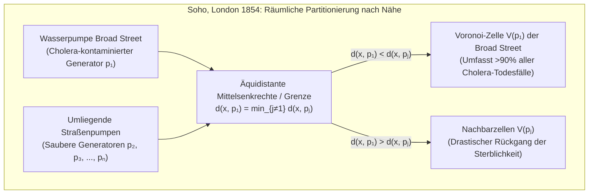

Während wir uns mit einem Smartphone durch eine Stadt bewegen, berechnet das Endgerät im Millisekundentakt, welche Mobilfunk-Basisstation den kürzesten Signalweg bietet, und führt an unsichtbaren Zellgrenzen nahtlose Handover durch. Geht ein Notruf ein, ermittelt die Leitstelle sofort, welches Rettungsfahrzeug den Einsatzort in minimaler Fahrzeit erreicht. Und in der Natur – vom Netzmuster der Giraffen über die Flügeladerung von Libellen und die Basaltsäulen des Giant's Causeway bis hin zur kosmischen Großstruktur aus Galaxienfilamenten und gigantischen Leerräumen (Cosmic Voids) – organisiert sich Materie in verblüffend ähnlichen polygonalen Mosaiken.

Hinter all diesen Phänomenen aus Epidemiologie, Stadtplanung, Funknetzplanung, Finite-Elemente-Methode (FEM), Festkörperphysik und biologischer Morphogenese steht die wohl eleganteste duale Struktur der Algorithmischen Geometrie (Computational Geometry): das <strong>Voronoi-Diagramm</strong> und sein planarer Dualgraph, die <strong>Delaunay-Triangulierung</strong>.

---

## 1. Der Londoner Cholera-Ausbruch von 1854 und die Geburt unsichtbarer Grenzen

Ende August 1854 brach im Londoner Stadtteil Soho rund um die Broad Street eine verheerende Cholera-Epidemie aus, die innerhalb von zehn Tagen über 500 Menschenleben (insgesamt 616 Tote) forderte. Während die damalige Schulmedizin fest an die *Miasmentheorie* (Übertragung durch üble Ausdünstungen in der Luft) glaubte, erkannte der Arzt und Epidemiologe <strong>Dr. John Snow (1813–1858)</strong> anhand der rein gastrointestinalen Symptome, dass der Erreger über kontaminiertes <strong>Trinkwasser</strong> aufgenommen werden musste.

Snow kartierte jeden Todesfall als schwarzen Balken an der jeweiligen Hausadresse und verzeichnete sämtliche öffentlichen Straßenwasserpumpen. Um Zweifler zu überzeugen und zu erklären, warum das direkt benachbarte Arbeitshaus (Workhouse, mit eigenem Brunnen) sowie die Lion-Brauerei (deren Arbeiter Freibier tranken) fast keine Toten beklagten, zeichnete Snow eine geometrische Grenzlinie in seine Karte ein: <strong>die Ortslinie aller Punkte, von denen aus der Fußweg zur Pumpe in der Broad Street exakt genauso lang war wie zur nächstgelegenen alternativen Wasserpumpe</strong>.



Dieses Polygon war nichts anderes als die <strong>Voronoi-Zelle</strong> der Broad-Street-Pumpe – und es umschloss über 90 % aller Todesfälle! Am 8. September 1854 wurde der Pumpenschwengel auf Snows Drängen abmontiert, woraufhin die Epidemie zusammenbrach. Historisch wurde dieses Konzept mehrfach unabhängig entdeckt: 1644 von <strong>René Descartes</strong> in seinen kosmischen Wirbelzellen (*tourbillons*), 1850 von <strong>Peter Gustav Lejeune Dirichlet</strong> für quadratische Formen (Dirichlet-Gebiete bzw. Wigner-Seitz-Zellen der Festkörperphysik), 1908 von <strong>Georgy Voronoi</strong> in beliebigen Dimensionen $\mathbb{R}^d$ und 1911 von <strong>Alfred H. Thiessen</strong> zur Niederschlagsberechnung in der Meteorologie.

---

## 2. Mathematische Definition und lineare Komplexität des Voronoi-Diagramms $\text{Vor}(P)$

### 2.1 Schnitt abgeschlossener Halbebenen und Konvexität

Sei $P = \{p_1, p_2, \dots, p_n\} \subset \mathbb{R}^2$ ($n \ge 3$) eine endliche Menge von $n$ paarweise verschiedenen Punkten (<strong>Generatoren</strong> oder <strong>Sites</strong>) in der euklidischen Ebene. Für zwei Generatoren $p_i, p_j \in P$ ($i \ne j$) teilt die Mittelsenkrechte $B(p_i, p_j) = \{x \in \mathbb{R}^2 \mid \|x - p_i\|_2 = \|x - p_j\|_2\}$ die Ebene in zwei abgeschlossene Halbebenen. Die Dominanz-Halbebene $H(p_i, p_j)$ lautet:

$$H(p_i, p_j) = \left\{ x \in \mathbb{R}^2 \;\middle|\; \|x - p_i\|_2 \le \|x - p_j\|_2 \right\} = \left\{ x \in \mathbb{R}^2 \;\middle|\; 2(p_j - p_i)^\top x \le \|p_j\|_2^2 - \|p_i\|_2^2 \right\}$$

Die <strong>Voronoi-Zelle</strong> $\mathcal{V}(p_i)$ ist der Durchschnitt aller $n-1$ abgeschlossenen Halbebenen gegenüber allen anderen Punkten $p_j$ ($j \ne i$):

$$\mathcal{V}(p_i) = \left\{ x \in \mathbb{R}^2 \;\middle|\; \|x - p_i\|_2 \le \|x - p_j\|_2 \;\;\forall j \ne i \right\} = \bigcap_{j \ne i} H(p_i, p_j)$$

Als Durchschnitt konvexer Halbebenen ist jede euklidische Voronoi-Zelle $\mathcal{V}(p_i)$ ein (eventuell unbeschränktes) <strong>konvexes Polygon</strong>. Dabei ist $\mathcal{V}(p_i)$ genau dann unbeschränkt, wenn $p_i$ auf dem Rand der konvexen Hülle $\text{CH}(P)$ liegt.

### 2.2 Beweis der linearen Komplexität über den Eulerschen Polyedersatz: $V \le 2n - 5$, $E \le 3n - 6$

Obwohl es $\binom{n}{2} = \Theta(n^2)$ Paare von Generatoren und damit $\Theta(n^2)$ Mittelsenkrechten gibt, besitzt ein planares Voronoi-Diagramm strikt lineare Komplexität:
<strong>【Beweis】</strong>: Wir kompaktifizieren $\mathbb{R}^2$ zur topologischen Sphäre $\mathbb{S}^2$, indem wir alle unbeschränkten Voronoi-Strahlen in einem künstlichen <strong>unendlich fernen Knoten</strong> $v_\infty$ zusammenführen. Der entstehende zusammenhängende planare Graph $G' = (V', E', F')$ besitzt $V' = V + 1$ Knoten, $E' = E$ Kanten und $F' = n$ Flächen. Nach dem <strong>Eulerschen Polyedersatz</strong> $V' - E' + F' = 2$ gilt:

$$(V + 1) - E + n = 2 \iff E = V + n - 1$$

Da an jedem endlichen Voronoi-Knoten sowie an $v_\infty$ mindestens 3 Voronoi-Zellen zusammentreffen, gilt für alle $V + 1$ Knoten der Minimalgrad $\deg(v) \ge 3$. Mit dem Handschlaglemma folgt:

$$2E = \sum_{v \in V \cup \{v_\infty\}} \deg(v) \ge 3(V + 1) \implies V \le \frac{2}{3}E - 1$$

Einsetzen in $E = V + n - 1$ liefert unmittelbar $E \le 3n - 6$ sowie $V \le 2n - 5$. Da jede Kante genau zwei Zellen begrenzt, beträgt die <strong>durchschnittliche Kantenzahl pro Voronoi-Zelle</strong>:

$$\bar{k} = \frac{2E}{n} \le \frac{2(3n - 6)}{n} = 6 - \frac{12}{n} < 6$$

Unabhängig davon, wie viele Millionen Punkte in der Ebene liegen, <strong>hat eine Voronoi-Zelle im Durchschnitt immer echt weniger als 6 Kanten!</strong>

| Voronoi-Variante | Distanzfunktion $d(x, p_i)$ | Geometrie der Bisektoren | Konvexität & Topologie | Worst-Case-Größe | Typische Anwendungen in Wissenschaft & Technik |
| :--- | :--- | :--- | :--- | :--- | :--- |
| Euklidisch ($L_2$) | $\|x - p_i\|_2$ | Gerade (Mittelsenkrechte) | Stets konvex & zusammenhängend | $\Theta(n)$ | Notfallgebiete, Meteorologie (Thiessen), Nächste-Nachbarn-Suche |
| Manhattan-Metrik ($L_1$) | $\|x_1 - x_i\| + \|x_2 - y_i\|$ | Horizontale, vertikale & $\pm 45^\circ$ Polygone | Sternförmig (nicht notwendig konvex) | $\Theta(n)$ | Stadtlogistik auf rechtwinkligen Straßennetzen, VLSI-Routing |
| Tschebyschow ($L_\infty$) | $\max(\|x_1 - x_i\|, \|x_2 - y_i\|)$ | Horizontale, vertikale & $\pm 45^\circ$ Polygone | Sternförmig | $\Theta(n)$ | Hochregallager-Krane, CNC-Pfadplanung |
| <strong>Additiv gewichtet (AW)</strong> | $\|x - p_i\|_2 - w_i$ | Hyperbelbögen | Sternförmig & zusammenhängend | $\Theta(n)$ | Asynchrones Kristallwachstum (Johnson-Mehl), TDOA-Ortung |
| <strong>Multiplikativ (Apollonius)</strong> | $\|x - p_i\|_2 / w_i$ | Kreisbögen (Apollonius-Kreise) | Nichtkonvex, evtl. unzusammenhängend | $\Theta(n^2)$ | Heterogene 5G-Sendeleistungen, Einzelhandels-Einzugsgebiete |
| <strong>Power-Diagramm (Laguerre)</strong> | $\|x - p_i\|_2^2 - r_i^2$ | Gerade (Potenzlinie zweier Kreise) | Stets konvex (Zelle kann leer sein) | $\Theta(n)$ | Polykristalline Gefüge, Schaumphysik, Optimaler Transport (OT) |

---

## 3. Der Dualgraph: Delaunay-Triangulierung $\text{DT}(P)$ und die drei Äquivalenzsätze

1934 definierte der russische Mathematiker <strong>Boris Nikolajewitsch Delaunay (Delone)</strong> den planaren Dualgraphen von $\text{Vor}(P)$: Zwei Generatoren $p_i, p_j \in P$ werden genau dann durch eine Kante verbunden, wenn ihre Voronoi-Zellen eine gemeinsame Kante positiver Länge teilen. In allgemeiner Lage (keine vier Punkte auf einem Kreis) liefert dies eine eindeutige Triangulierung von $\text{CH}(P)$, die <strong>Delaunay-Triangulierung $\text{DT}(P)$</strong>, charakterisiert durch drei fundamentale Sätze:

1. <strong>Umkreisbedingung (Empty Circumcircle Property)</strong>: Eine Triangulierung $\mathcal{T}$ ist genau dann eine Delaunay-Triangulierung, wenn das Innere des Umkreises $C(\triangle p_i p_j p_k)$ keines Dreiecks einen weiteren Punkt $p_l \in P$ enthält (da der Umkreismittelpunkt exakt der duale Voronoi-Knoten ist). Algebraisch wird dies über die $4 \times 4$-Determinante $\text{InCircle}(p_i, p_j, p_k, p_l) > 0$ geprüft.
2. <strong>Max-Min-Winkel-Optimalität (Sibson 1978 & Lawsons Edge-Flip 1972)</strong>: In der Finite-Elemente-Methode (FEM) führen extrem spitz- oder stumpfwinklige „Sliver-Dreiecke“ zu einer katastrophalen Konditionszahl $\kappa(K) \propto 1/\sin(\theta_{\min})$ der Steifigkeitsmatrix. Unter allen möglichen Triangulierungen von $P$ maximiert $\text{DT}(P)$ den aufsteigend sortierten Vektor aller Innenwinkel $\alpha(\mathcal{T})$ lexikographisch und maximiert damit insbesondere den kleinsten auftretenden Winkel $\theta_{\min}$! Durch iteratives Umklappen (<strong>Lawson Edge Flip</strong>) lokal illegaler Diagonalen ($\angle p_j + \angle p_l > 180^\circ$) konvergiert jede Starttriangulierung in höchstens $O(n^2)$ Schritten gegen $\text{DT}(P)$.
3. <strong>3D-Paraboloid-Liftung (Edelsbrunner & Seidel 1986)</strong>: Projiziert man jeden 2D-Punkt $(x, y)$ vertikal auf das Rotationsparaboloid $\mathcal{P}: z = x^2 + y^2$ im $\mathbb{R}^3$ mittels $\Phi(x, y) = (x, y, x^2 + y^2)$, so geht jede Kreisgleichung $(x-a)^2 + (y-b)^2 = R^2$ durch Einsetzen von $z = x^2 + y^2$ in eine lineare Ebenengleichung $z = 2ax + 2by - (a^2 + b^2 - R^2)$ über. Folglich ist die Delaunay-Triangulierung $\text{DT}(P)$ im $\mathbb{R}^2$ exakt die vertikale Projektion der unteren konvexen Hülle (Lower Convex Hull) der gelifteten Punktmenge $\Phi(P)$ im $\mathbb{R}^3$!

---

## 4. Steven Fortunes Sweep-Line- und Beach-Line-Algorithmus (1986) in $\Theta(n \log n)$

Ein naiver Sweep-Line-Algorithmus scheitert beim Voronoi-Diagramm daran, dass Punkte oberhalb der Sweep-Line $\ell: y = y_{\text{sweep}}$ näher an noch unentdeckten Generatoren unterhalb von $\ell$ liegen können. <strong>Steven Fortune (1986)</strong> löste dieses Kausalitätsproblem durch die <strong>Beach Line (Strandlinie)</strong>: Die Ortslinie aller Punkte, die zu einem bereits besuchten Punkt $p_i$ (Brennpunkt) denselben Abstand haben wie zur Sweep-Line $\ell$ (Leitlinie), ist eine nach oben geöffnete <strong>Parabel</strong>:

$$y = \frac{(x - x_i)^2}{2(y_i - y_{\text{sweep}})} + \frac{y_i + y_{\text{sweep}}}{2}$$

Die untere Einhüllende (Lower Envelope) dieser Parabeln bildet die Beach Line. Ihre Knickpunkte (Breakpoints), an denen zwei Parabelbögen aufeinandertreffen, sind gleich weit von beiden Brennpunkten und der Leitlinie entfernt und spuren beim Absenken der Sweep-Line exakt die Voronoi-Kanten nach! Mit einem balancierten Suchbaum (für maximal $2n-1$ Parabelbögen) und einer Prioritätswarteschlange für $n$ <strong>Site Events</strong> und höchstens $2n-5$ gültige <strong>Circle Events</strong> (Verschwinden eines Parabelbogens am tiefsten Punkt eines Umkreises $y_{\text{sweep}} = y_c - R$ unter Bildung eines Voronoi-Knotens) erreicht Fortunes Algorithmus die informationstheoretisch optimale Worst-Case-Laufzeit $\Theta(n \log n)$ bei $\Theta(n)$ Speicherbedarf.

---

## 5. Lloyd-Relaxation und Zentroide Voronoi-Parkettierungen (CVT)

Um für eine räumliche Dichtefunktion $\rho(x)$ die Quantisierungsenergie ($k$-Means-Funktional):

$$\mathcal{E}(P, \{\Omega_i\}) = \sum_{i=1}^n \int_{\Omega_i} \|x - p_i\|_2^2 \, \rho(x) \, dx$$

zu minimieren, müssen die Regionen Voronoi-Zellen $\Omega_i = \mathcal{V}(p_i)$ sein und jeder Generator $p_i$ muss im <strong>Massenschwerpunkt (Zentroid)</strong> $c_i$ seiner eigenen Voronoi-Zelle liegen ($p_i = c_i$). Eine solche Struktur heißt <strong>Zentroide Voronoi-Parkettierung (CVT)</strong>. Der <strong>Lloyd-Algorithmus (Stuart Lloyd, 1957)</strong> verschiebt jeden Punkt iterativ in den Schwerpunkt seiner aktuellen Voronoi-Zelle ($p_i^{(t+1)} \leftarrow c_i^{(t)}$), wodurch $\mathcal{E}$ streng monoton fällt und nach dem Satz von Fejes Tóth (1953) bei konstanter Dichte gegen ein reguläres <strong>sechseckiges Bienenwabengitter (Honeycomb Lattice)</strong> konvergiert.

Das folgende eigenständige Python-Skript implementiert das Sutherland-Hodgman-Halbebenen-Clipping, die exakte Schwerpunkt- und Energieberechnung über den Satz von Green (Gaußsche Trapezformel) sowie die Lloyd-Relaxation:

```python
import math
import random
from typing import List, Tuple

Point = Tuple[float, float]
Polygon = List[Point]

def clip_polygon_by_halfplane(poly: Polygon, p_i: Point, p_j: Point) -> Polygon:
    if not poly:
        return []
    xi, yi = p_i
    xj, yj = p_j
    a = 2.0 * (xj - xi)
    b = 2.0 * (yj - yi)
    c = (xj * xj + yj * yj) - (xi * xi + yi * yi)

    def signed_dist(pt: Point) -> float:
        return a * pt[0] + b * pt[1] - c

    out: Polygon = []
    m = len(poly)
    for k in range(m):
        cur_pt = poly[k]
        nxt_pt = poly[(k + 1) % m]
        d_cur = signed_dist(cur_pt)
        d_nxt = signed_dist(nxt_pt)
        if d_cur <= 1e-12:
            out.append(cur_pt)
            if d_nxt > 1e-12:
                t = d_cur / (d_cur - d_nxt)
                out.append((cur_pt[0] + t * (nxt_pt[0] - cur_pt[0]),
                            cur_pt[1] + t * (nxt_pt[1] - cur_pt[1])))
        elif d_nxt <= 1e-12:
            t = d_cur / (d_cur - d_nxt)
            out.append((cur_pt[0] + t * (nxt_pt[0] - cur_pt[0]),
                        cur_pt[1] + t * (nxt_pt[1] - cur_pt[1])))
    return out

def compute_clipped_voronoi(sites: List[Point], bbox: Tuple[float, float, float, float]) -> List[Polygon]:
    xmin, ymin, xmax, ymax = bbox
    base_rect: Polygon = [(xmin, ymin), (xmax, ymin), (xmax, ymax), (xmin, ymax)]
    cells: List[Polygon] = []
    for i in range(len(sites)):
        cell = base_rect
        for j in range(len(sites)):
            if i != j:
                cell = clip_polygon_by_halfplane(cell, sites[i], sites[j])
        cells.append(cell)
    return cells

def exact_polygon_moments(poly: Polygon, site: Point) -> Tuple[float, Point, float]:
    m = len(poly)
    if m < 3:
        return 0.0, site, 0.0
    area2, cx6, cy6, ixx12, iyy12 = 0.0, 0.0, 0.0, 0.0, 0.0
    for k in range(m):
        x0, y0 = poly[k]
        x1, y1 = poly[(k + 1) % m]
        cross = x0 * y1 - x1 * y0
        area2 += cross
        cx6 += (x0 + x1) * cross
        cy6 += (y0 + y1) * cross
        ixx12 += (x0 * x0 + x0 * x1 + x1 * x1) * cross
        iyy12 += (y0 * y0 + y0 * y1 + y1 * y1) * cross
    area = 0.5 * area2
    if abs(area) < 1e-15:
        return 0.0, site, 0.0
    cx, cy = cx6 / (3.0 * area2), cy6 / (3.0 * area2)
    i_origin = (ixx12 + iyy12) / 12.0
    sx, sy = site
    energy = i_origin - 2.0 * area * (cx * sx + cy * sy) + area * (sx * sx + sy * sy)
    return area, (cx, cy), energy

def simulate_lloyd_relaxation(n_sites: int = 25, iterations: int = 30) -> None:
    random.seed(42)
    bbox = (0.0, 0.0, 1.0, 1.0)
    sites = [(random.uniform(0.05, 0.95), random.uniform(0.05, 0.95)) for _ in range(n_sites)]
    for it in range(iterations + 1):
        cells = compute_clipped_voronoi(sites, bbox)
        total_energy, next_sites = 0.0, []
        for i, cell in enumerate(cells):
            _, centroid, energy = exact_polygon_moments(cell, sites[i])
            total_energy += energy
            next_sites.append(centroid)
        if it in (0, 5, 15, 30):
            print(f"Iter {it:2d}: Energy E = {total_energy:.8f}")
        sites = next_sites

if __name__ == "__main__":
    simulate_lloyd_relaxation()
```
