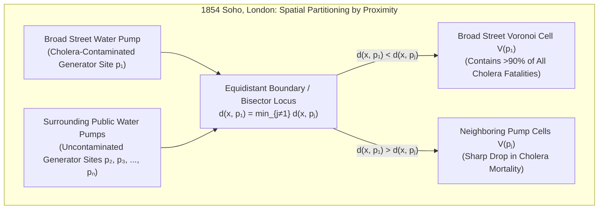
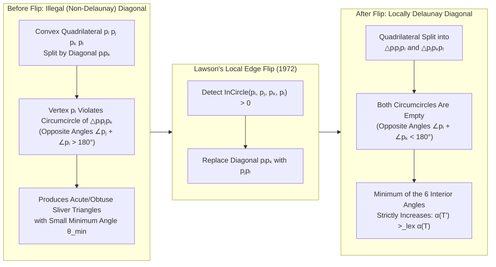
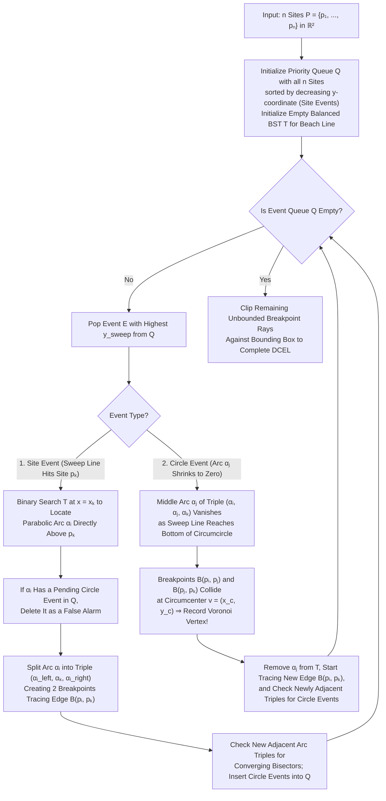

Every millisecond as you walk down a city street with a smartphone in your pocket, wireless protocols continuously evaluate which cellular base station offers the strongest signal path and execute seamless handovers across invisible territorial boundaries. When an emergency 911 or 119 call is placed, computer-aided dispatch systems instantaneously partition the metropolitan road network to determine which ambulance station or trauma center can reach the patient in the minimum travel time. And across the natural world—from the reticulated coat patterns of giraffes, the structural venation of dragonfly wings, and the hexagonal basalt columns of the Giant's Causeway to the cosmic web of galaxy superclusters surrounding giant intergalactic voids—matter self-organizes into strikingly similar polygonal mosaics.

Beneath all of these seemingly disparate phenomena—spatial epidemiology, urban infrastructure planning, wireless cellular engineering, Finite Element Method (FEM) mesh generation for computational fluid dynamics, solid-state crystal physics, and biological morphogenesis—lies the most fundamental dual structure in computational geometry: the <strong>Voronoi Diagram</strong> and its planar graph dual, the <strong>Delaunay Triangulation</strong>.

In this comprehensive treatise, we trace the mathematical and algorithmic foundations of proximity tessellations from first principles. Beginning with Dr. John Snow's 1854 Broad Street cholera map in Victorian London and René Descartes's 1644 cosmic vortices, we prove using Euler's polyhedral formula why a planar Voronoi diagram of $n$ sites has strictly linear combinatorial complexity ($V \le 2n - 5$, $E \le 3n - 6$, and an average of fewer than 6 edges per cell). We then establish the three great equivalence theorems of Boris Delaunay's triangulation—the Empty Circumcircle Property, Sibson and Lawson's Max-Min Angle Optimality Theorem, and Edelsbrunner and Seidel's 3D Paraboloid Lifting Map—before dissecting Steven Fortune's celebrated $\Theta(n \log n)$ sweep-line and parabolic beach-line algorithm and Stuart Lloyd's relaxation method for Centroidal Voronoi Tessellations (CVT).

---

## 1. The 1854 Broad Street Cholera Outbreak and the Birth of Invisible Boundaries

### 1.1 Miasma Dogma vs. Dr. John Snow's Spatial Epidemiology

In late August 1854, a catastrophic outbreak of Asiatic cholera erupted in the Soho district of central London, centered around Broad Street (now Broadwick Street). Within ten days, over 500 residents—and ultimately 616 people—perished within a radius of a few hundred yards from rapid, fatal dehydration.

At the time, the medical establishment and British public health authorities were overwhelmingly committed to the <strong>Miasma Theory</strong>, which held that diseases such as cholera and bubonic plague were transmitted through noxious "bad air" (*miasmata*) emanating from decaying organic matter and open sewers. However, the physician and pioneering anesthesiologist <strong>Dr. John Snow (1813–1858)</strong> observed a crucial clinical clue: cholera never began with respiratory symptoms, as an inhaled miasma would dictate, but invariably attacked the gastrointestinal tract first. Snow hypothesized that cholera was caused by an ingested germ transmitted through sewage-contaminated <strong>drinking water</strong>.

Walking the cobblestone streets of Soho, Snow meticulously recorded the residential address of every cholera fatality, plotting each death as a black rectangular bar stacked perpendicular to the street line on a map of the parish. Simultaneously, he plotted the exact locations of all public street <strong>water pumps</strong> from which Golden Square residents drew their daily drinking water.

### 1.2 The Perpendicular Bisector Boundary That Convicted the Pump

Visual inspection revealed an unmistakable cluster of fatalities around the public pump on Broad Street. Yet to refute the miasma theorists, qualitative visual clustering was not enough: there were several other street pumps nearby (on Rupert Street, Warwick Street, Bridle Lane, and Little Marlborough Street), and critics argued that some victims lived physically closer as the crow flies to neighboring streets than to the center of Broad Street.

Moreover, Snow had to explain two striking statistical anomalies right inside the outbreak zone:
1. <strong>The Poland Street Workhouse</strong>, located immediately north of Broad Street, housed 535 inmates surrounded by cholera deaths on every side, yet suffered only 5 fatalities. Snow discovered that the workhouse possessed its own private well and piped water supply; its residents never drank from the Broad Street pump.
2. <strong>The Lion Brewery</strong> on Broad Street employed over 70 workers right next to the lethal pump, yet not a single worker died of cholera. The workers were granted a daily allowance of free malt liquor and drew any water they used from a deep private well inside the brewery.

To make his spatial argument mathematically irrefutable, Snow added a geometric boundary line to his map (published in the second edition of *On the Mode of Communication of Cholera* and his 1855 parish inquiry report). He traced the locus of points where the walking distance to the Broad Street pump was exactly equal to the walking distance to the nearest alternative street pump.



Because water is heavy to carry, rational households naturally fetched water from whichever pump minimized their walking distance. Snow's polygon—the <strong>nearest-neighbor territory (Voronoi cell)</strong> of the Broad Street pump—enclosed almost every single cholera death in Soho! Even the rare outliers outside the polygon proved his thesis: a widow in distant Hampstead who died of cholera alongside her niece had formerly lived near Broad Street, loved the sparkling taste of its water, and had a carter deliver a large bottle of water from the Broad Street pump to her house every day.

When the Board of Guardians reluctantly removed the handle of the Broad Street pump on September 8, 1854, the outbreak subsided almost immediately. Twenty-nine years before Robert Koch isolated the bacterium *Vibrio cholerae* in 1883, John Snow had identified the source of a lethal epidemic using pure <strong>nearest-neighbor spatial partitioning</strong>.

### 1.3 From Descartes's Cosmic Vortices to Dirichlet and Voronoi

The geometric concept of partitioning space into regions of nearest proximity was independently discovered across multiple centuries and scientific disciplines:

- <strong>René Descartes (1644)</strong>: In Part III of his *Principia Philosophiae*, Descartes proposed a mechanical cosmology in which the heavens are filled with swirling vortices (*tourbillons*) of subtle matter centered around fixed stars (such as our Sun). Where adjacent stellar vortices press against one another, they form flat boundary interfaces, partitioning space into convex polygonal cells. Descartes's woodcut illustration is the earliest known depiction of a Voronoi tessellation in human history.
- <strong>Peter Gustav Lejeune Dirichlet (1850)</strong>: In his landmark paper *Über die Reduction der positiven quadratischen Formen mit drei unbestimmten ganzen Zahlen*, Dirichlet studied positive definite quadratic forms by partitioning 2D and 3D Euclidean lattices into domains of points closer to a given lattice point than to any other. In crystallography and solid-state physics, these regions are known as <strong>Dirichlet Domains</strong> or <strong>Wigner-Seitz Cells</strong>.
- <strong>Georgy Feodosevich Voronoi (1868–1908)</strong>: In 1908, the Ukrainian mathematician Georgy Voronoi published *Nouvelles applications des paramètres continus à la théorie des formes quadratiques*, generalizing Dirichlet's construction to arbitrary $d$-dimensional Euclidean spaces $\mathbb{R}^d$ and establishing the rigorous algebraic and combinatorial theory of high-dimensional proximity polytopes.
- <strong>Alfred H. Thiessen (1911)</strong>: Working at the United States Weather Bureau, meteorologist Alfred Thiessen introduced <strong>Thiessen Polygons</strong> to estimate areal average precipitation from non-uniformly distributed rain gauges, weighting each gauge's reading by the area of its Voronoi polygon rather than taking a naive unweighted arithmetic mean.

---

## 2. Mathematical Definition and Combinatorial Complexity of the Voronoi Diagram $\text{Vor}(P)$

### 2.1 Voronoi Cells as Intersections of Closed Half-Planes

Let $P = \{p_1, p_2, \dots, p_n\} \subset \mathbb{R}^2$ ($n \ge 3$) be a finite set of $n$ distinct points in the Euclidean plane, called <strong>sites</strong> or <strong>generators</strong>, with coordinates $p_i = (x_i, y_i)^\top$. Let $\|x - y\|_2 = \sqrt{(x_1 - y_1)^2 + (x_2 - y_2)^2}$ denote the standard Euclidean ($L_2$) metric.

For any two distinct sites $p_i, p_j \in P$ ($i \ne j$), the locus of points equidistant from $p_i$ and $p_j$ is their <strong>perpendicular bisector</strong> $B(p_i, p_j)$:

$$B(p_i, p_j) = \left\{ x \in \mathbb{R}^2 \;\middle|\; \|x - p_i\|_2 = \|x - p_j\|_2 \right\}$$

Squaring both sides gives $\|x\|_2^2 - 2p_i^\top x + \|p_i\|_2^2 = \|x\|_2^2 - 2p_j^\top x + \|p_j\|_2^2$. Notice that the quadratic term $\|x\|_2^2$ cancels identically, leaving a linear equation in $x$. The closed half-plane $H(p_i, p_j)$ of points at least as close to $p_i$ as to $p_j$ (the <strong>dominance region</strong> of $p_i$ over $p_j$) is therefore:

$$H(p_i, p_j) = \left\{ x \in \mathbb{R}^2 \;\middle|\; \|x - p_i\|_2 \le \|x - p_j\|_2 \right\} = \left\{ x \in \mathbb{R}^2 \;\middle|\; 2(p_j - p_i)^\top x \le \|p_j\|_2^2 - \|p_i\|_2^2 \right\}$$

The <strong>Voronoi Cell (or Voronoi Region)</strong> $\mathcal{V}(p_i)$ associated with site $p_i$ is the intersection of the $n - 1$ closed dominance half-planes against all other sites $p_j \in P \setminus \{p_i\}$:

$$\mathcal{V}(p_i) = \left\{ x \in \mathbb{R}^2 \;\middle|\; \|x - p_i\|_2 \le \|x - p_j\|_2 \;\;\forall j \in \{1, \dots, n\} \setminus \{i\} \right\} = \bigcap_{j \ne i} H(p_i, p_j)$$

From this half-plane intersection representation, two fundamental geometric properties follow immediately:

> [!IMPORTANT]
> <strong>Convexity and Unboundedness of Euclidean Voronoi Cells</strong>
> 1. <strong>Convexity</strong>: Every closed half-plane $H(p_i, p_j)$ is a convex set, and the intersection of any collection of convex sets is strictly convex. Hence, every Euclidean Voronoi cell $\mathcal{V}(p_i)$ is a (possibly unbounded) <strong>convex polygon</strong> bounded by at most $n - 1$ line segments or rays.
> 2. <strong>Duality with the Convex Hull</strong>: A Voronoi cell $\mathcal{V}(p_i)$ is <strong>unbounded</strong> (has infinite area) if and only if its generator site $p_i$ lies on the boundary of the <strong>Convex Hull</strong> $\text{CH}(P)$ of the site set $P$.

The union of all cell boundaries $\text{Vor}(P) = \bigcup_{i=1}^n \partial \mathcal{V}(p_i)$ forms a planar straight-line graph consisting of:
- <strong>Voronoi Edges</strong>: 1-dimensional segments or rays shared by two adjacent cells $\mathcal{V}(p_i) \cap \mathcal{V}(p_j)$, consisting of points equidistant to $p_i$ and $p_j$ and strictly closer to them than to any other site.
- <strong>Voronoi Vertices</strong>: 0-dimensional points where three or more Voronoi edges meet. Under the <strong>general position assumption</strong> (no four sites in $P$ are cocircular), every Voronoi vertex has degree exactly $3$ and is the unique <strong>circumcenter</strong> of the triangle $\triangle p_i p_j p_k$ formed by the three sites whose cells meet at that vertex.

### 2.2 The Combinatorial Complexity Paradox: Proof via Euler's Formula That $V \le 2n - 5$ and $E \le 3n - 6$

Consider a fundamental question of computational complexity: given $n$ sites in $\mathbb{R}^2$, there are $\binom{n}{2} = \frac{n(n-1)}{2} = \Theta(n^2)$ pairs of sites, and thus $\Theta(n^2)$ perpendicular bisectors. Could a Voronoi diagram have $\Theta(n^2)$ vertices and edges, with every cell having $\Theta(n)$ sides?

Remarkably, the answer is <strong>no</strong>. In the Euclidean plane $\mathbb{R}^2$, the vast majority of pairwise bisectors are completely shielded by closer sites, and the total number of Voronoi vertices $V$ and Voronoi edges $E$ scales <strong>strictly linearly</strong> with $n$. We now prove this cornerstone theorem using <strong>Euler's Planar Graph Formula</strong>.

#### [Theorem 2.1] Exact Linear Upper Bounds on Voronoi Vertices and Edges
For any set $P \subset \mathbb{R}^2$ of $n \ge 3$ non-collinear sites, the number of Voronoi vertices $V$ and Voronoi edges $E$ of $\text{Vor}(P)$ satisfy:

$$V \le 2n - 5, \qquad E \le 3n - 6$$

#### [Proof]
Because $\text{Vor}(P)$ contains unbounded rays extending to infinity, we compactify the Euclidean plane $\mathbb{R}^2$ onto the topological 2-sphere $\mathbb{S}^2$ (via one-point stereographic compactification) by introducing a single artificial <strong>vertex at infinity</strong> $v_\infty$ and connecting every unbounded Voronoi ray to $v_\infty$.

This produces a connected planar graph $G' = (V', E', F')$ embedded on $\mathbb{S}^2$ with:
1. <strong>Vertices</strong>: $V' = V + 1$ (the $V$ finite Voronoi vertices plus $v_\infty$).
2. <strong>Edges</strong>: $E' = E$ (each finite segment or unbounded ray in $\text{Vor}(P)$ corresponds to one edge in $G'$).
3. <strong>Faces</strong>: $F' = n$ (one topological face for each Voronoi cell $\mathcal{V}(p_i)$).

Applying <strong>Euler's Polyhedral Formula</strong> $V' - E' + F' = 2$ to $G'$ yields:

$$(V + 1) - E + n = 2 \iff E = V + n - 1 \quad \cdots \text{(Equation 1)}$$

Next, let us lower-bound the degree $\deg(v)$ of every vertex $v \in V'$:
- Every finite Voronoi vertex $v \in V$ is the intersection of at least three Voronoi cells (and thus at least three Voronoi edges meet at $v$), so $\deg(v) \ge 3$ (with equality when no 4 sites are cocircular, and $\deg(v) \ge 4$ when degeneracy occurs).
- The vertex at infinity $v_\infty$ terminates all unbounded Voronoi rays. Because the sites are not all collinear, the convex hull $\text{CH}(P)$ is a polygon with at least 3 edges, so at least 3 unbounded rays reach infinity, giving $\deg(v_\infty) \ge 3$.

Since every one of the $V + 1$ vertices in $G'$ has degree at least $3$, the <strong>Handshaking Lemma</strong> (summing vertex degrees counts each edge twice) gives:

$$2E = \sum_{v \in V \cup \{v_\infty\}} \deg(v) \ge 3(V + 1) \implies V \le \frac{2}{3}E - 1 \quad \cdots \text{(Equation 2)}$$

Substituting Inequality (2) into Euler's Relation (1) eliminates $V$:

$$E = V + n - 1 \le \left(\frac{2}{3}E - 1\right) + n - 1 \implies \frac{1}{3}E \le n - 2 \implies E \le 3n - 6$$

Finally, substituting $E \le 3n - 6$ back into $V = E - n + 1$ yields the vertex bound:

$$V \le (3n - 6) - n + 1 = 2n - 5 \qquad \blacksquare$$

#### [Corollary 2.2] The Average Voronoi Cell Has Fewer Than 6 Edges!
Every edge in $G'$ separates exactly two faces (two Voronoi cells). Therefore, the sum of the number of edges over all $n$ Voronoi cells is $2E$. Dividing by $n$ gives the <strong>average number of edges per Voronoi cell</strong> $\bar{k}$:

$$\bar{k} = \frac{2E}{n} \le \frac{2(3n - 6)}{n} = 6 - \frac{12}{n} < 6$$

> [!TIP]
> <strong>The "Six-Neighbor Law" of Planar Tessellations</strong>
> No matter how $n$ sites are arranged in the plane—whether $n = 10$ or $n = 10^9$—<strong>the average number of edges (and thus the average number of adjacent neighbors) of a Voronoi cell is strictly less than 6!</strong> While a single central site surrounded by a ring of $n - 1$ sites can have $n - 1$ edges, doing so forces all surrounding cells to be 3- or 4-sided, keeping the global average bounded by $6 - 12/n$. (Note, however, that in 3D and higher dimensions $\mathbb{R}^d$, Klee and Seidel showed that Voronoi diagrams can reach $\Theta(n^{\lceil d/2 \rceil})$ vertices, meaning a 3D Voronoi diagram can have $\Theta(n^2)$ complexity in the worst case, though it remains $O(n)$ for homogeneous spatial distributions!)

### 2.3 Beyond Euclidean $L_2$: Manhattan ($L_1$), Chebyshev ($L_\infty$), Apollonius, and Power Diagrams

By replacing the Euclidean distance $\|x - p_i\|_2$ with alternative distance functions $d(x, p_i)$, we obtain a rich family of <strong>Generalized Voronoi Diagrams</strong> tailored to specific physical and engineering domains:

1. Manhattan / Taxicab Metric ($L_1$)
   In grid-iron urban street networks like Manhattan or central Kyoto, vehicles and pedestrians travel along orthogonal north-south and east-west streets: $d_1(x, p_i) = |x_1 - x_i| + |x_2 - y_i|$. Because the "unit circle" in $L_1$ is a diamond rotated by $45^\circ$, the bisector between two sites is no longer a straight line, but a <strong>piecewise-linear polyline consisting of three segments</strong>: two horizontal or vertical rays connected by a diagonal segment at $\pm 45^\circ$.
2. Chebyshev / Supremum Metric ($L_\infty$)
   In automated warehouse gantry cranes, flatbed plotters, and semiconductor lithography stages where X and Y actuators move simultaneously and independently at maximum speed, travel time is governed by the slowest axis: $d_\infty(x, p_i) = \max(|x_1 - x_i|, |x_2 - y_i|)$. By rotating coordinates by $45^\circ$, $L_\infty$ is isometric to $L_1$ up to a factor of $\sqrt{2}$.
3. <strong>Additively Weighted Voronoi (Hyperbolic / Johnson-Mehl Diagram)</strong>
   Defined by $d_{\text{AW}}(x, p_i) = \|x - p_i\|_2 - w_i$. If crystal nuclei $p_i$ nucleate at asynchronous times $t_i = -w_i / v$ and grow radially outward at constant speed $v$, the interface where two growing circular crystals meet satisfies $\|x - p_i\|_2 - \|x - p_j\|_2 = w_i - w_j = \text{const}$. By the geometric definition of conic sections, the bisector between two sites with constant distance difference is a <strong>branch of a hyperbola</strong>.
4. <strong>Multiplicatively Weighted Voronoi (Apollonius Diagram)</strong>
   Defined by $d_{\text{MW}}(x, p_i) = \|x - p_i\|_2 / w_i$ ($w_i > 0$). This models cellular base stations with unequal transmission powers or competing retail stores with different attractiveness weights. The locus of points where the ratio of distances to two fixed points is constant ($\|x - p_i\|_2 / \|x - p_j\|_2 = w_i / w_j \ne 1$) is a <strong>Circle of Apollonius</strong>. Consequently, Voronoi cells in an Apollonius diagram have circular-arc boundaries, a weaker site's cell is completely enclosed inside a stronger site's cell, cells can become <strong>non-convex and disconnected</strong>, and the worst-case combinatorial complexity rises to $\Theta(n^2)$.
5. <strong>Power Diagram (Laguerre-Voronoi Tessellation)</strong>
   Defined by the power of a point with respect to a circle of radius $r_i$ centered at $p_i$: $d_{\text{pow}}(x, p_i) = \|x - p_i\|_2^2 - r_i^2$. Because the quadratic term $\|x\|_2^2$ cancels out in $d_{\text{pow}}(x, p_i) = d_{\text{pow}}(x, p_j)$, the bisector is the <strong>radical axis (chordal line)</strong> of the two circles—a <strong>perfectly straight line</strong>! Every cell remains a convex polygon (though a site with a small weight $r_i^2$ may have an empty cell), and the complexity remains $\Theta(n)$. Power diagrams are foundational in modeling polycrystalline metal grains, soap froths, and solving <strong>Semi-Discrete Optimal Transport (Monge-Ampère equations)</strong> in modern machine learning.

| Voronoi Variant | Distance Function $d(x, p_i)$ | Bisector Curve Geometry | Cell Convexity & Topology | Worst-Case Size | Primary Engineering & Scientific Applications |
| :--- | :--- | :--- | :--- | :--- | :--- |
| Standard Euclidean ($L_2$) | $\|x - p_i\|_2$ | Straight line (perpendicular bisector) | Always convex, connected | $\Theta(n)$ | Epidemiology, meteorology (Thiessen), nearest-neighbor search |
| Manhattan / Taxicab ($L_1$) | $\|x_1 - x_i\| + \|x_2 - y_i\|$ | Horizontal, vertical & $\pm 45^\circ$ polyline | Star-shaped (non-convex) | $\Theta(n)$ | Urban emergency dispatch on grid streets, VLSI routing |
| Chebyshev ($L_\infty$) | $\max(\|x_1 - x_i\|, \|x_2 - y_i\|)$ | Horizontal, vertical & $\pm 45^\circ$ polyline | Star-shaped (non-convex) | $\Theta(n)$ | Overhead gantry cranes, PCB drilling, Chebyshev approximation |
| <strong>Additively Weighted (AW)</strong> | $\|x - p_i\|_2 - w_i$ | Hyperbolic arcs | Star-shaped, connected | $\Theta(n)$ | Asynchronous crystal growth (Johnson-Mehl), TDOA localization |
| <strong>Multiplicatively Weighted</strong> | $\|x - p_i\|_2 / w_i$ | Circular arcs (Circles of Apollonius) | Non-convex, may disconnect | $\Theta(n^2)$ | Heterogeneous 5G macro/micro cells, retail catchment areas |
| <strong>Power Diagram (Laguerre)</strong> | $\|x - p_i\|_2^2 - r_i^2$ | Straight line (radical axis of circles) | Always convex (may be empty) | $\Theta(n)$ | Polycrystalline materials, foam physics, Optimal Transport (OT) |

---

## 3. Boris Delaunay's Dual Graph $\text{DT}(P)$ and the Three Fundamental Equivalence Theorems

### 3.1 Constructing the Planar Dual Graph (Delaunay, 1934)

In 1934, the Russian mathematician <strong>Boris Nikolaevich Delaunay (Delone, 1890–1980)</strong> investigated the dual structure obtained by inverting the incidence relations of the Voronoi diagram $\text{Vor}(P)$:
1. <strong>Vertices</strong>: The generator sites $P = \{p_1, \dots, p_n\}$ themselves serve as the vertices of the dual graph.
2. <strong>Delaunay Edges</strong>: Two sites $p_i, p_j \in P$ are connected by a straight line segment $\overline{p_i p_j}$ if and only if their Voronoi cells $\mathcal{V}(p_i)$ and $\mathcal{V}(p_j)$ share a Voronoi edge of positive length ($\dim(\mathcal{V}(p_i) \cap \mathcal{V}(p_j)) = 1$).
3. <strong>Delaunay Faces</strong>: Every finite Voronoi vertex $v$ where $k \ge 3$ Voronoi cells meet corresponds in the dual graph to a convex $k$-gon spanned by those $k$ generator sites.

When the site set $P$ is in <strong>general position</strong> (no three sites are collinear and <strong>no four sites are cocircular</strong>), every Voronoi vertex has degree exactly $3$, so every bounded face of the dual graph is a <strong>triangle</strong>. Moreover, Delaunay proved that these straight-line edges never cross one another and partition the convex hull $\text{CH}(P)$ into a valid, unique triangulation called the <strong>Delaunay Triangulation $\text{DT}(P)$</strong>.

The planar duality between $\text{Vor}(P)$ and $\text{DT}(P)$ provides an exact structural dictionary:

$$\begin{aligned}
\text{Voronoi Cell } \mathcal{V}(p_i) \text{ (Face)} \quad &\longleftrightarrow \quad \text{Delaunay Vertex } p_i \text{ (Site)} \\
\text{Voronoi Edge } e = \mathcal{V}(p_i) \cap \mathcal{V}(p_j) \quad &\longleftrightarrow \quad \text{Delaunay Edge } e^* = \overline{p_i p_j} \;\; (e \perp e^*) \\
\text{Voronoi Vertex } v = \mathcal{V}(p_i) \cap \mathcal{V}(p_j) \cap \mathcal{V}(p_k) \quad &\longleftrightarrow \quad \text{Delaunay Triangle } \triangle p_i p_j p_k \;\; (v = \text{Circumcenter}) \\
\text{Unbounded Voronoi Rays } (v_\infty) \quad &\longleftrightarrow \quad \text{Boundary Edges of Convex Hull } \partial \text{CH}(P)
\end{aligned}$$

### 3.2 Equivalence Theorem 1: The Empty Circumcircle Property

Among the exponentially many ways to triangulate a point set $P$, what geometric property uniquely characterizes the Delaunay triangulation?

#### [Theorem 3.1] The Empty Circumcircle Theorem
A triangulation $\mathcal{T}$ of a point set $P \subset \mathbb{R}^2$ is a Delaunay triangulation if and only if the circumcircle $C(\triangle p_i p_j p_k)$ of every triangle $\triangle p_i p_j p_k \in \mathcal{T}$ contains no point of $P$ in its strict interior.

#### [Proof]
Let $c$ be the circumcenter and $R = \|c - p_i\|_2 = \|c - p_j\|_2 = \|c - p_k\|_2$ be the circumradius of $\triangle p_i p_j p_k$.
By duality, $\triangle p_i p_j p_k$ is a Delaunay triangle if and only if the three Voronoi cells $\mathcal{V}(p_i), \mathcal{V}(p_j), \mathcal{V}(p_k)$ intersect at a common Voronoi vertex $v$. Since $c$ is the unique point in $\mathbb{R}^2$ equidistant from $p_i, p_j, p_k$, we must have $v = c$.
By definition of Voronoi cells, $c \in \mathcal{V}(p_i) \cap \mathcal{V}(p_j) \cap \mathcal{V}(p_k)$ holds if and only if for every other site $p_l \in P \setminus \{p_i, p_j, p_k\}$:

$$\|c - p_l\|_2 \ge \|c - p_i\|_2 = R$$

Geometrically, the condition $\|c - p_l\|_2 \ge R$ for all $l$ states precisely that no site $p_l \in P$ lies strictly inside the open disk bounded by the circumcircle $C(\triangle p_i p_j p_k)$. $\blacksquare$

In robust computational geometry, testing whether a query point $p_l = (x_l, y_l)$ lies inside the circumcircle of a counterclockwise-oriented triangle $(p_i, p_j, p_k)$ is performed without computing square roots or explicit circle centers via the $\text{InCircle}$ Determinant Predicate:

$$\text{InCircle}(p_i, p_j, p_k, p_l) = \det \begin{pmatrix} x_i & y_i & x_i^2 + y_i^2 & 1 \\ x_j & y_j & x_j^2 + y_j^2 & 1 \\ x_k & y_k & x_k^2 + y_k^2 & 1 \\ x_l & y_l & x_l^2 + y_l^2 & 1 \end{pmatrix} = \det \begin{pmatrix} x_i - x_l & y_i - y_l & (x_i - x_l)^2 + (y_i - y_l)^2 \\ x_j - x_l & y_j - y_l & (x_j - x_l)^2 + (y_j - y_l)^2 \\ x_k - x_l & y_k - y_l & (x_k - x_l)^2 + (y_k - y_l)^2 \end{pmatrix}$$

When $(p_i, p_j, p_k)$ are ordered counterclockwise, $\text{InCircle}(p_i, p_j, p_k, p_l) > 0$ if and only if $p_l$ lies <strong>strictly inside</strong> the circumcircle.

### 3.3 Equivalence Theorem 2: Max-Min Angle Optimality and Lawson's Edge-Flipping Algorithm

In scientific computing and numerical analysis—specifically the <strong>Finite Element Method (FEM)</strong> for structural mechanics, heat transfer, and computational fluid dynamics—a physical domain must be discretized into a triangular mesh.

Here, the arch-nemesis of numerical stability is the <strong>"sliver triangle"</strong> (an elongated, nearly degenerate triangle with very small or very obtuse interior angles). By the Babuska-Aziz and Ciarlet-Raviart interpolation theorems, both the $H^1$ gradient interpolation error on a triangle $T$ and the spectral condition number $\kappa(K)$ of the global FEM stiffness matrix $K$ blow up inversely with the sine of the minimum mesh angle $\theta_{\min}$:

$$\|\nabla u - \nabla u_h\|_{L^2(T)} \le \frac{C \, h_T}{\sin(\theta_{\min})} \|D^2 u\|_{L^2(T)}, \qquad \kappa(K) \propto \frac{1}{\sin(\theta_{\min})}$$

Why is the Delaunay triangulation the universal gold standard for FEM mesh generation? Because of a remarkable optimality theorem proved by <strong>Charles L. Lawson (1972)</strong> and <strong>Robin Sibson (1978)</strong>.

#### [Theorem 3.2] The Max-Min Angle Optimality Theorem (Sibson, 1978)
Let $P \subset \mathbb{R}^2$ be a point set whose convex hull boundary contains $h$ vertices. By Euler's formula, *every* triangulation $\mathcal{T}$ of $P$ consists of the exact same number of triangles, $m = 2n - 2 - h$, and therefore has $3m$ interior angles.
For any triangulation $\mathcal{T}$, let $\alpha(\mathcal{T}) = (\theta_1, \theta_2, \dots, \theta_{3m})$ denote the vector of its $3m$ interior angles sorted in non-decreasing order ($\theta_1 \le \theta_2 \le \dots \le \theta_{3m}$). Then the Delaunay triangulation $\text{DT}(P)$ lexicographically maximizes the angle vector $\alpha(\mathcal{T})$ among all possible triangulations of $P$! In particular, $\text{DT}(P)$ maximizes the smallest angle $\theta_{\min} = \theta_1$.

#### [Geometric Mechanism: Thales's Theorem and Lawson's Edge Flip]
Consider two adjacent triangles $\triangle p_i p_j p_k$ and $\triangle p_i p_k p_l$ sharing an internal diagonal edge $\overline{p_i p_k}$ whose union forms a strictly convex quadrilateral $p_i p_j p_k p_l$.
By Euclid's classical geometry of cyclic quadrilaterals (an extension of Thales's Inscribed Angle Theorem), point $p_l$ lies strictly inside the circumcircle of $\triangle p_i p_j p_k$ if and only if the sum of the two opposite angles facing diagonal $\overline{p_i p_k}$ exceeds $180^\circ$:

$$\text{InCircle}(p_i, p_j, p_k, p_l) > 0 \iff \angle p_i p_j p_k + \angle p_k p_l p_i > \pi$$

When this occurs, the shared edge $\overline{p_i p_k}$ is called <strong>locally non-Delaunay (illegal)</strong>. If we replace the diagonal $\overline{p_i p_k}$ with the alternative diagonal $\overline{p_j p_l}$—an operation known as <strong>Lawson's Edge Flip</strong>—the new opposite angles satisfy $\angle p_j p_i p_l + \angle p_l p_k p_j = 2\pi - (\angle p_i p_j p_k + \angle p_k p_l p_i) < \pi$, so the new triangles $\triangle p_i p_j p_l$ and $\triangle p_j p_k p_l$ strictly satisfy the empty circumcircle condition! Furthermore, comparing the inscribed angles subtended by the four exterior sides of the quadrilateral proves that <strong>the minimum of the six interior angles after the flip is strictly greater than the minimum of the six interior angles before the flip</strong>.



Because each edge flip strictly increases $\alpha(\mathcal{T})$ in lexicographical order and there are only finitely many triangulations of $P$, Lawson's algorithm—repeatedly flipping any locally illegal edge—can never cycle and is guaranteed to terminate at the globally optimal Delaunay triangulation $\text{DT}(P)$ in at most $\binom{n}{2} = O(n^2)$ flips!

### 3.4 Equivalence Theorem 3: The 3D Paraboloid Lifting Map (Edelsbrunner & Seidel, 1986)

Why does the third column of the $4 \times 4$ $\text{InCircle}$ determinant contain $z = x^2 + y^2$, the equation of a 3D paraboloid of revolution?
Discovered by <strong>Kevin Q. Brown (1979)</strong> and unified by <strong>Herbert Edelsbrunner and Raimund Seidel (1986)</strong>, the <strong>Paraboloid Lifting Map</strong> reveals a breathtaking bridge between 2D circles and 3D planes, uniting Delaunay triangulations, Voronoi diagrams, and 3D convex hulls into a single geometric object.

#### [Theorem 3.3] The Paraboloid Lifting Theorem
Define the vertical lifting map $\Phi: \mathbb{R}^2 \to \mathbb{R}^3$ that projects every 2D point $(x, y)$ onto the unit paraboloid of revolution $\mathcal{P} = \{(x, y, z) \in \mathbb{R}^3 \mid z = x^2 + y^2\}$:

$$\Phi(x, y) = \left(x, \; y, \; x^2 + y^2\right)$$

Given a site set $P = \{p_1, \dots, p_n\} \subset \mathbb{R}^2$, let $\Phi(P) = \{\Phi(p_1), \dots, \Phi(p_n)\} \subset \mathbb{R}^3$ be the lifted 3D point cloud, and consider its 3D convex hull $\text{CH}(\Phi(P))$.
Then the vertical projection onto the $xy$-plane of the Lower Convex Hull of $\text{CH}(\Phi(P))$ (the facets visible from $z = -\infty$ whose outward normal vectors have a negative $z$-component) is the exact Delaunay Triangulation $\text{DT}(P)$!

#### [Proof]
Expand the algebraic equation of a circle $C \subset \mathbb{R}^2$ with center $(a, b)$ and radius $R$:

$$(x - a)^2 + (y - b)^2 = R^2 \iff x^2 + y^2 = 2ax + 2by - (a^2 + b^2 - R^2)$$

On the paraboloid $\mathcal{P}$, the left-hand side $x^2 + y^2$ is simply the vertical coordinate $z$! Substituting $z = x^2 + y^2$ transforms the quadratic circle equation into a linear equation defining a non-vertical plane $\Pi_C \subset \mathbb{R}^3$:

$$\Pi_C : \quad z = 2ax + 2by - (a^2 + b^2 - R^2)$$

Therefore, every circle $C$ in $\mathbb{R}^2$ is the vertical $xy$-projection of the intersection curve (an ellipse) between the paraboloid $z = x^2 + y^2$ and a non-vertical plane $\Pi_C$ in $\mathbb{R}^3$!
Even better, for any point $p = (x, y) \in \mathbb{R}^2$, the vertical $z$-distance between its lifted point $\Phi(p) = (x, y, x^2 + y^2)$ and the plane $\Pi_C$ is:

$$z_{\Phi(p)} - z_{\Pi_C}(x, y) = (x^2 + y^2) - \left[2ax + 2by - (a^2 + b^2 - R^2)\right] = (x - a)^2 + (y - b)^2 - R^2$$

Because the paraboloid $z = x^2 + y^2$ is strictly convex (curving upward like a bowl), we obtain an exact three-way correspondence:
- Point $p_l$ lies <strong>strictly inside</strong> circle $C$ $\iff (x_l - a)^2 + (y_l - b)^2 < R^2 \iff$ Lifted point $\Phi(p_l)$ lies <strong>strictly below</strong> plane $\Pi_C$ ($z_{\Phi(p_l)} < z_{\Pi_C}$).
- Point $p_l$ lies <strong>on</strong> circle $C$ $\iff (x_l - a)^2 + (y_l - b)^2 = R^2 \iff$ Lifted point $\Phi(p_l)$ lies <strong>on</strong> plane $\Pi_C$.
- Point $p_l$ lies <strong>strictly outside</strong> circle $C$ $\iff (x_l - a)^2 + (y_l - b)^2 > R^2 \iff$ Lifted point $\Phi(p_l)$ lies <strong>strictly above</strong> plane $\Pi_C$ ($z_{\Phi(p_l)} > z_{\Pi_C}$).

Consequently, a triangle $\triangle p_i p_j p_k$ in $\mathbb{R}^2$ has an <strong>empty circumcircle</strong> (no other site $p_l \in P$ lies inside $C(\triangle p_i p_j p_k)$) if and only if no other lifted point $\Phi(p_l)$ lies below the plane $\Pi_C$ spanned by $\Phi(p_i), \Phi(p_j), \Phi(p_k)$—which is the exact definition of a lower facet of the 3D convex hull $\text{CH}(\Phi(P))$! $\blacksquare$

> [!TIP]
> How `scipy.spatial.Voronoi` and `Delaunay` Work Under the Hood (Qhull)
> The paraboloid lifting map also generates the Voronoi diagram directly! Consider the <strong>tangent plane</strong> $T_i$ to the paraboloid $z = x^2 + y^2$ at the lifted site $\Phi(p_i) = (x_i, y_i, x_i^2 + y_i^2)$:
> $$T_i(x, y) = 2x_i x + 2y_i y - (x_i^2 + y_i^2)$$
> The vertical gap between the paraboloid and the tangent plane $T_i$ above any point $x \in \mathbb{R}^2$ is $(x^2 + y^2) - T_i(x, y) = \|x - p_i\|_2^2$. Minimizing $\|x - p_i\|_2^2$ is therefore equivalent to <strong>maximizing $T_i(x, y)$</strong>! Thus, projecting the ridges of the <strong>upper envelope of the $n$ tangent planes $\{T_i\}_{i=1}^n$</strong> down to $\mathbb{R}^2$ yields the exact Voronoi diagram $\text{Vor}(P)$. This is why the industrial-strength C library <strong>Qhull</strong> (used by Python's SciPy, MATLAB, and R) computes Delaunay triangulations and Voronoi diagrams in arbitrary dimensions simply by running its Quickhull convex hull solver on lifted coordinates!

---

## 4. Optimal $\Theta(n \log n)$ Construction: Steven Fortune's Sweep-Line and Beach-Line Algorithm (1986)

### 4.1 The $\Omega(n \log n)$ Lower Bound and the Sweep-Line Paradox

Can we compute $\text{Vor}(P)$ or $\text{DT}(P)$ faster than $O(n \log n)$?
In the algebraic decision-tree model, sorting $n$ real numbers $x_1, x_2, \dots, x_n \in \mathbb{R}$ requires $\Omega(n \log n)$ operations. If we map these numbers to 2D sites $p_i = (x_i, 0)$ on the $x$-axis (or $p_i = (x_i, x_i^2)$ on a parabola), the adjacency order of their Voronoi cells (or Delaunay edges) immediately reveals the sorted order of $\{x_i\}$ in $O(n)$ traversal time. Therefore, $\Omega(n \log n)$ is a strict information-theoretic lower bound for constructing either $\text{Vor}(P)$ or $\text{DT}(P)$.

While Shamos and Hoey (1975) achieved $O(n \log n)$ via Divide-and-Conquer, merging two half-plane Voronoi diagrams along their seam requires intricate geometric stitch logic. For over a decade, computational geometers wondered whether a simpler <strong>plane sweep algorithm</strong>—sweeping a horizontal line $\ell: y = y_{\text{sweep}}$ downward from $+\infty$ to $-\infty$, as in Bentley-Ottmann segment intersection—could construct $\text{Vor}(P)$ directly in $O(n \log n)$ time.

Yet a naive sweep-line faces a seemingly fatal obstacle: <strong>the violation of causality</strong>.
In standard sweep-line algorithms, the geometry above the sweep-line $\ell$ is finalized because events below $\ell$ cannot affect intersections above $\ell$. In a Voronoi diagram, however, a point $q = (x, y)$ lying <strong>above</strong> the sweep-line ($y > y_{\text{sweep}}$) may be closer to an unseen future site $p_{\text{new}}$ lying just below $\ell$ than to any already-visited site above $\ell$! Because future sites below $\ell$ retroactively invade the territory above $\ell$, the Voronoi diagram above the sweep-line cannot be finalized at $\ell$.

### 4.2 Fortune's Breakthrough: The Parabolic Beach Line

In 1986, <strong>Steven Fortune</strong> at Bell Labs resolved this paradox with a stroke of geometric brilliance. Instead of maintaining the intersection of the Voronoi diagram with the sweep-line $\ell$, Fortune asked:

> *At a given sweep-line position $\ell: y = y_{\text{sweep}}$, what is the exact subset of points $q = (x, y)$ above $\ell$ whose Voronoi cell membership is <strong>100% immune</strong> to any future site that could possibly appear below $\ell$?*

Suppose an undiscovered site $p_{\text{new}}$ lies somewhere on or below the sweep-line ($y_{\text{new}} \le y_{\text{sweep}}$). How close can $p_{\text{new}}$ possibly be to a point $q = (x, y)$ above $\ell$? The minimum possible Euclidean distance from $q$ to the entire half-plane below $\ell$ is the perpendicular vertical distance from $q$ straight down to $\ell$, which equals $y - y_{\text{sweep}}$.

Consequently, a point $q = (x, y)$ above $\ell$ is guaranteed to belong to an already-discovered site above $\ell$ if and only if there is at least one visited site $p_i = (x_i, y_i)$ ($y_i > y_{\text{sweep}}$) whose distance to $q$ is less than or equal to $y - y_{\text{sweep}}$:

$$\min_{p_i : y_i > y_{\text{sweep}}} \|q - p_i\|_2 \le y - y_{\text{sweep}}$$

For a single visited site $p_i = (x_i, y_i)$, the boundary locus where the Euclidean distance to the point $p_i$ equals the perpendicular distance to the line $\ell: y = y_{\text{sweep}}$ is, by the classical Apollonian definition of a conic section, a <strong>Parabola</strong> $\beta(p_i, y_{\text{sweep}})$ with <strong>focus</strong> $p_i$ and <strong>directrix</strong> $\ell$:

$$\sqrt{(x - x_i)^2 + (y - y_i)^2} = y - y_{\text{sweep}} \iff y = \frac{(x - x_i)^2}{2(y_i - y_{\text{sweep}})} + \frac{y_i + y_{\text{sweep}}}{2}$$

Taking the <strong>lower envelope</strong> (pointwise minimum $y$ for each $x \in \mathbb{R}$) of the parabolas of all visited sites $y_i > y_{\text{sweep}}$ yields a continuous, $x$-monotone piecewise-parabolic curve called the <strong>Beach Line (汀線)</strong>:

$$\mathcal{B}(y_{\text{sweep}}) = \min_{p_i : y_i > y_{\text{sweep}}} \left\{ \frac{(x - x_i)^2}{2(y_i - y_{\text{sweep}})} + \frac{y_i + y_{\text{sweep}}}{2} \right\}$$

Why is the beach line magical? Consider any <strong>breakpoint</strong> $b = (x, y)$ where two adjacent parabolic arcs $\beta(p_i, y_{\text{sweep}})$ and $\beta(p_j, y_{\text{sweep}})$ meet on the beach line. Because $b$ lies on both parabolas simultaneously, its distance to focus $p_i$ and its distance to focus $p_j$ both equal its vertical distance to the directrix $\ell$:

$$\|b - p_i\|_2 = y - y_{\text{sweep}} = \|b - p_j\|_2 \implies \|b - p_i\|_2 = \|b - p_j\|_2$$

Every breakpoint on the beach line lies directly on a Voronoi edge $B(p_i, p_j)$! As the sweep-line $\ell$ slides downward, the breakpoints slide continuously along the perpendicular bisectors, tracing out the Voronoi edges of $\text{Vor}(P)$ in real time!

### 4.3 Site Events, Circle Events, and Exact $O(n \log n)$ Complexity

Instead of moving $\ell$ continuously, Fortune's algorithm processes discrete events where the combinatorial sequence of parabolic arcs along the beach line changes. There are <strong>only two types of events</strong>:



1. <strong>Site Event (Birth of a Parabolic Arc)</strong>
   Occurs when the sweep-line reaches a new site $p_k = (x_k, y_k)$ ($y_{\text{sweep}} = y_k$).
   - At $y_{\text{sweep}} = y_k$, the parabola $\beta(p_k, y_k)$ is a degenerate vertical ray shooting straight up from $p_k$ to pierce the beach line arc $\alpha_i$ located directly above $x = x_k$.
   - Arc $\alpha_i$ splits into two arcs $\alpha_i^{\text{left}}$ and $\alpha_i^{\text{right}}$ with the new arc $\alpha_k$ inserted between them: $(\dots, \alpha_i^{\text{left}}, \alpha_k, \alpha_i^{\text{right}}, \dots)$.
   - Two new breakpoints $(\alpha_i^{\text{left}}, \alpha_k)$ and $(\alpha_k, \alpha_i^{\text{right}})$ are born at the same point and move apart in opposite directions along the newly discovered Voronoi edge $B(p_i, p_k)$.
   - <strong>Combinatorial Bound on Beach Line Size</strong>: Because new parabolic arcs are *only* created during Site Events (two existing parabolas can never cross to create a new arc from nowhere), and each of the $n$ Site Events increases the number of arcs on the beach line by at most $+2$ (replacing $1$ arc with $3$), the beach line contains at most $2n - 1$ parabolic arcs at any time!
2. <strong>Circle Event (Death of a Parabolic Arc & Birth of a Voronoi Vertex)</strong>
   Occurs when two adjacent breakpoints $(\alpha_i, \alpha_j)$ and $(\alpha_j, \alpha_k)$ converge and collide at a point $v = (x_c, y_c)$, crushing the middle parabolic arc $\alpha_j$ to zero length.
   - At the exact instant of collision, $v$ lies on all three parabolas $\beta(p_i), \beta(p_j), \beta(p_k)$, meaning:
     $$\|v - p_i\|_2 = \|v - p_j\|_2 = \|v - p_k\|_2 = y_c - y_{\text{sweep}} := R$$
   - Thus $v = (x_c, y_c)$ is the circumcenter of $\triangle p_i p_j p_k$ (a Voronoi vertex!), and the collision happens precisely when the horizontal sweep-line $\ell$ reaches the lowest point of the circumcircle $C(\triangle p_i p_j p_k)$, at coordinate $y_{\text{sweep}} = y_c - R$!
   - Arc $\alpha_j$ is deleted from the beach-line tree $\mathcal{T}$, the two incoming Voronoi edges $B(p_i, p_j)$ and $B(p_j, p_k)$ terminate at vertex $v$, and a single new breakpoint $(\alpha_i, \alpha_k)$ departs from $v$ along the outgoing Voronoi edge $B(p_i, p_k)$.

Because the balanced binary search tree $\mathcal{T}$ has size $\le 2n - 1$ and the priority queue $\mathcal{Q}$ processes $n$ Site Events and at most $2n - 5$ valid Circle Events—each requiring $O(\log n)$ tree and heap operations—Fortune's Algorithm constructs $\text{Vor}(P)$ in optimal $\Theta(n \log n)$ worst-case time and $\Theta(n)$ space.

| Algorithm | Pioneer(s) & Year | Core Geometric Paradigm | Worst-Case Time | Expected Time | Space | Practical Engineering Profile |
| :--- | :--- | :--- | :--- | :--- | :--- | :--- |
| <strong>Half-Plane Intersection</strong> | Naive Method | Intersect $n-1$ half-planes independently per site | $O(n^2 \log n)$ | $O(n^2 \log n)$ | $O(n)$ | Trivial to code for bounded small $n$, slow for large $n$ |
| <strong>Lawson's Edge Flipping</strong> | Lawson (1972) | Iteratively flip locally non-Delaunay diagonals | $O(n^2)$ | $O(n \log n)$–$O(n^2)$ | $O(n)$ | Ideal for dynamic mesh repair and constrained DT |
| <strong>Divide-and-Conquer</strong> | Shamos & Hoey (1975)<br/>Guibas & Stolfi (1985) | Recursively split left/right and stitch along seam | $\Theta(n \log n)$ | $\Theta(n \log n)$ | $\Theta(n)$ | Asymptotically optimal; introduces elegant Quad-Edge data structure |
| <strong>Fortune's Sweep-Line</strong> | Steven Fortune (1986) | Downward sweep-line + parabolic beach-line envelope | $\Theta(n \log n)$ | $\Theta(n \log n)$ | $\Theta(n)$ | Optimal direct construction of 2D Voronoi diagrams |
| <strong>Randomized Incremental<br/>(Bowyer-Watson)</strong> | Bowyer (1981)<br/>Watson (1981) | Insert points in random order; retriangulate star-shaped circumcircle cavity | $O(n^2)$ | $\Theta(n \log n)$ | $\Theta(n)$ | Generalizes cleanly to 3D tetrahedral meshes ($\mathbb{R}^d$); industry standard in FEM solvers |
| <strong>3D Paraboloid Lifting</strong> | Brown (1979)<br/>Edelsbrunner & Seidel (1986) | Lift to $z = x^2 + y^2$ and compute lower 3D convex hull | $\Theta(n \log n)$ | $\Theta(n \log n)$ | $\Theta(n)$ | Unifies Convex Hull, Delaunay, and Voronoi (used in `Qhull` / `SciPy`) |

---

## 5. Lloyd's Relaxation and Centroidal Voronoi Tessellations (CVT): From Nature's Hexagons to 5G Base Stations

### 5.1 Spatial Quantization Energy and the Two Optimality Conditions

So far, we have assumed the generator sites $P = \{p_1, \dots, p_n\}$ are fixed. Now consider the inverse optimization problem central to urban planning, telecommunications, vector quantization, and unsupervised machine learning:

> *Given a bounded domain $\Omega \subset \mathbb{R}^2$ with a spatial density function $\rho(x) > 0$ (representing population density or wireless data demand), how should we position $n$ facilities $P = \{p_1, \dots, p_n\}$ and partition $\Omega$ into $n$ service regions $\{\Omega_i\}_{i=1}^n$ to minimize the expected squared distance (distortion or transport cost) across the entire domain?*

Mathematically, we seek to minimize the Spatial Quantization Energy (or $k$-Means Functional):

$$\mathcal{E}\left(P, \{\Omega_i\}_{i=1}^n\right) = \sum_{i=1}^n \int_{\Omega_i} \|x - p_i\|_2^2 \, \rho(x) \, dx$$

By calculus of variations, a global or local minimum of $\mathcal{E}(P, \{\Omega_i\})$ must simultaneously satisfy <strong>two necessary optimality conditions</strong>:
1. <strong>Optimal Partition for Fixed Generators (Voronoi Condition)</strong>:
   When the site locations $P = \{p_1, \dots, p_n\}$ are held fixed, the integrand $\|x - p_i\|_2^2 \rho(x)$ is minimized pointwise for every $x \in \Omega$ by assigning $x$ to its nearest site $p_i$. Thus, the optimal partition $\{\Omega_i^*\}$ is necessarily the <strong>Voronoi Tessellation</strong> $\Omega_i^* = \mathcal{V}(p_i) \cap \Omega$.
2. <strong>Optimal Generators for a Fixed Partition (Centroid Condition)</strong>:
   When the regions $\{\Omega_i\}$ are held fixed, differentiating $\mathcal{E}$ with respect to site coordinate $p_i$ yields:

$$\nabla_{p_i} \mathcal{E} = -2 \int_{\Omega_i} (x - p_i) \, \rho(x) \, dx = 0 \implies p_i^* = c_i := \frac{\displaystyle \int_{\Omega_i} x \, \rho(x) \, dx}{\displaystyle \int_{\Omega_i} \rho(x) \, dx}$$

That is, the optimal location $p_i^*$ inside region $\Omega_i$ is its Center of Mass (Centroid) $c_i$!

> [!IMPORTANT]
> <strong>Centroidal Voronoi Tessellation (CVT)</strong>
> A Voronoi tessellation $\{\mathcal{V}(p_i) \cap \Omega\}_{i=1}^n$ in which every generator site $p_i$ coincides with the mass centroid $c_i$ of its own Voronoi cell ($p_i = c_i$ for all $i = 1, \dots, n$) is called a <strong>Centroidal Voronoi Tessellation (CVT)</strong>.

### 5.2 Stuart Lloyd's Relaxation Algorithm (1957) and Fejes Tóth's Honeycomb Theorem

For a random initial configuration of points, $p_i \ne c_i$: cells have irregular shapes, wildly varying areas, and high quantization energy. In 1957 at Bell Labs, <strong>Stuart P. Lloyd</strong> introduced a remarkably simple alternating minimization scheme—<strong>Lloyd's Relaxation Algorithm</strong>—that iteratively alternates between the two optimality conditions:
1. <strong>Voronoi Step</strong>: Given current sites $P^{(t)}$, compute the clipped Voronoi cells $\{\mathcal{V}(p_i^{(t)}) \cap \Omega\}$.
2. <strong>Centroid Step</strong>: Compute the centroid $c_i^{(t)}$ of each cell $\mathcal{V}(p_i^{(t)}) \cap \Omega$ and update $p_i^{(t+1)} \leftarrow c_i^{(t)}$.
3. Repeat until $\max_i \|p_i^{(t+1)} - p_i^{(t)}\|_2 < \varepsilon$.

Because both the Voronoi step and the Centroid step strictly decrease $\mathcal{E}$ whenever $p_i^{(t)} \ne c_i^{(t)}$, the energy sequence $\mathcal{E}^{(0)} > \mathcal{E}^{(1)} > \mathcal{E}^{(2)} > \dots \ge 0$ is monotonically decreasing and converges smoothly to a Centroidal Voronoi Tessellation!

What geometric configuration achieves the absolute global minimum of $\mathcal{E}$ in 2D under uniform density $\rho(x) = 1$?
By <strong>László Fejes Tóth's Theorem (1953)</strong> (the proven 2D case of <strong>Gersho's Conjecture, 1979</strong>), the dimensionless normalized polar moment of inertia $G_k = \frac{1}{A^2} \int_{P_k} \|x - c\|_2^2 \, dx$ of a regular $k$-gon of area $A$ is:

$$G_k = \frac{1}{6 k \tan(\pi / k)} \left( 1 + 3 \tan^2\left(\frac{\pi}{k}\right) \right)$$

Evaluating $G_k$ across the three regular polygons capable of tiling the Euclidean plane ($k = 3, 4, 6$) yields:
- Equilateral Triangle Lattice ($k = 3$): $G_3 = \frac{5\sqrt{3}}{27} \approx 0.32075$
- Square Lattice ($k = 4$): $G_4 = \frac{1}{6} \approx 0.16667$
- Regular Hexagonal Honeycomb Lattice ($k = 6$): $G_6 = \frac{5\sqrt{3}}{54} \approx \mathbf{0.160375}$ (within $0.77\%$ of the unachievable circular disk lower bound $G_\infty = \frac{1}{2\pi} \approx 0.159155$!)

This explains why Lloyd's relaxation spontaneously drives disordered points toward a <strong>regular hexagonal honeycomb Voronoi tessellation</strong> (whose dual Delaunay triangulation is a mesh of nearly equilateral $60^\circ$ triangles!).

### 5.3 Exact Green's Theorem Polygon Integration and Self-Contained Python Implementation

For any convex Voronoi polygon with counterclockwise vertices $(x_0, y_0), (x_1, y_1), \dots, (x_{m-1}, y_{m-1})$ under uniform density $\rho(x) = 1$, <strong>Green's Theorem</strong> converts the 2D area, centroid, and second-moment integrals into exact algebraic sums over the boundary edges (the <strong>Shoelace Formula</strong>):

$$A = \frac{1}{2} \sum_{k=0}^{m-1} (x_k y_{k+1} - x_{k+1} y_k)$$

$$c_x = \frac{1}{6A} \sum_{k=0}^{m-1} (x_k + x_{k+1})(x_k y_{k+1} - x_{k+1} y_k), \qquad c_y = \frac{1}{6A} \sum_{k=0}^{m-1} (y_k + y_{k+1})(x_k y_{k+1} - x_{k+1} y_k)$$

Below is a complete, dependency-free Python implementation of Sutherland-Hodgman half-plane Voronoi clipping, exact Green's theorem centroid and energy evaluation, and Lloyd's relaxation toward a Centroidal Voronoi Tessellation:

```python
import math
import random
from typing import List, Tuple

Point = Tuple[float, float]
Polygon = List[Point]


def clip_polygon_by_halfplane(poly: Polygon, p_i: Point, p_j: Point) -> Polygon:
    # Clips a convex polygon `poly` against the dominance half-plane
    # H(p_i, p_j) = { x in R^2 | ||x - p_i||_2^2 <= ||x - p_j||_2^2 }
    # using the Sutherland-Hodgman polygon clipping algorithm.
    if not poly:
        return []
    xi, yi = p_i
    xj, yj = p_j
    a = 2.0 * (xj - xi)
    b = 2.0 * (yj - yi)
    c = (xj * xj + yj * yj) - (xi * xi + yi * yi)

    def signed_dist(pt: Point) -> float:
        return a * pt[0] + b * pt[1] - c

    out: Polygon = []
    m = len(poly)
    for k in range(m):
        cur_pt = poly[k]
        nxt_pt = poly[(k + 1) % m]
        d_cur = signed_dist(cur_pt)
        d_nxt = signed_dist(nxt_pt)

        if d_cur <= 1e-12:
            out.append(cur_pt)
            if d_nxt > 1e-12:
                t = d_cur / (d_cur - d_nxt)
                out.append((
                    cur_pt[0] + t * (nxt_pt[0] - cur_pt[0]),
                    cur_pt[1] + t * (nxt_pt[1] - cur_pt[1]),
                ))
        elif d_nxt <= 1e-12:
            t = d_cur / (d_cur - d_nxt)
            out.append((
                cur_pt[0] + t * (nxt_pt[0] - cur_pt[0]),
                cur_pt[1] + t * (nxt_pt[1] - cur_pt[1]),
            ))
    return out


def compute_clipped_voronoi(sites: List[Point], bbox: Tuple[float, float, float, float]) -> List[Polygon]:
    # Computes the exact bounded Voronoi diagram of `sites` inside `bbox = (xmin, ymin, xmax, ymax)`.
    xmin, ymin, xmax, ymax = bbox
    base_rect: Polygon = [(xmin, ymin), (xmax, ymin), (xmax, ymax), (xmin, ymax)]
    cells: List[Polygon] = []
    n = len(sites)
    for i in range(n):
        cell = base_rect
        for j in range(n):
            if i != j:
                cell = clip_polygon_by_halfplane(cell, sites[i], sites[j])
        cells.append(cell)
    return cells


def exact_polygon_moments(poly: Polygon, site: Point) -> Tuple[float, Point, float]:
    # Computes exact area A, centroid (cx, cy), and quantization energy
    # E_i = integral_{poly} ||x - site||_2^2 dx dy via Green's Theorem.
    m = len(poly)
    if m < 3:
        return 0.0, site, 0.0

    area2 = 0.0
    cx6 = 0.0
    cy6 = 0.0
    ixx12 = 0.0
    iyy12 = 0.0

    for k in range(m):
        x0, y0 = poly[k]
        x1, y1 = poly[(k + 1) % m]
        cross = x0 * y1 - x1 * y0
        area2 += cross
        cx6 += (x0 + x1) * cross
        cy6 += (y0 + y1) * cross
        ixx12 += (x0 * x0 + x0 * x1 + x1 * x1) * cross
        iyy12 += (y0 * y0 + y0 * y1 + y1 * y1) * cross

    area = 0.5 * area2
    if abs(area) < 1e-15:
        return 0.0, site, 0.0

    cx = cx6 / (3.0 * area2)
    cy = cy6 / (3.0 * area2)
    i_origin = (ixx12 + iyy12) / 12.0
    sx, sy = site
    # Parallel axis theorem: int ||x - s||^2 dx = I_origin - 2*A*(c . s) + A*||s||^2
    energy = i_origin - 2.0 * area * (cx * sx + cy * sy) + area * (sx * sx + sy * sy)
    return area, (cx, cy), energy


def simulate_lloyd_relaxation(n_sites: int = 30, iterations: int = 40) -> None:
    random.seed(42)
    bbox = (0.0, 0.0, 1.0, 1.0)
    sites: List[Point] = [(random.uniform(0.05, 0.95), random.uniform(0.05, 0.95)) for _ in range(n_sites)]

    print(f"{'Iter':>4} | {'Quantization Energy E':>21} | {'Area CV (Std/Mean)':>18} | {'Max Centroid Shift':>18}")
    print("-" * 70)

    for it in range(iterations + 1):
        cells = compute_clipped_voronoi(sites, bbox)
        total_energy = 0.0
        areas: List[float] = []
        next_sites: List[Point] = []
        max_shift = 0.0

        for i, cell in enumerate(cells):
            area, centroid, energy = exact_polygon_moments(cell, sites[i])
            total_energy += energy
            areas.append(area)
            next_sites.append(centroid)
            shift = math.hypot(centroid[0] - sites[i][0], centroid[1] - sites[i][1])
            if shift > max_shift:
                max_shift = shift

        mean_area = sum(areas) / len(areas)
        std_area = math.sqrt(sum((a - mean_area) ** 2 for a in areas) / len(areas))
        cv_area = std_area / mean_area

        if it in (0, 1, 2, 5, 10, 20, 40):
            print(f"{it:4d} | {total_energy:21.8f} | {cv_area:18.6f} | {max_shift:18.8f}")

        sites = next_sites


if __name__ == "__main__":
    simulate_lloyd_relaxation()
```

### 5.4 Universal Applications Across Physics, Biology, Cosmology, and AI

1. <strong>Biological Morphogenesis and Natural Pattern Formation</strong>
   - <strong>Giraffe Coat Patterns and Turtle Scutes</strong>: In Alan Turing's reaction-diffusion morphogenesis, melanin-activating morphogen centers nucleate in the embryonic dermis. Diffusing chemical wave fronts propagating outward at uniform speed meet along perpendicular bisectors where inhibitor concentration peaks, leaving pale unpigmented Voronoi borders between dark polygonal patches.
   - <strong>Dragonfly Wings and Corneal Endothelium</strong>: The secondary vein networks of dragonfly (*Odonata*) wings and monolayer epithelial tissues undergo mechanical tension relaxation equivalent to Lloyd's algorithm, converging to Centroidal Voronoi Tessellations that maximize structural bending stiffness and fracture resistance per unit mass.
2. <strong>Condensed Matter Physics and Materials Science</strong>
   - <strong>Wigner-Seitz Cells and Brillouin Zones</strong>: For any crystal Bravais lattice $\Lambda \subset \mathbb{R}^3$, its real-space Voronoi cell around the origin is the <strong>Wigner-Seitz primitive cell</strong>. In reciprocal wave-vector space ($k$-space), the Voronoi cell of the reciprocal lattice $\Lambda^*$ is the <strong>First Brillouin Zone</strong>, whose facet bisectors (Bragg diffraction planes $\mathbf{k} \cdot \mathbf{G} = \frac{1}{2}|\mathbf{G}|^2$) govern electronic band gaps, semiconductors, and Fermi surfaces.
   - <strong>Columnar Basalt (Giant's Causeway)</strong>: As thick basaltic lava flows cool from the surface downward, thermal contraction stress concentrates around quasi-periodic centers that self-organize via stress relaxation into a CVT, propagating hexagonal fracture columns perpendicular to the cooling isotherm.
3. <strong>Astrophysics and the Cosmic Web (Voronoi Foam Cosmology)</strong>
   In the <strong>Voronoi Foam Model</strong> of large-scale cosmic structure (Icke & van de Weygaert), underdense primordial regions (<strong>Cosmic Voids</strong>) expand faster than the background Hubble flow, sweeping matter outward like expanding bubbles. Where two voids meet, matter compresses into 2D sheets (<strong>Zeldovich Pancakes / Galaxy Walls</strong>); where three voids meet, walls intersect along 1D <strong>Galaxy Filaments</strong>; and where four voids meet at Voronoi vertices, matter accretes into massive <strong>Galaxy Superclusters</strong>.
4. <strong>5G/6G Wireless Networks, Swarm Robotics, and Machine Learning</strong>
   - <strong>Autonomous Multi-Robot Coverage Control (Cortés et al., 2004)</strong>: A swarm of $n$ autonomous drones or mobile sensors can optimally blanket an unknown environment without central coordination simply by computing their local Voronoi cells with immediate neighbors and applying the continuous-time Lloyd proportional control law $\dot{p}_i = -k(p_i - c_i)$.
   - <strong>Nearest-Neighbor Classification & Subgraph Hierarchies</strong>: In machine learning, the decision boundaries of the $1$-Nearest Neighbor ($1$-NN) classifier are literally the Voronoi diagram of the training set, while the Delaunay triangulation contains as nested subgraphs the <strong>Gabriel Graph (GG)</strong>, the <strong>Relative Neighborhood Graph (RNG)</strong>, and the <strong>Euclidean Minimum Spanning Tree (EMST)</strong>:
     $$\text{EMST}(P) \subseteq \text{RNG}(P) \subseteq \text{GG}(P) \subseteq \text{DT}(P)$$
     allowing $\text{EMST}(P)$ to be computed in $O(n \log n)$ time rather than $O(n^2)$!

---

## 6. Synthesis: The Dual Architecture of Space

When Dr. John Snow sketched a boundary of equal walking distance around the Broad Street water pump in 1854, he uncovered a universal geometric principle governing how discrete centers of influence partition continuous space.

- The Voronoi Diagram $\text{Vor}(P)$ decomposes space into convex polygonal territories via half-plane intersections, yet Euler's topological invariant $V - E + F = 2$ constrains its combinatorial size to at most $2n - 5$ vertices, $3n - 6$ edges, and strictly fewer than 6 edges per cell on average.
- The Delaunay Triangulation $\text{DT}(P)$ captures the dual neighborhood topology of $\text{Vor}(P)$, uniting the <strong>Empty Circumcircle Property</strong>, <strong>Max-Min Angle Optimality</strong> for finite element meshes, and the 3D Paraboloid Lifting Map $z = x^2 + y^2$ into a single mathematical edifice.
- <strong>Fortune's Sweep-Line Algorithm</strong> resolves the causality paradox of planar sweeping via the <strong>parabolic beach line</strong>, achieving the information-theoretic $\Theta(n \log n)$ lower bound.
- <strong>Lloyd's Relaxation</strong> couples Voronoi partitioning with centroid relocation to minimize spatial quantization energy $\mathcal{E}$, explaining why nature, physics, and engineering repeatedly converge toward the hexagonal symmetry of Centroidal Voronoi Tessellations.
