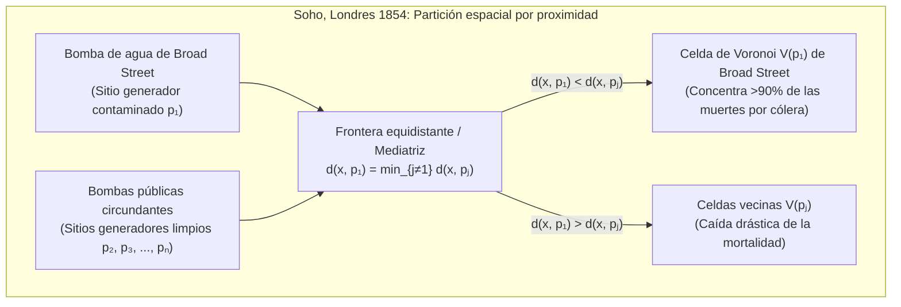

Cada milisegundo mientras caminamos por una ciudad con un teléfono inteligente en el bolsillo, los protocolos inalámbricos evalúan qué estación base celular ofrece el camino de señal más corto y ejecutan traspasos (*handovers*) invisibles. Cuando se realiza una llamada de emergencia, los sistemas de despacho dividen instantáneamente la red vial metropolitana para determinar qué ambulancia u hospital puede llegar al paciente en el tiempo mínimo. Y en toda la naturaleza —desde el pelaje reticulado de las jirafas, las venas de las alas de las libélulas y las columnas basálticas de la Calzada del Gigante hasta la red cósmica de supercúmulos de galaxias que rodean gigantescos vacíos intergalácticos— la materia se autoorganiza en mosaicos poligonales sorprendentemente similares.

Detrás de todos estos fenómenos en epidemiología espacial, planificación urbana, redes celulares 5G, generación de mallas para el Método de los Elementos Finitos (MEF), física del estado sólido y morfogénesis biológica subyace la estructura dual más fundamental de la geometría computacional: el <strong>Diagrama de Voronoi</strong> y su grafo dual planar, la <strong>Triangulación de Delaunay</strong>.

---

## 1. El brote de cólera de Broad Street en Londres (1854) y el nacimiento de las fronteras invisibles

A finales de agosto de 1854, un devastador brote de cólera azotó el distrito de Soho en Londres alrededor de Broad Street, causando más de 500 muertes en diez días (616 en total). Mientras el consenso médico defendía la *teoría miasmática* (transmisión por aire fétido), el médico <strong>Dr. John Snow (1813–1858)</strong> observó que los síntomas atacaban primero el tracto gastrointestinal y postuló que el cólera se transmitía a través de <strong>agua potable</strong> contaminada.

Snow registró cada fallecimiento como una barra negra en el mapa de Soho y marcó todas las bombas de agua públicas. Para refutar a los escépticos y explicar por qué el hospicio vecino (*Workhouse*, con pozo propio) y la cervecería Lion (donde los trabajadores bebían cerveza de malta gratuita y tenían un pozo profundo) apenas sufrieron bajas, Snow trazó una línea geométrica decisiva: <strong>el lugar geométrico de los puntos donde la distancia a pie hasta la bomba de Broad Street era exactamente igual a la distancia hasta la bomba pública alternativa más cercana</strong>.



Este polígono —la <strong>celda de Voronoi</strong> de la bomba de Broad Street— encerraba más del 90 % de todas las muertes por cólera. Al retirar la palanca de la bomba el 8 de septiembre de 1854, la epidemia cesó de inmediato. Este concepto fue descubierto independientemente por <strong>René Descartes (1644)</strong> en sus vórtices cósmicos (*Principia Philosophiae*), <strong>Peter Gustav Lejeune Dirichlet (1850)</strong> en formas cuadráticas (dominios de Dirichlet o celdas de Wigner-Seitz), <strong>Georgy Voronoi (1908)</strong> en dimensiones arbitrarias $\mathbb{R}^d$, y <strong>Alfred H. Thiessen (1911)</strong> en meteorología.

---

## 2. Definición matemática y complejidad lineal del Diagrama de Voronoi $\text{Vor}(P)$

### 2.1 Intersección de semiplanos cerrados y convexidad

Sea $P = \{p_1, p_2, \dots, p_n\} \subset \mathbb{R}^2$ ($n \ge 3$) un conjunto finito de $n$ puntos distintos (llamados <strong>sitios</strong> o <strong>generadores</strong>) en el plano euclidiano. Para dos sitios distintos $p_i, p_j \in P$ ($i \ne j$), la mediatriz $B(p_i, p_j) = \{x \in \mathbb{R}^2 \mid \|x - p_i\|_2 = \|x - p_j\|_2\}$ divide el plano en dos semiplanos cerrados. El semiplano de dominancia $H(p_i, p_j)$ es:

$$H(p_i, p_j) = \left\{ x \in \mathbb{R}^2 \;\middle|\; \|x - p_i\|_2 \le \|x - p_j\|_2 \right\} = \left\{ x \in \mathbb{R}^2 \;\middle|\; 2(p_j - p_i)^\top x \le \|p_j\|_2^2 - \|p_i\|_2^2 \right\}$$

La <strong>Celda de Voronoi</strong> $\mathcal{V}(p_i)$ asociada al sitio $p_i$ es la intersección de los $n-1$ semiplanos cerrados frente a todos los demás sitios $p_j$ ($j \ne i$):

$$\mathcal{V}(p_i) = \left\{ x \in \mathbb{R}^2 \;\middle|\; \|x - p_i\|_2 \le \|x - p_j\|_2 \;\;\forall j \ne i \right\} = \bigcap_{j \ne i} H(p_i, p_j)$$

Como la intersección de conjuntos convexos es convexa, toda celda de Voronoi euclidiana $\mathcal{V}(p_i)$ es un <strong>polígono convexo</strong> (acotado o no acotado). Además, $\mathcal{V}(p_i)$ es no acotada si y solo si $p_i$ se encuentra en la frontera de la envolvente convexa $\text{CH}(P)$.

### 2.2 Demostración de la complejidad lineal mediante la fórmula de Euler: $V \le 2n - 5$, $E \le 3n - 6$

Aunque existen $\binom{n}{2} = \Theta(n^2)$ pares de sitios, el número de vértices $V$ y aristas $E$ de $\text{Vor}(P)$ es estrictamente lineal en $n$.
<strong>【Demostración】</strong>: Compactificamos $\mathbb{R}^2$ sobre la esfera topológica $\mathbb{S}^2$ añadiendo un <strong>vértice en el infinito</strong> $v_\infty$ al que se conectan todos los rayos no acotados. Obtenemos un grafo planar conexo $G' = (V', E', F')$ con $V' = V + 1$ vértices, $E' = E$ aristas y $F' = n$ caras. Aplicando la <strong>Fórmula de Euler</strong> $V' - E' + F' = 2$:

$$(V + 1) - E + n = 2 \iff E = V + n - 1$$

Como cada vértice finito de Voronoi y $v_\infty$ son el punto de encuentro de al menos 3 celdas, el grado de cada uno de los $V + 1$ vértices cumple $\deg(v) \ge 3$. Por el lema del apretón de manos:

$$2E = \sum_{v \in V \cup \{v_\infty\}} \deg(v) \ge 3(V + 1) \implies V \le \frac{2}{3}E - 1$$

Sustituyendo en $E = V + n - 1$, obtenemos $E \le 3n - 6$ y $V \le 2n - 5$. Dado que cada arista es compartida por exactamente dos celdas, el <strong>número promedio de aristas por celda de Voronoi</strong> es:

$$\bar{k} = \frac{2E}{n} \le \frac{2(3n - 6)}{n} = 6 - \frac{12}{n} < 6$$

Sin importar cuántos millones de sitios haya en el plano, <strong>¡una celda de Voronoi tiene en promedio estrictamente menos de 6 lados!</strong>

| Variante de Voronoi | Función de distancia $d(x, p_i)$ | Geometría de la bisectriz | Convexidad y topología | Tamaño (peor caso) | Aplicaciones científicas y de ingeniería |
| :--- | :--- | :--- | :--- | :--- | :--- |
| Euclidiana estándar ($L_2$) | $\|x - p_i\|_2$ | Línea recta (mediatriz) | Siempre convexa y conexa | $\Theta(n)$ | Urgencias hospitalarias, meteorología (Thiessen), vecino más cercano |
| Manhattan ($L_1$) | $\|x_1 - x_i\| + \|x_2 - y_i\|$ | Polilínea horizontal, vertical y $\pm 45^\circ$ | Estrellada (no convexa) | $\Theta(n)$ | Despacho urbano en calles ortogonales, enrutamiento VLSI |
| Chebyshev ($L_\infty$) | $\max(\|x_1 - x_i\|, \|x_2 - y_i\|)$ | Polilínea horizontal, vertical y $\pm 45^\circ$ | Estrellada | $\Theta(n)$ | Grúas puente automatizadas, planificación robótica |
| <strong>Ponderado aditivo (AW)</strong> | $\|x - p_i\|_2 - w_i$ | Arcos de hipérbola | Estrellada y conexa | $\Theta(n)$ | Crecimiento cristalino asíncrono (Johnson-Mehl), localización TDOA |
| <strong>Ponderado multiplicativo</strong> | $\|x - p_i\|_2 / w_i$ | Arcos circulares (Círculos de Apolonio) | No convexa, puede desconectarse | $\Theta(n^2)$ | Celdas 5G heterogéneas, áreas comerciales |
| <strong>Diagrama de potencia (Laguerre)</strong> | $\|x - p_i\|_2^2 - r_i^2$ | Línea recta (eje radical) | Siempre convexa (puede ser vacía) | $\Theta(n)$ | Policristales, física de espumas, Transporte Óptimo (OT) |

---

## 3. El grafo dual: Triangulación de Delaunay $\text{DT}(P)$ y los tres teoremas de equivalencia

En 1934, el matemático ruso <strong>Boris Delaunay (Delone)</strong> definió el grafo dual planar de $\text{Vor}(P)$ conectando dos sitios $p_i, p_j \in P$ mediante un segmento si y solo si sus celdas $\mathcal{V}(p_i)$ y $\mathcal{V}(p_j)$ comparten una arista de Voronoi. En posición general (sin cuatro puntos cocíclicos), esto produce la <strong>Triangulación de Delaunay $\text{DT}(P)$</strong>, caracterizada por tres teoremas equivalentes:

1. <strong>Propiedad del círculo circunscrito vacío (Empty Circumcircle Property)</strong>: Una triangulación $\mathcal{T}$ es de Delaunay si y solo si el círculo circunscrito $C(\triangle p_i p_j p_k)$ de cada triángulo no contiene ningún otro sitio $p_l \in P$ en su interior estricto (su circuncentro es precisamente el vértice de Voronoi dual). Algebraicamente se verifica mediante el determinante $4 \times 4$ $\text{InCircle}(p_i, p_j, p_k, p_l) > 0$.
2. <strong>Optimalidad Max-Min de ángulos (Sibson 1978 y giro de aristas de Lawson 1972)</strong>: En el Método de los Elementos Finitos (MEF), los triángulos astilla (*sliver triangles*) degradan el número de condición $\kappa(K) \propto 1/\sin(\theta_{\min})$ de la matriz de rigidez. Entre todas las triangulaciones posibles de $P$, $\text{DT}(P)$ maximiza lexicográficamente el vector ordenado de ángulos interiores $\alpha(\mathcal{T})$, maximizando en particular el ángulo mínimo $\theta_{\min}$! El algoritmo de <strong>Lawson (*Edge Flip*)</strong> invierte iterativamente cualquier diagonal que viole la condición del círculo vacío y converge en a lo sumo $O(n^2)$ giros.
3. <strong>Levantamiento al paraboloide 3D (Edelsbrunner & Seidel 1986)</strong>: Proyectando verticalmente cada punto 2D $(x, y)$ sobre el paraboloide de revolución $\mathcal{P}: z = x^2 + y^2$ en $\mathbb{R}^3$ mediante $\Phi(x, y) = (x, y, x^2 + y^2)$, la ecuación de un círculo $(x-a)^2 + (y-b)^2 = R^2$ se transforma en un plano 3D $z = 2ax + 2by - (a^2 + b^2 - R^2)$. Por tanto, ¡la Triangulación de Delaunay $\text{DT}(P)$ es exactamente la proyección vertical sobre el plano $xy$ de la envolvente convexa inferior (*Lower Convex Hull*) de la nube de puntos levantada $\Phi(P)$ en $\mathbb{R}^3$!

---

## 4. Algoritmo de línea de barrido y «línea de playa» de Steven Fortune (1986) en $\Theta(n \log n)$

Un barrido plano ingenuo falla porque un punto situado por encima de la línea de barrido $\ell: y = y_{\text{sweep}}$ puede estar más cerca de un sitio aún no visitado debajo de $\ell$. En 1986, <strong>Steven Fortune</strong> resolvió esta paradoja manteniendo la <strong>línea de playa (*Beach Line*)</strong>: la envolvente inferior de las parábolas con foco en cada sitio visitado $p_i = (x_i, y_i)$ ($y_i > y_{\text{sweep}}$) y directriz $\ell$:

$$y = \frac{(x - x_i)^2}{2(y_i - y_{\text{sweep}})} + \frac{y_i + y_{\text{sweep}}}{2}$$

Los puntos de quiebre (*breakpoints*) entre dos arcos parabólicos adyacentes equidistan de ambos focos y de la directriz, trazando exactamente las aristas de Voronoi a medida que $\ell$ desciende. Usando un árbol binario de búsqueda equilibrado (con a lo sumo $2n-1$ arcos) y una cola de prioridad para procesar $n$ <strong>eventos de sitio (*Site Events*)</strong> y a lo sumo $2n-5$ eventos de círculo (*Circle Events*, colapso de un arco en el punto más bajo de un círculo circunscrito $y_{\text{sweep}} = y_c - R$ creando un vértice de Voronoi), el algoritmo alcanza el tiempo óptimo $\Theta(n \log n)$ y espacio $\Theta(n)$.

---

## 5. Relajación de Lloyd y Teselaciones de Voronoi Centroidales (CVT)

Para minimizar la energía de cuantización espacial (funcional de $k$-medias) ponderada por una densidad $\rho(x)$:

$$\mathcal{E}(P, \{\Omega_i\}) = \sum_{i=1}^n \int_{\Omega_i} \|x - p_i\|_2^2 \, \rho(x) \, dx$$

las regiones $\Omega_i$ deben ser celdas de Voronoi $\mathcal{V}(p_i)$ y cada generador $p_i$ debe coincidir con el <strong>centroide (centro de masa)</strong> $c_i$ de su propia celda ($p_i = c_i$), formando una <strong>Teselación de Voronoi Centroidal (CVT)</strong>. El <strong>algoritmo de Lloyd (Stuart Lloyd, 1957)</strong> mueve iterativamente cada sitio al centroide de su celda ($p_i^{(t+1)} \leftarrow c_i^{(t)}$), disminuyendo $\mathcal{E}$ monótonamente hacia una <strong>red hexagonal en panal de abejas</strong> óptima (teorema de Fejes Tóth, 1953).

A continuación se presenta una implementación completa en Python del recorte por semiplanos de Sutherland-Hodgman, integración exacta por el teorema de Green y relajación de Lloyd:

```python
import math
import random
from typing import List, Tuple

Point = Tuple[float, float]
Polygon = List[Point]

def clip_polygon_by_halfplane(poly: Polygon, p_i: Point, p_j: Point) -> Polygon:
    if not poly:
        return []
    xi, yi = p_i
    xj, yj = p_j
    a = 2.0 * (xj - xi)
    b = 2.0 * (yj - yi)
    c = (xj * xj + yj * yj) - (xi * xi + yi * yi)

    def signed_dist(pt: Point) -> float:
        return a * pt[0] + b * pt[1] - c

    out: Polygon = []
    m = len(poly)
    for k in range(m):
        cur_pt = poly[k]
        nxt_pt = poly[(k + 1) % m]
        d_cur = signed_dist(cur_pt)
        d_nxt = signed_dist(nxt_pt)
        if d_cur <= 1e-12:
            out.append(cur_pt)
            if d_nxt > 1e-12:
                t = d_cur / (d_cur - d_nxt)
                out.append((cur_pt[0] + t * (nxt_pt[0] - cur_pt[0]),
                            cur_pt[1] + t * (nxt_pt[1] - cur_pt[1])))
        elif d_nxt <= 1e-12:
            t = d_cur / (d_cur - d_nxt)
            out.append((cur_pt[0] + t * (nxt_pt[0] - cur_pt[0]),
                        cur_pt[1] + t * (nxt_pt[1] - cur_pt[1])))
    return out

def compute_clipped_voronoi(sites: List[Point], bbox: Tuple[float, float, float, float]) -> List[Polygon]:
    xmin, ymin, xmax, ymax = bbox
    base_rect: Polygon = [(xmin, ymin), (xmax, ymin), (xmax, ymax), (xmin, ymax)]
    cells: List[Polygon] = []
    for i in range(len(sites)):
        cell = base_rect
        for j in range(len(sites)):
            if i != j:
                cell = clip_polygon_by_halfplane(cell, sites[i], sites[j])
        cells.append(cell)
    return cells

def exact_polygon_moments(poly: Polygon, site: Point) -> Tuple[float, Point, float]:
    m = len(poly)
    if m < 3:
        return 0.0, site, 0.0
    area2, cx6, cy6, ixx12, iyy12 = 0.0, 0.0, 0.0, 0.0, 0.0
    for k in range(m):
        x0, y0 = poly[k]
        x1, y1 = poly[(k + 1) % m]
        cross = x0 * y1 - x1 * y0
        area2 += cross
        cx6 += (x0 + x1) * cross
        cy6 += (y0 + y1) * cross
        ixx12 += (x0 * x0 + x0 * x1 + x1 * x1) * cross
        iyy12 += (y0 * y0 + y0 * y1 + y1 * y1) * cross
    area = 0.5 * area2
    if abs(area) < 1e-15:
        return 0.0, site, 0.0
    cx, cy = cx6 / (3.0 * area2), cy6 / (3.0 * area2)
    i_origin = (ixx12 + iyy12) / 12.0
    sx, sy = site
    energy = i_origin - 2.0 * area * (cx * sx + cy * sy) + area * (sx * sx + sy * sy)
    return area, (cx, cy), energy

def simulate_lloyd_relaxation(n_sites: int = 25, iterations: int = 30) -> None:
    random.seed(42)
    bbox = (0.0, 0.0, 1.0, 1.0)
    sites = [(random.uniform(0.05, 0.95), random.uniform(0.05, 0.95)) for _ in range(n_sites)]
    for it in range(iterations + 1):
        cells = compute_clipped_voronoi(sites, bbox)
        total_energy, next_sites = 0.0, []
        for i, cell in enumerate(cells):
            _, centroid, energy = exact_polygon_moments(cell, sites[i])
            total_energy += energy
            next_sites.append(centroid)
        if it in (0, 5, 15, 30):
            print(f"Iter {it:2d}: Energy E = {total_energy:.8f}")
        sites = next_sites

if __name__ == "__main__":
    simulate_lloyd_relaxation()
```
