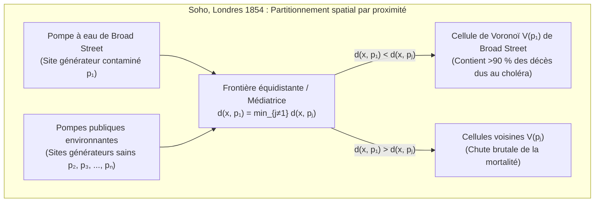

À chaque milliseconde où nous marchons dans une ville avec un smartphone en poche, les protocoles sans fil évaluent quelle station de base offre le chemin de propagation le plus court et exécutent des transferts intercellulaires (*handovers*) invisibles. Lorsqu'un appel d'urgence retentit, les systèmes de régulation médicale découpent instantanément le réseau routier pour identifier l'ambulance capable d'atteindre le patient en un temps minimal. Et dans la nature — du pelage réticulé des girafes aux nervures des ailes de libellules, des orgues basaltiques de la Chaussée des Géants jusqu'à la toile cosmique des superamas galactiques entourant les grands vides intergalactiques — la matière s'auto-organise en mosaïques polygonales d'une similitude frappante.

Derrière ces phénomènes issus de l'épidémiologie spatiale, de l'urbanisme, des télécommunications 5G, de la génération de maillages pour la méthode des éléments finis (MEF), de la physique du solide et de la morphogenèse biologique se cache la structure duale la plus fondamentale de la géométrie algorithmique (*Computational Geometry*) : le <strong>diagramme de Voronoï</strong> et son graphe dual planaire, la <strong>triangulation de Delaunay</strong>.

---

## 1. L'épidémie de choléra de Broad Street à Londres (1854) et la naissance des frontières invisibles

À la fin du mois d'août 1854, une foudroyante épidémie de choléra frappa le quartier de Soho à Londres, autour de Broad Street, faisant plus de 500 morts en dix jours (616 au total). Alors que les autorités médicales adhéraient au dogme de la *théorie des miasmes* (transmission par l'air vicié), le médecin <strong>John Snow (1813–1858)</strong> observa que les symptômes attaquaient exclusivement le système digestif et postula que le choléra se transmettait par de l'<strong>eau potable</strong> contaminée.

Snow reporta chaque décès sous forme de barre noire sur une carte de Soho et situa toutes les pompes à eau publiques. Pour réfuter ses détracteurs et expliquer pourquoi l'hospice (*Workhouse*, doté de son propre puits) et la brasserie Lion (dont les ouvriers buvaient de la bière gratuite et disposaient d'un puits profond) étaient épargnés, Snow traça sur sa carte une ligne géométrique décisive : <strong>le lieu des points situés à égale distance de marche entre la pompe de Broad Street et la pompe publique alternative la plus proche</strong>.



Ce polygone — la <strong>cellule de Voronoï</strong> de la pompe de Broad Street — englobait plus de 90 % des victimes ! Le retrait du levier de la pompe le 8 septembre 1854 stoppa net l'épidémie. Ce concept géométrique fut découvert indépendamment à plusieurs reprises : dès 1644 par <strong>René Descartes</strong> dans ses tourbillons cosmiques (*Principia Philosophiae*), en 1850 par <strong>Peter Gustav Lejeune Dirichlet</strong> pour les formes quadratiques (domaines de Dirichlet ou mailles de Wigner-Seitz en physique des cristaux), en 1908 par <strong>Georgy Voronoï</strong> en dimension quelconque $\mathbb{R}^d$, et en 1911 par le météorologue <strong>Alfred H. Thiessen</strong>.

---

## 2. Définition mathématique et complexité linéaire du diagramme de Voronoï $\text{Vor}(P)$

### 2.1 Intersection de demi-plans fermés et convexité

Soit $P = \{p_1, p_2, \dots, p_n\} \subset \mathbb{R}^2$ ($n \ge 3$) un ensemble fini de $n$ points distincts (appelés <strong>sites</strong> ou <strong>générateurs</strong>) du plan euclidien. Pour deux sites distincts $p_i, p_j \in P$ ($i \ne j$), la médiatrice $B(p_i, p_j) = \{x \in \mathbb{R}^2 \mid \|x - p_i\|_2 = \|x - p_j\|_2\}$ sépare le plan en deux demi-plans fermés. Le demi-plan de dominance $H(p_i, p_j)$ s'écrit :

$$H(p_i, p_j) = \left\{ x \in \mathbb{R}^2 \;\middle|\; \|x - p_i\|_2 \le \|x - p_j\|_2 \right\} = \left\{ x \in \mathbb{R}^2 \;\middle|\; 2(p_j - p_i)^\top x \le \|p_j\|_2^2 - \|p_i\|_2^2 \right\}$$

La <strong>cellule de Voronoï</strong> $\mathcal{V}(p_i)$ associée au site $p_i$ est l'intersection des $n-1$ demi-plans fermés face à tous les autres sites $p_j$ ($j \ne i$) :

$$\mathcal{V}(p_i) = \left\{ x \in \mathbb{R}^2 \;\middle|\; \|x - p_i\|_2 \le \|x - p_j\|_2 \;\;\forall j \ne i \right\} = \bigcap_{j \ne i} H(p_i, p_j)$$

Une intersection de demi-plans convexes étant convexe, toute cellule de Voronoï euclidienne est un <strong>polygone convexe</strong> (borné ou non). De plus, $\mathcal{V}(p_i)$ est non bornée si et seulement si $p_i$ appartient à la frontière de l'enveloppe convexe $\text{CH}(P)$.

### 2.2 Preuve de la complexité linéaire par la formule d'Euler : $V \le 2n - 5$, $E \le 3n - 6$

Bien qu'il existe $\binom{n}{2} = \Theta(n^2)$ médiatrices deux à deux, le nombre de sommets $V$ et d'arêtes $E$ de $\text{Vor}(P)$ est strictement linéaire en $n$.
<strong>【Démonstration】</strong> : En compactifiant le plan $\mathbb{R}^2$ sur la sphère topologique $\mathbb{S}^2$ par l'ajout d'un <strong>sommet à l'infini</strong> $v_\infty$ auquel se rattachent toutes les demi-droites non bornées, on obtient un graphe planaire connexe $G' = (V', E', F')$ avec $V' = V + 1$ sommets, $E' = E$ arêtes et $F' = n$ faces. La <strong>formule d'Euler</strong> $V' - E' + F' = 2$ donne :

$$(V + 1) - E + n = 2 \iff E = V + n - 1$$

Chaque sommet fini de Voronoï ainsi que $v_\infty$ étant à l'intersection d'au moins 3 cellules, le degré de chacun des $V + 1$ sommets vérifie $\deg(v) \ge 3$. Par le lemme des poignées de main :

$$2E = \sum_{v \in V \cup \{v_\infty\}} \deg(v) \ge 3(V + 1) \implies V \le \frac{2}{3}E - 1$$

En substituant dans $E = V + n - 1$, on obtient $E \le 3n - 6$ et $V \le 2n - 5$. Comme chaque arête borde exactement deux cellules, le <strong>nombre moyen d'arêtes par cellule de Voronoï</strong> est :

$$\bar{k} = \frac{2E}{n} \le \frac{2(3n - 6)}{n} = 6 - \frac{12}{n} < 6$$

Quel que soit le nombre de sites dans le plan, <strong>une cellule de Voronoï possède en moyenne strictement moins de 6 côtés !</strong>

| Variante de Voronoï | Distance $d(x, p_i)$ | Géométrie des bissectrices | Convexité & Topologie | Complexité (pire cas) | Applications scientifiques et industrielles |
| :--- | :--- | :--- | :--- | :--- | :--- |
| Euclidien standard ($L_2$) | $\|x - p_i\|_2$ | Droite (médiatrice) | Toujours convexe & connexe | $\Theta(n)$ | Urgences médicales, météorologie (Thiessen), plus proche voisin |
| Manhattan ($L_1$) | $\|x_1 - x_i\| + \|x_2 - y_i\|$ | Lignes brisées horizontales, verticales & $\pm 45^\circ$ | Étoilée (non convexe) | $\Theta(n)$ | Logistique urbaine sur réseau quadrillé, routage VLSI |
| Tchebychev ($L_\infty$) | $\max(\|x_1 - x_i\|, \|x_2 - y_i\|)$ | Lignes brisées horizontales, verticales & $\pm 45^\circ$ | Étoilée | $\Theta(n)$ | Ponts roulants d'entrepôts automatisés, robotique |
| <strong>Pondéré additif (AW)</strong> | $\|x - p_i\|_2 - w_i$ | Arcs d'hyperbole | Étoilée & connexe | $\Theta(n)$ | Croissance cristalline asynchrone (Johnson-Mehl), localisation TDOA |
| <strong>Pondéré multiplicatif (Apollonius)</strong> | $\|x - p_i\|_2 / w_i$ | Arcs de cercle (cercles d'Apollonius) | Non convexe, parfois disconnexe | $\Theta(n^2)$ | Cellules 5G de puissances inégales, aires de chalandise |
| <strong>Diagramme de puissance (Laguerre)</strong> | $\|x - p_i\|_2^2 - r_i^2$ | Droite (axe radical de deux cercles) | Toujours convexe (peut être vide) | $\Theta(n)$ | Polycristaux, physique des mousses, Transport Optimal (OT) |

---

## 3. Le graphe dual : la triangulation de Delaunay $\text{DT}(P)$ et ses trois théorèmes d'équivalence

En 1934, le mathématicien russe <strong>Boris Delaunay (Delone)</strong> introduisit le graphe dual planaire de $\text{Vor}(P)$ en reliant par un segment deux sites $p_i, p_j \in P$ si et seulement si leurs cellules $\mathcal{V}(p_i)$ et $\mathcal{V}(p_j)$ partagent une arête de Voronoï. En position générale (aucun quadruplet cocyclique), on obtient la <strong>triangulation de Delaunay $\text{DT}(P)$</strong>, caractérisée par trois propriétés équivalentes :

1. <strong>Propriété du cercle circonscrit vide (Empty Circumcircle Property)</strong> : Une triangulation $\mathcal{T}$ de $P$ est de Delaunay si et seulement si le cercle circonscrit $C(\triangle p_i p_j p_k)$ de chaque triangle ne contient aucun autre site $p_l \in P$ dans son intérieur strict (son centre étant le sommet de Voronoï dual équidistant de $p_i, p_j, p_k$). Ce test s'effectue via le déterminant $4 \times 4$ $\text{InCircle}(p_i, p_j, p_k, p_l) > 0$.
2. <strong>Optimalité Max-Min des angles (Sibson 1978 & basculement d'arête de Lawson 1972)</strong> : Dans la méthode des éléments finis (MEF), les triangles aplatis (« *sliver triangles* ») dégradent le conditionnement $\kappa(K) \propto 1/\sin(\theta_{\min})$ de la matrice de rigidité. Parmi toutes les triangulations de $P$, $\text{DT}(P)$ maximise lexicographiquement le vecteur trié des angles intérieurs $\alpha(\mathcal{T})$, et maximise en particulier le plus petit angle $\theta_{\min}$ ! L'algorithme de <strong>basculement d'arête de Lawson (*Edge Flip*)</strong> remplace toute diagonale violant la condition du cercle vide et converge en au plus $O(n^2)$ basculements.
3. <strong>Soulèvement sur le paraboloïde 3D (Edelsbrunner & Seidel 1986)</strong> : En projetant verticalement chaque point 2D $(x, y)$ sur le paraboloïde de révolution $\mathcal{P}: z = x^2 + y^2$ dans $\mathbb{R}^3$ via $\Phi(x, y) = (x, y, x^2 + y^2)$, l'équation d'un cercle $(x-a)^2 + (y-b)^2 = R^2$ devient celle d'un plan 3D $z = 2ax + 2by - (a^2 + b^2 - R^2)$. Ainsi, la triangulation de Delaunay $\text{DT}(P)$ est exactement la projection verticale sur le plan $xy$ de l'enveloppe convexe inférieure (*Lower Convex Hull*) du nuage de points soulevé $\Phi(P)$ dans $\mathbb{R}^3$ !

---

## 4. Algorithme de balayage et « ligne de plage » de Steven Fortune (1986) en $\Theta(n \log n)$

Lors d'un balayage par une droite horizontale $\ell: y = y_{\text{sweep}}$ descendant vers $-\infty$, un point situé au-dessus de $\ell$ peut être plus proche d'un futur site situé sous $\ell$. En 1986, <strong>Steven Fortune</strong> résolut ce paradoxe en maintenant la <strong>ligne de plage (*Beach Line*)</strong> : l'enveloppe inférieure des paraboles de foyer $p_i = (x_i, y_i)$ ($y_i > y_{\text{sweep}}$) et de directrice $\ell$ :

$$y = \frac{(x - x_i)^2}{2(y_i - y_{\text{sweep}})} + \frac{y_i + y_{\text{sweep}}}{2}$$

Les points de rupture (*breakpoints*) entre deux arcs paraboliques adjacents sont équidistants des deux foyers et de la directrice, et tracent donc exactement les arêtes de Voronoï au fur et à mesure que $\ell$ descend ! En gérant au plus $2n-1$ arcs dans un arbre binaire de recherche équilibré et en traitant $n$ <strong>événements de site (*Site Events*)</strong> et au plus $2n-5$ événements de cercle (*Circle Events*, disparition d'un arc au point le plus bas d'un cercle circonscrit $y_{\text{sweep}} = y_c - R$ créant un sommet de Voronoï) dans une file de priorité, l'algorithme atteint la borne optimale $\Theta(n \log n)$ en temps et $\Theta(n)$ en espace.

---

## 5. Relaxation de Lloyd et pavages de Voronoï centroïdaux (CVT)

Pour minimiser l'énergie de quantification spatiale (fonctionnelle des $k$-moyennes) pondérée par une densité $\rho(x)$ :

$$\mathcal{E}(P, \{\Omega_i\}) = \sum_{i=1}^n \int_{\Omega_i} \|x - p_i\|_2^2 \, \rho(x) \, dx$$

les régions $\Omega_i$ doivent être les cellules de Voronoï $\mathcal{V}(p_i)$ et chaque site $p_i$ doit coïncider avec le <strong>centroïde (centre de masse)</strong> $c_i$ de sa propre cellule ($p_i = c_i$), formant un <strong>pavage de Voronoï centroïdal (CVT)</strong>. L'<strong>algorithme de Lloyd (Stuart Lloyd, 1957)</strong> déplace itérativement chaque site vers le centroïde de sa cellule ($p_i^{(t+1)} \leftarrow c_i^{(t)}$), faisant décroître $\mathcal{E}$ de manière monotone vers un <strong>réseau hexagonal en nid d'abeille</strong> optimal (théorème de Fejes Tóth, 1953).

Voici une implémentation Python autonome du découpage par demi-plans de Sutherland-Hodgman, du théorème de Green et de la relaxation de Lloyd :

```python
import math
import random
from typing import List, Tuple

Point = Tuple[float, float]
Polygon = List[Point]

def clip_polygon_by_halfplane(poly: Polygon, p_i: Point, p_j: Point) -> Polygon:
    if not poly:
        return []
    xi, yi = p_i
    xj, yj = p_j
    a = 2.0 * (xj - xi)
    b = 2.0 * (yj - yi)
    c = (xj * xj + yj * yj) - (xi * xi + yi * yi)

    def signed_dist(pt: Point) -> float:
        return a * pt[0] + b * pt[1] - c

    out: Polygon = []
    m = len(poly)
    for k in range(m):
        cur_pt = poly[k]
        nxt_pt = poly[(k + 1) % m]
        d_cur = signed_dist(cur_pt)
        d_nxt = signed_dist(nxt_pt)
        if d_cur <= 1e-12:
            out.append(cur_pt)
            if d_nxt > 1e-12:
                t = d_cur / (d_cur - d_nxt)
                out.append((cur_pt[0] + t * (nxt_pt[0] - cur_pt[0]),
                            cur_pt[1] + t * (nxt_pt[1] - cur_pt[1])))
        elif d_nxt <= 1e-12:
            t = d_cur / (d_cur - d_nxt)
            out.append((cur_pt[0] + t * (nxt_pt[0] - cur_pt[0]),
                        cur_pt[1] + t * (nxt_pt[1] - cur_pt[1])))
    return out

def compute_clipped_voronoi(sites: List[Point], bbox: Tuple[float, float, float, float]) -> List[Polygon]:
    xmin, ymin, xmax, ymax = bbox
    base_rect: Polygon = [(xmin, ymin), (xmax, ymin), (xmax, ymax), (xmin, ymax)]
    cells: List[Polygon] = []
    for i in range(len(sites)):
        cell = base_rect
        for j in range(len(sites)):
            if i != j:
                cell = clip_polygon_by_halfplane(cell, sites[i], sites[j])
        cells.append(cell)
    return cells

def exact_polygon_moments(poly: Polygon, site: Point) -> Tuple[float, Point, float]:
    m = len(poly)
    if m < 3:
        return 0.0, site, 0.0
    area2, cx6, cy6, ixx12, iyy12 = 0.0, 0.0, 0.0, 0.0, 0.0
    for k in range(m):
        x0, y0 = poly[k]
        x1, y1 = poly[(k + 1) % m]
        cross = x0 * y1 - x1 * y0
        area2 += cross
        cx6 += (x0 + x1) * cross
        cy6 += (y0 + y1) * cross
        ixx12 += (x0 * x0 + x0 * x1 + x1 * x1) * cross
        iyy12 += (y0 * y0 + y0 * y1 + y1 * y1) * cross
    area = 0.5 * area2
    if abs(area) < 1e-15:
        return 0.0, site, 0.0
    cx, cy = cx6 / (3.0 * area2), cy6 / (3.0 * area2)
    i_origin = (ixx12 + iyy12) / 12.0
    sx, sy = site
    energy = i_origin - 2.0 * area * (cx * sx + cy * sy) + area * (sx * sx + sy * sy)
    return area, (cx, cy), energy

def simulate_lloyd_relaxation(n_sites: int = 25, iterations: int = 30) -> None:
    random.seed(42)
    bbox = (0.0, 0.0, 1.0, 1.0)
    sites = [(random.uniform(0.05, 0.95), random.uniform(0.05, 0.95)) for _ in range(n_sites)]
    for it in range(iterations + 1):
        cells = compute_clipped_voronoi(sites, bbox)
        total_energy, next_sites = 0.0, []
        for i, cell in enumerate(cells):
            _, centroid, energy = exact_polygon_moments(cell, sites[i])
            total_energy += energy
            next_sites.append(centroid)
        if it in (0, 5, 15, 30):
            print(f"Iter {it:2d}: Energy E = {total_energy:.8f}")
        sites = next_sites

if __name__ == "__main__":
    simulate_lloyd_relaxation()
```
