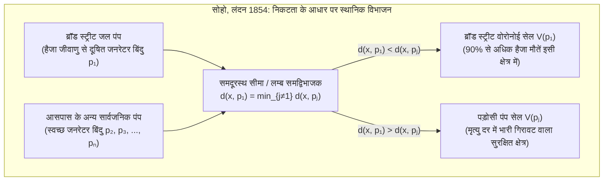

जब हम अपनी जेब में स्मार्टफोन लेकर शहर की सड़कों पर चलते हैं, तो हर मिलीसेकंड में वायरलेस प्रोटोकॉल यह गणना करते हैं कि कौन सा सेलुलर बेस स्टेशन सबसे छोटा सिग्नल पथ प्रदान करता है और अदृश्य क्षेत्रीय सीमाओं के पार निर्बाध हैंडओवर (*Handover*) निष्पादित करते हैं। जब कोई आपातकालीन कॉल आती है, तो डिस्पैच सिस्टम तुरंत सड़क नेटवर्क का विभाजन करके यह तय करता है कि कौन सी एम्बुलेंस या अस्पताल न्यूनतम समय में रोगी तक पहुँच सकता है। और प्रकृति में—जिराफ़ के जालीदार पैटर्न, ड्रैगनफ़्लाई के पंखों की शिराओं और 'जायंट्स कॉज़वे' के षट्कोणीय बेसाल्ट स्तंभों से लेकर विशाल अंतरगैलेक्टिक रिक्तियों (*Cosmic Voids*) को घेरने वाले आकाशगंगाओं के ब्रह्मांडीय जाल तक—पदार्थ आश्चर्यजनक रूप से समान बहुभुज मोज़ेक में स्वतः संगठित हो जाता है।

स्थानिक महामारी विज्ञान, शहरी नियोजन, 5G वायरलेस संचार, परिमित तत्व विधि (FEM) मेश निर्माण, ठोस अवस्था भौतिकी और जैविक आकृति विज्ञान (Morphogenesis) की इन सभी घटनाओं के पीछे कम्प्यूटेशनल ज्यामिति (*Computational Geometry*) की सबसे मौलिक द्वैत संरचना छिपी है: <strong>वोरोनोई आरेख (Voronoi Diagram)</strong> और इसका समतलीय द्वैत ग्राफ, <strong>डेलोने त्रिकोणीकरण (Delaunay Triangulation)</strong>।

---

## 1. 1854 का लंदन ब्रॉड स्ट्रीट हैजा प्रकोप और 'अदृश्य सीमाओं' का जन्म

अगस्त 1854 के अंत में, मध्य लंदन के सोहो (Soho) जिले में ब्रॉड स्ट्रीट के आसपास हैजा का भयानक प्रकोप हुआ, जिसमें दस दिनों के भीतर 500 से अधिक (कुल 616) निवासियों की मृत्यु हो गई। उस समय चिकित्सा जगत 'मियाज्मा सिद्धांत' (दूषित हवा से रोग फैलने) में विश्वास रखता था, लेकिन चिकित्सक <strong>डॉ. जॉन स्नो (Dr. John Snow, 1813–1858)</strong> ने देखा कि लक्षण हमेशा पाचन तंत्र से शुरू होते हैं, और उन्होंने परिकल्पना की कि हैजा दूषित <strong>पेयजल</strong> के माध्यम से फैलता है।

स्नो ने प्रत्येक मृतक के घर को मानचित्र पर काली पट्टी के रूप में अंकित किया और सभी सार्वजनिक जल पंपों को चिह्नित किया। संशयवादियों को गलत साबित करने और यह समझाने के लिए कि ब्रॉड स्ट्रीट के ठीक बगल में स्थित वर्कहाउस (जिसका अपना निजी कुआँ था) और लायन ब्रुअरी (जहाँ श्रमिकों को मुफ्त माल्ट बीयर मिलती थी) में लगभग कोई मृत्यु क्यों नहीं हुई, स्नो ने मानचित्र पर एक निर्णायक ज्यामितीय रेखा खींची: <strong>उन बिंदुओं का बिंदुपथ जहाँ से ब्रॉड स्ट्रीट पंप तक पैदल दूरी किसी भी अन्य निकटतम सार्वजनिक पंप तक की पैदल दूरी के ठीक बराबर थी</strong>।



यह बहुभुज ब्रॉड स्ट्रीट पंप का <strong>वोरोनोई सेल (Voronoi Cell)</strong> था, जिसके भीतर हैजा से होने वाली 90% से अधिक मौतें समाहित थीं! 8 सितंबर 1854 को पंप का हैंडल हटाए जाने के बाद महामारी तुरंत समाप्त हो गई। विज्ञान के इतिहास में इस ज्यामितीय विचार की स्वतंत्र रूप से कई बार खोज हुई: 1644 में <strong>रेने देकार्त (René Descartes)</strong> द्वारा ब्रह्मांडीय भंवर सिद्धांत (*Principia Philosophiae*) में, 1850 में <strong>पीटर गुस्ताव डिरिचलेट (Dirichlet)</strong> द्वारा द्विघात रूपों (ठोस अवस्था भौतिकी के विग्नर-सीट्ज़ सेल) में, 1908 में यूक्रेनी गणितज्ञ <strong>जॉर्जी वोरोनोई (Georgy Voronoi)</strong> द्वारा $d$-आयामी अंतरिक्ष $\mathbb{R}^d$ में, और 1911 में मौसम विज्ञानी <strong>अल्फ्रेड थियेसेन (Thiessen)</strong> द्वारा औसत वर्षा अनुमान के लिए।

---

## 2. वोरोनोई आरेख $\text{Vor}(P)$ की गणितीय परिभाषा और रैखिक जटिलता प्रमाण

### 2.1 बंद अर्ध-समतलों का प्रतिच्छेदन और उत्तलता

मान लीजिए कि यूक्लिडियन समतल $\mathbb{R}^2$ में $n$ भिन्न बिंदुओं (जिन्हें <strong>साइट्स</strong> या <strong>जनरेटर</strong> कहा जाता है) का एक परिमित समुच्चय $P = \{p_1, p_2, \dots, p_n\} \subset \mathbb{R}^2$ ($n \ge 3$) दिया गया है। किन्हीं दो भिन्न साइटों $p_i, p_j \in P$ ($i \ne j$) के लिए, लम्ब समद्विभाजक $B(p_i, p_j) = \{x \in \mathbb{R}^2 \mid \|x - p_i\|_2 = \|x - p_j\|_2\}$ समतल को दो बंद अर्ध-समतलों में विभाजित करता है। प्रभुत्व अर्ध-समतल (Dominance Half-Plane) $H(p_i, p_j)$ इस प्रकार परिभाषित है:

$$H(p_i, p_j) = \left\{ x \in \mathbb{R}^2 \;\middle|\; \|x - p_i\|_2 \le \|x - p_j\|_2 \right\} = \left\{ x \in \mathbb{R}^2 \;\middle|\; 2(p_j - p_i)^\top x \le \|p_j\|_2^2 - \|p_i\|_2^2 \right\}$$

साइट $p_i$ से जुड़ा <strong>वोरोनोई सेल</strong> $\mathcal{V}(p_i)$ अन्य सभी साइटों $p_j$ ($j \ne i$) के सापेक्ष $n-1$ बंद अर्ध-समतलों का प्रतिच्छेदन (Intersection) होता है:

$$\mathcal{V}(p_i) = \left\{ x \in \mathbb{R}^2 \;\middle|\; \|x - p_i\|_2 \le \|x - p_j\|_2 \;\;\forall j \ne i \right\} = \bigcap_{j \ne i} H(p_i, p_j)$$

चूँकि उत्तल समुच्चयों का प्रतिच्छेदन सदैव उत्तल होता है, प्रत्येक यूक्लिडियन वोरोनोई सेल $\mathcal{V}(p_i)$ एक <strong>उत्तल बहुभुज (Convex Polygon)</strong> होता है। इसके अलावा, $\mathcal{V}(p_i)$ अपरिबद्ध (Unbounded) होता है यदि और केवल यदि $p_i$ उत्तल आवरण $\text{CH}(P)$ की सीमा पर स्थित हो।

### 2.2 ऑयलर के सूत्र द्वारा रैखिक जटिलता का प्रमाण: $V \le 2n - 5$, $E \le 3n - 6$

यद्यपि साइटों के $\binom{n}{2} = \Theta(n^2)$ युग्म होते हैं, फिर भी समतलीय वोरोनोई आरेख के शीर्षों $V$ और किनारों $E$ की संख्या $n$ में सख्ती से रैखिक होती है।
<strong>【प्रमाण】</strong>: सभी अपरिबद्ध वोरोनोई किरणों को एक कृत्रिम <strong>अनंत स्थित शीर्ष</strong> $v_\infty$ से जोड़कर समतल $\mathbb{R}^2$ को स्थलाकृतिक गोले $\mathbb{S}^2$ पर संहत (Compactify) करें। इससे हमें एक संबद्ध समतलीय ग्राफ $G' = (V', E', F')$ प्राप्त होता है जिसमें $V' = V + 1$ शीर्ष, $E' = E$ किनारे और $F' = n$ फलक हैं। <strong>ऑयलर के बहुफलकीय सूत्र</strong> $V' - E' + F' = 2$ से:

$$(V + 1) - E + n = 2 \iff E = V + n - 1$$

चूँकि प्रत्येक परिमित वोरोनोई शीर्ष और $v_\infty$ पर कम से कम 3 वोरोनोई सेल मिलते हैं, इसलिए सभी $V + 1$ शीर्षों की कोटि $\deg(v) \ge 3$ होती है। हैंडशेकिंग लेम्मा (Handshaking Lemma) द्वारा:

$$2E = \sum_{v \in V \cup \{v_\infty\}} \deg(v) \ge 3(V + 1) \implies V \le \frac{2}{3}E - 1$$

इसे $E = V + n - 1$ में प्रतिस्थापित करने पर $E \le 3n - 6$ और $V \le 2n - 5$ प्राप्त होता है। चूँकि प्रत्येक किनारा ठीक दो सेलों द्वारा साझा किया जाता है, इसलिए <strong>प्रति वोरोनोई सेल किनारों की औसत संख्या</strong> है:

$$\bar{k} = \frac{2E}{n} \le \frac{2(3n - 6)}{n} = 6 - \frac{12}{n} < 6$$

समतल पर चाहे कितने भी करोड़ बिंदु क्यों न हों, <strong>एक वोरोनोई सेल में औसतन हमेशा 6 से कम भुजाएँ होती हैं!</strong>

| वोरोनोई प्रकार | दूरी फलन $d(x, p_i)$ | समद्विभाजक की ज्यामिति | उत्तलता और संबद्धता | अधिकतम जटिलता | प्रमुख वैज्ञानिक और इंजीनियरिंग अनुप्रयोग |
| :--- | :--- | :--- | :--- | :--- | :--- |
| मानक यूक्लिडियन ($L_2$) | $\|x - p_i\|_2$ | सीधी रेखा (लम्ब समद्विभाजक) | सदैव उत्तल और संबद्ध | $\Theta(n)$ | आपातकालीन अस्पताल क्षेत्र, मौसम विज्ञान (थियेसेन), निकटतम पड़ोसी खोज |
| मैनहट्टन ($L_1$) | $\|x_1 - x_i\| + \|x_2 - y_i\|$ | क्षैतिज, ऊर्ध्वाधर और $\pm 45^\circ$ बहु-रेखा | तारा-आकार (गैर-उत्तल) | $\Theta(n)$ | ग्रिड शहरों में लॉजिस्टिक्स, VLSI चिप राउटिंग |
| चेबिशेव ($L_\infty$) | $\max(\|x_1 - x_i\|, \|x_2 - y_i\|)$ | क्षैतिज, ऊर्ध्वाधर और $\pm 45^\circ$ बहु-रेखा | तारा-आकार | $\Theta(n)$ | स्वचालित गोदाम क्रेन, रोबोट पथ नियोजन |
| <strong>योगात्मक भारित (AW)</strong> | $\|x - p_i\|_2 - w_i$ | अतिपरवलयिक चाप (Hyperbola) | तारा-आकार और संबद्ध | $\Theta(n)$ | अतुल्यकालिक क्रिस्टल वृद्धि (जॉनसन-मेहल), TDOA नेविगेशन |
| <strong>गुणात्मक भारित (अपोलोनियस)</strong> | $\|x - p_i\|_2 / w_i$ | वृत्ताकार चाप (अपोलोनियस वृत्त) | गैर-उत्तल, असंबद्ध संभव | $\Theta(n^2)$ | भिन्न शक्ति वाले 5G टावर, खुदरा व्यापार क्षेत्र विश्लेषण |
| <strong>पावर आरेख (लागेर / Power)</strong> | $\|x - p_i\|_2^2 - r_i^2$ | सीधी रेखा (मूलाक्ष / Radical Axis) | सदैव उत्तल (रिक्त सेल संभव) | $\Theta(n)$ | बहुक्रिस्टलीय धातु, फोम भौतिकी, इष्टतम परिवहन (Optimal Transport) |

---

## 3. द्वैत ग्राफ: डेलोने त्रिकोणीकरण $\text{DT}(P)$ और तीन तुल्यता प्रमेय

1934 में रूसी गणितज्ञ <strong>बोरिस डेलोने (Boris Delaunay / Delone)</strong> ने $\text{Vor}(P)$ के समतलीय द्वैत ग्राफ को परिभाषित किया: दो साइटों $p_i, p_j \in P$ को एक रेखाखंड से तभी जोड़ा जाता है जब उनके वोरोनोई सेल एक साझा किनारा रखते हों। सामान्य स्थिति में, यह <strong>डेलोने त्रिकोणीकरण $\text{DT}(P)$</strong> बनाता है, जो तीन समतुल्य प्रमेयों द्वारा अभिलक्षित होता है:

1. <strong>रिक्त परिवृत्त गुणधर्म (Empty Circumcircle Property)</strong>: कोई त्रिकोणीकरण $\mathcal{T}$ डेलोने त्रिकोणीकरण होता है यदि और केवल यदि प्रत्येक त्रिभुज $\triangle p_i p_j p_k$ के परिवृत्त $C(\triangle p_i p_j p_k)$ के सख्त आंतरिक भाग में $P$ का कोई अन्य बिंदु $p_l$ न हो (क्योंकि परिवृत्त का केंद्र ही द्वैत वोरोनोई शीर्ष है)। इसे $4 \times 4$ सारणिक $\text{InCircle}(p_i, p_j, p_k, p_l) > 0$ द्वारा परखा जाता है।
2. <strong>अधिकतम-न्यूनतम कोण इष्टतमता (सिबसन 1978 और लॉसन एज-फ्लिप 1972)</strong>: परिमित तत्व विधि (FEM) में चपटे 'स्लिवर त्रिभुज' (*sliver triangles*) कठोरता आव्यूह की कंडीशन संख्या $\kappa(K) \propto 1/\sin(\theta_{\min})$ को बिगाड़ देते हैं। $P$ के सभी संभावित त्रिकोणीकरणों में, $\text{DT}(P)$ आरोही क्रम में व्यवस्थित आंतरिक कोण सदिश $\alpha(\mathcal{T})$ को शब्दकोशीय रूप से अधिकतम करता है, विशेष रूप से न्यूनतम कोण $\theta_{\min}$ को अधिकतम करता है! <strong>लॉसन का एज फ्लिप (*Edge Flip*)</strong> रिक्त वृत्त शर्त का उल्लंघन करने वाले किसी भी विकर्ण को पलट कर अधिकतम $O(n^2)$ चरणों में $\text{DT}(P)$ पर अभिसरित हो जाता है।
3. <strong>3D परवलयज लिफ्टिंग मानचित्र (Edelsbrunner & Seidel 1986)</strong>: प्रत्येक 2D बिंदु $(x, y)$ को $\Phi(x, y) = (x, y, x^2 + y^2)$ के माध्यम से $\mathbb{R}^3$ में परवलयज $\mathcal{P}: z = x^2 + y^2$ पर प्रक्षेपित करने पर, वृत्त का समीकरण $(x-a)^2 + (y-b)^2 = R^2$ एक 3D समतल समीकरण $z = 2ax + 2by - (a^2 + b^2 - R^2)$ में बदल जाता है। अतः डेलोने त्रिकोणीकरण $\text{DT}(P)$ वास्तव में $\mathbb{R}^3$ में उठाए गए बिंदु समुच्चय $\Phi(P)$ के निचले उत्तल आवरण (*Lower Convex Hull*) का $xy$-समतल पर ऊर्ध्वाधर प्रक्षेपण है!

---

## 4. स्टीवन फॉर्च्यून का स्वीप-लाइन और 'बीच-लाइन' एल्गोरिदम (1986): इष्टतम $\Theta(n \log n)$ निर्माण

साधारण समतल स्वीप विफल हो जाता है क्योंकि स्वीप-लाइन $\ell: y = y_{\text{sweep}}$ के ऊपर स्थित बिंदु $\ell$ के नीचे स्थित किसी अनदेखे भविष्य के बिंदु के अधिक निकट हो सकता है। 1986 में <strong>स्टीवन फॉर्च्यून (Steven Fortune)</strong> ने <strong>बीच लाइन (*Beach Line*)</strong>—प्रत्येक देखे गए बिंदु $p_i = (x_i, y_i)$ ($y_i > y_{\text{sweep}}$) को नाभि (Focus) और स्वीप-लाइन $\ell$ को नियता (Directrix) मानकर बनने वाले परवलयों के निचले आवरण—को बनाए रखकर इस विरोधाभास को हल किया:

$$y = \frac{(x - x_i)^2}{2(y_i - y_{\text{sweep}})} + \frac{y_i + y_{\text{sweep}}}{2}$$

दो आसन्न परवलयिक चापों के बीच के ब्रेकपॉइंट दोनों नाभियों और नियता से समदूरस्थ होते हैं, और $\ell$ के नीचे जाने पर वोरोनोई किनारों को सटीक रूप से ट्रेस करते हैं! संतुलित बाइनरी सर्च ट्री (अधिकतम $2n-1$ चाप) और प्राथमिकता क्यू में $n$ <strong>साइट इवेंट्स (*Site Events*)</strong> तथा अधिकतम $2n-5$ सर्कल इवेंट्स (*Circle Events* — परिवृत्त के सबसे निचले बिंदु $y_{\text{sweep}} = y_c - R$ पर चाप का लुप्त होकर वोरोनोई शीर्ष बनाना) को प्रोसेस करके यह एल्गोरिदम इष्टतम $\Theta(n \log n)$ समय और $\Theta(n)$ स्थान प्राप्त करता है।

---

## 5. लॉयड का विश्राम (Lloyd's Relaxation) और सेंट्रोइडल वोरोनोई टेसेलेशन (CVT)

घनत्व फलन $\rho(x)$ के अंतर्गत स्थानिक परिमाणीकरण ऊर्जा ($k$-Means फलनक) को न्यूनतम करने के लिए:

$$\mathcal{E}(P, \{\Omega_i\}) = \sum_{i=1}^n \int_{\Omega_i} \|x - p_i\|_2^2 \, \rho(x) \, dx$$

प्रत्येक क्षेत्र $\Omega_i$ वोरोनोई सेल $\mathcal{V}(p_i)$ होना चाहिए और प्रत्येक जनरेटर $p_i$ अपने स्वयं के सेल के <strong>द्रव्यमान केंद्र (Centroid)</strong> $c_i$ पर स्थित होना चाहिए ($p_i = c_i$), जिसे <strong>सेंट्रोइडल वोरोनोई टेसेलेशन (CVT)</strong> कहते हैं। <strong>लॉयड का एल्गोरिदम (Stuart Lloyd, 1957)</strong> पुनरावृत्त रूप से प्रत्येक साइट को उसके सेल के केंद्रक पर ले जाता है ($p_i^{(t+1)} \leftarrow c_i^{(t)}$), जिससे ऊर्जा $\mathcal{E}$ एकदिष्ट रूप से घटती हुई <strong>नियमित षट्कोणीय मधुकोश जालक (Honeycomb Lattice)</strong> पर अभिसरित होती है (फेजेस टॉट प्रमेय, 1953)।

नीचे सदरलैंड-हॉजमैन अर्ध-समतल क्लिपिंग, ग्रीन के प्रमेय (शूलेस सूत्र) और लॉयड विश्राम का पूर्ण Python कार्यान्वयन दिया गया है:

```python
import math
import random
from typing import List, Tuple

Point = Tuple[float, float]
Polygon = List[Point]

def clip_polygon_by_halfplane(poly: Polygon, p_i: Point, p_j: Point) -> Polygon:
    if not poly:
        return []
    xi, yi = p_i
    xj, yj = p_j
    a = 2.0 * (xj - xi)
    b = 2.0 * (yj - yi)
    c = (xj * xj + yj * yj) - (xi * xi + yi * yi)

    def signed_dist(pt: Point) -> float:
        return a * pt[0] + b * pt[1] - c

    out: Polygon = []
    m = len(poly)
    for k in range(m):
        cur_pt = poly[k]
        nxt_pt = poly[(k + 1) % m]
        d_cur = signed_dist(cur_pt)
        d_nxt = signed_dist(nxt_pt)
        if d_cur <= 1e-12:
            out.append(cur_pt)
            if d_nxt > 1e-12:
                t = d_cur / (d_cur - d_nxt)
                out.append((cur_pt[0] + t * (nxt_pt[0] - cur_pt[0]),
                            cur_pt[1] + t * (nxt_pt[1] - cur_pt[1])))
        elif d_nxt <= 1e-12:
            t = d_cur / (d_cur - d_nxt)
            out.append((cur_pt[0] + t * (nxt_pt[0] - cur_pt[0]),
                        cur_pt[1] + t * (nxt_pt[1] - cur_pt[1])))
    return out

def compute_clipped_voronoi(sites: List[Point], bbox: Tuple[float, float, float, float]) -> List[Polygon]:
    xmin, ymin, xmax, ymax = bbox
    base_rect: Polygon = [(xmin, ymin), (xmax, ymin), (xmax, ymax), (xmin, ymax)]
    cells: List[Polygon] = []
    for i in range(len(sites)):
        cell = base_rect
        for j in range(len(sites)):
            if i != j:
                cell = clip_polygon_by_halfplane(cell, sites[i], sites[j])
        cells.append(cell)
    return cells

def exact_polygon_moments(poly: Polygon, site: Point) -> Tuple[float, Point, float]:
    m = len(poly)
    if m < 3:
        return 0.0, site, 0.0
    area2, cx6, cy6, ixx12, iyy12 = 0.0, 0.0, 0.0, 0.0, 0.0
    for k in range(m):
        x0, y0 = poly[k]
        x1, y1 = poly[(k + 1) % m]
        cross = x0 * y1 - x1 * y0
        area2 += cross
        cx6 += (x0 + x1) * cross
        cy6 += (y0 + y1) * cross
        ixx12 += (x0 * x0 + x0 * x1 + x1 * x1) * cross
        iyy12 += (y0 * y0 + y0 * y1 + y1 * y1) * cross
    area = 0.5 * area2
    if abs(area) < 1e-15:
        return 0.0, site, 0.0
    cx, cy = cx6 / (3.0 * area2), cy6 / (3.0 * area2)
    i_origin = (ixx12 + iyy12) / 12.0
    sx, sy = site
    energy = i_origin - 2.0 * area * (cx * sx + cy * sy) + area * (sx * sx + sy * sy)
    return area, (cx, cy), energy

def simulate_lloyd_relaxation(n_sites: int = 25, iterations: int = 30) -> None:
    random.seed(42)
    bbox = (0.0, 0.0, 1.0, 1.0)
    sites = [(random.uniform(0.05, 0.95), random.uniform(0.05, 0.95)) for _ in range(n_sites)]
    for it in range(iterations + 1):
        cells = compute_clipped_voronoi(sites, bbox)
        total_energy, next_sites = 0.0, []
        for i, cell in enumerate(cells):
            _, centroid, energy = exact_polygon_moments(cell, sites[i])
            total_energy += energy
            next_sites.append(centroid)
        if it in (0, 5, 15, 30):
            print(f"Iter {it:2d}: Energy E = {total_energy:.8f}")
        sites = next_sites

if __name__ == "__main__":
    simulate_lloyd_relaxation()
```
