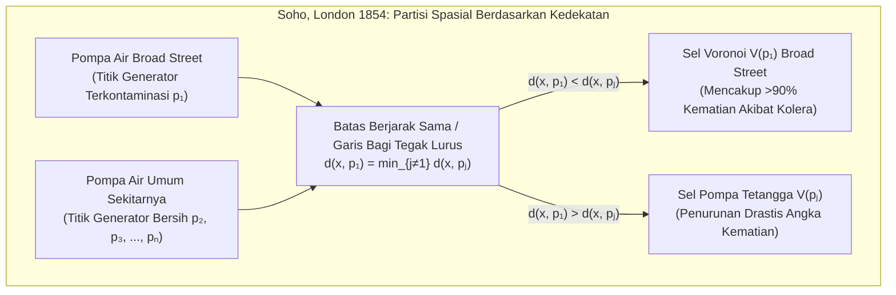

Setiap milidetik saat kita berjalan di kota dengan ponsel pintar di saku, protokol nirkabel menghitung menara *base transceiver station* (BTS) mana yang memberikan jalur sinyal terpendek dan melakukan *handover* mulus melintasi batas-batas wilayah tak kasatmata. Ketika panggilan darurat 119 atau 911 berdering, sistem pengiriman medis langsung mempartisi jaringan jalan raya untuk menentukan ambulans atau rumah sakit mana yang dapat menjangkau pasien dalam waktu tempuh minimum. Di alam bebas—mulai dari corak jaring jerapah, struktur tulang sayap capung, dan kolom basal heksagonal *Giant's Causeway* hingga jaring kosmik gugus galaksi yang mengelilingi kehampaan antargalaksi (*Cosmic Voids*)—materi mengatur dirinya sendiri menjadi mosaik poligonal yang sangat serupa.

Di balik semua fenomena dalam epidemiologi spasial, perencanaan kota, jaringan seluler 5G, pembuatan *mesh* Metode Elemen Hingga (FEM), fisika zat padat, dan morfogenesis biologis ini terdapat struktur dual paling fundamental dalam geometri komputasional (*Computational Geometry*): <strong>Diagram Voronoi</strong> dan graf dual planarnya, <strong>Triangulasi Delaunay</strong>.

---

## 1. Wabah Kolera Broad Street London (1854) dan Lahirnya Batas Tak Kasatmata

Pada akhir Agustus 1854, wabah kolera ganas melanda distrik Soho di London sekitar Broad Street, menewaskan lebih dari 500 warga dalam sepuluh hari (total 616 jiwa). Saat itu otoritas medis menganut *Teori Miasma* (penularan melalui udara buruk), namun dokter <strong>Dr. John Snow (1813–1858)</strong> mengamati bahwa gejala awal selalu menyerang saluran pencernaan dan mengajukan hipotesis bahwa kolera ditularkan melalui <strong>air minum</strong> yang terkontaminasi.

Snow memetakan setiap kematian sebagai balok hitam pada peta jalan Soho dan menandai semua pompa air umum. Untuk membantah para skeptis serta menjelaskan mengapa rumah miskin (*Workhouse*, yang memiliki sumur sendiri) dan pabrik bir Lion (di mana pekerja minum bir gratis dan memiliki sumur dalam) nyaris tanpa korban, Snow menggambar garis batas geometris yang menentukan: <strong>tempat kedudukan titik-titik di mana jarak berjalan kaki ke pompa Broad Street sama persis dengan jarak ke pompa air alternatif terdekat</strong>.



Poligon tersebut—<strong>sel Voronoi</strong> dari pompa Broad Street—melingkupi lebih dari 90% kematian kolera! Ketika gagang pompa dilepas pada 8 September 1854, wabah langsung berhenti. Konsep ini ditemukan secara independen oleh <strong>René Descartes (1644)</strong> melalui vorteks kosmik (*Principia Philosophiae*), <strong>Peter Gustav Lejeune Dirichlet (1850)</strong> (domain Dirichlet atau sel Wigner-Seitz), <strong>Georgy Voronoi (1908)</strong> untuk dimensi $\mathbb{R}^d$, dan <strong>Alfred H. Thiessen (1911)</strong> dalam meteorologi.

---

## 2. Definisi Matematis dan Kompleksitas Linier Diagram Voronoi $\text{Vor}(P)$

### 2.1 Irisan Setengah-Bidang Tertutup dan Konveksitas

Misalkan $P = \{p_1, p_2, \dots, p_n\} \subset \mathbb{R}^2$ ($n \ge 3$) adalah himpunan berhingga dari $n$ titik berbeda (disebut <strong>situs</strong> atau <strong>generator</strong>) pada bidang Euklides. Untuk dua situs berbeda $p_i, p_j \in P$ ($i \ne j$), garis bagi tegak lurus $B(p_i, p_j) = \{x \in \mathbb{R}^2 \mid \|x - p_i\|_2 = \|x - p_j\|_2\}$ membagi bidang menjadi dua setengah-bidang tertutup. Setengah-bidang dominasi $H(p_i, p_j)$ adalah:

$$H(p_i, p_j) = \left\{ x \in \mathbb{R}^2 \;\middle|\; \|x - p_i\|_2 \le \|x - p_j\|_2 \right\} = \left\{ x \in \mathbb{R}^2 \;\middle|\; 2(p_j - p_i)^\top x \le \|p_j\|_2^2 - \|p_i\|_2^2 \right\}$$

<strong>Sel Voronoi</strong> $\mathcal{V}(p_i)$ dari situs $p_i$ adalah irisan dari $n-1$ setengah-bidang tertutup terhadap semua situs lainnya $p_j$ ($j \ne i$):

$$\mathcal{V}(p_i) = \left\{ x \in \mathbb{R}^2 \;\middle|\; \|x - p_i\|_2 \le \|x - p_j\|_2 \;\;\forall j \ne i \right\} = \bigcap_{j \ne i} H(p_i, p_j)$$

Karena irisan himpunan konveks selalu konveks, setiap sel Voronoi Euklides $\mathcal{V}(p_i)$ merupakan <strong>poligon konveks</strong>. Selain itu, $\mathcal{V}(p_i)$ tidak terbatas (*unbounded*) jika dan hanya jika $p_i$ berada pada batas selubung konveks $\text{CH}(P)$.

### 2.2 Bukti Kompleksitas Linier via Rumus Euler: $V \le 2n - 5$, $E \le 3n - 6$

Meskipun terdapat $\binom{n}{2} = \Theta(n^2)$ pasang situs, jumlah simpul (*vertices*) $V$ dan sisi (*edges*) $E$ pada $\text{Vor}(P)$ bersifat linier terhadap $n$.
<strong>【Bukti】</strong>: Kompaktifikasi bidang $\mathbb{R}^2$ ke bola topologi $\mathbb{S}^2$ dengan menambahkan satu <strong>simpul di tak hingga</strong> $v_\infty$ tempat semua sinar Voronoi tak terbatas bertemu. Kita memperoleh graf planar terhubung $G' = (V', E', F')$ dengan $V' = V + 1$ simpul, $E' = E$ sisi, dan $F' = n$ muka. Berdasarkan <strong>Rumus Euler</strong> $V' - E' + F' = 2$:

$$(V + 1) - E + n = 2 \iff E = V + n - 1$$

Karena setiap simpul Voronoi berhingga dan $v_\infty$ merupakan titik temu sedikitnya 3 sel, derajat setiap simpul dari $V + 1$ simpul memenuhi $\deg(v) \ge 3$. Berdasarkan *Handshaking Lemma*:

$$2E = \sum_{v \in V \cup \{v_\infty\}} \deg(v) \ge 3(V + 1) \implies V \le \frac{2}{3}E - 1$$

Substitusi ke $E = V + n - 1$ menghasilkan $E \le 3n - 6$ dan $V \le 2n - 5$. Karena setiap sisi dibagi oleh tepat dua sel, <strong>rata-rata jumlah sisi per sel Voronoi</strong> adalah:

$$\bar{k} = \frac{2E}{n} \le \frac{2(3n - 6)}{n} = 6 - \frac{12}{n} < 6$$

Berapa pun jutaan titik yang ada di bidang, <strong>rata-rata sel Voronoi selalu memiliki kurang dari 6 sisi!</strong>

| Varian Voronoi | Fungsi Jarak $d(x, p_i)$ | Geometri Garis Bagi | Konveksitas & Topologi | Ukuran Kasus Terburuk | Aplikasi Sains & Rekayasa Utama |
| :--- | :--- | :--- | :--- | :--- | :--- |
| Euklides Standar ($L_2$) | $\|x - p_i\|_2$ | Garis lurus (bisektor tegak lurus) | Selalu konveks & terhubung | $\Theta(n)$ | Wilayah RS darurat, meteorologi (Thiessen), pencarian tetangga terdekat |
| Manhattan ($L_1$) | $\|x_1 - x_i\| + \|x_2 - y_i\|$ | Polilinier horizontal, vertikal & $\pm 45^\circ$ | Berbentuk bintang (non-konveks) | $\Theta(n)$ | Logistik kota jalan grid, perutean chip VLSI |
| Chebyshev ($L_\infty$) | $\max(\|x_1 - x_i\|, \|x_2 - y_i\|)$ | Polilinier horizontal, vertikal & $\pm 45^\circ$ | Berbentuk bintang | $\Theta(n)$ | Derek gudang otomatis, perencanaan gerak robot |
| <strong>Berbobot Aditif (AW)</strong> | $\|x - p_i\|_2 - w_i$ | Busur hiperbola | Berbentuk bintang & terhubung | $\Theta(n)$ | Pertumbuhan kristal asinkron (Johnson-Mehl), lokalisasi TDOA |
| <strong>Berbobot Multiplikatif</strong> | $\|x - p_i\|_2 / w_i$ | Busur lingkaran (Lingkaran Apollonius) | Non-konveks, dapat terputus | $\Theta(n^2)$ | Sel 5G daya berbeda, analisis area pasar ritel |
| <strong>Diagram Daya (Laguerre)</strong> | $\|x - p_i\|_2^2 - r_i^2$ | Garis lurus (sumbu radikal lingkaran) | Selalu konveks (bisa kosong) | $\Theta(n)$ | Material polikristalin, fisika busa, Transportasi Optimal (OT) |

---

## 3. Graf Dual: Triangulasi Delaunay $\text{DT}(P)$ dan Tiga Teorema Ekuivalensi

Pada tahun 1934, matematikawan Rusia <strong>Boris Delaunay (Delone)</strong> mendefinisikan graf dual planar dari $\text{Vor}(P)$ dengan menghubungkan dua situs $p_i, p_j \in P$ jika dan hanya jika sel Voronoi mereka berbagi sisi bersama. Pada posisi umum, graf ini membentuk <strong>Triangulasi Delaunay $\text{DT}(P)$</strong> yang memenuhi tiga teorema ekuivalensi:

1. <strong>Sifat Lingkaran Luar Kosong (Empty Circumcircle Property)</strong>: Suatu triangulasi $\mathcal{T}$ adalah Delaunay jika dan hanya jika bagian dalam lingkaran luar $C(\triangle p_i p_j p_k)$ dari setiap segitiga tidak memuat situs lain $p_l \in P$ (pusat lingkaran luarnya adalah simpul Voronoi dual). Diuji melalui determinan $4 \times 4$ $\text{InCircle}(p_i, p_j, p_k, p_l) > 0$.
2. <strong>Optimalitas Sudut Max-Min (Sibson 1978 & *Edge Flip* Lawson 1972)</strong>: Dalam Metode Elemen Hingga (FEM), segitiga pipih (*sliver triangles*) merusak bilangan kondisi matriks kekakuan $\kappa(K) \propto 1/\sin(\theta_{\min})$. Di antara semua kemungkinan triangulasi dari $P$, $\text{DT}(P)$ memaksimumkan secara leksikografis vektor terurut sudut dalam $\alpha(\mathcal{T})$, khususnya memaksimumkan sudut terkecil $\theta_{\min}$! Algoritma <strong>Lawson (*Edge Flip*)</strong> membalik diagonal yang melanggar syarat lingkaran kosong dan konvergen dalam paling banyak $O(n^2)$ langkah.
3. <strong>Pemetaan Angkat Paraboloida 3D (Edelsbrunner & Seidel 1986)</strong>: Dengan memproyeksikan setiap titik 2D $(x, y)$ secara vertikal ke paraboloida putar $\mathcal{P}: z = x^2 + y^2$ di $\mathbb{R}^3$ melalui $\Phi(x, y) = (x, y, x^2 + y^2)$, persamaan lingkaran $(x-a)^2 + (y-b)^2 = R^2$ berubah menjadi bidang linier 3D $z = 2ax + 2by - (a^2 + b^2 - R^2)$. Oleh karena itu, Triangulasi Delaunay $\text{DT}(P)$ adalah proyeksi vertikal ke bidang $xy$ dari Selubung Konveks Bawah (*Lower Convex Hull*) himpunan titik $\Phi(P)$ di $\mathbb{R}^3$!

---

## 4. Algoritma Garis Sapu dan «Garis Pantai» Steven Fortune (1986) dalam $\Theta(n \log n)$

Penyapuan bidang biasa gagal karena titik di atas garis sapu $\ell: y = y_{\text{sweep}}$ bisa lebih dekat ke situs yang belum ditemukan di bawah $\ell$. Pada tahun 1986, <strong>Steven Fortune</strong> memecahkan paradoks ini dengan memelihara <strong>Garis Pantai (*Beach Line*)</strong>—selubung bawah dari parabola-parabola dengan fokus pada situs yang telah dikunjungi $p_i = (x_i, y_i)$ ($y_i > y_{\text{sweep}}$) dan direktris $\ell$:

$$y = \frac{(x - x_i)^2}{2(y_i - y_{\text{sweep}})} + \frac{y_i + y_{\text{sweep}}}{2}$$

Titik potong (*breakpoints*) antara dua busur parabola yang bersebelahan berjarak sama terhadap kedua fokus dan direktris, sehingga secara otomatis melacak sisi-sisi Voronoi saat $\ell$ bergerak turun! Dengan pohon pencarian biner seimbang (memuat paling banyak $2n-1$ busur) dan antrean prioritas untuk memproses $n$ <strong>Site Events</strong> serta paling banyak $2n-5$ <strong>Circle Events</strong> (menyusutnya busur tengah pada titik terendah lingkaran luar $y_{\text{sweep}} = y_c - R$ yang melahirkan simpul Voronoi), algoritma Fortune mencapai kompleksitas waktu optimal $\Theta(n \log n)$ dan ruang $\Theta(n)$.

---

## 5. Relaksasi Lloyd dan Centroidal Voronoi Tessellation (CVT)

Untuk meminimumkan energi kuantisasi spasial (fungsional $k$-Means) dengan fungsi kerapatan $\rho(x)$:

$$\mathcal{E}(P, \{\Omega_i\}) = \sum_{i=1}^n \int_{\Omega_i} \|x - p_i\|_2^2 \, \rho(x) \, dx$$

setiap wilayah $\Omega_i$ harus merupakan sel Voronoi $\mathcal{V}(p_i)$ dan setiap generator $p_i$ harus berimpit dengan <strong>pusat massa (sentroid)</strong> $c_i$ dari selnya sendiri ($p_i = c_i$), membentuk <strong>Centroidal Voronoi Tessellation (CVT)</strong>. <strong>Algoritma Lloyd (Stuart Lloyd, 1957)</strong> secara iteratif memindahkan setiap situs ke sentroid selnya ($p_i^{(t+1)} \leftarrow c_i^{(t)}$), menurunkan energi $\mathcal{E}$ secara monoton menuju <strong>kisi sarang lebah heksagonal beraturan</strong> yang optimal secara global (Teorema Fejes Tóth, 1953).

Berikut adalah implementasi Python lengkap untuk pemotongan setengah-bidang Sutherland-Hodgman, teorema Green (rumus tali sepatu), dan relaksasi Lloyd:

```python
import math
import random
from typing import List, Tuple

Point = Tuple[float, float]
Polygon = List[Point]

def clip_polygon_by_halfplane(poly: Polygon, p_i: Point, p_j: Point) -> Polygon:
    if not poly:
        return []
    xi, yi = p_i
    xj, yj = p_j
    a = 2.0 * (xj - xi)
    b = 2.0 * (yj - yi)
    c = (xj * xj + yj * yj) - (xi * xi + yi * yi)

    def signed_dist(pt: Point) -> float:
        return a * pt[0] + b * pt[1] - c

    out: Polygon = []
    m = len(poly)
    for k in range(m):
        cur_pt = poly[k]
        nxt_pt = poly[(k + 1) % m]
        d_cur = signed_dist(cur_pt)
        d_nxt = signed_dist(nxt_pt)
        if d_cur <= 1e-12:
            out.append(cur_pt)
            if d_nxt > 1e-12:
                t = d_cur / (d_cur - d_nxt)
                out.append((cur_pt[0] + t * (nxt_pt[0] - cur_pt[0]),
                            cur_pt[1] + t * (nxt_pt[1] - cur_pt[1])))
        elif d_nxt <= 1e-12:
            t = d_cur / (d_cur - d_nxt)
            out.append((cur_pt[0] + t * (nxt_pt[0] - cur_pt[0]),
                        cur_pt[1] + t * (nxt_pt[1] - cur_pt[1])))
    return out

def compute_clipped_voronoi(sites: List[Point], bbox: Tuple[float, float, float, float]) -> List[Polygon]:
    xmin, ymin, xmax, ymax = bbox
    base_rect: Polygon = [(xmin, ymin), (xmax, ymin), (xmax, ymax), (xmin, ymax)]
    cells: List[Polygon] = []
    for i in range(len(sites)):
        cell = base_rect
        for j in range(len(sites)):
            if i != j:
                cell = clip_polygon_by_halfplane(cell, sites[i], sites[j])
        cells.append(cell)
    return cells

def exact_polygon_moments(poly: Polygon, site: Point) -> Tuple[float, Point, float]:
    m = len(poly)
    if m < 3:
        return 0.0, site, 0.0
    area2, cx6, cy6, ixx12, iyy12 = 0.0, 0.0, 0.0, 0.0, 0.0
    for k in range(m):
        x0, y0 = poly[k]
        x1, y1 = poly[(k + 1) % m]
        cross = x0 * y1 - x1 * y0
        area2 += cross
        cx6 += (x0 + x1) * cross
        cy6 += (y0 + y1) * cross
        ixx12 += (x0 * x0 + x0 * x1 + x1 * x1) * cross
        iyy12 += (y0 * y0 + y0 * y1 + y1 * y1) * cross
    area = 0.5 * area2
    if abs(area) < 1e-15:
        return 0.0, site, 0.0
    cx, cy = cx6 / (3.0 * area2), cy6 / (3.0 * area2)
    i_origin = (ixx12 + iyy12) / 12.0
    sx, sy = site
    energy = i_origin - 2.0 * area * (cx * sx + cy * sy) + area * (sx * sx + sy * sy)
    return area, (cx, cy), energy

def simulate_lloyd_relaxation(n_sites: int = 25, iterations: int = 30) -> None:
    random.seed(42)
    bbox = (0.0, 0.0, 1.0, 1.0)
    sites = [(random.uniform(0.05, 0.95), random.uniform(0.05, 0.95)) for _ in range(n_sites)]
    for it in range(iterations + 1):
        cells = compute_clipped_voronoi(sites, bbox)
        total_energy, next_sites = 0.0, []
        for i, cell in enumerate(cells):
            _, centroid, energy = exact_polygon_moments(cell, sites[i])
            total_energy += energy
            next_sites.append(centroid)
        if it in (0, 5, 15, 30):
            print(f"Iter {it:2d}: Energy E = {total_energy:.8f}")
        sites = next_sites

if __name__ == "__main__":
    simulate_lloyd_relaxation()
```
