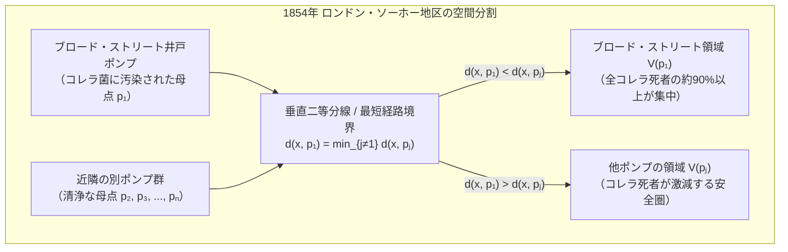
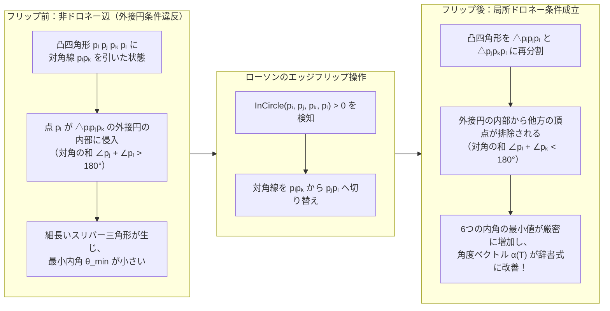
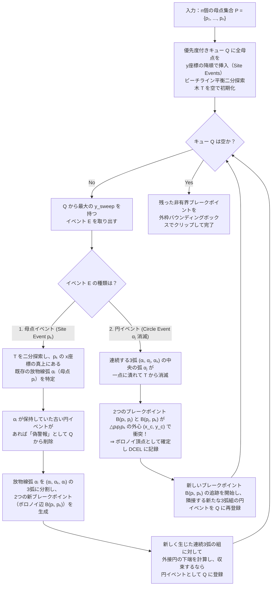

私たちがスマートフォンの画面を開いて移動するとき、端末はミリ秒単位で「今この瞬間、どの携帯電話基地局の電波塔と通信すべきか」を判断し、隣接する基地局のエリアへとシームレスにハンドオーバー（接続切り替え）を繰り返している。また、都市のどこかで119番通報が鳴り響いた瞬間、指令システムは道路網と救急病院・消防署の配置から「どの救急車を出動させれば最短時間で現場に到達できるか」を即座に割り出す。あるいは、キリンの網目模様、トンボの翅（はね）の翅脈、乾燥した干潟のひび割れ、玄武岩の柱状節理、さらには宇宙の大規模構造における銀河フィラメントと超空洞（ボイド）に至るまで、自然界は驚くほど似通った「多角形のネットワーク」で埋め尽くされている。

これら一見するとまったく無関係に見える現象――疫学調査、都市インフラの管轄区域、無線通信網のセル設計、有限要素法（FEM）による航空機・自動車の数値流体シミュレーション、そして生物の形態形成（モルフォジェネシス）――の背後には、計算幾何学（Computational Geometry）における最も美しく、かつ最も実用的な双対構造が潜んでいる。それが<strong>ボロノイ図（Voronoi Diagram）</strong>と、その平面双対グラフである<strong>ドロネー三角形分割（Delaunay Triangulation）</strong>である。

本稿では、1854年のロンドンを襲ったコレラ禍におけるジョン・スノウ医師の空間疫学地図から出発し、オイラーの多面体定理を用いたボロノイ図の組合せ計算量の厳密な証明、ドロネー三角形分割が満たす「空の外接円条件」「最小角最大化定理」「3次元放物面への持ち上げ写像」という3つの等価性、スティーヴン・フォーチュン（Steven Fortune）が1986年に発見した驚異の掃引線・ビーチラインアルゴリズム（$\Theta(n \log n)$ 時間）、そしてロイドの緩和法（Lloyd's Relaxation）による重心ボロノイ分割（CVT）の数理までを、第一原理から徹底的に掘り下げていく。

---

## 1. 1854年ロンドン・ソーホー地区のコレラ禍と「見えない境界線」の誕生

### 1.1 瘴気説のドグマとジョン・スノウの空間統計学

1854年8月末、ヴィクトリア朝期のイギリス・ロンドンの中心部ソーホー（Soho）地区、ブロード・ストリート（Broad Street、現在のブロードウィック・ストリート）周辺で、突如として激烈なコレラのアウトブレイクが発生した。発症からわずか数時間で深刻な脱水症状に陥り死に至るこの疫病により、半径数百メートルという狭い区画の中で、わずか10日間のうちに500名以上（最終的には616名）の住民が命を落とした。

当時の医学界と公衆衛生当局を支配していたのは、「コレラやペストは汚物や腐敗物から立ち上る悪臭＝<strong>瘴気（Miasma）</strong>を吸い込むことで空気感染する」という<strong>瘴気説（Miasma Theory）</strong>であった。しかし、麻酔科医であり疫学の先駆者でもあった<strong>ジョン・スノウ（Dr. John Snow, 1813–1858）</strong>は、患者の初期症状が一貫して呼吸器ではなく消化器（激しい嘔吐と水様便）に現れることに着目し、「コレラの原因物質は空気ではなく、汚染された<strong>飲料水</strong>を介して経口摂取されている」という水系感染仮説を唱えた。

スノウはソーホー地区の街路を一軒一軒歩き回り、死者が出た建物の位置を黒色の横棒（バー）として地図上にプロットしていった。同時に、住民が日常的に飲料水を汲んでいた街角の<strong>公共井戸ポンプ（Water Pumps）</strong>の正確な位置を地図上に書き込んだのである。

### 1.2 「等距離の境界線」が暴いた真犯人

地図を眺めたスノウは、ブロード・ストリートの真ん中に設置された1基の井戸ポンプの周囲に、死者の黒いバーが圧倒的な密度で集中していることに気づいた。しかし、当時の懐疑派を論破するためには、「ただ何となく近くに死者が多い」という定性的な印象だけでは不十分だった。なぜなら、ブロード・ストリート周辺には他にも複数の井戸ポンプ（ルパート・ストリート、ワーウィック・ストリート、ブライidle・レーンなど）が点在しており、場所によっては「どのポンプのせいなのか」が一見して判然としなかったからである。

さらに、奇妙な「例外（アノマリー）」が2つあった。
1. ブロード・ストリートのすぐ北側に位置する<strong>救貧院（Workhouse）</strong>では、535名の収容者が暮らしていたにもかかわらず、コレラによる死者はわずか5名しか出なかった。調査の結果、救貧院には独自の専用井戸があり、収容者はブロード・ストリートの公共ポンプから水を汲んでいなかったことが判明した。
2. ポンプのすぐ隣にある<strong>ライオン醸造所（Lion Brewery）</strong>でも、70名以上の労働者から死者が1人も出なかった。彼らには毎日「無料のビール」が支給されており、さらに醸造所内にも専用の深井戸があったため、誰も外のポンプの水を飲んでいなかったのである。

そしてスノウは、自身の仮説を決定づけるために、地図上にある幾何学的な補助線を描き加えた（1855年の第2版報告書および後の疫学地図に明示された境界線）。それは、<strong>「ブロード・ストリートの井戸ポンプまでの歩行距離と、他のどの井戸ポンプまでの歩行距離とがちょうど等しくなる点（等距離点）を結んだ境界線」</strong>であった。



人間は重い水桶を運ぶとき、特別な理由がない限り<strong>自宅から最も近い井戸ポンプ</strong>を利用する。スノウが描いた「ブロード・ストリートのポンプが他のどのポンプよりも近くなる領域」の多角形境界の内側に、コレラによる死者のほぼすべてが綺麗に収まっていたのである。さらに、その境界線の外側に住みながら死亡した少数の例外者（たとえば遠く離れたハムステッドに住む未亡人とその姪）を追跡調査したところ、彼女はかつてブロード・ストリート周辺に住んでおり、あのポンプの水の味を好んで、わざわざ毎日召使いにガラス瓶でブロード・ストリートの水を汲んで運ばせていたことまで突き止められた。

スノウの進言により、懐疑的だった教区委員会が1854年9月8日にブロード・ストリートのポンプの「取っ手（ハンドル）」を取り外すと、コレラの流行は劇的に終息した。ロベルト・コッホがコレラ菌（*Vibrio cholerae*）を顕微鏡下で単離・同定する実に29年も前に、スノウは<strong>「平面上の母点（サイト）集合に対する最近接領域への空間分割」</strong>という純粋な幾何学的推論によって、見えない病原体の発生源を特定したのである。

### 1.3 デカルトの宇宙渦動論からディリクレ、ボロノイへ

スノウが疫学の現場で直感的に用いたこの「縄張り分割」の概念は、数学と物理学の歴史において幾度も独立に再発見されてきた。

最も古い記録は、1644年にフランスの哲学者・数学者<strong>ルネ・デカルト（René Descartes）</strong>が出版した『哲学原理（*Principia Philosophiae*）』第3部に遡る。デカルトは太陽系と恒星系の構造を説明する「宇宙渦動説（Vortex Theory）」の中で、宇宙空間に散らばる恒星（母点）の周囲にエーテル物質の渦（*tourbillons*）が形成され、隣接する恒星の渦同士が押し合いへし合いすることで、宇宙空間が凸多角形（3次元では凸多面体）の勢力圏へと隙間なく分割されている美しい挿絵を描いた。これは人類史上初めて描かれたボロノイ図として知られている。

その後、この幾何学的構造に厳密な数学的定式化を与えたのは、19世紀から20世紀初頭にかけての数論学者たちであった。
- <strong>ペーター・グスタフ・ディリクレ（Peter Gustav Lejeune Dirichlet, 1850年）</strong>：2次形式の簡約理論（数の幾何学）において、2次元および3次元の規則的な格子点（ブラヴェ格子）の周囲で「原点に他のどの格子点よりも近い領域」を定義した。これは今日、固体物理学における<strong>ディリクレ領域（Dirichlet Domain）</strong>あるいは<strong>ウィグナー・ザイツ胞（Wigner-Seitz Cell）</strong>と呼ばれている。
- <strong>ゲオルギー・フェオド세ヴィチ・ボロノイ（Georgy Feodosevich Voronoi, 1868–1908）</strong>：ウクライナ出身の数学者ボロノイは、死の直前である1908年の記念碑的論文『2次形式の理論への連続パラメータの新しい応用』において、ディリクレの構成を任意の一般次元 $d$（$\mathbb{R}^d$）における配置へと拡張し、その組合せ論的・代数的構造を徹底的に解明した。
- <strong>アルフレッド・ティーセン（Alfred H. Thiessen, 1911年）</strong>：アメリカの気象学者ティーセンは、まばらに配置された雨量計の観測値から地域全体の平均降水量を正確に推定するため、各雨量計の「支配多角形（<strong>ティーセン多角形：Thiessen Polygons</strong>）」の面積を重み係数として用いる手法を考案した。

こうして、疫学・天文学・数論・結晶学・気象学という全く異なる分野で独自に芽吹いた「最も近い拠点の勢力圏」の概念は、20世紀後半のコンピュータ科学の勃興とともに、計算幾何学の中核概念<strong>ボロノイ図（Voronoi Diagram）</strong>として統合されることになったのである。

---

## 2. ボロノイ図 $\text{Vor}(P)$ の厳密な数学的定義と組合せ計算量

### 2.1 半平面の共通部分としてのボロノイ領域

ユークリッド平面 $\mathbb{R}^2$ 上に、互いに異なる $n$ 個の点からなる有限集合 $P = \{p_1, p_2, \dots, p_n\} \subset \mathbb{R}^2$（$n \ge 3$）が与えられたとする。集合 $P$ の各要素 $p_i = (x_i, y_i)^\top$ を<strong>母点（Site / Generator）</strong>と呼ぶ。また、2点 $x, y \in \mathbb{R}^2$ 間の標準的なユークリッド距離（$L_2$ ノルム）を $\|x - y\|_2 = \sqrt{(x_1 - y_1)^2 + (x_2 - y_2)^2}$ と表す。

任意の2つの異なる母点 $p_i, p_j \in P$（$i \ne j$）に対し、それらから等距離にある点の軌跡は<strong>垂直二等分線（Perpendicular Bisector）</strong> $B(p_i, p_j)$ となる。

$$B(p_i, p_j) = \left\{ x \in \mathbb{R}^2 \;\middle|\; \|x - p_i\|_2 = \|x - p_j\|_2 \right\}$$

両辺を2乗して整理すると、$\|x\|_2^2 - 2p_i^\top x + \|p_i\|_2^2 = \|x\|_2^2 - 2p_j^\top x + \|p_j\|_2^2$ より、非線形の2乗項 $\|x\|_2^2$ が綺麗に相殺され、$x$ に関する<strong>1次方程式（直線）</strong>が得られる。これを用いて、「母点 $p_j$ よりも母点 $p_i$ の方に近いか等しい点の集合」である閉半平面（Closed Half-Plane） $H(p_i, p_j)$ を次のように定義する。

$$H(p_i, p_j) = \left\{ x \in \mathbb{R}^2 \;\middle|\; \|x - p_i\|_2 \le \|x - p_j\|_2 \right\} = \left\{ x \in \mathbb{R}^2 \;\middle|\; 2(p_j - p_i)^\top x \le \|p_j\|_2^2 - \|p_i\|_2^2 \right\}$$

このとき、母点 $p_i$ に属する<strong>ボロノイ領域（Voronoi Cell / Voronoi Region）</strong> $\mathcal{V}(p_i)$ とは、他のすべての母点 $p_j$（$j \ne i$）に対する優越半平面 $H(p_i, p_j)$ の<strong>共通部分（Intersection）</strong>として厳密に定義される。

$$\mathcal{V}(p_i) = \left\{ x \in \mathbb{R}^2 \;\middle|\; \|x - p_i\|_2 \le \|x - p_j\|_2 \;\;\forall j \in \{1, \dots, n\} \setminus \{i\} \right\} = \bigcap_{j \ne i} H(p_i, p_j)$$

この定義から、直ちに以下の極めて重要な幾何学的性質が導かれる。

> [!IMPORTANT]
> <strong>ボロノイ領域の凸性と非有界条件</strong>
> 1. <strong>凸多角形性</strong>：各閉半平面 $H(p_i, p_j)$ は凸集合であり、凸集合の任意の共通部分は再び凸集合となる。したがって、ユークリッド距離におけるボロノイ領域 $\mathcal{V}(p_i)$ は、高々 $n-1$ 本の線分または半直線で囲まれた（非有界であり得る）<strong>凸多角形（Convex Polygon）</strong>である。
> 2. <strong>凸包との双対関係</strong>：母点 $p_i$ のボロノイ領域 $\mathcal{V}(p_i)$ が非有界（面積が無限大）であることと、母点 $p_i$ が母点集合全体の<strong>凸包（Convex Hull）</strong> $\text{CH}(P)$ の境界上に位置することは<strong>必要十分条件（同値）</strong>である。

平面全体 $\mathbb{R}^2$ から各ボロノイ領域の内部（Interior）を取り除いた境界のネットワーク $\text{Vor}(P) = \bigcup_{i=1}^n \partial \mathcal{V}(p_i)$ を、母点集合 $P$ の<strong>ボロノイ図（Voronoi Diagram）</strong>と呼ぶ。ボロノイ図は以下の構成要素からなる平面グラフを形成する。
- <strong>ボロノイ辺（Voronoi Edge）</strong>：2つの領域 $\mathcal{V}(p_i)$ と $\mathcal{V}(p_j)$ が共有する1次元の境界線分（または半直線）。その上のすべての点は $p_i$ と $p_j$ から等距離にあり、他のどの母点よりもこの2点に近い。
- <strong>ボロノイ頂点（Voronoi Vertex）</strong>：3つ以上のボロノイ辺が交わる0次元の点。一般の位置（どの4つの母点も同一円周上にない配置）では、すべてのボロノイ頂点の次数はちょうど $3$ であり、3つの母点 $p_i, p_j, p_k$ から等距離にある点――すなわち三角形 $\triangle p_i p_j p_k$ の<strong>外心（Circumcenter）</strong>に一致する。

### 2.2 組合せ計算量のパラドックス：なぜボロノイ辺は $O(n^2)$ ではなく $O(n)$ なのか？

ここで計算幾何学における最初の驚くべき事実（組合せ計算量の定理）に直面する。
$n$ 個の母点があるとき、母点のペア $\{p_i, p_j\}$ の総数は二項係数 $\binom{n}{2} = \frac{n(n-1)}{2} = \Theta(n^2)$ 個存在する。それぞれのペアが1本の垂直二等分線を持つため、素朴に考えれば「ボロノイ図には $\Theta(n^2)$ 本のボロノイ辺とボロノイ頂点が存在し、各ボロノイ領域は平均して $\Theta(n)$ 角形になるのではないか？」と予想したくなる。

しかし実際には、$\binom{n}{2}$ 本の垂直二等分線のうち大半は他のより近い母点の領域によって遮蔽され、ボロノイ辺として生き残るのはごく一部に過ぎない。<strong>平面ボロノイ図の頂点数 $V$ と辺数 $E$ は、母点数 $n$ に対して厳密に線形（$O(n)$）で抑えられる</strong>のである。この美しい定理を<strong>オイラーの多面体定理（Euler's Planar Graph Formula）</strong>を用いて厳密に証明しよう。

#### 【定理 2.1】平面ボロノイ図の頂点数と辺数の上界
$n \ge 3$ 個の母点集合 $P \subset \mathbb{R}^2$（すべての母点が一直線上に並ぶ退化配置を除く）に対するボロノイ図 $\text{Vor}(P)$ のボロノイ頂点数を $V$、ボロノイ辺数を $E$ とすると、次式が成り立つ。

$$V \le 2n - 5, \qquad E \le 3n - 6$$

#### 【証明】
ボロノイ図には無限遠に向かって伸びる半直線（非有界なボロノイ辺）が含まれているため、そのままでは有界な平面グラフに対するオイラーの公式を適用できない。そこで、平面 $\mathbb{R}^2$ に<strong>無限遠点（Point at Infinity）</strong> $v_\infty$ を1つ付け加えて位相的な2次元球面 $\mathbb{S}^2$ へとコンパクト化（アレクサンドロフの1点コンパクト化）する。無限遠へ伸びるすべての半直線状のボロノイ辺は、この仮想頂点 $v_\infty$ に接続するものとみなす。

こうして得られた球面 $\mathbb{S}^2$ 上の連結平面グラフ $G' = (V', E', F')$ について考える。
1. 頂点数 $V'$：元のボロノイ頂点 $V$ 個に無限遠点 $v_\infty$ を加えるため、$V' = V + 1$ である。
2. 辺数 $E'$：各ボロノイ辺がそのまま $G'$ の辺となるため、$E' = E$ である。
3. 面数 $F'$：各ボロノイ領域 $\mathcal{V}(p_i)$ が球面上の1つの面（Face）に対応するため、$F' = n$ である。

球面上の連結平面グラフに対して<strong>オイラーの多面体定理</strong>を適用すると、次式が成り立つ。

$$V' - E' + F' = 2 \implies (V + 1) - E + n = 2 \implies E = V + n - 1 \quad \cdots \text{(式1)}$$

次に、グラフ $G'$ の各頂点 $v \in V'$ の<strong>次数（Degree：その頂点に接続する辺の本数）</strong> $\deg(v)$ を評価する。
- 通常の有限なボロノイ頂点 $v \in V$ は、少なくとも3つのボロノイ領域が出会う点であるため、必ず3本以上のボロノイ辺が接続する。すなわち $\deg(v) \ge 3$ である（4点以上が同一円周上にある退化ケースでは $\deg(v) \ge 4$ となる）。
- 無限遠点 $v_\infty$ には、非有界なボロノイ辺がすべて集まる。非有界なボロノイ辺の本数は凸包 $\text{CH}(P)$ の境界上の辺数に等しく、全母点が同一直線上にない限り凸包は少なくとも三角形（3頂点以上）をなすため、$\deg(v_\infty) \ge 3$ である。

したがって、$G'$ のすべての頂点（全 $V + 1$ 個）において $\deg(v) \ge 3$ が成立する。グラフ理論の<strong>握手補題（Handshaking Lemma）</strong>より、全頂点の次数の総和は全辺数のちょうど2倍に等しい（各辺が2つの端点を持つため）。

$$2E = \sum_{v \in V'} \deg(v) \ge 3 V' = 3(V + 1) \implies V \le \frac{2}{3}E - 1 \quad \cdots \text{(式2)}$$

この不等式（式2）をオイラーの公式（式1） $E = V + n - 1$ に代入して $V$ を消去すると、辺数 $E$ の上界が得られる。

$$E \le \left(\frac{2}{3}E - 1\right) + n - 1 \implies \frac{1}{3}E \le n - 2 \implies E \le 3n - 6$$

さらに、この $E \le 3n - 6$ を（式1）の変形 $V = E - n + 1$ に代入すると、頂点数 $V$ の上界が得られる。

$$V \le (3n - 6) - n + 1 = 2n - 5 \qquad \blacksquare$$

#### 【系 2.2】ボロノイ領域の平均辺数は常に「6未満」である
この定理から、直感に反するほど強力な系が導かれる。1本のボロノイ辺はちょうど2つのボロノイ領域の境界として共有されるため、全 $n$ 個のボロノイ領域の辺数の総和は $2E$ に等しい。したがって、1つのボロノイ領域が持つ<strong>辺の数の平均値 $\bar{k}$</strong> は次のようになる。

$$\bar{k} = \frac{2E}{n} \le \frac{2(3n - 6)}{n} = 6 - \frac{12}{n} < 6$$

> [!TIP]
> <strong>「平均6角形未満」の普遍法則</strong>
> 母点の数 $n$ が100個であろうと、1億個であろうと、平面上の任意のボロノイ図において<strong>1つのボロノイ領域が持つ辺の数（隣接する母点の数）の平均値は絶対に6を超えない</strong>（極限 $n \to \infty$ で最大でも $6$ に漸近する）。特定の母点の周りに $n-1$ 個の母点を円状に配置すれば、その1つのセルだけを $(n-1)$ 角形にすることは可能だが、その代償として周囲のセルはすべて3角形や4角形になり、全体の平均辺数は厳密に $6 - 12/n$ 以下に抑え込まれるのである。

### 2.3 非ユークリッド距離（マンハッタン距離 $L_1$・チェビシェフ距離 $L_\infty$）と重み付きボロノイ図への拡張

ボロノイ図の定義式 $\mathcal{V}(p_i) = \{x \mid d(x, p_i) \le d(x, p_j)\}$ における距離関数 $d(\cdot, \cdot)$ を標準的なユークリッド距離 $L_2$ から変更すると、都市工学や物性物理学において極めて有用な<strong>一般化ボロノイ図（Generalized Voronoi Diagrams）</strong>が得られる。

1. ミンコフスキー距離 $L_p$ とマンハッタン距離（$L_1$ Taxicab Metric）
   京都の碁盤の目やニューヨークのマンハッタンのように、東西方向と南北方向の格子状道路に沿ってしか移動できない都市空間では、2点間の実効的な移動距離は<strong>マンハッタン距離（$L_1$ 距離）</strong> $d_1(x, p_i) = |x_1 - x_i| + |x_2 - y_i|$ で測られる。
   $L_1$ 距離における「単位円」は $45^\circ$ 傾いた正方形（ダイヤモンド形）になるため、2点間の垂直二等分線は直線ではなく、<strong>水平・垂直な半直線と斜め $45^\circ$ の線分が折れ曲がって連結した折れ線</strong>となる（2点の $x$ 座標差と $y$ 座標差が等しい場合には、二等分線が1次元の線ではなく2次元の広がりを持つ領域に退化することさえある！）。
2. チェビシェフ距離（$L_\infty$ Supremum Metric）
   工場の天井クレーンや半導体露光装置のXYステージ、チェスの「キング」の移動のように、X軸方向のモーターとY軸方向のモーターを独立かつ同時に最高速度で駆動できるシステムでは、移動時間は両軸の移動距離の最大値 $d_\infty(x, p_i) = \max(|x_1 - x_i|, |x_2 - y_i|)$ で決まる。これは $L_1$ 距離を $45^\circ$ 回転・スケーリングした双対的な距離空間であり、ボロノイ境界は水平・垂直・$\pm 45^\circ$ の線分で構成される。
3. <strong>加法重み付きボロノイ図（Additively Weighted / Johnson-Mehl Diagram）</strong>
   各母点に重み $w_i \in \mathbb{R}$ を与え、距離を $d_{\text{AW}}(x, p_i) = \|x - p_i\|_2 - w_i$ と定義する。これは金属の凝固や結晶成長において、各結晶核 $p_i$ が異なる時刻 $t_i = -w_i / v$ に発生し、一定の成長速度 $v$ で同心円状に広がっていく<strong>ジョンソン・メール（Johnson-Mehl）結晶成長モデル</strong>に対応する。2点間の境界条件 $\|x - p_i\|_2 - \|x - p_j\|_2 = w_i - w_j = \text{const}$ は、「2焦点からの距離の差が一定」という定義そのものであるため、ボロノイ境界は直線ではなく<strong>双曲線（Hyperbola）</strong>となる。
4. <strong>乗法重み付きボロノイ図（Multiplicatively Weighted / Apollonius Diagram）</strong>
   距離を $d_{\text{MW}}(x, p_i) = \|x - p_i\|_2 / w_i$（$w_i > 0$）と定義する。これは送信出力の異なる無線基地局や、集客力（ブランド力・店舗面積）の異なる商業施設の商圏分析（ハフモデル等の決定論的極限）に対応する。2点からの距離の比が一定（$\|x - p_i\|_2 / \|x - p_j\|_2 = w_i / w_j \ne 1$）となる軌跡は、古代ギリシアの幾何学者アポロニウスが発見した<strong>アポロニウスの円（Circle of Apollonius）</strong>となる。このためボロノイ境界は円弧で構成され、重みの小さい母点の領域が重みの大きい母点の領域の内部に「丸呑み」されて有界な円盤になったり、1つのボロノイ領域が複数の非連結なピースに分裂したりし、最悪計算量も $\Theta(n^2)$ に跳ね上がる。
5. <strong>パワー図（Power Diagram / Laguerre-Voronoi Diagram）</strong>
   各母点 $p_i$ を半径 $r_i$ の円とみなし、点 $x$ から円への接線の長さの2乗（方べき：Power of a Point） $d_{\text{pow}}(x, p_i) = \|x - p_i\|_2^2 - r_i^2$ を距離指標とする。驚くべきことに、2乗項 $\|x\|_2^2$ が相殺されるため、境界線（2円の<strong>根軸：Radical Axis</strong>）は再び<strong>完全な直線</strong>となり、すべてのセルが凸多角形を保つ！この性質により、パワー図は多結晶材料の粒径分布モデリング、泡（フォーム）の物理学、および現代機械学習における<strong>最適輸送理論（Optimal Transport / Semi-discrete Monge-Ampère Equation）</strong>の数値解法において絶大な威力を発揮している。

| ボロノイ図の種類 | 距離関数 $d(x, p_i)$ | 境界線（二等分線）の幾何形状 | セルの凸性・連結性 | 最悪組合せ計算量 | 代表的な応用分野 |
| :--- | :--- | :--- | :--- | :--- | :--- |
| 標準ユークリッド ($L_2$) | $\|x - p_i\|_2$ | 直線（垂直二等分線） | 常に凸・単連結 | $\Theta(n)$ | 救急管轄、気象（ティーセン多角形）、最近傍探索 |
| マンハッタン ($L_1$) | $\|x_1 - x_i\| + \|x_2 - y_i\|$ | 水平・垂直・$\pm 45^\circ$ の折れ線 | 星状（必ずしも凸でない） | $\Theta(n)$ | 格子状都市の配送計画、VLSI配線設計 |
| チェビシェフ ($L_\infty$) | $\max(\|x_1 - x_i\|, \|x_2 - y_i\|)$ | 水平・垂直・$\pm 45^\circ$ の折れ線 | 星状（必ずしも凸でない） | $\Theta(n)$ | 自動倉庫クレーン制御、ロボット経路計画 |
| <strong>加法重み付き (AW)</strong> | $\|x - p_i\|_2 - w_i$ | 双曲線弧（Hyperbolic Arcs） | 星状・単連結 | $\Theta(n)$ | 異時核生成を伴う結晶成長（Johnson-Mehl）、GPS測位 |
| <strong>乗法重み付き (アポロニウス)</strong> | $\|x - p_i\|_2 / w_i$ | 円弧（アポロニウスの円） | 非凸・非連結になり得る | $\Theta(n^2)$ | 出力の異なる基地局のセル設計、商業施設の商圏分析 |
| <strong>パワー図 (Laguerre)</strong> | $\|x - p_i\|_2^2 - r_i^2$ | 直線（2円の根軸） | 常に凸（空セルになり得る） | $\Theta(n)$ | 金属多結晶組織、泡の構造、半離散最適輸送（OT） |

---

## 3. 双対グラフとしてのドロネー三角形分割 $\text{DT}(P)$ と 3 つの等価定理

### 3.1 ボリス・ドロネー（1934年）による平面双対グラフの構成

1934年、ロシアの数学者<strong>ボリス・ニコラエヴィチ・ドロネー（Boris Nikolaevich Delaunay / Delone, 1890–1980）</strong>は、ボロノイ図の「隣接関係」を裏返すことで得られる平面双対グラフ（Planar Dual Graph）に注目し、そこに驚くべき幾何学的最適性が宿っていることを発見した。

母点集合 $P = \{p_1, \dots, p_n\} \subset \mathbb{R}^2$ のボロノイ図 $\text{Vor}(P)$ に対し、その双対グラフ $\mathcal{G}^* = (P, E^*)$ を以下の規則で定義する。
1. <strong>頂点集合</strong>：元の母点集合 $P$ そのものを頂点とする。
2. <strong>双対辺（ドロネー辺）</strong>：2つの母点 $p_i, p_j \in P$ のボロノイ領域 $\mathcal{V}(p_i)$ と $\mathcal{V}(p_j)$ が長さ正のボロノイ辺を共有するとき（$\dim(\mathcal{V}(p_i) \cap \mathcal{V}(p_j)) = 1$）、かつそのときに限り、母点 $p_i$ と $p_j$ を直線分 $\overline{p_i p_j}$ で結ぶ。
3. <strong>双対の面（ドロネー面）</strong>：ボロノイ図における1つのボロノイ頂点 $v$（周囲のボロノイ領域 $\mathcal{V}(p_{i_1}), \mathcal{V}(p_{i_2}), \dots, \mathcal{V}(p_{i_k})$ が一点で会する点）は、双対グラフにおいては母点 $p_{i_1}, p_{i_2}, \dots, p_{i_k}$ を頂点とする凸多角形の面に対応する。

母点集合 $P$ が<strong>一般の位置（General Position）</strong>にあるとき――すなわち、どの3点も同一直線上になく、かつ<strong>どの4点も同一円周上にない（No four points are cocircular）</strong>とき――すべてのボロノイ頂点の次数はちょうど $3$ となる。したがって、双対グラフ $\mathcal{G}^*$ のすべての有界な面は<strong>三角形</strong>となり、母点集合の凸包 $\text{CH}(P)$ の内部を隙間なく重なりなく分割する一意な三角形分割が得られる（4点以上が同一円周上にある退化ケースでは、対応する円内接凸多角形に任意の対角線を引いて三角形に細分する）。これを<strong>ドロネー三角形分割（Delaunay Triangulation）</strong>と呼び、$\text{DT}(P)$ と表記する。

ボロノイ図 $\text{Vor}(P)$ とドロネー三角形分割 $\text{DT}(P)$ の間には、以下の完全な1対1の双対辞書が成り立つ。

$$\begin{aligned}
\text{母点 } p_i \text{ のボロノイ領域 } \mathcal{V}(p_i) \quad &\longleftrightarrow \quad \text{ドロネー頂点（母点） } p_i \\
\text{ボロノイ辺 } e = \mathcal{V}(p_i) \cap \mathcal{V}(p_j) \quad &\longleftrightarrow \quad \text{ドロネー辺 } e^* = \overline{p_i p_j} \;\; (\text{直交する：} e \perp e^*) \\
\text{ボロノイ頂点 } v = \mathcal{V}(p_i) \cap \mathcal{V}(p_j) \cap \mathcal{V}(p_k) \quad &\longleftrightarrow \quad \text{ドロネー三角形 } \triangle p_i p_j p_k \;\; (v \text{ は } \triangle p_i p_j p_k \text{ の外心})
\end{aligned}$$

> [!NOTE]
> <strong>注意：ボロノイ辺とドロネー辺は必ずしも「交差」しない</strong>
> ボロノイ辺 $e$ はドロネー辺 $e^* = \overline{p_i p_j}$ の垂直二等分線の一部であるため、両者を延長した直線は必ず直交する（$e \perp e^*$）。しかし、ドロネー三角形が鈍角三角形である場合、その外心（ボロノイ頂点）は三角形の外部に飛び出すため、線分としてのボロノイ辺 $e$ とドロネー辺 $e^*$ が空間的に交わらないことがある点には注意が必要である。

### 3.2 等価定理1：空の外接円条件（The Empty Circumcircle Property）

与えられた点集合 $P$ を三角形分割する方法は無数に存在するが、その中でドロネー三角形分割 $\text{DT}(P)$ を一意に特徴づける第1の性質が<strong>空の外接円条件（Empty Circumcircle Property）</strong>である。

#### 【定理 3.1】空の外接円定理
点集合 $P \subset \mathbb{R}^2$ の三角形分割 $\mathcal{T}$ がドロネー三角形分割であることの必要十分条件は、$\mathcal{T}$ に含まれるすべての三角形 $\triangle p_i p_j p_k$ の<strong>外接円 $C(p_i, p_j, p_k)$ の内部（Strict Interior）に、$P$ の他のいかなる母点 $p_l$ も含まれない</strong>ことである。

#### 【証明】
三角形 $\triangle p_i p_j p_k$ の外接円の中心（外心）を $c$、半径を $R = \|c - p_i\|_2 = \|c - p_j\|_2 = \|c - p_k\|_2$ とする。
- $\triangle p_i p_j p_k$ がドロネー三角形であるとは、双対の定義より、3つのボロノイ領域 $\mathcal{V}(p_i), \mathcal{V}(p_j), \mathcal{V}(p_k)$ が共通のボロノイ頂点 $v$ で交わることと同値である。
- 3点 $p_i, p_j, p_k$ から等距離にある点は平面上にただ1つ、外心 $c$ しか存在しないため、$v = c$ である。
- 点 $c$ が $\mathcal{V}(p_i) \cap \mathcal{V}(p_j) \cap \mathcal{V}(p_k)$ に属するための必要十分条件は、任意の他の母点 $p_l \in P \setminus \{p_i, p_j, p_k\}$ に対して次式が成り立つことである。

$$\|c - p_l\|_2 \ge \|c - p_i\|_2 = R$$

この不等式 $\|c - p_l\|_2 \ge R$ は、幾何学的には「他のいかなる母点 $p_l$ も、中心 $c$・半径 $R$ の外接円 $C(p_i, p_j, p_k)$ の<strong>内部（$\|c - p_l\|_2 < R$）には存在しない</strong>（円周上または外部にある）」ことを意味している。$\blacksquare$

計算機上でこの「点 $p_l = (x_l, y_l)$ が反時計回りに並んだ3点 $(p_i, p_j, p_k)$ の外接円の内部にあるか否か」を判定するには、平方根や割り算を一切含まない次の $4 \times 4$ 行列式（<strong>InCircle 述語 / InCircle Predicate</strong>）の符号を計算すればよい。

$$\text{InCircle}(p_i, p_j, p_k, p_l) = \det \begin{pmatrix} x_i & y_i & x_i^2 + y_i^2 & 1 \\ x_j & y_j & x_j^2 + y_j^2 & 1 \\ x_k & y_k & x_k^2 + y_k^2 & 1 \\ x_l & y_l & x_l^2 + y_l^2 & 1 \end{pmatrix} = \det \begin{pmatrix} x_i - x_l & y_i - y_l & (x_i - x_l)^2 + (y_i - y_l)^2 \\ x_j - x_l & y_j - y_l & (x_j - x_l)^2 + (y_j - y_l)^2 \\ x_k - x_l & y_k - y_l & (x_k - x_l)^2 + (y_k - y_l)^2 \end{pmatrix}$$

$(p_i, p_j, p_k)$ が反時計回り（$\text{Orient2D}(p_i, p_j, p_k) > 0$）に整列しているとき、$\text{InCircle}(p_i, p_j, p_k, p_l) > 0$ ならば $p_l$ は外接円の<strong>厳密な内部</strong>にあり、$= 0$ ならば同一円周上、$< 0$ ならば外部にある。

### 3.3 等価定理2：最小角最大化定理（Max-Min Angle Optimality）と有限要素法メッシュ生成

航空機の翼周りの空気の流れ（ナビエ・ストークス方程式）や、建築構造物の応力解析、電磁界解析などをコンピュータで解く<strong>有限要素法（Finite Element Method: FEM）</strong>では、解析対象となる2次元・3次元領域を微小な三角形（または四面体）の要素メッシュへと分割する必要がある。

このとき、数値計算の精度と安定性を破壊する最大の敵が、内角が極端に小さい（あるいは $180^\circ$ に近い）<strong>扁平な細長い三角形（Sliver Triangles / スリバー要素）</strong>である。偏微分方程式の離散化理論（Babuska-Aziz の定理や Ciarlet-Raviart の補間誤差評価）によれば、三角形要素 $T$ 上での有限要素近似の勾配誤差および剛性行列（Stiffness Matrix） $K$ の条件数（Condition Number） $\kappa(K)$ は、メッシュ内の<strong>最小内角 $\theta_{\min}$ の正弦 $\sin(\theta_{\min})$ に反比例して悪化する</strong>。

$$\|\nabla u - \nabla u_h\|_{L^2(T)} \le \frac{C \, h_T}{\sin(\theta_{\min})} \|D^2 u\|_{L^2(T)}, \qquad \kappa(K) \propto \frac{1}{\sin(\theta_{\min})}$$

したがって、数値計算エンジニアにとって「与えられた節点集合 $P$ に対して、すべての三角形の内角の最小値 $\theta_{\min}$ を可能な限り大きくする（スリバー三角形を徹底的に排除する）三角形分割は何か？」は死活問題となる。この問題に対する完璧な解答を与えたのが、<strong>チャールズ・ローソン（Charles L. Lawson, 1972年）</strong>と<strong>ロビン・シブソン（Robin Sibson, 1978年）</strong>による次の定理である。

#### 【定理 3.2】最小角最大化定理（Max-Min Angle Theorem）
点集合 $P \subset \mathbb{R}^2$ の任意の三角形分割 $\mathcal{T}$ に含まれる三角形の総数を $m$ とする（オイラーの公式より、凸包の頂点数を $h$ とすると、どの三角形分割でも三角形の個数は常に $m = 2n - 2 - h$ で一定である）。
$\mathcal{T}$ に現れる全 $3m$ 個の内角を小さい順に並べた角度ベクトルを $\alpha(\mathcal{T}) = (\theta_1, \theta_2, \dots, \theta_{3m})$（$\theta_1 \le \theta_2 \le \dots \le \theta_{3m}$）とするとき、<strong>ドロネー三角形分割 $\text{DT}(P)$ は、すべての可能な三角形分割の中で角度ベクトル $\alpha(\mathcal{T})$ を辞書式順序（Lexicographical Order）で最大化する</strong>。特に、最小角 $\theta_{\min} = \theta_1$ を最大化する。

#### 【証明の核心：タレスの円周角の定理とローソンのエッジフリップ】
4つの点 $p_i, p_j, p_k, p_l$ が凸四角形をなしている状況を考えよう。この凸四角形を2つの三角形に分割する方法は、対角線 $\overline{p_i p_k}$ を引くか、対角線 $\overline{p_j p_l}$ を引くかの2通りしかない。
いま、対角線 $\overline{p_i p_k}$ によって分割された2つの三角形 $\triangle p_i p_j p_k$ と $\triangle p_i p_k p_l$ が、<strong>空の外接円条件に違反している</strong>と仮定しよう。すなわち、点 $p_l$ が $\triangle p_i p_j p_k$ の外接円の内部にあるとする（これは、対角 $\angle p_i p_j p_k + \angle p_k p_l p_i > 180^\circ$ であることと同値である）。

このとき、対角線を $\overline{p_i p_k}$ から $\overline{p_j p_l}$ へと繋ぎ変える操作を<strong>エッジフリップ（Edge Flip / Diagonal Flip）</strong>と呼ぶ。
中学校の幾何学で学ぶ<strong>円周角の定理（Inscribed Angle Theorem）</strong>の拡張を思い出そう。弦 $\overline{p_i p_l}$ を見込む円周角に対して、外接円の<strong>内部</strong>にある点 $p_l$ や境界上の点から見込む角を比較すると、対角線をフリップした後の新しい2つの三角形 $\triangle p_i p_j p_l$ と $\triangle p_j p_k p_l$ における6つの内角の最小値は、フリップ前の6つの内角の最小値よりも<strong>厳密に大きくなる</strong>ことが初等幾何学的に証明できる！



ローソン（1972年）は、任意の初期三角形分割から出発して、「空の外接円条件に違反する内辺（Locally Non-Delaunay Edge）を見つけてはフリップする」という局所操作を繰り返すと、フリップのたびに角度ベクトル $\alpha(\mathcal{T})$ が辞書式順序で厳密に単調増加するため、<strong>決して無限ループに陥ることなく、高々 $\binom{n}{2} = O(n^2)$ 回のフリップで必ず大域的に最適なドロネー三角形分割 $\text{DT}(P)$ に収束する</strong>ことを証明した。

### 3.4 等価定理3：3次元回転放物面への持ち上げ写像（The 3D Paraboloid Lifting Map）

ここで再び、先ほどの $\text{InCircle}$ 行列式の第3列に現れた $z = x^2 + y^2$ という項に注目しよう。なぜ2次元平面上の円に関する判定式の中に、3次元の回転放物面の方程式 $z = x^2 + y^2$ が現れるのだろうか？
1979年のケヴィン・ブラウン（Kevin Q. Brown）および1986年の<strong>ヘルベルト・エーデルスブルンナー（Herbert Edelsbrunner）とライムント・ザイデル（Raimund Seidel）</strong>の研究によって明らかにされたこの事実は、計算幾何学全体を通じて最も感動的な「次元を超える統一理論」である。

#### 【定理 3.3】放物面持ち上げ写像と3次元下側凸包の双対性
2次元平面 $\mathbb{R}^2$ の各点 $(x, y)$ を、3次元空間 $\mathbb{R}^3$ 内の単位回転放物面（Paraboloid of Revolution） $\mathcal{P}: z = x^2 + y^2$ 上へと垂直に投影する<strong>持ち上げ写像（Lifting Map）</strong> $\Phi: \mathbb{R}^2 \to \mathbb{R}^3$ を次のように定義する。

$$\Phi(x, y) = \left(x, \; y, \; x^2 + y^2\right)$$

このとき、2次元点集合 $P = \{p_1, \dots, p_n\} \subset \mathbb{R}^2$ を持ち上げた3次元点集合 $\Phi(P) = \{\Phi(p_1), \dots, \Phi(p_n)\} \subset \mathbb{R}^3$ の<strong>3次元凸包 $\text{CH}(\Phi(P))$ の「下側境界面（Lower Convex Hull：$z = -\infty$ から見上げたときに見えるファセット群）」を $xy$ 平面へ垂直に射影したものは、元の点集合 $P$ のドロネー三角形分割 $\text{DT}(P)$ に完全に一致する！</strong>

#### 【証明】
平面 $\mathbb{R}^2$ 上で中心 $(a, b)$、半径 $R$ を持つ円 $C$ の方程式を展開してみよう。

$$(x - a)^2 + (y - b)^2 = R^2 \iff x^2 + y^2 - 2ax - 2by + (a^2 + b^2 - R^2) = 0$$

ここで、放物面上の点の $z$ 座標 $z = x^2 + y^2$ を代入すると、驚くべきことに2次項が消え、$x, y, z$ に関する<strong>3次元空間内の平面（Plane）の方程式 $\Pi_C$</strong> へと化ける！

$$\Pi_C : \quad z = 2ax + 2by - (a^2 + b^2 - R^2)$$

つまり、<strong>「2次元平面上のあらゆる円 $C$ は、3次元空間における回転放物面 $z = x^2 + y^2$ と非垂直な平面 $\Pi_C$ との交線（楕円）を $xy$ 平面に射影したものに他ならない」</strong>のである。
さらに、2次元の点 $p = (x, y)$ と円 $C$ の間のべき乗距離（Power Distance） $(x - a)^2 + (y - b)^2 - R^2$ は、3次元の持ち上げ点 $\Phi(p) = (x, y, x^2+y^2)$ と平面 $\Pi_C$ との間の<strong>垂直方向（$z$ 軸方向）の符号付き距離</strong>に完全に一致する。

$$(x - a)^2 + (y - b)^2 - R^2 = (x^2 + y^2) - \underbrace{\left(2ax + 2by - (a^2 + b^2 - R^2)\right)}_{\text{平面 } \Pi_C \text{ の高さ } z_{\Pi}(x, y)} = z_{\Phi(p)} - z_{\Pi}(x, y)$$

したがって、以下の同値関係が成立する。
- 点 $p_l$ が $\triangle p_i p_j p_k$ の外接円 $C$ の<strong>内部</strong>にある $\iff (x_l - a)^2 + (y_l - b)^2 < R^2 \iff$ 持ち上げ点 $\Phi(p_l)$ は、3点 $\Phi(p_i), \Phi(p_j), \Phi(p_k)$ を通る3次元平面 $\Pi_C$ よりも<strong>真に下側（$z_{\Phi(p_l)} < z_{\Pi}$）</strong>に位置する。
- 点 $p_l$ が外接円 $C$ の<strong>外部</strong>にある $\iff (x_l - a)^2 + (y_l - b)^2 > R^2 \iff$ 持ち上げ点 $\Phi(p_l)$ は、平面 $\Pi_C$ よりも<strong>真に上側（$z_{\Phi(p_l)} > z_{\Pi}$）</strong>に位置する。

よって、「$\triangle p_i p_j p_k$ の外接円の内部に他のいかなる母点 $p_l$ も存在しない（空の外接円条件）」ということは、3次元空間において「3点 $\Phi(p_i), \Phi(p_j), \Phi(p_k)$ が張る三角形ファセットを通る平面 $\Pi_C$ よりも下側には、$\Phi(P)$ の他のいかなる点も存在しない」こと――すなわち、<strong>$\triangle \Phi(p_i)\Phi(p_j)\Phi(p_k)$ が3次元凸包 $\text{CH}(\Phi(P))$ の下側凸包（Lower Convex Hull）のファセットをなすこと</strong>と完全に同値である！ $\blacksquare$

> [!TIP]
> <strong>ボロノイ図も放物面の「接平面」から同時に生まれる！</strong>
> この双対性はドロネー三角形分割だけにとどまらない。各母点 $p_i = (x_i, y_i)$ を放物面上に持ち上げた点 $\Phi(p_i) = (x_i, y_i, x_i^2 + y_i^2)$ において、放物面 $z = x^2 + y^2$ に接する<strong>接平面（Tangent Plane）</strong> $T_i : z = 2x_i x + 2y_i y - (x_i^2 + y_i^2)$ を考える。
> 任意の点 $x \in \mathbb{R}^2$ における放物面の高さと接平面 $T_i$ の高さの差は、$(x^2 + y^2) - (2x_i x + 2y_i y - x_i^2 - y_i^2) = \|x - p_i\|_2^2$ に等しい。したがって、$x$ に最も近い母点 $p_i$ を探すことは、$x$ の真上で<strong>最も高い位置（$z$ 座標が最大）にある接平面 $T_i$</strong> を探すことと同値になる。すなわち、$n$ 枚の接平面の上側包絡面（Upper Envelope、すなわち上側半空間の共通部分である凸多面体）の稜線を $xy$ 平面へ垂直に射影したものが、そのまま<strong>ボロノイ図 $\text{Vor}(P)$</strong> となるのである！（この原理により、Python の `scipy.spatial.Delaunay` や `scipy.spatial.Voronoi` の内部エンジンである <strong>Qhull</strong> は、実は「高次元凸包アルゴリズム」を1つ実装するだけで、凸包・ドロネー三角形分割・ボロノイ図のすべてを同時に計算している）。

---

## 4. フォーチュンの掃引線アルゴリズム（Fortune's Sweep-Line Algorithm, 1986）による最適 $\Theta(n \log n)$ 構築

### 4.1 情報理論的下界 $\Omega(n \log n)$ と「掃引線のパラドックス」

$n$ 個の母点からボロノイ図やドロネー三角形分割を計算するには、最低でもどれだけの計算時間が必要だろうか？
1次元の実数配列 $\{x_1, x_2, \dots, x_n\}$ の<strong>ソート（並び替え）問題</strong>には、比較ベースモデルにおいて $\Omega(n \log n)$ 回の比較が必要であることが情報理論的に証明されている。もし2次元平面上の点集合 $\{(x_1, 0), (x_2, 0), \dots, (x_n, 0)\}$（あるいは放物線上の点 $\{(x_i, x_i^2)\}$）のボロノイ図やドロネー三角形分割を $T(n)$ 時間で構築できれば、隣接するセルや辺を端から順にたどるだけで $O(n)$ 時間でソート済み配列を復元できてしまう。したがって、ボロノイ図およびドロネー三角形分割の構築には<strong>最悪計算量として $\Omega(n \log n)$ 時間が絶対に必要（下界）</strong>である。

では、どうすればこの理論的限界である $O(n \log n)$ 時間でボロノイ図を構築できるのか？
1975年にシャモス（Michael I. Shamos）とホイ（Dan Hoey）は<strong>分割統治法（Divide-and-Conquer）</strong>によって初の $O(n \log n)$ アルゴリズムを提案したが、左右2つの部分ボロノイ図を中央のジグザグな折れ線（分割チェーン）に沿って縫い合わせるマージ処理が極めて複雑であり、実装上のバグや数値誤差の温床となった。

一方、計算幾何学にはもう1つの王道パラダイムがある。平面上に水平な直線（<strong>掃引線：Sweep Line</strong> $\ell: y = y_{\text{sweep}}$）を置き、上から下（$y = +\infty \to -\infty$）へと滑らかに動かしながら、掃引線が通過した領域の幾何構造を順次確定させていく<strong>平面掃引法（Plane Sweep Method）</strong>である。線分交差列挙問題に対するベントレー・オットマン（Bentley-Ottmann）のアルゴリズムなどはその典型である。

しかし、ボロノイ図に対して素朴な平面掃引法を適用しようとすると、致命的な壁――<strong>「未来の母点による過去の書き換え」</strong>――にぶつかる。
なぜなら、掃引線 $\ell$ よりも<strong>上側（すでに通過した領域）</strong>にある点 $x = (x, y)$（$y > y_{\text{sweep}}$）であっても、それがどのボロノイ領域に属するかは、掃引線 $\ell$ よりも<strong>下側（まだ掃引線が到達していない未来の領域）</strong>に潜んでいる未知の母点 $p_{\text{future}}$ の位置に依存してしまうからである！もし掃引線のすぐ下に新しい母点 $p_{\text{future}}$ が現れれば、掃引線より上側の領域までその母点のボロノイ領域が侵食してくるため、掃引線上の状態だけを保持していてはボロノイ辺を正しく確定させることができない。

### 4.2 スティーヴン・フォーチュンの革命的着想：「放物線の包絡線＝ビーチライン」

1986年、ベル研究所の<strong>スティーヴン・フォーチュン（Steven Fortune）</strong>は、発想を180度転換することでこのパラドックスを鮮やかに解決した。
「掃引線 $\ell$ より上側の領域すべてを確定させようとするから破綻するのだ。では、<strong>掃引線 $\ell$ より上側の点 $(x, y)$ のうち、今後掃引線より下側にどんな未知の母点が現れようとも、絶対に所属領域が覆されない『完全に確定した安全圏』の境界はどこか？</strong>」と問うたのである。

今後、掃引線 $\ell: y = y_{\text{sweep}}$ よりも下側（$y_{\text{new}} \le y_{\text{sweep}}$）に現れる可能性がある未知の母点 $p_{\text{new}}$ を考えよう。上側の点 $q = (x, y)$（$y > y_{\text{sweep}}$）から見て、未知の母点 $p_{\text{new}}$ が最も近づくことができる最悪ケース（最短距離）は、$p_{\text{new}}$ が $q$ の真下の掃引線上にぴったり張り付いているとき（$p_{\text{new}} = (x, y_{\text{sweep}})$）であり、その距離は垂線の長さ $y - y_{\text{sweep}}$ である。

したがって、点 $q = (x, y)$ から、すでに掃引線を通過した既知の母点 $p_i = (x_i, y_i)$（$y_i > y_{\text{sweep}}$）までのユークリッド距離 $\|q - p_i\|_2$ が、掃引線 $\ell$ までの垂直距離 $y - y_{\text{sweep}}$ 以下であれば（すなわち $\|q - p_i\|_2 \le y - y_{\text{sweep}}$ であれば）、今後掃引線の下側からいかなる未知の母点が現れようとも、それが $p_i$ より $q$ に近くなることは<strong>幾何学的に100%あり得ない</strong>！

この「確定領域」と「未確定領域」を分かつ臨界境界の式を書いてみよう。母点 $p_i = (x_i, y_i)$ からの距離と、直線 $\ell: y = y_{\text{sweep}}$ からの垂直距離が等しくなる点 $(x, y)$ の軌跡である。

$$\sqrt{(x - x_i)^2 + (y - y_i)^2} = y - y_{\text{sweep}}$$

「定点（<strong>焦点 Focus</strong> $p_i$）からの距離と、定直線（<strong>準線 Directrix</strong> $\ell$）からの距離が等しい点の軌跡」――これは高校数学で学ぶ<strong>放物線（Parabola）</strong>の定義そのものである！
両辺を2乗して $y$ について解くと、母点 $p_i$ と現在の掃引線位置 $y_{\text{sweep}}$ が定める放物線 $\beta(p_i, y_{\text{sweep}})$ の明示的な方程式が得られる。

$$(x - x_i)^2 + y^2 - 2y_i y + y_i^2 = y^2 - 2y_{\text{sweep}} y + y_{\text{sweep}}^2 \implies y = \frac{(x - x_i)^2}{2(y_i - y_{\text{sweep}})} + \frac{y_i + y_{\text{sweep}}}{2}$$

掃引線 $\ell$ よりも上側にあるすべての既知の母点 $\{p_i \mid y_i > y_{\text{sweep}}\}$ それぞれが、上向きに開いた放物線 $\beta(p_i, y_{\text{sweep}})$ を張る。これらの放物線の<strong>下側包絡線（Lower Envelope：各 $x$ 座標において最も下側＝掃引線に近い放物線弧を繋ぎ合わせた曲線）</strong>は、まるで砂浜に打ち寄せる波打ち際のように見えることから、<strong>ビーチライン（Beach Line / 汀線）</strong>と名付けられた。

$$\mathcal{B}(y_{\text{sweep}}) = \min_{p_i : y_i > y_{\text{sweep}}} \left\{ \frac{(x - x_i)^2}{2(y_i - y_{\text{sweep}})} + \frac{y_i + y_{\text{sweep}}}{2} \right\}$$

このビーチライン $\mathcal{B}(y_{\text{sweep}})$ が持つ驚異的な性質こそが、フォーチュンのアルゴリズムの心臓部である。
ビーチライン上で隣り合う2つの放物線弧 $\beta(p_i, y_{\text{sweep}})$ と $\beta(p_j, y_{\text{sweep}})$ が交わる<strong>折れ点（Breakpoint / ブレークポイント）</strong> $b = (x, y)$ について考えよう。点 $b$ は両方の放物線上にあるため、次式を同時に満たす。

$$\|b - p_i\|_2 = y - y_{\text{sweep}} = \|b - p_j\|_2 \implies \|b - p_i\|_2 = \|b - p_j\|_2$$

つまり、<strong>ビーチライン上のブレークポイント $b$ は、常に2つの母点 $p_i$ と $p_j$ の垂直二等分線（ボロノイ辺）の上に正確に乗っている！</strong> そして掃引線 $y_{\text{sweep}}$ が下に向かって連続的に移動するにつれて、各放物線が膨らみながら変形し、ブレークポイント $b(y_{\text{sweep}})$ は<strong>ボロノイ辺そのものを一筆書きのようにトレースしていく</strong>のである！

### 4.3 母点イベント（Site Event）と円イベント（Circle Event）の完全解析

掃引線を連続的に動かす代わりに、計算機上では<strong>ビーチラインの位相構造（放物線弧の並び順）が変化する離散的な瞬間（イベント）</strong>だけを優先度付きキュー（Priority Queue）で処理すればよい。フォーチュンは、ビーチラインの位相が変化するイベントが以下の<strong>わずか2種類しかない</strong>ことを証明した。



#### 1. 母点イベント（Site Event）：新しい放物線弧の誕生
掃引線 $\ell$ が新しい母点 $p_k = (x_k, y_k)$ に到達した瞬間（$y_{\text{sweep}} = y_k$）に発生する。
- この瞬間、分母 $2(y_k - y_{\text{sweep}}) = 0$ となるため、新母点 $p_k$ の放物線は「点 $p_k$ から真上に向かって垂直に伸びる幅ゼロの線分（退化した放物線）」として出現し、ちょうど $x = x_k$ の真上にあった既存の放物線弧 $\alpha_i$（母点 $p_i$）に下から突き刺さる。
- これにより、既存の放物線弧 $\alpha_i$ は左側の $\alpha_i^{\text{left}}$ と右側の $\alpha_i^{\text{right}}$ に分断され、その間に新しい弧 $\alpha_k$ が挟まって、ビーチラインの並びは $\dots, \alpha_i^{\text{left}}, \alpha_k, \alpha_i^{\text{right}}, \dots$ という3つの弧に置き換わる。
- 同時に、$(\alpha_i^{\text{left}}, \alpha_k)$ と $(\alpha_k, \alpha_i^{\text{right}})$ の境界である2つの新しいブレークポイントが同一点から誕生し、掃引線の下降とともに互いに逆向きに離れながら、母点 $p_i$ と $p_k$ の間の<strong>新しいボロノイ辺 $B(p_i, p_k)$ を左右両方向へと描き始める</strong>。
- <strong>非常に重要な定理</strong>：新しい放物線弧が現れるのは、この母点イベントの瞬間だけである（2つの既存の放物線が後から勝手に交差して新しい弧を生み出すことは、放物線の曲率の単調性から起こり得ない）。1回の母点イベントで放物線弧の数は $1$ 個から $3$ 個へと（差し引き $+2$ 個）増えるため、$n$ 個の母点に対して<strong>ビーチライン上に同時に存在し得る放物線弧の総数は、いかなる瞬間も最大 $2n - 1$ 個以下</strong>である！

#### 2. 円イベント（Circle Event）：放物線弧の消滅とボロノイ頂点の確定
ビーチライン上で連続する3つの放物線弧 $(\alpha_i, \alpha_j, \alpha_k)$ に注目しよう。左のブレークポイント $b_{ij}$ は垂直二等分線 $B(p_i, p_j)$ 上を動き、右のブレークポイント $b_{jk}$ は垂直二等分線 $B(p_j, p_k)$ 上を動く。もしこの2本の二等分線が下方向に向かって収束する向きにあるならば、やがて2つのブレークポイント $b_{ij}$ と $b_{jk}$ が同一点 $v$ で衝突し、真ん中の放物線弧 $\alpha_j$ の幅がゼロに潰れてビーチラインから消滅する！
では、その衝突は<strong>掃引線 $y_{\text{sweep}}$ がどの高さまで降りた瞬間</strong>に起きるのか？
衝突点 $v$ は3つの放物線 $\beta(p_i), \beta(p_j), \beta(p_k)$ のすべての上にあるため、次式が成り立つ。

$$\|v - p_i\|_2 = \|v - p_j\|_2 = \|v - p_k\|_2 = y_v - y_{\text{sweep}} := R$$

これは驚くべき幾何学的意味を持っている。
1. 点 $v = (x_c, y_c)$ は3つの母点 $p_i, p_j, p_k$ から等距離 $R$ にある点――すなわち、<strong>三角形 $\triangle p_i p_j p_k$ の外接円の中心（外心＝ボロノイ頂点）</strong>である！
2. そして、外心 $v = (x_c, y_c)$ から掃引線 $\ell: y = y_{\text{sweep}}$ までの垂直距離 $y_c - y_{\text{sweep}}$ がちょうど外接円の半径 $R$ に等しいということは、<strong>掃引線 $\ell$ が三角形 $\triangle p_i p_j p_k$ の外接円の「一番下の点（下端 $y = y_c - R$）」に接した瞬間</strong>に、外心 $v = (x_c, y_c)$ で放物線弧 $\alpha_j$ が消滅し、ボロノイ頂点 $v$ が誕生するということである！
3. さらに、その瞬間まで弧 $\alpha_j$ がビーチライン上に生き残っていたということは、その外接円の内部に他のいかなる母点も存在しなかった（もし内部に別の母点があれば、先に母点イベントが発生して $\alpha_j$ を分断し、古い円イベントを「偽警報（False Alarm）」として無効化していたはずである）ことを保証しており、<strong>空の外接円条件が自動的に満たされる</strong>のである！

### 4.4 計算量解析と主要アルゴリズムの比較

フォーチュンのアルゴリズムにおける計算量を集計しよう。
- ビーチラインの状態木 $\mathcal{T}$：葉に放物線弧（最大 $2n-1$ 個）、内部ノードにブレークポイントを格納する平衡二分探索木（赤黒木やAVL木）を用いる。任意の $x$ 座標に対する弧の検索・分割・削除はすべて $O(\log n)$ 時間で行える。
- イベントキュー $\mathcal{Q}$：ヒープによる優先度付きキューを用いる。母点イベントは正確に $n$ 回発生し、有効な円イベントは生成されるボロノイ頂点の数（定理2.1より最大 $2n - 5$ 回）しか発生しない（偽警報として途中で削除される円イベントも含めて、生成される円イベントの総数は高々 $2n$ 個である）。
- したがって、合計 $O(n)$ 回のイベントそれぞれを $O(\log n)$ 時間で処理するため、<strong>最悪時間計算量は $\Theta(n \log n)$、空間計算量は $\Theta(n)$</strong> となり、情報理論的下界にピタリと一致する最適アルゴリズムとなる。

| アルゴリズム名 | 提案者・年代 | 基本アプローチ | 最悪時間計算量 | 平均（期待）時間計算量 | 空間計算量 | 実装難易度と工学的特徴 |
| :--- | :--- | :--- | :--- | :--- | :--- | :--- |
| <strong>半平面交差の反復法</strong> | 素朴法 | 各母点ごとに $n-1$ 個の半平面の共通部分を計算 | $O(n^2 \log n)$ | $O(n^2 \log n)$ | $O(n)$ | 実装は容易だが大規模点群では実用に耐えない |
| <strong>ローソンのフリップ法</strong> | Lawson (1972) | 任意の三角形分割から非ドロネー辺を反復フリップ | $O(n^2)$ | $O(n \log n)$〜$O(n^2)$ | $O(n)$ | 既存のメッシュの局所修正や動的更新に極めて有効 |
| <strong>分割統治法 (D&C)</strong> | Shamos & Hoey (1975)<br/>Guibas & Stolfi (1985) | 点群を左右に二分割し、Quad-Edge構造で中央をマージ | $\Theta(n \log n)$ | $\Theta(n \log n)$ | $\Theta(n)$ | 理論的に美しいがマージ処理のコーナーケースが複雑 |
| <strong>フォーチュンの掃引線法</strong> | Steven Fortune (1986) | 掃引線と放物線包絡線（ビーチライン）のイベント駆動追跡 | $\Theta(n \log n)$ | $\Theta(n \log n)$ | $\Theta(n)$ | ボロノイ図を直接 $O(n \log n)$ で構築する決定版 |
| <strong>乱択逐次添加法<br/>(Bowyer-Watson)</strong> | Bowyer (1981)<br/>Watson (1981) | 点をランダム順に1つずつ追加し、外接円に侵入された三角形群（星状キャビティ）を再分割 | $O(n^2)$ | $\Theta(n \log n)$ | $\Theta(n)$ | 3次元・高次元（$\mathbb{R}^d$）への拡張が最も容易であり、商用FEMメッシュ生成器の主流 |
| <strong>3次元放物面凸包法</strong> | Brown (1979)<br/>Edelsbrunner & Seidel (1986) | $z = x^2 + y^2$ へ持ち上げて3次元Quickhull等で下側凸包を計算 | $O(n^2)$ または $\Theta(n \log n)$ | $\Theta(n \log n)$ | $\Theta(n)$ | `scipy.spatial` (Qhull) で採用。凸包エンジンをそのまま流用可能 |

---

## 5. ロイドの緩和法（Lloyd's Relaxation）と重心ボロノイ分割（CVT）：自然界の模様から5G基地局配置まで

### 5.1 空間量子化エネルギー汎関数と「2つの最適性条件」

ここまでは「あらかじめ固定された母点集合 $P = \{p_1, \dots, p_n\}$ に対して、その勢力圏（ボロノイ図）を求める問題」を扱ってきた。しかし、現実の都市計画や通信工学、あるいは情報理論においては、その逆問題――<strong>「母点 $P = \{p_1, \dots, p_n\}$ の位置そのものを自由に動かして最適化できるとき、どこに救急病院や5G基地局を配置すれば、都市全体の住民の移動距離（または通信ロス）の総和を最小化できるか？」</strong>――こそが本質的な課題となる。

有界な対象領域 $\Omega \subset \mathbb{R}^2$ 上に、人口密度や通信トラフィック密度を表す非負の重み関数 $\rho(x) > 0$（$x \in \Omega$）が与えられているとしよう。領域 $\Omega$ を $n$ 個の管轄区域 $\{\Omega_1, \Omega_2, \dots, \Omega_n\}$ に分割し、それぞれの区域に1つずつ拠点（母点） $p_i \in \Omega$ を配置するとき、領域全体の<strong>二乗距離歪みエネルギー（Spatial Quantization / Distortion Energy Functional）</strong> $\mathcal{E}(P, \{\Omega_i\})$ は次式で定義される。

$$\mathcal{E}\left(P, \{\Omega_i\}_{i=1}^n\right) = \sum_{i=1}^n \int_{\Omega_i} \|x - p_i\|_2^2 \, \rho(x) \, dx$$

この目的関数 $\mathcal{E}$ は、情報理論・信号処理においては連続信号を有限個の代表ベクトル $p_i$ で近似する<strong>ベクトル量子化（Vector Quantization: VQ）の平均二乗誤差</strong>であり、機械学習・データマイニングにおいては<strong>$k$-平均法（$k$-Means Clustering）の目的関数（連続極限）</strong>そのものであり、物理学においては各領域を母点 $p_i$ の周りで回転させたときの<strong>極慣性モーメント（Polar Moment of Inertia）の総和</strong>に他ならない。

このエネルギー汎関数 $\mathcal{E}(P, \{\Omega_i\})$ が極小値をとるための<strong>2つの必要条件</strong>を導出しよう。
1. 【第1条件：母点 $P$ を固定したときの領域分割 $\{\Omega_i\}$ の最適化】
   拠点の位置 $P = \{p_1, \dots, p_n\}$ が固定されているとき、積分の中身 $\|x - p_i\|_2^2 \, \rho(x)$ を各点 $x \in \Omega$ ごとに最小化するには、点 $x$ を<strong>最もユークリッド距離が近い母点 $p_i$ の領域 $\Omega_i$</strong> に割り当てればよい。したがって、最適な領域分割 $\{\Omega_i^*\}$ は必然的に<strong>ボロノイ分割（$\Omega_i^* = \mathcal{V}(p_i) \cap \Omega$）</strong>となる！
2. 【第2条件：領域分割 $\{\Omega_i\}$ を固定したときの母点位置 $P$ の最適化】
   領域分割 $\{\Omega_i\}$ が固定されているとき、エネルギー $\mathcal{E}$ を母点 $p_i$ の座標で偏微分（勾配 $\nabla_{p_i} \mathcal{E}$ を計算）してゼロとおく。

$$\nabla_{p_i} \mathcal{E} = \nabla_{p_i} \int_{\Omega_i} \|x - p_i\|_2^2 \, \rho(x) \, dx = -2 \int_{\Omega_i} (x - p_i) \, \rho(x) \, dx = 0$$

これを $p_i$ について解くと、エネルギーを最小化する最適な母点位置 $p_i^*$ は、その領域 $\Omega_i$ の<strong>重心（Centroid / Center of Mass） $c_i$</strong> に完全に一致することがわかる！

$$p_i^* = c_i := \frac{\displaystyle \int_{\Omega_i} x \, \rho(x) \, dx}{\displaystyle \int_{\Omega_i} \rho(x) \, dx}$$

> [!IMPORTANT]
> <strong>重心ボロノイ分割（Centroidal Voronoi Tessellation: CVT）の定義</strong>
> 母点集合 $P = \{p_1, \dots, p_n\}$ によって生成されたボロノイ領域 $\{\mathcal{V}(p_i) \cap \Omega\}$ において、<strong>すべての母点 $p_i$ が自身のボロノイ領域の重心 $c_i$ と完全に一致している（$p_i = c_i, \; \forall i$）</strong>ような特別なボロノイ図を、<strong>重心ボロノイ分割（Centroidal Voronoi Tessellation: CVT）</strong>と呼ぶ。CVT は空間量子化エネルギー $\mathcal{E}(P) = \sum_{i=1}^n \int_{\mathcal{V}(p_i) \cap \Omega} \|x - p_i\|_2^2 \rho(x) dx$ の停留点（極小点）を与える。

### 5.2 ロイドの緩和アルゴリズム（1957年）とハニカム正六角形格子への収束

一般的なランダムな母点配置では、母点 $p_i$ は自身のボロノイ領域 $\mathcal{V}(p_i)$ の中心から偏った位置にあり、セルの形状や面積もバラバラな歪んだ多角形になっている。そこで、1957年にベル研究所の<strong>スチュアート・ロイド（Stuart P. Lloyd）</strong>がパルス符号変調（PCM）の最適量子化器設計のために考案した<strong>ロイドのアルゴリズム（Lloyd's Relaxation Algorithm）</strong>は、上記の「第1条件」と「第2条件」を交互に反復適用する（Alternating Minimization）。

1. <strong>Step 1（Voronoi Tessellation）</strong>：現在の母点集合 $P^{(t)} = \{p_1^{(t)}, \dots, p_n^{(t)}\}$ に対して、領域 $\Omega$ でクリップされたボロノイ図 $\{\mathcal{V}(p_i^{(t)}) \cap \Omega\}$ を構築する（これにより $\mathcal{E}(P^{(t)}, \{\mathcal{V}(p_i^{(t)})\}) \le \mathcal{E}(P^{(t)}, \{\mathcal{V}(p_i^{(t-1)})\})$ となりエネルギーが減少する）。
2. <strong>Step 2（Centroid Relocation）</strong>：各ボロノイ領域 $\mathcal{V}(p_i^{(t)}) \cap \Omega$ の重心 $c_i^{(t)}$ を計算し、次のステップの母点位置をその重心へと移動させる：$p_i^{(t+1)} \leftarrow c_i^{(t)}$（これにより $\mathcal{E}(P^{(t+1)}, \{\mathcal{V}(p_i^{(t)})\}) \le \mathcal{E}(P^{(t)}, \{\mathcal{V}(p_i^{(t)})\})$ となり、さらにエネルギーが減少する）。
3. <strong>Step 3（Convergence）</strong>：全母点の移動量 $\max_i \|p_i^{(t+1)} - p_i^{(t)}\|_2$ が許容誤差 $\varepsilon$ 以下になるまで Step 1〜2 を繰り返す。

各反復ステップでエネルギー $\mathcal{E}$ が厳密に単調減少（$\mathcal{E}^{(t+1)} \le \mathcal{E}^{(t)}$）し、かつ $\mathcal{E} \ge 0$ と下に有界であるため、ロイドの緩和法は極めて安定に<strong>重心ボロノイ分割（CVT）</strong>へと収束していく。

では、一様密度 $\rho(x) = 1$ の2次元平面において、エネルギー $\mathcal{E}$ を大域的に最小化する究極の CVT の形状とは何だろうか？
ハンガリーの数学者<strong>ラースロー・フェイェシュ・トート（László Fejes Tóth, 1953年）</strong>が厳密に証明した定理（および高次元における<strong>ガーショの予想：Gersho's Conjecture, 1979年</strong>）によれば、面積 $A$ を持つ任意の $k$ 角形の単位面積あたり極慣性モーメントは無次元の<strong>正多角形から最小化され、さらに平面を隙間なく充填できる多角形の中では「正六角形（Regular Hexagon：ハニカム格子）」が大域的最小値を達成する</strong>！
実際、面積 $A$ の正 $k$ 角形の重心周りの極慣性モーメント $I_k$ は次式で与えられる。

$$I_k = \int_{\text{Regular } k\text{-gon}} \|x - c\|_2^2 \, dx = \frac{A^2}{6 k \tan(\pi / k)} \left( 1 + 3 \tan^2\left(\frac{\pi}{k}\right) \right)$$

平面を周期的にタイル張りできる正多角形（$k = 3, 4, 6$）について無次元化量子化係数 $G_k = I_k / A^2$ を比較すると、以下のようになる。
- 正三角形格子（$k = 3$）：$G_3 = \frac{1}{18\sqrt{3}}(1 + 9) = \frac{5\sqrt{3}}{27} \approx 0.32075$
- 正方格子（$k = 4$）：$G_4 = \frac{1}{24}(1 + 3) = \frac{1}{6} \approx 0.16667$
- 正六角形ハニカム格子（$k = 6$）：$G_6 = \frac{1}{36 / \sqrt{3}}(1 + 1) = \frac{5\sqrt{3}}{54} \approx \mathbf{0.160375}$
- （参考：平面充填不可能な円盤の理論下界 $k \to \infty$：$G_\infty = \frac{1}{2\pi} \approx 0.159155$）

驚くべきことに、正六角形ハニカム格子の係数 $G_6 \approx 0.160375$ は、幾何学的に不可能な「真円の詰め込み」の理論限界 $1/(2\pi) \approx 0.159155$ に対して<strong>わずか 0.77% しか違わない</strong>！
だからこそ、ランダムに撒かれた点群にロイドの緩和法を適用すると、点群は自己組織化的に<strong>正六角形が並ぶハニカム構造（およびその双対である正三角形ドロネーメッシュ）</strong>へと整列していくのである。

### 5.3 多角形の面積・重心の厳密公式（グリーンの定理・靴紐公式）と Python 実装

計算機上でロイドの緩和法を実装する際、一様密度 $\rho(x) = 1$ の下での凸ボロノイ多角形 $V$（反時計回りに並んだ頂点列 $(x_0, y_0), (x_1, y_1), \dots, (x_{m-1}, y_{m-1})$、ただし $(x_m, y_m) := (x_0, y_0)$）の面積 $A$ と重心 $c = (c_x, c_y)$ は、数値積分（モンテカルロ法やピクセル近似）を使うまでもなく、ベクトル解析の<strong>グリーンの定理（Green's Theorem）</strong>から導かれる<strong>ガウスの靴紐公式（Shoelace Formula）</strong>によって $O(m)$ 時間で<strong>解析的かつ厳密に</strong>計算できる。

$$A = \frac{1}{2} \sum_{k=0}^{m-1} (x_k y_{k+1} - x_{k+1} y_k)$$

$$c_x = \frac{1}{6A} \sum_{k=0}^{m-1} (x_k + x_{k+1})(x_k y_{k+1} - x_{k+1} y_k), \qquad c_y = \frac{1}{6A} \sum_{k=0}^{m-1} (y_k + y_{k+1})(x_k y_{k+1} - x_{k+1} y_k)$$

さらに、多角形 $V$ の原点周りの極慣性モーメント $\int_V (x^2 + y^2)\,dx\,dy$ もグリーンの定理により頂点座標だけで厳密に計算でき、平行軸の定理（シュタイナーの定理）を用いれば、母点 $p_i$ 周りの量子化エネルギー $\mathcal{E}_i = \int_V \|x - p_i\|_2^2\,dx$ も機械精度で求まる。

以下に、外部の幾何ライブラリ（`scipy` 等）に一切頼らず、<strong>Sutherland-Hodgman の半平面多角形クリッピング法による有界ボロノイ図の構築、靴紐公式による重心計算、ロイドの緩和法、および双対ドロネー三角形の最小角・空の外接円検証</strong>までを完全実装した自己完結型の Python コードを示す。

```python
import math
import random
from typing import List, Tuple

Point = Tuple[float, float]
Polygon = List[Point]


def clip_polygon_by_halfplane(poly: Polygon, p_i: Point, p_j: Point) -> Polygon:
    # Sutherland-Hodgman法により、凸多角形 poly を優越半平面
    # H(p_i, p_j) = { x | ||x - p_i||^2 <= ||x - p_j||^2 } でクリップする。
    # 不等式: 2*(x_j - x_i)*x + 2*(y_j - y_i)*y <= (x_j^2 + y_j^2) - (x_i^2 + y_i^2)
    if not poly:
        return []
    xi, yi = p_i
    xj, yj = p_j
    a = 2.0 * (xj - xi)
    b = 2.0 * (yj - yi)
    c = (xj * xj + yj * yj) - (xi * xi + yi * yi)

    def inside(pt: Point) -> float:
        # 負または0なら半平面の内部
        return a * pt[0] + b * pt[1] - c

    out: Polygon = []
    m = len(poly)
    for k in range(m):
        cur_pt = poly[k]
        nxt_pt = poly[(k + 1) % m]
        d_cur = inside(cur_pt)
        d_nxt = inside(nxt_pt)

        if d_cur <= 1e-12:
            out.append(cur_pt)
            if d_nxt > 1e-12:
                # 内部から外部へ出る交点を追加
                t = d_cur / (d_cur - d_nxt)
                ix = cur_pt[0] + t * (nxt_pt[0] - cur_pt[0])
                iy = cur_pt[1] + t * (nxt_pt[1] - cur_pt[1])
                out.append((ix, iy))
        else:
            if d_nxt <= 1e-12:
                # 外部から内部へ入る交点を追加
                t = d_cur / (d_cur - d_nxt)
                ix = cur_pt[0] + t * (nxt_pt[0] - cur_pt[0])
                iy = cur_pt[1] + t * (nxt_pt[1] - cur_pt[1])
                out.append((ix, iy))
    return out


def compute_clipped_voronoi(sites: List[Point], bbox: Tuple[float, float, float, float]) -> List[Polygon]:
    # 境界ボックス bbox = (xmin, ymin, xmax, ymax) 内で各母点の有界ボロノイ領域を計算する。
    xmin, ymin, xmax, ymax = bbox
    base_rect: Polygon = [(xmin, ymin), (xmax, ymin), (xmax, ymax), (xmin, ymax)]
    cells: List[Polygon] = []
    n = len(sites)
    for i in range(n):
        cell = base_rect
        for j in range(n):
            if i == j:
                continue
            cell = clip_polygon_by_halfplane(cell, sites[i], sites[j])
        cells.append(cell)
    return cells


def polygon_area_centroid_and_energy(poly: Polygon, site: Point) -> Tuple[float, Point, float]:
    # ガウスの靴紐公式とグリーンの定理を用いて、多角形 poly の
    # 面積 A、重心 (cx, cy)、および母点 site 周りの二乗距離エネルギー E = ∫ ||x - site||^2 dx を厳密計算する。
    m = len(poly)
    if m < 3:
        return 0.0, site, 0.0

    area2 = 0.0
    cx6 = 0.0
    cy6 = 0.0
    ixx12 = 0.0
    iyy12 = 0.0

    for k in range(m):
        x0, y0 = poly[k]
        x1, y1 = poly[(k + 1) % m]
        cross = x0 * y1 - x1 * y0
        area2 += cross
        cx6 += (x0 + x1) * cross
        cy6 += (y0 + y1) * cross
        ixx12 += (x0 * x0 + x0 * x1 + x1 * x1) * cross
        iyy12 += (y0 * y0 + y0 * y1 + y1 * y1) * cross

    area = 0.5 * area2
    if abs(area) < 1e-15:
        return 0.0, site, 0.0

    cx = cx6 / (3.0 * area2)
    cy = cy6 / (3.0 * area2)
    # 原点周りの極慣性モーメント I_0 = ∫ (x^2 + y^2) dx dy
    i_origin = (ixx12 + iyy12) / 12.0
    # 平行軸の定理より母点 site = (sx, sy) 周りのエネルギー:
    # ∫ ||x - s||^2 dx = I_0 - 2*A*(cx*sx + cy*sy) + A*(sx^2 + sy^2)
    sx, sy = site
    energy = i_origin - 2.0 * area * (cx * sx + cy * sy) + area * (sx * sx + sy * sy)
    return area, (cx, cy), energy


def run_lloyd_relaxation_demo(n_sites: int = 30, iterations: int = 40) -> None:
    random.seed(42)
    bbox = (0.0, 0.0, 1.0, 1.0)
    sites: List[Point] = [(random.uniform(0.05, 0.95), random.uniform(0.05, 0.95)) for _ in range(n_sites)]

    print(f"{'Iter':>4} | {'Quantization Energy E':>21} | {'Area CV (Std/Mean)':>18} | {'Max Site Shift':>14}")
    print("-" * 66)

    for it in range(iterations + 1):
        cells = compute_clipped_voronoi(sites, bbox)
        total_energy = 0.0
        areas: List[float] = []
        new_sites: List[Point] = []
        max_shift = 0.0

        for i, cell in enumerate(cells):
            area, centroid, energy = polygon_area_centroid_and_energy(cell, sites[i])
            total_energy += energy
            areas.append(area)
            new_sites.append(centroid)
            shift = math.hypot(centroid[0] - sites[i][0], centroid[1] - sites[i][1])
            if shift > max_shift:
                max_shift = shift

        mean_area = sum(areas) / len(areas)
        std_area = math.sqrt(sum((a - mean_area) ** 2 for a in areas) / len(areas))
        cv_area = std_area / mean_area

        if it in (0, 1, 2, 5, 10, 20, 40):
            print(f"{it:4d} | {total_energy:21.8f} | {cv_area:18.6f} | {max_shift:14.8f}")

        sites = new_sites


if __name__ == "__main__":
    run_lloyd_relaxation_demo()
```

このプログラムを実行すると、初期配置（`Iter = 0`）では空間量子化エネルギー $\mathcal{E}$ が高く、各ボロノイ領域の面積の変動係数（標準偏差÷平均面積：Area CV）も大きくばらついていたものが、ロイドの緩和ステップを重ねるごとにエネルギー $\mathcal{E}$ が単調に減少し、各セルの面積が驚くほど均一な六角形（CVT）へと収束していく過程を定量的に観察することができる。

### 5.4 自然界・物理学・情報工学を貫くボロノイとドロネーの普遍性

ボロノイ図、ドロネー三角形分割、そしてロイドの緩和法（CVT）は、現代の自然科学と工学のあらゆる階層に姿を現す。

1. <strong>生物の形態形成（Morphogenesis）と動物体表パターン</strong>
   - <strong>キリンの網目模様（Giraffe Coat Patterns）</strong>：1952年にアラン・チューリング（Alan Turing）が提唱した<strong>反応拡散系（Reaction-Diffusion System）</strong>において、胚発生期の皮膚組織にメラニン色素生成の活性化因子（Activator）のピーク（母点）が点在し、そこから周囲へ一様な速度で拡散していく場合、各ピークからの拡散波がぶつかり合って色素の沈着が阻害される境界線は、まさに<strong>ボロノイ図の辺（白い網目）</strong>となる。また、マサイキリンとアミメキリンの模様の違いは、初期母点の配置密度と加法・乗法重みの違い（一般化ボロノイ図）として精密に再現できる。
   - <strong>トンボの翅（Dragonfly Wings）と植物の柔組織</strong>：トンボの翅の複雑な翅脈ネットワーク、カメの甲羅の鱗板（Scutes）、角膜内皮細胞の単層シートは、細胞分裂や機械的張力の均衡（石鹸泡のプラトーの法則やヤング・ラプラス方程式）を通じて自然にロイドの緩和過程を経た<strong>重心ボロノイ分割（CVT）</strong>を形成しており、最小の材料重量で最大のねじれ剛性と破壊靭性を実現している。
2. <strong>凝縮系物理学（固体物理）と材料科学</strong>
   - <strong>ウィグナー・ザイツ胞（Wigner-Seitz Cell）とブリルアンゾーン（Brillouin Zone）</strong>：結晶の周期的な原子配列（ブラヴェ格子）のボロノイ領域は実空間における<strong>ウィグナー・ザイツ胞</strong>であり、波数空間（逆格子空間 $k$-space）における原点のボロノイ領域こそが、半導体・金属・超伝導体の電子バンド構造とフェルミ面を決定づける<strong>第1ブリルアンゾーン（First Brillouin Zone）</strong>そのものである！たとえば体心立方格子（BCC）の逆格子は面心立方格子（FCC）であり、そのボロノイ領域（第1ブリルアンゾーン）は正方形6面と正六角形8面からなる美しい<strong>切頂八面体（Truncated Octahedron：ケルビン立体）</strong>となる。
   - <strong>玄武岩の柱状節理（Columnar Basalt）と多結晶材料</strong>：北アイルランドの「ジャイアンツ・コーズウェイ」や日本の東尋坊・高千穂峡に見られる玄武岩の正六角形柱は、高温の溶岩が冷却・収縮する際、熱応力エネルギーを最小化するように収縮中心（母点）がロイド緩和的な自己組織化を起こし、そのボロノイ境界に沿って亀裂（クラック）が垂直に進行した結果である。
3. <strong>宇宙物理学（Cosmology）：宇宙の大規模構造とボロノイ泡沫モデル</strong>
   初期宇宙の微小な密度揺らぎが重力不安定性によって成長する際、逆に低密度領域（<strong>超空洞：Cosmic Voids</strong>）の中心を母点とみなすと、空洞が周囲の物質を外側へと押し広げながら膨張し、隣り合う空洞の境界（ボロノイ面＝ゼルドヴィッチ・パンケーキ）に銀河団の壁（グレート・ウォール）が集積し、3つのボロノイ面が交わるボロノイ辺に<strong>銀河フィラメント</strong>が、4つのボロノイ面が会するボロノイ頂点に<strong>超銀河団（Superclusters）</strong>が形成される（アイケ・イッケ Icke & van de Weygaert の<strong>ボロノイ泡沫モデル Voronoi Foam Model</strong>）。
4. <strong>無線通信（5G/6G）・ロボティクス・機械学習</strong>
   - <strong>移動体通信ネットワークのセル設計</strong>：基地局の配置において、ロイドの緩和法（トラフィック密度 $\rho(x)$ で重み付けした CVT）を用いることで、都市中心部には高密度なスモールセルを、郊外には広域マクロセルを自律的に最適配置し、信号対干渉雑音比（SINR）とカバレッジを最大化できる。
   - <strong>マルチロボット群の分散協調制御（Cortés et al., 2004）</strong>：災害現場や惑星探査に投入された $n$ 台の自律ドローン群が、中央司令塔なしに「自分の周囲の隣接ドローンとのボロノイ領域だけを局所計算し、その重心へ向かって比例制御 $\dot{p}_i = -k(p_i - c_i)$ で移動する（連続時間ロイド法）」だけで、大域的に未知の領域全体を最も効率よく監視・カバーする陣形へと自律分散収束することが証明されている。
   - <strong>機械学習における最近傍決定境界と郵便局問題（Post Office Problem）</strong>：パターン認識における $1$-最近傍法（$1$-NN Classifier）の決定境界は訓練データ集合のボロノイ図そのものである。また、ドロネー三角形分割はユークリッド最小全域木（EMST: Euclidean Minimum Spanning Tree）、相対近傍グラフ（RNG）、ガブリエルグラフ（GG）をすべて部分グラフとして包含する（$\text{EMST} \subseteq \text{RNG} \subseteq \text{GG} \subseteq \text{DT}(P)$）という階層定理を満たしており、空間グラフ解析と多様体学習の揺るぎない基盤となっている。

---

## 6. まとめ：計算幾何学が切り拓く空間の秩序

1854年、コレラが猛威を振るうロンドンの街角でジョン・スノウ医師が1本の垂直二等分線を地図上に引いたとき、それは単なる感染症の調査手法にとどまらず、「空間における距離と影響圏の本質」を捉える普遍的な数学の幕開けであった。

本稿で辿ってきた論理の連鎖を振り返ろう。
1. <strong>ボロノイ図 $\text{Vor}(P)$</strong> は、$n-1$ 個の閉半平面の共通部分として各母点の最近接領域を凸多角形として切り出す。母点のペアが $\Theta(n^2)$ 個あるにもかかわらず、オイラーの多面体定理 $V - E + F = 2$ という位相幾何学の制約によって、ボロノイ頂点数は高々 $2n - 5$、ボロノイ辺数は高々 $3n - 6$、そして<strong>セルの平均辺数は常に「6未満」</strong>という驚異的な線形計算量に封じ込められる。
2. その平面双対グラフである<strong>ドロネー三角形分割 $\text{DT}(P)$</strong> は、<strong>「空の外接円条件」</strong>、有限要素法の数値安定性を保証する<strong>「最小角最大化定理（ローソンのエッジフリップ）」</strong>、そして2次元の円を3次元の平面へと変換する<strong>「回転放物面 $z = x^2 + y^2$ への持ち上げ写像と下側凸包」</strong>という3つの異なる数学的顔を完璧な同値性のもとに統合する。
3. <strong>フォーチュンの掃引線アルゴリズム</strong>は、既知の母点を焦点・掃引線を準線とする放物線群の下側包絡線（<strong>ビーチライン</strong>）を導入することで、「未来の母点が過去の領域を書き換える」という平面掃引のパラドックスを打ち破り、情報理論的下界である $\Theta(n \log n)$ 時間でのボロノイ図構築を実現した。
4. そして<strong>ロイドの緩和法</strong>は、母点をボロノイ領域の重心へと反復移動させることで空間量子化エネルギー $\mathcal{E}$ を単調に減少させ、ハニカム正六角形格子に代表される<strong>重心ボロノイ分割（CVT）</strong>へと空間を自己組織化させる。

私たちが手にするスマートフォンの通信網から、航空機を設計するスーパーコンピュータの流体メッシュ、キリンの模様や玄武岩の柱、そして果てしない宇宙の大規模構造に至るまで、世界はボロノイとドロネーの双対性が織りなす幾何学のタペストリーそのものなのである。
